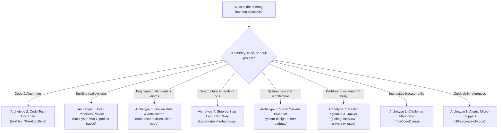
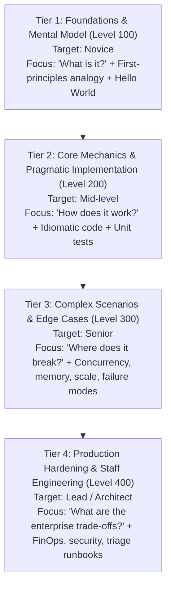
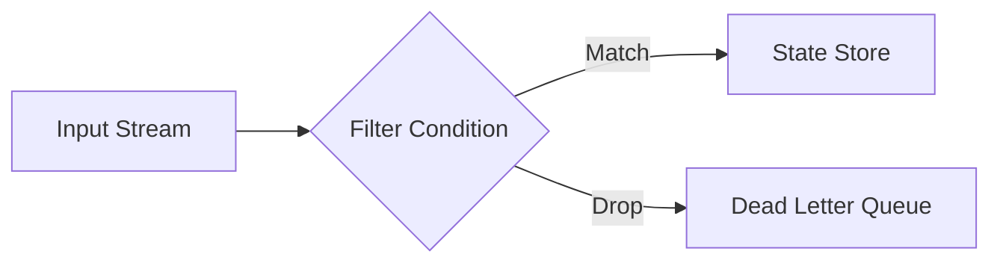

# Coding Learning Repo Architect & Curriculum Engineering Skill

Use this skill when designing, scaffolding, authoring, refactoring, and maintaining world-class coding-based learning repositories and technical curricula. This skill distills the architectural, structural, pedagogical, and operational patterns analyzed from **25 of the highest-rated GitHub educational repositories** (~5,000,000+ aggregate stars).

---

## 1. Top 25 GitHub Learning Repositories Benchmark & Taxonomy

The highest-rated educational coding repositories fall into eight distinct structural archetypes:

| # | Repository | Stars | Primary Archetype | Core Pedagogical Innovation |
|---|---|---|---|---|
| 1 | **`codecrafters-io/build-your-own-x`** | ~564k | First-Principles Project | Rebuilding production systems from scratch (Feynman principle). |
| 2 | **`sindresorhus/awesome`** | ~540k | Deterministic Catalog | Strict taxonomy, automated schema linting, opinionated 1-line summaries. |
| 3 | **`freeCodeCamp/freeCodeCamp`** | ~459k | Challenge Monorepo | Declarative test-driven micro-challenges with browser/runtime verification. |
| 4 | **`EbookFoundation/free-programming-books`** | ~401k | Sub-Indexed Directory | Automated dead-link CI bots, language/subject sharding, localized editions. |
| 5 | **`donnemartin/system-design-primer`** | ~378k | Visual System Blueprint | Hand-drawn architectural diagrams, trade-off matrices, real benchmark numbers. |
| 6 | **`kamranahmedse/developer-roadmap`** | ~372k | Visual Decision Tree | Role-based visual roadmaps, progressive disclosure (node -> topic guide). |
| 7 | **`jwasham/coding-interview-university`** | ~364k | Master Syllabus & Checklists | Multi-month timeline, checkbox tracking `[ ]`, prerequisite sequencing. |
| 8 | **`practical-tutorials/project-based-learning`** | ~290k | Project Categorization | Hands-on application building categorized by language and domain. |
| 9 | **`vinta/awesome-python`** | ~230k | Ecosystem Cartography | Categorized index of battle-tested libraries with quality filtering. |
| 10 | **`TheAlgorithms/Python`** | ~195k | Executable Codebase | Pure idiomatic Python with inline doctests and zero external dependencies. |
| 11 | **`trekhleb/javascript-algorithms`** | ~190k | Code-Test-Doc Triad | 3-file pattern (`README.md` + code + test) with `[B]`eginner/`[A]`dvanced tags. |
| 12 | **`ossu/computer-science`** | ~180k | Academic Degree Roadmap | University-grade curriculum with strict prerequisite chains and effort hours. |
| 13 | **`labuladong/fucking-algorithm`** | ~125k | Reusable Problem Templates | Algorithmic skeletons (Sliding Window, DP state machines) + visual traces. |
| 14 | **`yangshun/tech-interview-handbook`** | ~120k | Cognitive Cheat Sheets | "Pattern-to-Algorithm" matching rubrics, corner cases, and career lifecycle. |
| 15 | **`30-seconds/30-seconds-of-code`** | ~120k | Atomic Micro-Snippets | < 30 LOC bite-sized snippets, tags, difficulty, and automated static indexing. |
| 16 | **`goldbergyoni/nodebestpractices`** | ~105k | Golden Rule & Anti-Pattern | Numbered sections, priority badges, "Otherwise" risk analysis, Good vs Bad code. |
| 17 | **`ryanmcdermott/clean-code-javascript`** | ~95k | Anti-Pattern Contrast | Principle statement followed directly by side-by-side `Bad:` vs `Good:`. |
| 18 | **`iluwatar/java-design-patterns`** | ~90k | Module Pattern Monorepo | Consistent template (Intent, Analogy, Code, UML, Consequences) + JUnit tests. |
| 19 | **`florinpop17/app-ideas`** | ~80k | Tiered Challenge Specs | Tier 1/2/3 project specs with User Stories, Acceptance Criteria, and Bonus tasks. |
| 20 | **`kelseyhightower/kubernetes-the-hard-way`** | ~70k | Step-by-Step Lab | Zero-magic modular numbered labs (`01-`, `02-`), copyable CLI, verification checks. |
| 21 | **`AsimTahir/python-clean-code`** | ~55k | Language Idiom Specialization | Universal software engineering principles adapted to language-specific idioms. |
| 22 | **`firstcontributions/first-contributions`** | ~45k | Interactive Onboarding | Zero-friction fork/PR workflow tutorial with automated merge verification. |
| 23 | **`charlax/professional-programming`** | ~38k | Practitioner Maturity Model | Synthesis of seminal research papers, production lessons, and systems thinking. |
| 24 | **`trekhleb/learn-python`** | ~18k | Playground Assertion Lab | Executable script collection where learners verify syntax via native `assert`. |
| 25 | **`karan/Projects`** | ~35k | Domain Problem Collection | Categorized real-world problem statements (Networking, Algorithms, Web). |

---

## 2. The 8 Structural Archetypes for Coding Repositories

When structuring a new learning repository or reorganizing an existing one, select the matching archetype based on the learning goal:



### Archetype 1: Interactive Challenge Monorepo (`freeCodeCamp`)
- **Best For**: Step-by-step interactive platforms, automated grading engines, coding bootcamps.
- **Directory Pattern**:
  ```
  curriculum/
  └── challenges/
      └── {language-or-track}/
          └── {certification-or-topic}/
              └── {module-slug}/
                  ├── 01-intro.md
                  ├── 02-first-exercise.md
                  └── 03-second-exercise.md
  ```
- **File Structure**: Each exercise is a Markdown/MDX file with YAML frontmatter:
  ```markdown
  ---
  id: 64b8f0a12e8a1a001c9d4e5f
  title: Implement Two-Pointer Array Reversal
  difficulty: beginner
  tags: [arrays, two-pointers, in-place]
  ---
  ## Description
  ...
  ## Instructions
  ...
  ## Seed Code
  ```python
  def reverse_array(arr):
      pass
  ```
  ## Assert Tests
  ```python
  assert reverse_array([1, 2, 3, 4]) == [4, 3, 2, 1]
  assert reverse_array([]) == []
  ```
  ## Solution
  ...
  ```

### Archetype 2: Code-Test-Doc Triad (`trekhleb/javascript-algorithms`, `TheAlgorithms`)
- **Best For**: Algorithms, data structures, library patterns, SDK drills.
- **Directory Pattern**:
  ```
  src/
  ├── data-structures/
  │   ├── linked-list/
  │   │   ├── README.md               # Visual explanation, Big-O, real-world usage
  │   │   ├── LinkedList.js           # Production-clean implementation with docstrings
  │   │   └── LinkedList.test.js      # Comprehensive unit tests (Jest/Vitest/Pytest)
  └── algorithms/
      ├── sorting/
      │   └── quick-sort/
      │       ├── README.md
      │       ├── QuickSort.py
      │       └── test_quick_sort.py
  ```
- **Key Invariant**: Every code module MUST have a corresponding automated test file that runs in CI.

### Archetype 3: Golden Rule & Anti-Pattern Taxonomy (`goldbergyoni/nodebestpractices`)
- **Best For**: Best practices, code review standards, security hardening, language idioms.
- **Directory Pattern**:
  ```
  sections/
  ├── 1-code-style/
  │   ├── 1.1-use-const-over-let.md
  │   └── 1.2-prefer-async-await.md
  ├── 2-error-handling/
  │   ├── 2.1-use-async-error-middleware.md
  │   └── 2.2-fail-fast-on-unhandled-rejections.md
  └── 3-security/
  ```
- **Rule Layout Pattern**:
  1. **Section Number & Title** (e.g., `2.1 Use centralized error handling`)
  2. **Priority Badge** (`Critical`, `High`, `Medium`)
  3. **1-Sentence Golden Rule Summary**
  4. **"Otherwise" (Impact Analysis)**: Concrete disaster scenario if ignored (e.g., memory leak, silent crash).
  5. **Side-by-Side Code Blocks**:
     - `❌ Bad Practice`: realistic production anti-pattern.
     - `✅ Good Practice`: clean, idiomatically correct pattern with explanation.

### Archetype 4: Step-by-Step Lab / Hard Way (`kelseyhightower/kubernetes-the-hard-way`)
- **Best For**: Cloud infrastructure, DevOps, cluster bootstrapping, database internals.
- **Directory Pattern**:
  ```
  labs/
  ├── 01-prerequisites.md
  ├── 02-compute-resources.md
  ├── 03-provisioning-pki-ca.md
  ├── ...
  ├── 13-smoke-test-verification.md
  └── 14-teardown-cleanup.md
  ```
- **Lab Invariant**:
  - Zero magical scripts or wrappers.
  - Every lab ends with an explicit **Verification Check**:
    ```bash
    # Verification: Ensure all worker nodes report Ready status
    kubectl get nodes --output wide
    # Expected output:
    # worker-0   Ready   <none>   10m   v1.31.0
    ```
  - Mandatory final lab: `teardown-cleanup.md` to prevent cloud runaway costs.

### Archetype 5: Visual System Design & Trade-Off Blueprint (`donnemartin/system-design-primer`)
- **Best For**: Distributed systems, Lakehouse architectures, cloud solution designs.
- **Structure**:
  - High-level concept chapters (`caching.md`, `sharding.md`, `message-queues.md`).
  - Architectural blueprints featuring Mermaid or SVG diagrams.
  - Real-world numbers: Latency comparison numbers (L1 cache vs RAM vs SSD vs Network).
  - Standard 4-step interview decomposition:
    1. Scope the problem (Use cases + Constraints: QPS, storage, bandwidth).
    2. High-level architecture (Diagram + data flow).
    3. Design deep dive (Bottlenecks, replication, partitioning).
    4. Trade-off matrix (Pros vs Cons vs Alternatives).

### Archetype 6: First-Principles "Build Your Own X" (`build-your-own-x`, `project-based-learning`)
- **Best For**: Deep technical mastery, understanding core engineering mechanisms.
- **Categorization Scheme**: Grouped by system domain:
  - `Build your own Database` (B-Trees, WAL, query parser)
  - `Build your own Git` (Content-addressable storage, blob, tree, commit objects)
  - `Build your own Docker / Container runtime` (cgroups, namespaces, chroot)
  - `Build your own Web Server / Reverse Proxy` (Epoll, TCP socket handshake)
- **Challenge Structure**: User Stories + Minimal Seed + Test Harness + Extension ideas.

### Archetype 7: Master Syllabus & Checkbox Tracker (`coding-interview-university`, `ossu`)
- **Best For**: Comprehensive multi-month learning paths and university-grade curricula.
- **Core Elements**:
  - Clear time budget: (e.g. "8-month track: 15-20 hours/week").
  - Structured prerequisites with strict dependency graphs.
  - Checkbox progression (`- [ ] Topic` -> `- [x] Topic`) giving visual ownership to the learner.
  - Curated high-signal external resources (primary documentation, papers, video lectures).

### Archetype 8: Atomic Micro-Snippets & Search Indexing (`30-seconds-of-code`)
- **Best For**: Quick reference libraries, standard utility functions, interview drills.
- **Constraints**:
  - Each snippet must take $\le 30\text{ seconds}$ to understand.
  - Code length strictly under 30 lines.
  - Includes: Description, TypeScript/Python implementation, Example usage, Complexity ($O(1)$, $O(N)$).

---

## 3. Essential Repository Anatomy & Layout Blueprint

Every production-grade coding learning repository must include the following root architecture:

```
learning-repo-root/
├── .github/
│   ├── workflows/
│   │   ├── ci.yml                 # Automated test suite, linter, typecheck
│   │   └── link-check.yml         # Validates all markdown URLs and relative anchors
│   ├── ISSUE_TEMPLATE/            # Structured issue forms (Bug report, exercise proposal)
│   └── PULL_REQUEST_TEMPLATE.md   # PR checklist (tests pass, style followed, docs updated)
├── docs/                          # Architecture diagrams, design docs, reading lists
│   ├── images/                    # SVGs, architectural blueprints
│   └── pdf/                       # Compiled printable PDF cheat sheets
├── exercises/ or src/             # Numbered or tiered modules
│   ├── 01-foundations/
│   ├── 02-intermediate/
│   └── 03-advanced-production/
├── scripts/                       # Maintenance scripts (generators, linters, validators)
│   ├── validate-metadata.py       # Validates JSON/YAML schemas and unique IDs
│   └── compile-catalog.py         # Builds static indices or cheatsheets
├── .editorconfig                  # Universal indentation and newline enforcement
├── .markdownlint.json             # Markdown style standard
├── AGENTS.md                      # Agent rules & design system guidelines
├── CONTRIBUTING.md                # Step-by-step contribution & exercise authoring rubric
├── LICENSE                        # Clear open-source license (MIT, Apache 2.0, CC-BY-SA 4.0)
├── README.md                      # Hero navigation, quickstart, roadmap, visual badges
├── ROADMAP.md                     # Visual curriculum roadmap & upcoming milestones
└── TAXONOMY.md                    # Canonical topic definitions, tags, and difficulty tiers
```

---

## 4. The 4-Tier Progressive Disclosure Model

A common failure mode of technical tutorials is overloading beginners with operational edge cases or boring seniors with trivial syntax. All modules must follow the **4-Tier Progressive Disclosure Model**:



1. **Tier 1 (Level 100 - Foundations)**:
   - Concepts explained through physical or mechanical analogies.
   - Minimal runnable example ($\le 15$ lines of code).
   - Zero esoteric jargon; all foundational vocabulary explicitly defined.
2. **Tier 2 (Level 200 - Core Mechanics)**:
   - Standard idiomatic implementation.
   - Accompanying unit test assertions.
   - Algorithmic Big-O time and space complexity annotations.
3. **Tier 3 (Level 300 - Edge Cases & Performance)**:
   - What happens when inputs are malicious, empty, or $10^9$ elements?
   - Concurrency race conditions, memory pressure, and garbage collection behavior.
   - Profiling and benchmarking traces.
4. **Tier 4 (Level 400 - Production Hardening & Architecture)**:
   - Multi-tenant security, zero trust boundaries, and dynamic masking.
   - FinOps cost optimization and compute scaling economics.
   - Incident triage runbooks and post-mortem defense playbooks.

---

## 5. Pedagogical Authoring Templates

### Template A: The Standard Code Exercise (`README.md` + Code + Tests)

When creating a new exercise or coding drill, adhere strictly to this template:

```markdown
# [Module ID]: [Descriptive Title]

> **Tier**: [Level 100/200/300/400] | **Difficulty**: [Beginner/Intermediate/Advanced]
> **Prerequisites**: [Module-X, Concept-Y] | **Estimated Time**: [15-30 mins]
> **Key Concepts**: `keyword1`, `keyword2`, `keyword3`

---

## 1. Executive Summary & Mental Model
[A 2-3 paragraph explanation of what the problem is, why it exists, and the physical mental model behind it. Use KaTeX math for formulas when applicable.]

## 2. Architecture & Data Flow


## 3. Implementation Code
```python
# Fully typed, production-ready, clean idiomatic implementation
def solution(...):
    pass
```

## 4. Complexity & Trade-Offs
- **Time Complexity**: $\mathcal{O}(N \log N)$ due to sorting step.
- **Space Complexity**: $\mathcal{O}(1)$ auxiliary memory; operates in-place.
- **Trade-Offs**: Sacrifices stability for $O(1)$ space.

## 5. Anti-Patterns & Common Pitfalls
- ❌ **Pitfall 1**: Failing to handle `None` or empty collections.
- ❌ **Pitfall 2**: Unbounded memory growth when scaling inputs.

## 6. Self-Verification & Automated Tests
```python
# Self-contained pytest or doctest assertions
def test_solution_happy_path():
    assert solution([1, 2, 3]) == [3, 2, 1]

def test_solution_edge_cases():
    assert solution([]) == []
```
```

### Template B: Anti-Pattern Contrast ("Bad vs Good")

When authoring best-practice rules or code style guidelines:

```markdown
### Rule 4.2: Avoid Unbounded Distributed Shuffles with Cardinality Explosions

**Severity**: `High` | **Impact**: `Driver/Executor OOM, Disk Spill`

#### 1. The Rule
Always apply aggressive pre-aggregation or key salting before executing joins on high-cardinality skew keys.

#### 2. Otherwise (Consequences)
If ignored, 95% of your cluster executors sit idle while a single executor receives 80% of the partition data, spilling gigabytes to disk and eventually throwing `Container killed by YARN for exceeding memory limits (Exit code 137)`.

#### 3. Code Comparison

##### ❌ Bad Practice (Unbounded Skew Join)
```python
# Bad: Raw join on skewed customer_id where 'GUEST' accounts for 40M rows
joined_df = orders_df.join(customers_df, on="customer_id", how="inner")
```

##### ✅ Good Practice (Two-Phase Key Salting)
```python
import pyspark.sql.functions as F

# Good: Salt the skewed key across 16 random buckets, aggregate, then unsalt
SALT_FACTOR = 16
salted_orders = orders_df.withColumn(
    "salted_key",
    F.concat(F.col("customer_id"), F.lit("_"), F.floor(F.rand() * SALT_FACTOR))
)
# Replicate customer lookup dimension across all 16 salt buckets
exploded_customers = customers_df.withColumn(
    "salt_bucket", F.explode(F.array([F.lit(i) for i in range(SALT_FACTOR)]))
).withColumn(
    "salted_key", F.concat(F.col("customer_id"), F.lit("_"), F.col("salt_bucket"))
)

joined_df = salted_orders.join(exploded_customers, on="salted_key", how="inner")
```
```

---

## 6. Automated Testing, CI/CD, and Verification Harnesses

Top repositories never rely on manual verification. Every code snippet is continuously tested:

### 1. Python Doctest Pattern (Zero External Dependencies)
Embedding executable tests directly in docstrings guarantees code never rots:

```python
def binary_search(arr: list[int], target: int) -> int:
    """
    Perform iterative binary search on a sorted list.

    >>> binary_search([1, 3, 5, 7, 9], 5)
    2
    >>> binary_search([1, 3, 5, 7, 9], 10)
    -1
    >>> binary_search([], 1)
    -1
    """
    left, right = 0, len(arr) - 1
    while left <= right:
        mid = (left + right) // 2
        if arr[mid] == target:
            return mid
        elif arr[mid] < target:
            left = mid + 1
        else:
            right = mid - 1
    return -1

if __name__ == "__main__":
    import doctest
    results = doctest.testmod()
    assert results.failed == 0, f"Doctest failed: {results}"
    print("All doctests passed successfully!")
```

### 2. GitHub Actions CI Pipeline (`.github/workflows/ci.yml`)
```yaml
name: Curriculum CI Quality Gate
on: [push, pull_request]

jobs:
  validate-and-test:
    runs-on: ubuntu-latest
    steps:
      - uses: actions/checkout@v4
      - uses: actions/setup-python@v5
        with:
          python-version: '3.11'
      - name: Run Python Doctests & Unit Tests
        run: |
          python -m pip install --upgrade pytest black flake8
          black --check .
          flake8 . --max-line-length=100
          pytest -v --doctest-modules
      - name: Validate Markdown Links & Anchors
        uses: gaurav-nelson/github-action-markdown-link-check@v1
        with:
          config-file: '.github/link-check-config.json'
```

---

## 7. Interactive Features & Community Extensions

To maximize engagement, top repositories supplement raw markdown with rich companion assets:

1. **Interactive Mindmaps & Web UIs**: Exporting curriculum JSON/frontmatter to interactive search and mindmap applications (e.g. Next.js, Cloudflare OpenNext, Docusaurus).
2. **Flashcards & Spaced Repetition**: Compiling Q&A scenarios and key concepts into Anki `.apkg` or CSV decks.
3. **Printable Vector Reference PDFs**: Generating multi-page A4 cheat sheets and technical manuals using ReportLab or Typst for offline reference.
4. **Checkbox Progress Tracking**: Including `- [ ]` markdown checkboxes allowing learners to fork the repository and track personal progress in their own GitHub branches.
5. **Community Discussion & Discord Bridges**: Linking each major topic to dedicated discussion threads or Discord channels for collaborative troubleshooting.

---

## 8. Operational Quality Audit Checklist

Before releasing or merging any new exercise, module, or repository section, run this 10-point audit:

- [ ] **1. Clear Prerequisite Chain**: Are required foundational concepts linked?
- [ ] **2. 1-Line Mental Model**: Does the module begin with a memorable physical or conceptual analogy?
- [ ] **3. Architecture Diagram**: Is there a Mermaid or ASCII data-flow diagram?
- [ ] **4. Fully Executable Code**: Does the code run without modifications? No missing imports or pseudocode placeholders.
- [ ] **5. Automated Test Assertions**: Are there doctests, pytest cases, or unit assertions checking both happy paths and edge cases?
- [ ] **6. Complexity Stated**: Are time $\mathcal{O}(...)$ and space $\mathcal{O}(...)$ bounds explicitly analyzed?
- [ ] **7. Negative Examples / Anti-Patterns**: Does the module highlight common pitfalls and explain the consequence of doing it wrong?
- [ ] **8. WCAG 2.2 AA Contrast Compliance**: Are diagram colors, badge tokens, and typography readable across light, dark, and e-ink themes?
- [ ] **9. Link Health & Anchor Integrity**: Do all internal relative file links (`file://` or repo-relative paths) resolve without 404s?
- [ ] **10. Kebab-Case ID & Schema Uniqueness**: Does the item carry a deterministic, unique kebab-case ID matching the project's metadata schema?
