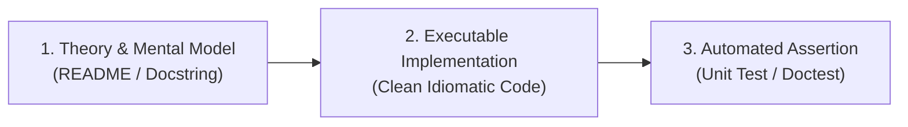

# Contributing to PySpark Handbook

Thank you for your interest in contributing to **PySpark Handbook** (`santoshjammi29/pyspark-handbook`)! This repository is an official component of the **Modern Data Engineering Lakehouse Ecosystem** ([moderndataengineer.uk](https://moderndataengineer.uk)).

Our curriculum and code samples follow strict architectural standards synthesized from the **Top 25 educational repositories on GitHub** (~5,000,000+ stars).

---

## 1. Core Pedagogical Invariants

Every drill, exercise, notebook, and architecture guide in this repository must satisfy the **Code-Test-Doc Triad**:



1. **The Code-Test-Doc Triad**:
   - **Theory & Mental Model**: Every topic must begin with an intuitive real-world analogy and high-level architecture diagram (Mermaid or ASCII flow).
   - **Executable Code**: Code must be 100% runnable with zero missing imports or broken pseudocode.
   - **Automated Test Assertions**: Every code module must include automated verification tests (e.g. `pytest`, `doctest`, or unit assertions) checking happy paths and edge cases.

2. **The Anti-Pattern Standard ("Bad vs Good")**:
   - Contrastive learning is twice as memorable as isolated clean code.
   - Every guide should illustrate both:
     - `❌ Bad Practice`: Common production pitfall or anti-pattern.
     - `✅ Good Practice`: Hardened, performant, production-ready solution.
   - **The "Otherwise" Requirement**: Explicitly state the operational consequence of ignoring the rule (e.g., *Driver OOM*, *Data Corruption*, *Lock Contention*, *Spill to Disk*).

3. **4-Tier Progressive Disclosure Model**:
   - **Level 100 (Foundations)**: Core definitions, basic syntax, single-node execution.
   - **Level 200 (Core Mechanics)**: Standard production patterns, schema validation, error handling.
   - **Level 300 (Complex Scenarios & Skew)**: Performance tuning, partition skew, memory triage, runbooks.
   - **Level 400 (Staff Architect)**: Cross-cloud trade-offs, FinOps cost curves, zero-trust security.

---

## 2. Authoring Guidelines & Schema

### Exercise Directory Layout
```
module-name/
├── README.md               # Visual explanation, Big-O complexity, real-world context
├── implementation.py       # Production-clean, typed implementation
└── test_implementation.py  # Self-contained pytest test suite
```

### Primary Evidence Sourcing
Every submission must be grounded in primary authoritative documentation:
- Official documentation (Spark, Delta Lake, Databricks, dbt, Apache Kafka, Microsoft Fabric).
- Peer-reviewed research papers and seminal industry specifications (e.g., BCBS 239, DORA, Raft, Chandy-Lamport).

---

## 3. Pre-Publish Quality Audit Checklist

Before submitting a Pull Request, verify:

- [ ] **1. Triad Compliance**: Does the module contain explanation, runnable code, and automated tests?
- [ ] **2. 1-Line Mental Model**: Is there an intuitive summary at the top?
- [ ] **3. Architecture Diagram**: Is there a Mermaid or ASCII data-flow diagram?
- [ ] **4. Fully Executable**: Does the code run without external dependencies where possible?
- [ ] **5. Anti-Pattern Demonstrated**: Is there a side-by-side `Bad` vs `Good` comparison?
- [ ] **6. Complexity Analyzed**: Are Big-O time and auxiliary space bounds explicitly stated?
- [ ] **7. WCAG 2.2 AA Contrast**: Are all text and diagram elements accessible across themes?
- [ ] **8. Link Integrity**: Do all internal markdown links resolve correctly?
- [ ] **9. Taxonomy Alignment**: Does the topic map cleanly to `Apache Spark & Distributed Compute` in `TAXONOMY.md`?
- [ ] **10. Kebab-Case ID**: Is the unique identifier lowercase kebab-case?

---

## 4. Pull Request Workflow

1. **Fork the repository** on GitHub.
2. **Create a topic branch**: `git checkout -b feat/your-exercise-name`.
3. **Run local tests**: Ensure all unit tests and linters pass.
4. **Commit with Conventional Commits**: e.g., `feat(module): add two-phase salting drill`.
5. **Submit PR**: Reference any relevant issues and verify the CI checks turn green.
