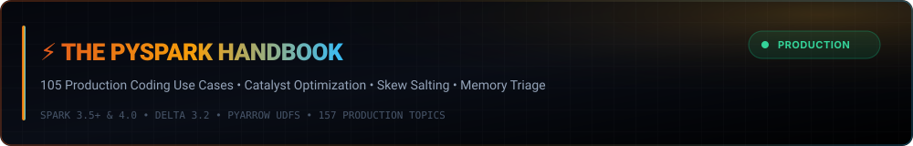
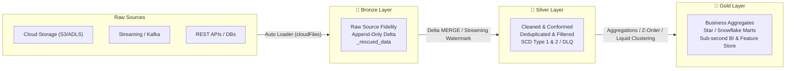
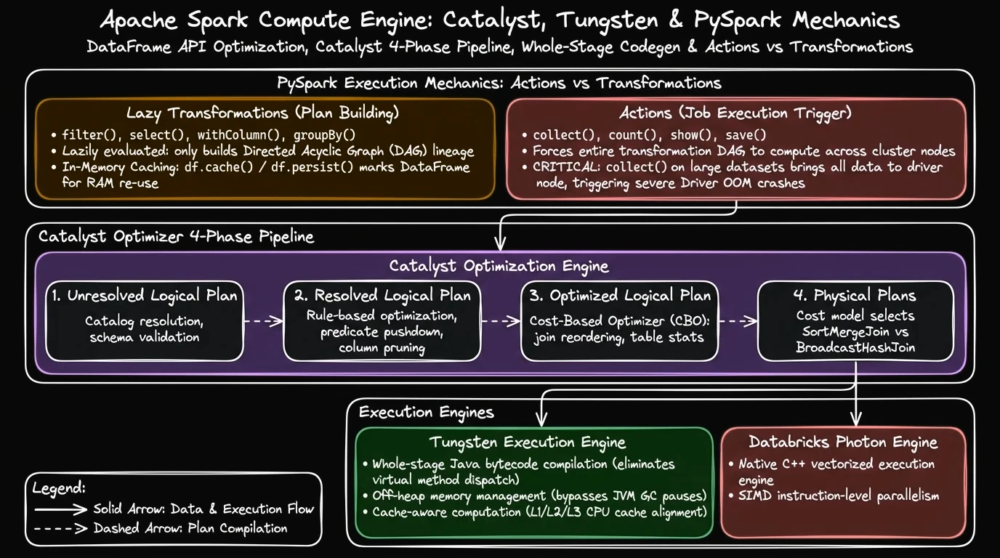

<p align="center">
  
</p>

# ⚡ The PySpark Handbook

**105 Production Coding Use Cases, Performance Tuning Recipes, Lakehouse Masterclass & Incident Runbooks**

[](https://github.com/santoshjammi29/pyspark-handbook/actions)
[](https://spark.apache.org/)
[](https://www.databricks.com/)
[](https://delta.io/)
[](https://www.python.org/)
[](databricks.yml)
[](LICENSE)

*The definitive enterprise reference repository of 105 battle-tested Apache Spark & Databricks Lakehouse coding use cases, architectural blueprints, disaster recovery incident runbooks, and 4-tier technical interview preparation guide.*  
*Structured in the official **Databricks Source Notebook format (`.py`)** for seamless 1-click sync with **Databricks Repos / Git Folders**, **Databricks Asset Bundles (DABs)**, **VS Code / Databricks Connect v2**, and CI/CD runtimes.*

[Curriculum Overview](#-curriculum-overview) • [Lakehouse Architecture](#-lakehouse-architecture) • [Whiteboard Blueprints](#-whiteboard-blueprints) • [Interactive CLI](#-interactive-cli-explorer) • [Quickstart](#-quickstart) • [Architectures](#️-architectural-deep-dives) • [Runbooks](#-production-incident-runbooks) • [Interview Matrix](#-4-tier-interview-preparation-matrix)  • [Core Concepts (157 Topics)](#-core-curriculum-concepts--topics) • [Sister Repositories](#-sister-repositories--knowledge-base)

---

## 🎯 Overview & Mission

Modern Lakehouse engineering demands deep fluency in distributed memory execution, ACID transaction semantics, streaming ingestion, query plan optimization, and enterprise data governance.

This repository provides **105 end-to-end, runnable, modular use cases** covering:
- **Core & Advanced Distributed Compute:** PyArrow Pandas UDFs, Higher-Order Functions, Nested Structs/Arrays, Windowing, and Catalyst internals.
- **Lakehouse Storage & ACID Transactions:** Delta Lake transaction log, MERGE INTO, Time Travel, VACUUM, and Liquid Clustering (`CLUSTER BY`).
- **Streaming & Ingestion:** Databricks Auto Loader (`cloudFiles`), event-time watermarking, stream-stream joins, and Dead Letter Queues (DLQ).
- **Enterprise Governance & DevOps:** Unity Catalog 3-tier namespace, Row Filters, Dynamic Column Masking, and Databricks Asset Bundles (DABs) IaC.
- **Operational Triage & Reliability:** 6 production incident runbooks covering Driver/Executor OOMs, Shuffle Disk Spill, Skew Salting, State Store Leaks, and PyArrow serialization crashes.

---

## 🚀 Quickstart

### Prerequisites
- Python 3.9, 3.10, 3.11, or 3.12
- PySpark 3.5.0+ (`pip install -r requirements.txt`)
- Java 11 or 17 (required for local Spark execution)

### 1. Clone the Repository
```bash
git clone https://github.com/santoshjammi29/pyspark-handbook.git
cd pyspark-handbook
```

### 2. Local Environment Setup
```bash
python -m venv .venv
source .venv/bin/activate
pip install -r requirements.txt
```

### 3. Run Validation Tests
```bash
python scripts/run_tests.py
```

---

## 💻 Interactive CLI Explorer

Explore recipes, search code patterns, inspect incident runbooks, and study interview guides directly from your terminal:

```bash
# Search by recipe number (e.g. Recipe 025: Window Functions)
python scripts/interactive_shell.py 025

# Search by topic or concept keyword
python scripts/interactive_shell.py "pandas udf"
python scripts/interactive_shell.py "two phase salting"

# List all available recipes, runbooks, and interview tiers
python scripts/interactive_shell.py --list
python scripts/interactive_shell.py --runbooks
python scripts/interactive_shell.py --architectures
python scripts/interactive_shell.py --interview
```

---

## 🏛️ Lakehouse Architecture

### 1. Medallion Lakehouse Architecture (Bronze → Silver → Gold)



---

## 🖼️ Master Whiteboard Architecture Blueprints

The repository includes **52 publication-grade architectural whiteboard blueprints** mirrored under [`assets/whiteboards/`](assets/whiteboards) and cataloged with comprehensive multi-persona breakdowns, failure modes, and engine internals in [`docs/whiteboard_diagrams/README.md`](docs/whiteboard_diagrams/README.md).

- 🖼️ **[Master Whiteboard Blueprints Hub](docs/whiteboard_diagrams/handbook_whiteboard_blueprints.md)**: Complete whiteboard architecture blueprints with storage vs. compute, control vs. data planes, memory tiers, and failure modes.
- 📊 **[Spark Architecture & Tuning Cheatsheet](assets/whiteboards/spark_architecture_catalyst_cheatsheet.jpg)**: High-resolution visual cheatsheet covering cluster topology, Catalyst compiler phases, and memory tiers.
- 🔀 **[Join Strategies Decision Matrix](assets/whiteboards/spark_join_strategies_decision_matrix.jpg)**: Visual flowchart and decision tree for distributed joins and broadcast thresholds.
- ⚡ **[Skew & Memory Spill Triage](assets/whiteboards/spark_performance_skew_spill_triage.jpg)**: Step-by-step diagnostic workflow for data skew, spill to disk, and OOM triage.

### 📐 Visual Blueprints Showcase

<table>
  <tr>
    <td width="50%" valign="top">
      <a href="docs/whiteboard_diagrams/README.md#spark-catalyst-photon-engine">
        
      </a>
      <br><strong>Databricks Compute: Catalyst Optimizer, AQE & Photon</strong><br>
      <em>Physical and logical query optimization pipeline with adaptive runtime plan restructuring.</em>
    </td>
    <td width="50%" valign="top">
      <a href="docs/whiteboard_diagrams/README.md#spark-shuffle-memory-execution">
        
      </a>
      <br><strong>Apache Spark Memory Architecture & Shuffle Mechanics</strong><br>
      <em>Unified memory manager, execution vs storage allocation, and Tungsten off-heap structures.</em>
    </td>
  </tr>
  <tr>
    <td width="50%" valign="top">
      <a href="docs/whiteboard_diagrams/README.md#spark-memory-management-spill">
        
      </a>
      <br><strong>Apache Spark Memory Management & Shuffle Spilling Mechanics</strong><br>
      <em>Driver and executor memory pool sizing and spill-to-disk disk triage.</em>
    </td>
    <td width="50%" valign="top">
      <a href="docs/whiteboard_diagrams/README.md#spark-data-skew-aqe-optimization">
        
      </a>
      <br><strong>Apache Spark Data Skew Remediation & AQE Optimization</strong><br>
      <em>Two-phase key salting, split-range joins, and adaptive partition coalescing.</em>
    </td>
  </tr>
  <tr>
    <td width="50%" valign="top">
      <a href="docs/whiteboard_diagrams/README.md#spark-join-decision-tree">
        
      </a>
      <br><strong>Apache Spark Join Strategy Selection Decision Tree</strong><br>
      <em>Broadcast Hash, Shuffled Hash, Sort-Merge, and Broadcast Nested Loop selection algorithm.</em>
    </td>
    <td width="50%" valign="top">
      <a href="docs/whiteboard_diagrams/README.md#spark-aqe-dynamic-optimization">
        
      </a>
      <br><strong>Apache Spark Adaptive Query Execution (AQE) Architecture</strong><br>
      <em>Runtime statistics aggregation and dynamic shuffle partition coalescing.</em>
    </td>
  </tr>
  <tr>
    <td width="50%" valign="top">
      <a href="docs/whiteboard_diagrams/README.md#spark-streaming-state-store">
        
      </a>
      <br><strong>Spark Structured Streaming State Store & Watermarking Mechanics</strong><br>
      <em>RocksDB state backend, event-time watermarking, and incremental state commit checkpoints.</em>
    </td>
    <td width="50%" valign="top">
      <a href="docs/whiteboard_diagrams/README.md#photon-engine-vs-jvm">
        
      </a>
      <br><strong>Databricks Photon Native C++ Engine vs Classic Spark JVM</strong><br>
      <em>Vectorized SIMD instruction pipelining and JVM JIT compilation comparison.</em>
    </td>
  </tr>
</table>

> 🔍 **Explore all 52 blueprints with 5-persona breakdowns, failure modes, and engine internals in [docs/whiteboard_diagrams/README.md](docs/whiteboard_diagrams/README.md)**.

## 🗺️ Curriculum Overview

The 105 recipes progress systematically across **4 difficulty tiers**:
- **Level 100 (Beginner):** Core DataFrame transformations, StructType schemas, basic actions, file I/O.
- **Level 200 (Intermediate):** Complex types, explode, analytical window functions, Auto Loader ingestion.
- **Level 300 (Advanced):** Catalyst plan inspection, AQE skew join optimization, stateful streaming watermarks.
- **Level 400 (Principal/Architect):** Memory sizing calculations, disaster recovery, end-to-end multi-tenant capstones.

| Module | Recipes | Difficulty | Core Topics & Competencies |
| :--- | :---: | :---: | :--- |
| 📊 **[Module 01: Core PySpark Foundations & DataFrame API](#01-core-dataframe-api)** | `001 – 012` | 🟢<br>Beginner | DataFrame creation, explicit StructType schemas, PyArrow Pandas UDFs, safe type casting, column projections, and DBUtils emulation. |
| 🧩 **[Module 02: Complex Data Types & Nested Structures](#02-complex-data-types)** | `013 – 022` | 🟡<br>Intermediate | Nested StructTypes, Arrays, Maps, Higher-Order Functions (transform, filter, aggregate), JSON parsing, XML shredding, and schema evolution. |
| 🪟 **[Module 03: Advanced SQL & Analytical Window Functions](#03-sql-and-window-functions)** | `023 – 032` | 🟡<br>Intermediate | Ranking, lead/lag, rolling moving averages, cumulative distribution, OLAP cubes, pivots, broadcast hash joins, and range vs rows framing. |
| 🧱 **[Module 04: Delta Lake Architecture & ACID Operations](#04-delta-lake-and-acid)** | `033 – 043` | 🔴<br>Advanced | Transaction Log internals (_delta_log), ACID CRUD, MERGE INTO optimizations, Time Travel, VACUUM safety, and Deletion Vectors. |
| 📥 **[Module 05: Data Ingestion, Auto Loader & Cloud Formats](#05-data-ingestion-autoloader)** | `044 – 053` | 🟡<br>Intermediate | Databricks Auto Loader (cloudFiles), schema inference, _rescued_data poison pill quarantine, Parquet, Avro, and parallel JDBC ingestion. |
| ⚡ **[Module 06: Structured Streaming & Near Real-Time Processing](#06-streaming-realtime)** | `054 – 063` | 🔴<br>Advanced | Streaming micro-batches, AvailableNow triggers, event-time watermarking, stateful window aggregations, stream-stream joins, and DLQ sinks. |
| 🏛️ **[Module 07: Lakehouse Data Modeling, CDC & SCD Implementation](#07-lakehouse-modeling-scd)** | `064 – 073` | 🔴<br>Advanced | Medallion Architecture (Bronze/Silver/Gold), Slowly Changing Dimensions (SCD Types 1, 2, 3, 4), Debezium CDC replay, and Data Vault 2.0. |
| 🏎️ **[Module 08: Performance Tuning, AQE & Skew Mitigation](#08-performance-and-tuning)** | `074 – 085` | 🔴<br>Advanced | Catalyst Logical & Physical Plans, Adaptive Query Execution (AQE), Salting join skew, Hive-style bucketing, OOM diagnosis, and Photon. |
| 🛡️ **[Module 09: Unity Catalog Governance, Security & FinOps](#09-unity-catalog-and-security)** | `086 – 095` | 🔴<br>Advanced | Unity Catalog 3-tier namespace, Managed & External Volumes, Row-Level Security, Dynamic Column Masking, Secret Scopes, and DABs. |
| 🚀 **[Module 10: End-to-End Enterprise Production Projects](#10-end-to-end-projects)** | `096 – 105` | 🟣<br>Principal | Full capstones: FinTech Fraud Detection, Omnichannel Retail Lakehouse, Healthcare FHIR Ingestion, IoT Telemetry, RAG Embeddings, and Workflows. |

---

## 📚 Complete 105 Recipe Catalog

<a id="01-core-dataframe-api"></a>
<details>
<summary><b>📊 Module 01: Core PySpark Foundations & DataFrame API (001 – 012)</b> — <i>🟢 Beginner – 🟡 Intermediate</i></summary>

> 💡 **Core Focus:** DataFrame creation, explicit StructType schemas, PyArrow Pandas UDFs, safe type casting, column projections, and DBUtils emulation.

| Recipe | Notebook Title | Level | Real-World Scenario | Spark Architecture Key Concept |
| :---: | :--- | :---: | :--- | :--- |
| `001` | [`SparkSession Initialization & DataFrame Creation Strategies`](notebooks/01_core_dataframe_api/001_sparksession_initialization_and_dataframe_creation_strategies.py) | 🟢<br>Beginner | A digital commerce platform needs to ingest customer profile extracts from multiple legacy sources (in-memory lists, Python dictionaries, Pandas exports, and RDDs) into a unified PySpark DataFrame with strict schema validation. | SparkSession serves as the unified entry point introduced in Spark 2.0, encapsulating SparkContext, SQLContext, and HiveContext. |
| `002` | [`Schema Enforcement, Safe Type Casting & Try-Cast Handling`](notebooks/01_core_dataframe_api/002_schema_enforcement_safe_type_casting_and_try_cast_handling.py) | 🟢<br>Beginner | A payments processor receives raw transaction dumps where numeric amounts contain currency symbols, timestamps are in non-standard formats, and corrupted text entries cause pipeline aborts on type casting. | In ANSI SQL mode (`spark.sql.ansi.enabled = true`), standard `.cast()` throws runtime exceptions on invalid values (e.g. casting 'INVALID' to INT). |
| `003` | [`Column Manipulation, Batch Addition & Projection Pruning`](notebooks/01_core_dataframe_api/003_column_manipulation_batch_addition_and_projection_pruning.py) | 🟢<br>Beginner | A SaaS telemetry service needs to enrich raw session events with calculated duration, derived flags, normalized client identifiers, and drop redundant legacy headers without incurring multiple Catalyst plan rebuilds. | Chaining dozens of `.withColumn()` calls produces a deep Catalyst logical plan tree that can drastically increase driver planning and compilation time. |
| `004` | [`Filtering, Multi-Condition Predicates & Pushdown Analysis`](notebooks/01_core_dataframe_api/004_filtering_multi_condition_predicates_and_pushdown_analysis.py) | 🟢<br>Beginner | A logistics fleet management company needs to identify critical alerts: vehicles with engine temperatures exceeding safe thresholds, low tire pressure, or battery degradation across specific geographic territories. | Predicate pushdown allows the storage layer (Parquet/Delta) to skip entire row groups and data files using file-level min/max statistics without deserializing data into the JVM heap. |
| `005` | [`String Operations, Regex Extraction & Data Cleansing`](notebooks/01_core_dataframe_api/005_string_operations_regex_extraction_and_data_cleansing.py) | 🟢<br>Beginner | A marketing automation system ingests unstructured customer lead notes containing messy phone numbers, email addresses with inconsistent cases, and unformatted address strings. | Spark SQL string functions are backed by native UTF-8 binary representations in Apache Spark's Tungsten project, avoiding Java String object allocation overhead. |
| `006` | [`Date & Timestamp Mastery: Parsing, Arithmetic & Timezones`](notebooks/01_core_dataframe_api/006_date_and_timestamp_mastery_parsing_arithmetic_and_timezones.py) | 🟢<br>Beginner | A global ride-sharing platform records ride dispatch, pickup, and dropoff events across multiple international timezones. | Spark 3.0 introduced Proleptic Gregorian calendar support by default (`spark.sql.session.timeZone`). |
| `007` | [`Handling Nulls, NaNs & Imputation Strategies`](notebooks/01_core_dataframe_api/007_handling_nulls_nans_and_imputation_strategies.py) | 🟢<br>Beginner | A medical diagnostics platform aggregates clinical lab test results. | In PySpark, `NULL` (unknown value) and `NaN` (IEEE 754 Not-a-Number float) have distinct semantics. `isnan()` only applies to Double/Float columns, while `isNull()` applies to all types. |
| `008` | [`Sorting, Ordering Semantics & Stratified Sampling`](notebooks/01_core_dataframe_api/008_sorting_ordering_semantics_and_stratified_sampling.py) | 🟢<br>Beginner | A financial auditing team must sample transaction logs for regulatory compliance. | `orderBy()` and `sort()` trigger a global RangePartitioner shuffle across all executor partitions, which can be expensive on multi-terabyte datasets. `sortWithinPartitions()` sorts locally inside each partition without shuffling. |
| `009` | [`Deduplication Strategies: dropDuplicates vs Window Row-Number`](notebooks/01_core_dataframe_api/009_deduplication_strategies_dropduplicates_vs_window_row_number.py) | 🟡<br>Intermediate | An e-commerce order ingestion pipeline receives duplicate HTTP webhook payloads. | `dropDuplicates()` uses a HashAggregate under the hood. |
| `010` | [`Transformations vs Actions, Lazy Evaluation & Lineage Graph`](notebooks/01_core_dataframe_api/010_transformations_vs_actions_lazy_evaluation_and_lineage_graph.py) | 🟡<br>Intermediate | A performance engineering lead must diagnose why a data pipeline fails after running for 40 minutes, only to crash on a lightweight `.count()` action. | Spark constructs a Directed Acyclic Graph (DAG) of stages separated by shuffle boundaries. |
| `011` | [`Custom PySpark UDFs vs Vectorized Pandas UDFs (PyArrow)`](notebooks/01_core_dataframe_api/011_custom_pyspark_udfs_vs_vectorized_pandas_udfs_pyarrow.py) | 🟡<br>Intermediate | A credit scoring model applies complex non-linear mathematical risk adjustments to customer accounts. | Standard Python UDFs serialize JVM row data to a Python worker process row-by-row via Py4J, incurring massive serialization and deserialization overhead and disabling Catalyst optimizations. |
| `012` | [`Emulating Databricks DBUtils, Widgets & Secret Scopes Locally`](notebooks/01_core_dataframe_api/012_emulating_databricks_dbutils_widgets_and_secret_scopes_locally.py) | 🟡<br>Intermediate | An enterprise migration team develops Databricks pipelines locally inside VS Code or CI/CD test runners before deploying to production workspaces. | In Databricks, `dbutils` is a Java/Scala bridge injected into the Python REPL. |

[⬆️ Back to Curriculum Overview](#-curriculum-overview)
</details>

<a id="02-complex-data-types"></a>
<details>
<summary><b>🧩 Module 02: Complex Data Types & Nested Structures (013 – 022)</b> — <i>🟡 Intermediate</i></summary>

> 💡 **Core Focus:** Nested StructTypes, Arrays, Maps, Higher-Order Functions (transform, filter, aggregate), JSON parsing, XML shredding, and schema evolution.

| Recipe | Notebook Title | Level | Real-World Scenario | Spark Architecture Key Concept |
| :---: | :--- | :---: | :--- | :--- |
| `013` | [`Array Creation, Element Extraction and Array Search Functions`](notebooks/02_complex_data_types/013_array_creation_element_extraction_and_array_search_functions.py) | 🟡<br>Intermediate | A digital streaming platform logs user engagement tags, genre preferences, and content playlists as arrays. | Spark represents ArrayType as native columnar array buffers in Tungsten memory. `element_at` uses 1-based indexing for positive indices (1 = first element) and -1 for the last element, differing from standard Python 0-based indexing. |
| `014` | [`Spark Higher-Order Functions: Transform, Filter and Aggregate`](notebooks/02_complex_data_types/014_spark_higher_order_functions_transform_filter_and_aggregate.py) | 🟡<br>Intermediate | A fintech loyalty platform tracks customer reward points earned across multiple merchant transactions in an array. | Higher-order functions run inline lambda expressions inside the JVM on array elements without flattening the DataFrame. |
| `015` | [`Exploding and Flattening Arrays: explode vs explode_outer and posexplode`](notebooks/02_complex_data_types/015_exploding_and_flattening_arrays_explode_vs_explode_outer_and_posexplode.py) | 🟡<br>Intermediate | A flight booking aggregator normalizes JSON payloads of airline bookings. | Standard `explode()` drops rows where the array is empty or NULL, leading to silent data loss. `explode_outer()` emits a row with NULL for the exploded element, preserving the parent record. `posexplode()` generates both position (zero-based index) and element. |
| `016` | [`Struct Creation, Nested Field Access and Updating Sub-Fields`](notebooks/02_complex_data_types/016_struct_creation_nested_field_access_and_updating_sub_fields.py) | 🟡<br>Intermediate | A customer identity platform groups personal attributes, contact points, and address details into nested structs for clean schema organization. | StructType is a compound type that stores multiple typed named fields together in memory. |
| `017` | [`Recursive Schema Traversal: Flattening Deeply Nested JSON/Structs`](notebooks/02_complex_data_types/017_recursive_schema_traversal_flattening_deeply_nested_json_structs.py) | 🔴<br>Advanced | An enterprise integration hub ingests complex payloads from ERP and CRM systems containing 5+ levels of nested structs and arrays. | Deeply nested schemas can cause severe query compilation overhead. |
| `018` | [`MapType Creation, Key Extraction and Dynamic Properties`](notebooks/02_complex_data_types/018_maptype_creation_key_extraction_and_dynamic_properties.py) | 🟡<br>Intermediate | An advertising technology platform captures custom user ad-tracking attributes (cookies, campaign IDs, UTM tags, experiment variants) as dynamic key-value pairs where keys vary across partners and cannot be fixed into a static schema. | MapType represents key-value collections with arbitrary keys of identical data type. |
| `019` | [`Parsing Raw JSON Payloads: from_json, to_json and schema_of_json`](notebooks/02_complex_data_types/019_parsing_raw_json_payloads_from_json_to_json_and_schema_of_json.py) | 🟡<br>Intermediate | A payment gateway streams raw JSON transaction events via Apache Kafka or cloud storage. | `from_json()` parses JSON strings inside JVM tasks using Jackson parser, avoiding Python serialization. |
| `020` | [`Handling Corrupted & Malformed JSON: Permissive vs DropMalformed vs FailFast`](notebooks/02_complex_data_types/020_handling_corrupted_and_malformed_json_permissive_vs_dropmalformed_vs_failfast.py) | 🟡<br>Intermediate | A public data ingestion pipeline scrapes third-party web endpoints. | `PERMISSIVE` is Spark's default mode: corrupted fields evaluate to NULL and the unparseable string is diverted to `_corrupt_record`. `FAILFAST` halts execution immediately upon encountering syntax errors. `DROPMALFORMED` silently drops damaged records. |
| `021` | [`XML Data Ingestion, Hierarchical Parsing and Tag Structuring`](notebooks/02_complex_data_types/021_xml_data_ingestion_hierarchical_parsing_and_tag_structuring.py) | 🟡<br>Intermediate | A legacy healthcare exchange transmits insurance claims in XML format. | Native XML parsing in Spark utilizes the `spark-xml` library (or Databricks built-in XML reader in DBR 14+). |
| `022` | [`Advanced Aggregations: collect_list vs collect_set and Sorted Collections`](notebooks/02_complex_data_types/022_advanced_aggregations_collect_list_vs_collect_set_and_sorted_collections.py) | 🟡<br>Intermediate | A digital customer journey pipeline aggregates all URLs visited by users within a session. | `collect_list` and `collect_set` are wide aggregations that buffer array elements in executor memory per group. |

[⬆️ Back to Curriculum Overview](#-curriculum-overview)
</details>

<a id="03-sql-and-window-functions"></a>
<details>
<summary><b>🪟 Module 03: Advanced SQL & Analytical Window Functions (023 – 032)</b> — <i>🟡 Intermediate – 🔴 Advanced</i></summary>

> 💡 **Core Focus:** Ranking, lead/lag, rolling moving averages, cumulative distribution, OLAP cubes, pivots, broadcast hash joins, and range vs rows framing.

| Recipe | Notebook Title | Level | Real-World Scenario | Spark Architecture Key Concept |
| :---: | :--- | :---: | :--- | :--- |
| `023` | [`Basic and Multi-Column Aggregations with Alias Management`](notebooks/03_sql_and_window_functions/023_basic_and_multi_column_aggregations_with_alias_management.py) | 🟢<br>Beginner | A retail analytics engine calculates daily regional performance metrics across store departments: total gross revenue, average transaction value, maximum discount applied, and distinct active shoppers. | Spark executes aggregations via HashAggregate (when data types are mutable) or SortAggregate. |
| `024` | [`Advanced Multidimensional OLAP: Rollup, Cube and Grouping Sets`](notebooks/03_sql_and_window_functions/024_advanced_multidimensional_olap_rollup_cube_and_grouping_sets.py) | 🟡<br>Intermediate | A financial controller needs a single unified sales reporting view that includes: (1) Detailed breakdown by Year, Quarter, and Product, (2) Subtotals by Year and Quarter, (3) Subtotals by Year alone, and (4) The grand total across the entire enterprise. | `rollup()` generates $N + 1$ grouping levels for $N$ dimensions in hierarchical order. `cube()` computes $2^N$ grouping combinations. |
| `025` | [`Pivoting and Unpivoting Data: pivot and stack Expression Mastery`](notebooks/03_sql_and_window_functions/025_pivoting_and_unpivoting_data_pivot_and_stack_expression_mastery.py) | 🟡<br>Intermediate | A business intelligence dashboard requires monthly revenue pivoted into wide columns (Jan, Feb, Mar...) for tabular display. | Calling `.pivot('col')` without specifying distinct values forces an extra, expensive distributed pass over the data to discover all unique column values. |
| `026` | [`Ranking Window Functions: row_number, rank, dense_rank and percent_rank`](notebooks/03_sql_and_window_functions/026_ranking_window_functions_row_number_rank_dense_rank_and_percent_rank.py) | 🟡<br>Intermediate | A national sales management board ranks sales representatives within each geographic territory based on quarterly quota attainment. | Window ranking functions require a WindowSpec with `partitionBy()` and `orderBy()`. |
| `027` | [`Aggregate & Cumulative Window Functions: Running Totals and Moving Averages`](notebooks/03_sql_and_window_functions/027_aggregate_and_cumulative_window_functions_running_totals_and_moving_averages.py) | 🟡<br>Intermediate | A fintech wealth management app displays account balance trajectories and 7-day smoothed moving averages of daily expenditures to help customers track spending habits. | The default window frame for an ordered window is `RANGE BETWEEN UNBOUNDED PRECEDING AND CURRENT ROW`. |
| `028` | [`Offset Window Functions: lead, lag and Period-over-Period Churn`](notebooks/03_sql_and_window_functions/028_offset_window_functions_lead_lag_and_period_over_period_churn.py) | 🟡<br>Intermediate | A SaaS subscription billing service analyzes customer MRR (Monthly Recurring Revenue). | Offset functions fetch values from neighboring rows within the same executor partition buffer without self-joining the table. |
| `029` | [`Sessionization and the Gaps & Islands Problem in PySpark`](notebooks/03_sql_and_window_functions/029_sessionization_and_the_gaps_and_islands_problem_in_pyspark.py) | 🔴<br>Advanced | A digital analytics platform tracks web page views. | Solving Gaps & Islands in Spark uses a 2-step window pattern: (1) An ordered window with `lag()` to compute time delta between consecutive events and emit a 1/0 boundary indicator, and (2) A cumulative sum window over the boundary indicator to generate monotonic session IDs across the entire partition. |
| `030` | [`Relational Joins Masterclass: Inner, Outer, Semi and Anti Joins`](notebooks/03_sql_and_window_functions/030_relational_joins_masterclass_inner_outer_semi_and_anti_joins.py) | 🟡<br>Intermediate | An enterprise CRM data reconciler syncs accounts between Salesforce and a billing database. | `left_semi` join filters rows from the left table that have at least one match in the right table without duplicating left rows or including right columns. `left_anti` returns rows from the left table that have NO match in the right table. |
| `031` | [`Broadcast Hash Joins, Threshold Tuning and Memory Limits`](notebooks/03_sql_and_window_functions/031_broadcast_hash_joins_threshold_tuning_and_memory_limits.py) | 🟡<br>Intermediate | A point-of-sale stream joins billions of transaction rows with a small 2MB store metadata lookup table. | In a Broadcast Hash Join, the driver downloads the small DataFrame, builds an in-memory hash table, and broadcasts it to all worker executors via Spark's peer-to-peer torrent protocol. |
| `032` | [`Spark SQL Views, Temp Tables and Catalyst SQL Optimization`](notebooks/03_sql_and_window_functions/032_spark_sql_views_temp_tables_and_catalyst_sql_optimization.py) | 🟢<br>Beginner | A hybrid analytics team consists of Python data engineers and SQL business analysts. | Temporary views exist purely as logical metadata pointers in the SparkSession catalog without materializing data to disk. |

[⬆️ Back to Curriculum Overview](#-curriculum-overview)
</details>

<a id="04-delta-lake-and-acid"></a>
<details>
<summary><b>🧱 Module 04: Delta Lake Architecture & ACID Operations (033 – 043)</b> — <i>🟡 Intermediate – 🔴 Advanced</i></summary>

> 💡 **Core Focus:** Transaction Log internals (_delta_log), ACID CRUD, MERGE INTO optimizations, Time Travel, VACUUM safety, and Deletion Vectors.

| Recipe | Notebook Title | Level | Real-World Scenario | Spark Architecture Key Concept |
| :---: | :--- | :---: | :--- | :--- |
| `033` | [`Delta Table Creation, Metadata Inspection and Transaction Log Internals`](notebooks/04_delta_lake_and_acid/033_delta_table_creation_metadata_inspection_and_transaction_log_internals.py) | 🟡<br>Intermediate | A lakehouse platform architect requires an immutable, audit-compliant storage layer for financial ledger records. | Delta Lake brings ACID transactions to Apache Spark using a write-ahead log stored in `_delta_log/`. |
| `034` | [`ACID CRUD Operations on Delta: Insert, Update and Delete Mechanics`](notebooks/04_delta_lake_and_acid/034_acid_crud_operations_on_delta_insert_update_and_delete_mechanics.py) | 🟡<br>Intermediate | A GDPR/CCPA privacy compliance pipeline requires modifying existing customer records: deleting individuals exercising 'Right to be Forgotten' and updating consent preferences without taking the database offline. | Delta Lake files are immutable. |
| `035` | [`Delta Upsert and MERGE INTO Mastery with Multiple Conditions`](notebooks/04_delta_lake_and_acid/035_delta_upsert_and_merge_into_mastery_with_multiple_conditions.py) | 🟡<br>Intermediate | A retail inventory management system synchronizes daily inventory updates from 500 physical warehouses. | Delta MERGE is an atomic operation that performs a full outer join between source updates and target Delta files to identify matching keys. |
| `036` | [`Delta Time Travel, Audit History and Version Rollback`](notebooks/04_delta_lake_and_acid/036_delta_time_travel_audit_history_and_version_rollback.py) | 🟡<br>Intermediate | A bug in an automated ETL pricing script mistakenly discounted all luxury goods by 90% during an overnight run. | Delta Lake maintains physical Parquet files from previous commits until `VACUUM` is executed. |
| `037` | [`VACUUM Command, Retention Hours and Safe Tombstone Management`](notebooks/04_delta_lake_and_acid/037_vacuum_command_retention_hours_and_safe_tombstone_management.py) | 🟡<br>Intermediate | A cloud lakehouse table ingests high-frequency updates, accumulating 50,000 unreferenced obsolete Parquet files and generating massive cloud storage bills. | Delta `VACUUM` physically deletes data files that have been marked as removed (tombstoned) in the transaction log and are older than the retention threshold (default 168 hours / 7 days). |
| `038` | [`Delta OPTIMIZE, File Compaction and Auto-Compaction Strategies`](notebooks/04_delta_lake_and_acid/038_delta_optimize_file_compaction_and_auto_compaction_strategies.py) | 🟡<br>Intermediate | A streaming ingestion job writes 1,000 tiny 50KB Parquet files into a Delta table every hour. | The small file problem causes high metadata lookup overhead on cloud storage (millions of GET/LIST API calls). `OPTIMIZE` reads groups of tiny files and rewrites them into consolidated 1GB (or user-tuned size) Parquet files, creating a single commit in `_delta_log`. |
| `039` | [`Z-Order Multi-Dimensional Indexing vs Liquid Clustering (CLUSTER BY)`](notebooks/04_delta_lake_and_acid/039_z_order_multi_dimensional_indexing_vs_liquid_clustering_cluster_by.py) | 🔴<br>Advanced | An ad-tech analytics platform runs ad-hoc queries filtering on combinations of `customer_id`, `event_date`, and `campaign_id`. | Z-Ordering maps multi-dimensional data onto a 1D space-filling curve, preserving spatial locality so queries filtering on any subset of Z-ordered columns skip unneeded Parquet files. |
| `040` | [`Delta Change Data Feed (CDF): Enabling and Consuming Row-Level Changes`](notebooks/04_delta_lake_and_acid/040_delta_change_data_feed_cdf_enabling_and_consuming_row_level_changes.py) | 🔴<br>Advanced | An enterprise financial lakehouse architecture maintains a real-time risk dashboard that must react to downstream row-level modifications (inserts, updates, and deletes) occurring in the upstream customer ledger without re-scanning the entire table. | Delta Change Data Feed (CDF) generates row-level change events alongside commits. |
| `041` | [`Delta Schema Evolution (mergeSchema) and Schema Enforcement`](notebooks/04_delta_lake_and_acid/041_delta_schema_evolution_mergeschema_and_schema_enforcement.py) | 🟡<br>Intermediate | A product catalog service frequently releases new product attributes (e.g. `warranty_months`, `energy_rating`). | Delta Lake enforces schema on write to prevent bad data from silently corrupting tables. |
| `042` | [`Delta Table Constraints: CHECK and NOT NULL Data Quality Rules`](notebooks/04_delta_lake_and_acid/042_delta_table_constraints_check_and_not_null_data_quality_rules.py) | 🟡<br>Intermediate | A banking compliance application requires strict data quality invariants on account records: account balances must never drop below -$500 USD, customer email addresses must contain '@', and account IDs must never be null. | Delta constraints are stored directly in table metadata properties (`_delta_log`). |
| `043` | [`In-Place Parquet to Delta Lake Migration with CONVERT TO DELTA`](notebooks/04_delta_lake_and_acid/043_in_place_parquet_to_delta_lake_migration_with_convert_to_delta.py) | 🟡<br>Intermediate | An enterprise data platform has 100TB of historical data stored across partitioned Parquet directories in Amazon S3 or Azure ADLS. | `CONVERT TO DELTA` reads the file metadata and directory structure of an existing Parquet directory and synthesizes commit `000000.json` in `_delta_log/` in seconds. |

[⬆️ Back to Curriculum Overview](#-curriculum-overview)
</details>

<a id="05-data-ingestion-autoloader"></a>
<details>
<summary><b>📥 Module 05: Data Ingestion, Auto Loader & Cloud Formats (044 – 053)</b> — <i>🟡 Intermediate – 🔴 Advanced</i></summary>

> 💡 **Core Focus:** Databricks Auto Loader (cloudFiles), schema inference, _rescued_data poison pill quarantine, Parquet, Avro, and parallel JDBC ingestion.

| Recipe | Notebook Title | Level | Real-World Scenario | Spark Architecture Key Concept |
| :---: | :--- | :---: | :--- | :--- |
| `044` | [`CSV Ingestion Edge Cases: Multiline, Escaped Quotes and Custom Delimiters`](notebooks/05_data_ingestion_autoloader/044_csv_ingestion_edge_cases_multiline_escaped_quotes_and_custom_delimiters.py) | 🟡<br>Intermediate | A financial auditing pipeline imports legacy bank statement extracts. | By default, Spark splits CSV files across byte boundaries for parallel reading, which breaks if records contain embedded newlines. |
| `045` | [`Parquet and ORC Columnar Ingestion: Predicate Pushdown and Dictionary Encoding`](notebooks/05_data_ingestion_autoloader/045_parquet_and_orc_columnar_ingestion_predicate_pushdown_and_dictionary_encoding.py) | 🟡<br>Intermediate | A petabyte-scale telemetry lakehouse queries 500 million vehicle diagnostic events daily. | Columnar storage arranges data by column rather than row. |
| `046` | [`Avro Binary Ingestion and Schema Registry Compatibility`](notebooks/05_data_ingestion_autoloader/046_avro_binary_ingestion_and_schema_registry_compatibility.py) | 🟡<br>Intermediate | An enterprise Apache Kafka event bus publishes high-throughput customer account updates serialized in Apache Avro format. | Apache Avro is a row-oriented binary serialization format widely used for streaming pipelines due to its compact size and schema evolution rules. |
| `047` | [`JDBC Parallel Ingestion: Partitioning by Column, fetchsize and Connection Sizing`](notebooks/05_data_ingestion_autoloader/047_jdbc_parallel_ingestion_partitioning_by_column_fetchsize_and_connection_sizing.py) | 🟡<br>Intermediate | A night batch pipeline extracts 50 million sales transaction records from an operational PostgreSQL production database into the Lakehouse. | By default, `spark.read.jdbc()` executes a single query on a single executor task (`SELECT * FROM table`), creating a severe driver bottleneck. |
| `048` | [`Databricks Auto Loader Directory Mode: cloudFiles, Schema Inference and Checkpointing`](notebooks/05_data_ingestion_autoloader/048_databricks_auto_loader_directory_mode_cloudfiles_schema_inference_and_checkpointing.py) | 🟡<br>Intermediate | A cloud storage bucket receives thousands of landing files (JSON and CSV) every hour from IoT devices. | Auto Loader uses `cloudFiles` source to incrementally discover landing files without re-scanning previously processed files. |
| `049` | [`Auto Loader Schema Evolution and Rescued Data Column (_rescued_data)`](notebooks/05_data_ingestion_autoloader/049_auto_loader_schema_evolution_and_rescued_data_column_rescued_data.py) | 🟡<br>Intermediate | Third-party vendors send telemetry files where new columns appear without prior warning, or column types change unexpectedly. | When `schemaEvolutionMode` is enabled, Auto Loader automatically evolves the target schema when new columns arrive. |
| `050` | [`Building a Metadata-Driven Multi-Format Ingestion Engine`](notebooks/05_data_ingestion_autoloader/050_building_a_metadata_driven_multi_format_ingestion_engine.py) | 🔴<br>Advanced | A centralized lakehouse ingestion platform must onboard 200+ distinct source datasets daily spanning CSV, Parquet, JSON, and ORC. | A metadata-driven framework separates orchestration logic from data transformation code. |
| `051` | [`Incremental Batch File Discovery: Watermarking and Modification Timestamps`](notebooks/05_data_ingestion_autoloader/051_incremental_batch_file_discovery_watermarking_and_modification_timestamps.py) | 🟡<br>Intermediate | A legacy data pipeline runs hourly batch jobs that read from an S3/ADLS bucket where external partners drop new files. | Spark's file readers support path options `modifiedAfter` and `modifiedBefore` (ISO 8601 strings). |
| `052` | [`Handling Compressed Archives (.zip, .tar.gz, .bz2) in Distributed PySpark`](notebooks/05_data_ingestion_autoloader/052_handling_compressed_archives_zip_tar_gz_bz2_in_distributed_pyspark.py) | 🔴<br>Advanced | A regulatory agency deposits quarterly compliance archives as massive 5GB ZIP and TAR.GZ files. | Compression formats without sync markers (GZIP, ZIP) are not splittable: a single 5GB GZIP file must be processed by exactly one Spark task. |
| `053` | [`Distributed REST API and Webhook Ingestion without Driver OOM`](notebooks/05_data_ingestion_autoloader/053_distributed_rest_api_and_webhook_ingestion_without_driver_oom.py) | 🔴<br>Advanced | A financial data vendor exposes historical equity prices via an authenticated REST API with rate limits. | Using `mapPartitions` initializes one HTTP connection pool (`requests.Session()`) per partition rather than opening a new TCP connection per row. |

[⬆️ Back to Curriculum Overview](#-curriculum-overview)
</details>

<a id="06-streaming-realtime"></a>
<details>
<summary><b>⚡ Module 06: Structured Streaming & Near Real-Time Processing (054 – 063)</b> — <i>🔴 Advanced</i></summary>

> 💡 **Core Focus:** Streaming micro-batches, AvailableNow triggers, event-time watermarking, stateful window aggregations, stream-stream joins, and DLQ sinks.

| Recipe | Notebook Title | Level | Real-World Scenario | Spark Architecture Key Concept |
| :---: | :--- | :---: | :--- | :--- |
| `054` | [`Structured Streaming Foundations: Sources, Execution Model and Query Progress`](notebooks/06_streaming_realtime/054_structured_streaming_foundations_sources_execution_model_and_query_progress.py) | 🟡<br>Intermediate | A payments platform monitors live transaction throughput. | Spark Structured Streaming treats a live stream as an unbounded, continuously appended table. |
| `055` | [`Streaming Triggers: ProcessingTime, Once and AvailableNow for Cost Optimization`](notebooks/06_streaming_realtime/055_streaming_triggers_processingtime_once_and_availablenow_for_cost_optimization.py) | 🟡<br>Intermediate | A cloud financial platform runs streaming pipelines. | `Trigger.AvailableNow` solves the major limitation of `Trigger.Once`. |
| `056` | [`Streaming Window Aggregations and Watermarking for Late-Arriving Events`](notebooks/06_streaming_realtime/056_streaming_window_aggregations_and_watermarking_for_late_arriving_events.py) | 🔴<br>Advanced | A mobile gaming platform aggregates player score events over 10-minute tumbling windows. | A watermark specifies the maximum threshold by which event-time can lag behind the maximum event-time observed by the engine ($Watermark = Max(event\_time) - Delay$). |
| `057` | [`Stream-Static Joins with Slowly Changing Dimension Lookups`](notebooks/06_streaming_realtime/057_stream_static_joins_with_slowly_changing_dimension_lookups.py) | 🟡<br>Intermediate | A financial fraud detection system processes streaming credit card swipe authorizations. | In a Stream-Static join, the static DataFrame is re-evaluated by Spark at the beginning of each streaming micro-batch. |
| `058` | [`Stream-Stream Dual Watermark Joins with Interval Conditions`](notebooks/06_streaming_realtime/058_stream_stream_dual_watermark_joins_with_interval_conditions.py) | 🔴<br>Advanced | An online retail logistics platform matches checkout order events with payment confirmation events arriving from Stripe/PayPal across separate event streams. | In a stream-stream join, both datasets are unbounded. |
| `059` | [`Streaming Deduplication Across Time Windows with Watermarks`](notebooks/06_streaming_realtime/059_streaming_deduplication_across_time_windows_with_watermarks.py) | 🟡<br>Intermediate | An IoT gateway ingests sensor readings from connected vehicles over cellular networks. | In Structured Streaming, calling `dropDuplicates(['key'])` without a watermark causes Spark to store every primary key ever seen in memory forever, eventually triggering an Executor OOM. |
| `060` | [`Idempotent ACID Delta Upserts using writeStream.foreachBatch`](notebooks/06_streaming_realtime/060_idempotent_acid_delta_upserts_using_writestream_foreachbatch.py) | 🔴<br>Advanced | A payments streaming pipeline consumes live financial transactions that include both new purchases and refund updates to existing transactions. | `foreachBatch` gives access to the output DataFrame of each micro-batch as a standard static DataFrame. |
| `061` | [`Arbitrary Stateful Streaming Operations with FlatMapGroupsWithState Concepts`](notebooks/06_streaming_realtime/061_arbitrary_stateful_streaming_operations_with_flatmapgroupswithstate_concepts.py) | 🔴<br>Advanced | A telecommunications security monitor detects SIM-swap and fraud patterns across customer cell towers. | `mapGroupsWithState` and `flatMapGroupsWithState` allow developers to maintain arbitrary user-defined state objects across streaming batches. |
| `062` | [`Dead-Letter Queue (DLQ) Quarantine Streaming Pattern in PySpark`](notebooks/06_streaming_realtime/062_dead_letter_queue_dlq_quarantine_streaming_pattern_in_pyspark.py) | 🟡<br>Intermediate | A real-time clickstream ingestion pipeline processes 10,000 events/second. | A Dead-Letter Queue pattern ensures continuous pipeline uptime (zero downtime). |
| `063` | [`Streaming Observability: StreamingQueryListener and SLA Latency Alerting`](notebooks/06_streaming_realtime/063_streaming_observability_streamingquerylistener_and_sla_latency_alerting.py) | 🔴<br>Advanced | An enterprise fintech streaming pipeline must maintain an SLA of processing events within 60 seconds of origination. | Spark's `StreamingQueryListener` provides an asynchronous callback API. |

[⬆️ Back to Curriculum Overview](#-curriculum-overview)
</details>

<a id="07-lakehouse-modeling-scd"></a>
<details>
<summary><b>🏛️ Module 07: Lakehouse Data Modeling, CDC & SCD Implementation (064 – 073)</b> — <i>🟡 Intermediate – 🔴 Advanced</i></summary>

> 💡 **Core Focus:** Medallion Architecture (Bronze/Silver/Gold), Slowly Changing Dimensions (SCD Types 1, 2, 3, 4), Debezium CDC replay, and Data Vault 2.0.

| Recipe | Notebook Title | Level | Real-World Scenario | Spark Architecture Key Concept |
| :---: | :--- | :---: | :--- | :--- |
| `064` | [`Medallion Architecture: Bronze Ingestion Layer Standards and Audit Trails`](notebooks/07_lakehouse_modeling_scd/064_medallion_architecture_bronze_ingestion_layer_standards_and_audit_trails.py) | 🟡<br>Intermediate | An enterprise data lakehouse ingests raw transactional data from ERP, CRM, and partner APIs. | The Bronze layer is an append-only, raw historical archive of source data. |
| `065` | [`Medallion Architecture: Silver Transformation, Cleansing and Conformance`](notebooks/07_lakehouse_modeling_scd/065_medallion_architecture_silver_transformation_cleansing_and_conformance.py) | 🟡<br>Intermediate | Raw invoices from the Bronze layer contain duplicate entries, unstandardized status codes ('appr', 'APPROVED', 'approved'), missing tax codes, and stringified numeric values. | The Silver layer represents the enterprise-conformed, cleansed version of truth. |
| `066` | [`Medallion Architecture: Gold Business Aggregations and Dimensional Serving`](notebooks/07_lakehouse_modeling_scd/066_medallion_architecture_gold_business_aggregations_and_dimensional_serving.py) | 🟡<br>Intermediate | Executive leadership and Power BI dashboards require pre-aggregated quarterly vendor performance scorecards: total invoiced volume, approval rate percentages, average turnaround time, and vendor tier classifications. | The Gold layer consists of project-specific, business-level aggregated tables, star schema dimension and fact tables, or feature store tables. |
| `067` | [`Distributed Surrogate Key Generation: monotonically_increasing_id vs xxhash64 vs UUIDs`](notebooks/07_lakehouse_modeling_scd/067_distributed_surrogate_key_generation_monotonically_increasing_id_vs_xxhash64_vs_uuids.py) | 🟡<br>Intermediate | A lakehouse dimensional model builds customer and account dimension tables. | `monotonically_increasing_id()` generates 64-bit integers where the upper 33 bits represent the partition ID and the lower 31 bits represent the row ID within the partition. |
| `068` | [`Slowly Changing Dimension Type 1 (SCD Type 1) In-Place Overwrites via Delta Merge`](notebooks/07_lakehouse_modeling_scd/068_slowly_changing_dimension_type_1_scd_type_1_in_place_overwrites_via_delta_merge.py) | 🟡<br>Intermediate | A master customer dimension stores current contact email, phone number, and address. | SCD Type 1 overwrites old data with new data in-place without maintaining historical versions. |
| `069` | [`Slowly Changing Dimension Type 2 (SCD Type 2) Historical Tracking with Effective Dates`](notebooks/07_lakehouse_modeling_scd/069_slowly_changing_dimension_type_2_scd_type_2_historical_tracking_with_effective_dates.py) | 🔴<br>Advanced | An insurance underwriting platform tracks policyholder residential address history. | SCD Type 2 preserves the full history of attribute changes over time. |
| `070` | [`Slowly Changing Dimension Type 3 and Type 4 Multi-Tier Implementation`](notebooks/07_lakehouse_modeling_scd/070_slowly_changing_dimension_type_3_and_type_4_multi_tier_implementation.py) | 🟡<br>Intermediate | A sales commission system tracks territory reassignments. | SCD Type 3 stores previous and current attribute values side-by-side in the same row, simplifying year-over-year territory comparisons. |
| `071` | [`Change Data Capture (CDC) Ingestion from Debezium/Kafka into Lakehouse`](notebooks/07_lakehouse_modeling_scd/071_change_data_capture_cdc_ingestion_from_debezium_kafka_into_lakehouse.py) | 🔴<br>Advanced | A transactional MySQL inventory database streams row-level changes into Kafka via Debezium CDC. | Debezium CDC events contain metadata fields: `op` (operation: c=create, u=update, d=delete, r=snapshot read) and `ts_ms` (source commit timestamp). |
| `072` | [`Star Schema Implementation: Fact and Conformed Dimension Modeling in Spark`](notebooks/07_lakehouse_modeling_scd/072_star_schema_implementation_fact_and_conformed_dimension_modeling_in_spark.py) | 🟡<br>Intermediate | A retail enterprise transitions from a monolithic relational data warehouse to a Databricks Lakehouse. | Star Schemas remain the gold standard for BI reporting in Lakehouses due to user familiarity and tool compatibility (Power BI / Tableau). |
| `073` | [`Data Vault 2.0 in the Lakehouse: Hubs, Links and Satellites Modeling`](notebooks/07_lakehouse_modeling_scd/073_data_vault_2_0_in_the_lakehouse_hubs_links_and_satellites_modeling.py) | 🔴<br>Advanced | A large banking institution integrates 30 disparate core banking, loan, and credit systems. | Data Vault 2.0 separates business keys (Hubs), relationships (Links), and descriptive attributes (Satellites). |

[⬆️ Back to Curriculum Overview](#-curriculum-overview)
</details>

<a id="08-performance-and-tuning"></a>
<details>
<summary><b>🏎️ Module 08: Performance Tuning, AQE & Skew Mitigation (074 – 085)</b> — <i>🔴 Advanced</i></summary>

> 💡 **Core Focus:** Catalyst Logical & Physical Plans, Adaptive Query Execution (AQE), Salting join skew, Hive-style bucketing, OOM diagnosis, and Photon.

| Recipe | Notebook Title | Level | Real-World Scenario | Spark Architecture Key Concept |
| :---: | :--- | :---: | :--- | :--- |
| `074` | [`Catalyst Optimizer Deep Dive: Parsed, Analyzed, Optimized Plans and Code Generation`](notebooks/08_performance_and_tuning/074_catalyst_optimizer_deep_dive_parsed_analyzed_optimized_plans_and_code_generation.py) | 🔴<br>Advanced | A lead data architect conducts code reviews for data pipelines. | Catalyst compiles queries through 4 stages: (1) Analysis via Catalog lookup, (2) Logical Optimization (predicate pushdown, constant folding, projection pruning), (3) Physical Planning (choosing join algorithms, e.g. |
| `075` | [`Adaptive Query Execution (AQE): Dynamic Coalescing, Join Switching and Skew Joins`](notebooks/08_performance_and_tuning/075_adaptive_query_execution_aqe_dynamic_coalescing_join_switching_and_skew_joins.py) | 🔴<br>Advanced | A 2TB batch ETL pipeline runs with `spark.sql.shuffle.partitions = 200`. | Traditional Spark plans are fixed before execution starts. |
| `076` | [`Data Skew Detection and Mitigation Using Salting and Two-Stage Joins`](notebooks/08_performance_and_tuning/076_data_skew_detection_and_mitigation_using_salting_and_two_stage_joins.py) | 🔴<br>Advanced | A national e-commerce platform joins website clicks with user accounts. | Data skew occurs when one partition contains disproportionately more records than others. |
| `077` | [`Partitioning Strategies: Avoiding Over-Partitioning and Directory Pruning`](notebooks/08_performance_and_tuning/077_partitioning_strategies_avoiding_over_partitioning_and_directory_pruning.py) | 🟡<br>Intermediate | A telemetry pipeline partitioned data by `year/month/day/hour/device_id`. | Hive-style partitioning creates physical filesystem directories (`/date=2023-11-20/`). |
| `078` | [`Bucketing for Pre-Sorted Join Optimization and Shuffle Elimination`](notebooks/08_performance_and_tuning/078_bucketing_for_pre_sorted_join_optimization_and_shuffle_elimination.py) | 🔴<br>Advanced | Two multi-billion-row fact tables (Orders and Shipments) are joined hourly in a critical financial pipeline. | Bucketing pre-shuffles and pre-sorts data on write according to a hash function of the bucket column. |
| `079` | [`Caching and Persistence: StorageLevel (MEMORY_AND_DISK) vs Cache Traps`](notebooks/08_performance_and_tuning/079_caching_and_persistence_storagelevel_memory_and_disk_vs_cache_traps.py) | 🟡<br>Intermediate | A machine learning feature engineering notebook calls `df.cache()` on a 50GB dataset. | `cache()` is an alias for `persist(StorageLevel.MEMORY_AND_DISK)`. |
| `080` | [`Repartition vs Coalesce Internals: Full Shuffle vs Partition Minimization`](notebooks/08_performance_and_tuning/080_repartition_vs_coalesce_internals_full_shuffle_vs_partition_minimization.py) | 🟡<br>Intermediate | A data pipeline writes daily reports to cloud storage. | `repartition()` performs a full shuffle across all cluster nodes using a HashPartitioner, creating evenly balanced partitions. |
| `081` | [`Shuffle Partition Sizing and Tuning for Small vs Terabyte-Scale Jobs`](notebooks/08_performance_and_tuning/081_shuffle_partition_sizing_and_tuning_for_small_vs_terabyte_scale_jobs.py) | 🟡<br>Intermediate | A 100MB dataset query takes 45 seconds because Spark defaults to 200 shuffle partitions (`spark.sql.shuffle.partitions = 200`), launching 200 tasks that each process 500KB. | Spark's default `spark.sql.shuffle.partitions = 200` was chosen arbitrarily in Spark 1.0. |
| `082` | [`Diagnosing and Fixing OutOfMemory (OOM) Errors: Driver vs Executor Heap`](notebooks/08_performance_and_tuning/082_diagnosing_and_fixing_outofmemory_oom_errors_driver_vs_executor_heap.py) | 🔴<br>Advanced | A production ETL job intermittently crashes with `java.lang.OutOfMemoryError: Java heap space`. | Driver OOM occurs when the master node runs out of memory, usually caused by collecting large DataFrames (`collect()`, `toPandas()`), broadcasting tables larger than driver memory, or accumulating massive lineage DAGs. |
| `083` | [`Spark UI, EventLog Metrics, Task Skew and Shuffle Spill Analysis`](notebooks/08_performance_and_tuning/083_spark_ui_eventlog_metrics_task_skew_and_shuffle_spill_analysis.py) | 🔴<br>Advanced | A mission-critical nightly reconciliation job slows down by 3x on weekends. | Shuffle Spill occurs when an executor's execution memory buffer cannot hold intermediate shuffle or aggregation data. |
| `084` | [`Vectorized Execution and Photon Engine Acceleration Mechanics`](notebooks/08_performance_and_tuning/084_vectorized_execution_and_photon_engine_acceleration_mechanics.py) | 🔴<br>Advanced | An enterprise evaluates migrating high-throughput SQL analytics from classic Apache Spark clusters to Databricks clusters with Photon Engine enabled. | Classic Apache Spark compiles queries into Java bytecode running inside JVMs. |
| `085` | [`Fixing Accidental Cartesian Products and BroadcastNestedLoopJoins`](notebooks/08_performance_and_tuning/085_fixing_accidental_cartesian_products_and_broadcastnestedloopjoins.py) | 🔴<br>Advanced | A junior engineer submits a join query where the join condition accidentally uses an OR operator across two conditions: `ON (a.id = b.id OR a.email = b.email)`. | SortMergeJoin and BroadcastHashJoin strictly require equi-join conditions (`=`). |

[⬆️ Back to Curriculum Overview](#-curriculum-overview)
</details>

<a id="09-unity-catalog-and-security"></a>
<details>
<summary><b>🛡️ Module 09: Unity Catalog Governance, Security & FinOps (086 – 095)</b> — <i>🟡 Intermediate – 🔴 Advanced</i></summary>

> 💡 **Core Focus:** Unity Catalog 3-tier namespace, Managed & External Volumes, Row-Level Security, Dynamic Column Masking, Secret Scopes, and DABs.

| Recipe | Notebook Title | Level | Real-World Scenario | Spark Architecture Key Concept |
| :---: | :--- | :---: | :--- | :--- |
| `086` | [`Unity Catalog Three-Tier Namespace: Catalogs, Schemas and Managed vs External Tables`](notebooks/09_unity_catalog_and_security/086_unity_catalog_three_tier_namespace_catalogs_schemas_and_managed_vs_external_tables.py) | 🟡<br>Intermediate | An enterprise migrates from the legacy Hive Metastore (`hive_metastore.default`) to Databricks Unity Catalog. | Unity Catalog introduces a centralized governance model across workspaces using a 3-tier namespace: `catalog` -> `schema` -> `table/view/volume`. |
| `087` | [`Unity Catalog Volumes for Unstructured and Semi-Structured Data Governance`](notebooks/09_unity_catalog_and_security/087_unity_catalog_volumes_for_unstructured_and_semi_structured_data_governance.py) | 🟡<br>Intermediate | A machine learning team manages non-tabular files (PDF documents, medical images, audio files, and model weights) in cloud storage. | Unity Catalog Volumes govern non-tabular files (CSVs, images, PDFs, models) alongside tabular tables. |
| `088` | [`Dynamic Row-Level Security (RLS) Using Row Filters and User Functions`](notebooks/09_unity_catalog_and_security/088_dynamic_row_level_security_rls_using_row_filters_and_user_functions.py) | 🔴<br>Advanced | A multinational sales organization maintains a single centralized `sales_pipeline` table. | Unity Catalog Row Filters evaluate dynamically at query compilation time. |
| `089` | [`Dynamic Column Masking for PII Protection and Compliance`](notebooks/09_unity_catalog_and_security/089_dynamic_column_masking_for_pii_protection_and_compliance.py) | 🟡<br>Intermediate | A medical insurance database stores member Social Security Numbers (SSN), full names, and email addresses. | Column Masks evaluate dynamically at query execution. |
| `090` | [`PII Encryption, Salted Hashing and AES Decryption (aes_encrypt, sha2)`](notebooks/09_unity_catalog_and_security/090_pii_encryption_salted_hashing_and_aes_decryption_aes_encrypt_sha2.py) | 🔴<br>Advanced | A payment processing platform stores credit card Primary Account Numbers (PANs). | Spark SQL built-in `aes_encrypt(expr, key, mode, padding)` provides hardware-accelerated AES encryption. |
| `091` | [`Databricks Secret Scopes and Secure Credential Injection via dbutils.secrets`](notebooks/09_unity_catalog_and_security/091_databricks_secret_scopes_and_secure_credential_injection_via_dbutils_secrets.py) | 🟡<br>Intermediate | A data integration pipeline connects to cloud databases, external APIs (Stripe, Salesforce), and message queues. | Databricks Secret Scopes store encrypted key-value pairs backed by Databricks internal storage or cloud key vaults (Azure Key Vault / AWS KMS). |
| `092` | [`FinOps and DBU Cost Calculation Using system.billing.usage System Tables`](notebooks/09_unity_catalog_and_security/092_finops_and_dbu_cost_calculation_using_system_billing_usage_system_tables.py) | 🔴<br>Advanced | A Director of Data Engineering needs to track monthly Databricks DBU (Databricks Unit) consumption across business units (Finance, Marketing, ML). | Databricks system tables (`system.billing.usage`, `system.compute.clusters`) provide historical operational telemetry. |
| `093` | [`Lakeflow Declarative Pipelines and Delta Live Tables (DLT) Expectations`](notebooks/09_unity_catalog_and_security/093_lakeflow_declarative_pipelines_and_delta_live_tables_dlt_expectations.py) | 🔴<br>Advanced | An enterprise financial lakehouse migrates manual notebook pipelines to Databricks Lakeflow Declarative Pipelines (Delta Live Tables). | Lakeflow Declarative Pipelines (DLT) allow data engineers to define *what* tables to produce rather than *how* to orchestrate them. |
| `094` | [`Declarative Automation Bundles (DABs / Asset Bundles) for Multi-Environment CI/CD`](notebooks/09_unity_catalog_and_security/094_databricks_asset_bundles_dabs_for_multi_environment_ci_cd_automation.py) | 🔴<br>Advanced | An enterprise development team deploys 50 Databricks workflows and pipelines across development, staging, and production workspaces. | Declarative Automation Bundles (DABs) provide declarative Infrastructure-as-Code (IaC) for Databricks Lakehouse assets. |
| `095` | [`Semantic Layer Modeling and Databricks Metric Views for BI and AI Agents`](notebooks/09_unity_catalog_and_security/095_semantic_layer_modeling_and_databricks_metric_views_for_bi_and_ai_agents.py) | 🔴<br>Advanced | Different business teams calculate 'Customer Churn' and 'Net Revenue' using conflicting SQL formulas, producing discrepancies between executive reports and Databricks Genie AI natural language answers. | A Semantic Layer translates physical Delta tables into business concepts (Measures and Dimensions). |

[⬆️ Back to Curriculum Overview](#-curriculum-overview)
</details>

<a id="10-end-to-end-projects"></a>
<details>
<summary><b>🚀 Module 10: End-to-End Enterprise Production Projects (096 – 105)</b> — <i>🔴 Advanced Capstone</i></summary>

> 💡 **Core Focus:** Full capstones: FinTech Fraud Detection, Omnichannel Retail Lakehouse, Healthcare FHIR Ingestion, IoT Telemetry, RAG Embeddings, and Workflows.

| Recipe | Notebook Title | Level | Real-World Scenario | Spark Architecture Key Concept |
| :---: | :--- | :---: | :--- | :--- |
| `096` | [`Project Finance: Real-Time Credit Card Fraud Detection and Customer 360`](notebooks/10_end_to_end_projects/096_project_finance_real_time_credit_card_fraud_detection_and_customer_360.py) | 🔴<br>Advanced | A tier-1 retail bank processes 50 million credit card swipe transactions daily. | Financial fraud detection requires low latency and high consistency. |
| `097` | [`Project Retail: Omnichannel Multi-Source Lakehouse ETL`](notebooks/10_end_to_end_projects/097_project_retail_omnichannel_multi_source_lakehouse_etl.py) | 🔴<br>Advanced | A major omnichannel retailer operates physical retail stores, an e-commerce website, and customer support via Salesforce. | Omnichannel retail requires resolving disparate identity keys (e.g. loyalty card ID from store POS vs email from web cookies). |
| `098` | [`Project Healthcare: HIPAA-Compliant Clinical Records De-Identification`](notebooks/10_end_to_end_projects/098_project_healthcare_hipaa_compliant_clinical_records_de_identification.py) | 🔴<br>Advanced | A hospital research network prepares electronic health records (EHR) for clinical cancer research. | HIPAA Safe Harbor requires removing names, phone numbers, and truncating zip codes where populations exceed 20,000. |
| `099` | [`Project Telecom: Customer Churn Prediction Feature Store and Window Features`](notebooks/10_end_to_end_projects/099_project_telecom_customer_churn_prediction_feature_store_and_window_features.py) | 🔴<br>Advanced | A major mobile carrier experiences 2% monthly customer churn. | Feature stores prevent online/offline training-serving skew. |
| `100` | [`Project Cybersecurity: Web Server Access Log Analytics and Threat Detection`](notebooks/10_end_to_end_projects/100_project_cybersecurity_web_server_access_log_analytics_and_threat_detection.py) | 🔴<br>Advanced | A cyber defense operations center monitors 100 million web server access logs daily. | Log parsing in big data pipelines is CPU-intensive. |
| `101` | [`Project IoT: Industrial Telemetry Anomaly Detection via Z-Score Statistics`](notebooks/10_end_to_end_projects/101_project_iot_industrial_telemetry_anomaly_detection_via_z_score_statistics.py) | 🔴<br>Advanced | A smart manufacturing plant operates 5,000 robotic welding arms. | The three-sigma ($3\sigma$) rule assumes sensor readings under normal operation follow an approximate Gaussian distribution. |
| `102` | [`Project Supply Chain: Inventory Replenishment Forecasting and Reorder Triggers`](notebooks/10_end_to_end_projects/102_project_supply_chain_inventory_replenishment_forecasting_and_reorder_triggers.py) | 🔴<br>Advanced | A national grocery chain manages 10,000 SKUs across 20 regional distribution centers. | Supply chain optimization requires reconciling historical sales velocity with supplier delivery lead times. |
| `103` | [`Project E-Commerce: Collaborative Filtering Recommendation Engine with Spark MLlib`](notebooks/10_end_to_end_projects/103_project_e_commerce_collaborative_filtering_recommendation_engine_with_spark_mllib.py) | 🔴<br>Advanced | An online retail store has 1 million products and 5 million shoppers. | Spark MLlib ALS (Alternating Least Squares) factorizes the sparse user-item interaction matrix R into low-rank user matrix U and item matrix V (R ≈ U × Vᵀ). |
| `104` | [`Project Agentic AI & RAG: Lakehouse Document Chunking and Vector Search`](notebooks/10_end_to_end_projects/104_project_agentic_ai_and_rag_lakehouse_document_chunking_and_vector_search.py) | 🔴<br>Advanced | An enterprise customer service platform deploys an Agentic AI chatbot powered by Databricks Genie and LLMs. | RAG architectures require chunking large documents into semantically coherent segments (e.g. 500 characters with 100 character overlap) and embedding them into high-dimensional vectors. |
| `105` | [`Master Enterprise Production Orchestration, Workflow Parameters and Alerting`](notebooks/10_end_to_end_projects/105_master_enterprise_production_orchestration_workflow_parameters_and_alerting.py) | 🔴<br>Advanced | A mission-critical enterprise financial pipeline executes 15 dependent tasks every night. | Databricks Workflows orchestrates complex multi-task DAGs. |

[⬆️ Back to Curriculum Overview](#-curriculum-overview)
</details>

---

## 🏛️ Architectural Deep Dives

Four production-tested architectural specifications located under `architectures/`:

| Spec ID | Document Title | Target Level | Core Architectural Focus |
| :---: | :--- | :---: | :--- |
| **01** | **[The Catalyst Optimizer & Project Tungsten](architectures/01_catalyst_optimizer_and_tungsten_engine.md)** | `Level 300-400` | Query optimization pipeline, UnsafeRow binary format, Whole-Stage Code Generation, and CPU register-level execution. |
| **02** | **[Unified Memory Management & Spill Mechanics](architectures/02_spark_unified_memory_management_and_spill_mechanics.md)** | `Level 300-400` | JVM Heap partitioning, Execution vs Storage dynamic borrowing, Tungsten disk spill math, and G1GC configuration. |
| **03** | **[Adaptive Query Execution (AQE) Deep Dive](architectures/03_adaptive_query_execution_aqe_deep_dive.md)** | `Level 300-400` | Dynamic partition coalescing, runtime join switching to BHJ, and automatic partition splitting for skewed joins. |
| **04** | **[Structured Streaming & Stateful Stream Processing](architectures/04_structured_streaming_and_stateful_stream_processing.md)** | `Level 300-400` | Micro-batch vs continuous processing, event-time watermarking, RocksDB off-heap state store, and WAL exactly-once semantics. |

---

## 🚨 Production Incident Runbooks

Six operational disaster recovery runbooks located under `runbooks/`:

| Runbook ID | Title & Direct Link | Severity | Root Cause & Remediation Focus |
| :---: | :--- | :---: | :--- |
| **01** | **[Driver & Executor OOM Triage](runbooks/01_driver_and_executor_oom_triage.md)** | `SEV-1` | Resolve `java.lang.OutOfMemoryError`, container killed by YARN/K8s (Exit code 137), `.collect()` traps, and overhead sizing. |
| **02** | **[Tungsten Shuffle Spill & Partition Sizing](runbooks/02_shuffle_spill_and_partition_sizing.md)** | `SEV-2` | Eliminate massive `Spill (Disk)` using dynamic partition calculation (150MB target rule) and AQE partition coalescing. |
| **03** | **[Data Skew & Two-Phase Salting](runbooks/03_data_skew_and_two_phase_salting.md)** | `SEV-1` | Triage single straggler tasks stuck at 99%, null key accumulation, and implement two-phase key salting with exploded lookups. |
| **04** | **[Streaming State Store Leaks & Watermark Drops](runbooks/04_streaming_state_store_and_watermark_drops.md)** | `SEV-1` | Stop state store memory leaks via event-time watermarking, switch to RocksDB, and recover from checkpoint corruption. |
| **05** | **[Delta ACID Concurrency & Metadata Triage](runbooks/05_delta_acid_concurrency_and_metadata_bottlenecks.md)** | `SEV-2` | Resolve `ConcurrentModificationException`, eliminate small file latency via `OPTIMIZE` and Liquid Clustering, and tune `VACUUM`. |
| **06** | **[PyArrow Serialization & Worker Crashes](runbooks/06_pandas_udf_arrow_serialization_and_gc_pauses.md)** | `SEV-2` | Fix Python daemon crashes, tune `spark.sql.execution.arrow.maxRecordsPerBatch`, and eliminate JVM GC overhead. |

---

## 🎓 4-Tier Interview Preparation Matrix

Comprehensive technical interview guides and flashcard deck located under `interview/`:

| Tier | Role Target | Core Focus Areas | Direct Link |
| :---: | :--- | :--- | :---: |
| **Tier 1** | **Junior & Associate PySpark Engineer** | SparkSession, DataFrame API, Lazy Evaluation, Narrow vs Wide Dependencies, Basic Aggregations, File Formats. | [`01_junior.md`](interview/01_junior_and_associate_pyspark_engineer.md) |
| **Tier 2** | **Mid-Level Data Engineer** | Complex Types, Higher-Order Functions, Analytical Windows, PyArrow Pandas UDFs, Delta Lake ACID, Auto Loader. | [`02_mid_level.md`](interview/02_mid_level_data_engineer.md) |
| **Tier 3** | **Senior Distributed Systems Engineer** | Catalyst Optimizer, Project Tungsten, Memory Pools & Spill Triage, AQE Skew Joins, Two-Phase Salting, Stateful Streaming. | [`03_senior.md`](interview/03_senior_distributed_systems_engineer.md) |
| **Tier 4** | **Staff & Principal Spark Architect** | Cluster Sizing Formulas, Multi-Tenant Fair Queues, Geo-DR, Zero-Copy Lakehouse Federation, FinOps Compute Right-Sizing. | [`04_staff.md`](interview/04_staff_and_principal_spark_architect.md) |
| **Deck** | **50 Rapid-Fire Flashcards** | 50 rapid-fire questions and answers across all 10 modules of the PySpark Handbook curriculum. | [`05_flashcards.md`](interview/05_flashcards_deck_50.md) |

---

## 🧠 Core Curriculum Concepts & Topics (157 Topics Covered)

> 💡 **Enterprise Knowledge Base Integration**: This repository implements **157 production topics** from the [Modern Data Engineering Systems Encyclopedia (921 Topics)](https://moderndataengineer.uk/concepts), grouped by **Relevant Functional Sections** and then by **Difficulty Level**. All sections are **collapsible and collapsed by default** for effortless navigation. Browse the full curriculum in [`topics/README.md`](topics/README.md).

### 📑 Topics Directory at a Glance

| Pillar / Module | Topic Count | Functional Sections Covered | Status |
|:---|:---:|:---|:---:|
| ⚡ **Apache Spark & Distributed Compute Engine** | **135** | Core Architecture & RDD/DataFrame Primitives, Catalyst Optimizer & Execution Plans, Partitioning, Shuffling & Skew Mitigation, and 3 more | ✅ Collapsible Deck |
| 🐍 **Python & Vectorized Data Engineering Primitives** | **22** | CPython Internals & Memory Architecture, Language Idioms, Generators & Type Contracts, Vectorized & In-Memory IPC (Arrow / Polars) | ✅ Collapsible Deck |

<details>
<summary><b>⚡ Apache Spark & Distributed Compute Engine (135 Topics across 6 Sections)</b> — <i>Click to expand module</i></summary>

<details>
<summary>&nbsp;&nbsp;📂 <b>Section: Catalyst Optimizer & Execution Plans (24 Topics)</b></summary>

<details>
<summary>&nbsp;&nbsp;&nbsp;&nbsp;🟢 Easy: <b>🟢 Easy (Level 100) (2 Topics)</b></summary>

| # | Topic / Concept | Level | Architectural Definition & Core Principle |
|:---:|---|:---:|---|
| 1 | **Managed vs External Tables** | `🟢 Easy` | Catalog table definitions specifying whether Spark manages both the metadata and the physical storage data. |
| 2 | **Temp Views & Global Temp Views** | `🟢 Easy` | Session-scoped and cluster-scoped virtual tables that provide temporary SQL query interfaces over DataFrames without persisting physical data files to storage. |

</details>

<details>
<summary>&nbsp;&nbsp;&nbsp;&nbsp;🟡 Intermediate: <b>🟡 Intermediate (Level 200) (8 Topics)</b></summary>

| # | Topic / Concept | Level | Architectural Definition & Core Principle |
|:---:|---|:---:|---|
| 1 | **Adaptive Query Execution (AQE)** | `🟡 Intermediate` | An optimization framework that dynamically adjusts Spark physical execution plans during runtime based on intermediate stage statistics. |
| 2 | **Catalyst Optimizer** | `🟡 Intermediate` | The core query optimization engine powering Spark SQL and the DataFrame API. |
| 3 | **DAG & RDD Lineage** | `🟡 Intermediate` | The logical execution graph tracking all transformations applied to a dataset to enable fault-tolerance. |
| 4 | **DAG Scheduler** | `🟡 Intermediate` | The high-level scheduling layer in Apache Spark that converts a logical DAG of RDD transformations into a physical execution plan of stages. |
| 5 | **EXPLAIN Plan (Spark Query Plan)** | `🟡 Intermediate` | A Spark debugging tool that displays the logical and physical execution plan for a DataFrame or SQL query, enabling engineers to verify optimisations, diagnose performance issues, and understand data flow. |
| 6 | **Join Strategies** | `🟡 Intermediate` | The physical execution algorithms selected by the Catalyst optimizer for distributed table joins, including Broadcast Hash Join (BHJ), Sort-Merge Join (SMJ), and Shuffle Hash Join (SHJ). |
| 7 | **Shuffle Operations** | `🟡 Intermediate` | The distributed physical data redistribution process across cluster executor nodes triggered by wide transformations such as `groupBy()`, `join()`, `distinct()`, and `repartition()`. |
| 8 | **UDFs vs. Native Functions** | `🟡 Intermediate` | The architectural trade-offs between native Catalyst expressions and custom Python UDFs, highlighting serialization overhead, memory penalties, and whole-stage code generation boundaries. |

</details>

<details>
<summary>&nbsp;&nbsp;&nbsp;&nbsp;🔴 Advanced: <b>🔴 Advanced (Level 300) (8 Topics)</b></summary>

| # | Topic / Concept | Level | Architectural Definition & Core Principle |
|:---:|---|:---:|---|
| 1 | **BroadcastNestedLoopJoin Anti-Pattern** | `🔴 Advanced` | The most dangerous physical join operator in Apache Spark, executing an $O(M 	imes N)$ Cartesian product comparison when equi-join conditions are missing. |
| 2 | **Catalyst Optimizer — Analysis Phase** | `🔴 Advanced` | The first phase of Spark's Catalyst Optimizer where unresolved logical plans are validated against the catalog to produce a resolved logical plan. |
| 3 | **Catalyst Optimizer — Physical Planning** | `🔴 Advanced` | The phase of Spark's Catalyst Optimizer that selects the most efficient physical execution strategy from multiple candidate plans using a cost model. |
| 4 | **Photon Execution Engine** | `🔴 Advanced` | Databricks' native vectorised query execution engine written in C++, replacing Spark's JVM-based Whole-Stage CodeGen for SQL and DataFrame workloads to deliver significantly higher throughput. |
| 5 | **PySpark Actions vs Transformations: Lazy Evaluation and Driver OOM** | `🔴 Advanced` | The foundational execution boundary in Apache Spark separating lazily evaluated DAG construction (Transformations) from physical execution triggers (Actions), along with memory safety guardrails. |
| 6 | **Spark Partitioning vs. Bucketing Architecture** | `🔴 Advanced` | The two primary storage organization techniques in Apache Spark that govern physical directory layouts, file pruning, and shuffle elimination. |
| 7 | **Tungsten Engine** | `🔴 Advanced` | Spark's physical execution optimizer that manages memory directly using raw off-heap byte arrays. |
| 8 | **Whole-Stage Code Generation (Tungsten)** | `🔴 Advanced` | Collapsing an entire physical query execution stage of multiple operators into a single optimized Java bytecode loop. |

</details>

<details>
<summary>&nbsp;&nbsp;&nbsp;&nbsp;🟣 Architect: <b>🟣 Staff Architect (Level 400) (6 Topics)</b></summary>

| # | Topic / Concept | Level | Architectural Definition & Core Principle |
|:---:|---|:---:|---|
| 1 | **Adaptive Query Execution (AQE) Runtime Optimization** | `🟣 Architect` | Dynamic query re-optimization framework in Apache Spark inspecting physical shuffle statistics at stage boundaries to re-plan execution plans on the fly. |
| 2 | **AQE Query Stage Re-Optimization Boundaries** | `🟣 Architect` | The runtime execution boundaries in Apache Spark where completed shuffle stages materialize partition statistics, enabling the catalyst optimizer to dynamically alter downstream physical plans. |
| 3 | **Post-Shuffle Partition Coalescing** | `🟣 Architect` | An automated runtime optimization in Spark AQE that aggregates small contiguous shuffle partitions into larger logical partitions to minimize driver scheduling overhead. |
| 4 | **Spark Connect Architecture & Decoupled Python Drivers** | `🟣 Architect` | A decoupled client-server architecture in Apache Spark 3.4+ that transmits unresolved logical query plans via gRPC protocol buffers from a lightweight Python client to a remote Spark server. |
| 5 | **Spark DataFrame API: Catalyst Optimizer and Project Tungsten** | `🟣 Architect` | The high-level declarative query interface in Apache Spark that achieves superior throughput and memory efficiency over RDDs through automated Catalyst query planning and Tungsten byte-code generation. |
| 6 | **Spark Memory Management: Off-Heap, Storage vs Execution Dynamics** | `🟣 Architect` | The internal physical memory layout of a Spark JVM executor governed by UnifiedMemoryManager and Project Tungsten. |

</details>

</details>

<details>
<summary>&nbsp;&nbsp;📂 <b>Section: Memory Management & Tungsten Engine (26 Topics)</b></summary>

<details>
<summary>&nbsp;&nbsp;&nbsp;&nbsp;🟡 Intermediate: <b>🟡 Intermediate (Level 200) (5 Topics)</b></summary>

| # | Topic / Concept | Level | Architectural Definition & Core Principle |
|:---:|---|:---:|---|
| 1 | **Broadcast Variable** | `🟡 Intermediate` | A Spark mechanism to efficiently distribute a read-only value (e.g., a lookup table or configuration map) to every executor once, stored in executor memory for reuse across all tasks. |
| 2 | **Cache vs Persist Operations** | `🟡 Intermediate` | DataFrame operations used to store intermediate execution results in memory or disk to avoid recalculations. |
| 3 | **Reading the Spark UI** | `🟡 Intermediate` | The web-based performance monitoring and telemetry dashboard used to inspect execution plans, identify straggler tasks, detect memory spill, and profile shuffle I/O across Spark Jobs, Stages, and SQL DAGs. |
| 4 | **Shuffle Hash Join vs. Sort Merge Join** | `🟡 Intermediate` | The architectural trade-offs between sorting keys on disk (SMJ) versus building in-memory hash tables across partitions (SHJ). |
| 5 | **Storage Level: MEMORY_AND_DISK** | `🟡 Intermediate` | A Spark cache storage level that stores partitions in JVM heap memory and spills remaining partitions to local executor disk if memory is insufficient. |

</details>

<details>
<summary>&nbsp;&nbsp;&nbsp;&nbsp;🔴 Advanced: <b>🔴 Advanced (Level 300) (15 Topics)</b></summary>

| # | Topic / Concept | Level | Architectural Definition & Core Principle |
|:---:|---|:---:|---|
| 1 | **Executor Memory Overhead** | `🔴 Advanced` | The amount of non-heap off-JVM memory reserved per executor for native processes, Python workers, and JVM internal overhead, separate from spark.executor.memory. |
| 2 | **G1GC Garbage Collector in Spark** | `🔴 Advanced` | The Garbage-First (G1) GC is the recommended JVM garbage collector for Spark executors, offering predictable pause times and better heap region management than the older ParallelGC. |
| 3 | **G1GC Garbage Collector Tuning in Spark** | `🔴 Advanced` | Configuring the Garbage-First Garbage Collector (`-XX:+UseG1GC`) for low-pause heap reclamation in large Spark executors. |
| 4 | **Memory Management & Spill** | `🔴 Advanced` | The Spark Unified Memory architecture that dynamically shares RAM between Execution (shuffles/joins) and Storage (caching), spilling in-memory buffers to disk when executor memory limits are exceeded. |
| 5 | **Memory Spill to Disk** | `🔴 Advanced` | A performance degradation state where Spark runs out of executor RAM and writes execution buffers to disk. |
| 6 | **Off-Heap Memory** | `🔴 Advanced` | Memory allocated outside the JVM heap using native OS memory, bypassing garbage collection entirely and managed explicitly by Project Tungsten's memory manager. |
| 7 | **Shuffle Hash Join (SHJ)** | `🔴 Advanced` | A Spark join strategy that shuffles both tables by join key and builds an in-memory hash table from the smaller side of each partition to probe with the larger side. |
| 8 | **Small File Problem** | `🔴 Advanced` | A performance anti-pattern where a Delta/Parquet table accumulates thousands of tiny files, causing excessive file listing overhead, driver memory pressure during metadata operations, and poor read throughput. |
| 9 | **Spark Executor Memory Overhead Sizing** | `🔴 Advanced` | Allocating native off-heap memory via `spark.executor.memoryOverhead` for PyArrow, C++ libraries, and OS buffers. |
| 10 | **Spark Tungsten Off-Heap Memory Model** | `🔴 Advanced` | Project Tungsten's memory management system that allocates binary row representations directly in C-style off-heap memory using sun.misc.Unsafe. |
| 11 | **Spill to Disk** | `🔴 Advanced` | The mechanism by which Spark writes in-progress shuffle or sort buffers to executor local disk when execution memory is insufficient to hold all intermediate records. |
| 12 | **Stream-Stream Joins** | `🔴 Advanced` | A bidirectional stateful join between two continuous real-time data streams requiring event-time watermarking and time-interval constraints on both sides to bound in-memory state buffer growth. |
| 13 | **Tungsten Binary Row Format (UnsafeRow)** | `🔴 Advanced` | Apache Spark's off-heap binary row format that stores data as raw bytes using sun.misc.Unsafe, bypassing JVM object overhead and enabling cache-efficient processing. |
| 14 | **Watermarks & Late Data** | `🔴 Advanced` | A streaming state management mechanism (`withWatermark()`) that specifies the maximum allowable delay for incoming events, permitting Spark to evict expired state from memory. |
| 15 | **Whole-Stage Code Generation** | `🔴 Advanced` | A Project Tungsten optimisation that compiles an entire pipeline of Spark operators into a single Java function, eliminating virtual function dispatch overhead and enabling JIT optimisation. |

</details>

<details>
<summary>&nbsp;&nbsp;&nbsp;&nbsp;🟣 Architect: <b>🟣 Staff Architect (Level 400) (6 Topics)</b></summary>

| # | Topic / Concept | Level | Architectural Definition & Core Principle |
|:---:|---|:---:|---|
| 1 | **Driver OutOfMemory (OOM)** | `🟣 Architect` | A fatal Spark application failure where the driver JVM process exhausts its heap memory, typically caused by collecting large results, broadcasting oversized DataFrames, or accumulating large metadata. |
| 2 | **Executor OutOfMemory (OOM)** | `🟣 Architect` | A Spark task failure where an executor JVM process runs out of heap memory during task execution, typically caused by data skew, oversized joins, or insufficient shuffle partition count. |
| 3 | **Spark SQL Broadcast Joins & Key Salting for Data Skew** | `🟣 Architect` | Distributed query execution techniques in Apache Spark to eliminate shuffle bottlenecks during asymmetric joins and mitigate executor memory exhaustion caused by skewed join keys. |
| 4 | **Spark Unified Memory Manager** | `🟣 Architect` | The memory management subsystem introduced in Apache Spark that unifies execution and storage memory into a single shared pool with dynamic borrowing. |
| 5 | **The 5 S's of Apache Spark Performance** | `🟣 Architect` | The 5 S's of Spark is a diagnostic framework categorizing all distributed big data bottlenecks into Storage, Skew, Spill, Shuffle, and Serialization. |
| 6 | **Volcano Iterator vs. Vectorized Execution** | `🟣 Architect` | The Volcano Iterator model processes queries tuple-at-a-time via a pull-based next() interface, whereas Vectorized Execution processes batches of column vectors directly in CPU cache. |

</details>

</details>

<details>
<summary>&nbsp;&nbsp;📂 <b>Section: Partitioning, Shuffling & Skew Mitigation (25 Topics)</b></summary>

<details>
<summary>&nbsp;&nbsp;&nbsp;&nbsp;🟢 Easy: <b>🟢 Easy (Level 100) (2 Topics)</b></summary>

| # | Topic / Concept | Level | Architectural Definition & Core Principle |
|:---:|---|:---:|---|
| 1 | **Narrow Transformation** | `🟢 Easy` | A Spark transformation where each output partition depends on exactly one input partition, requiring no data movement across the network. |
| 2 | **Wide Transformation** | `🟢 Easy` | A Spark transformation where each output partition may depend on multiple input partitions from different executors, requiring a full shuffle of data across the network. |

</details>

<details>
<summary>&nbsp;&nbsp;&nbsp;&nbsp;🟡 Intermediate: <b>🟡 Intermediate (Level 200) (6 Topics)</b></summary>

| # | Topic / Concept | Level | Architectural Definition & Core Principle |
|:---:|---|:---:|---|
| 1 | **coalesce() vs repartition()** | `🟡 Intermediate` | Two Spark functions for changing partition count: coalesce() reduces partitions without a full shuffle by merging local partitions, while repartition() performs a full shuffle to evenly redistribute data across any number of partitions. |
| 2 | **Dynamic Partition Overwrite** | `🟡 Intermediate` | A Spark write mode that overwrites only the partitions present in the incoming DataFrame, leaving partitions not touched by the current write intact. |
| 3 | **Partition Pruning** | `🟡 Intermediate` | A Spark read optimisation that skips entire partition directories in storage when a query's WHERE clause exactly matches or narrows the partitioning key, avoiding unnecessary I/O. |
| 4 | **Spark AQE Dynamic Shuffle Partition Coalescing** | `🟡 Intermediate` | A runtime optimization in Apache Spark 3.0+ that inspects post-shuffle partition sizes and automatically combines undersized partitions into target-sized task bundles. |
| 5 | **Spark Broadcast Hash Join (BHJ)** | `🟡 Intermediate` | A distributed join strategy in Apache Spark that distributes an entire small DataFrame to all executor nodes to eliminate costly shuffle operations. |
| 6 | **Stage Boundary** | `🟡 Intermediate` | A stage boundary in Spark marks the point where a wide transformation (shuffle) separates two stages, requiring all tasks in the upstream stage to complete before the downstream stage begins. |

</details>

<details>
<summary>&nbsp;&nbsp;&nbsp;&nbsp;🔴 Advanced: <b>🔴 Advanced (Level 300) (12 Topics)</b></summary>

| # | Topic / Concept | Level | Architectural Definition & Core Principle |
|:---:|---|:---:|---|
| 1 | **AQE Dynamic Join Strategy Switching** | `🔴 Advanced` | A runtime optimization in Adaptive Query Execution that converts planned SortMergeJoins into BroadcastHashJoins based on post-shuffle partition size statistics. |
| 2 | **AQE Dynamic Skew Join Splitting** | `🔴 Advanced` | An AQE optimization that automatically identifies skewed shuffle partitions at runtime and splits them into smaller sub-partitions to balance executor workload. |
| 3 | **AQE Shuffle Partition Coalescing** | `🔴 Advanced` | An Adaptive Query Execution feature that merges small post-shuffle partitions at runtime into larger ones, eliminating the small-file and task-overhead problem from over-partitioning. |
| 4 | **Bucket Join** | `🔴 Advanced` | A Spark join optimisation that eliminates shuffle entirely by pre-bucketing both tables on the join key with the same number of buckets, co-locating matching keys on the same partitions. |
| 5 | **Data Skew & Salt Keys** | `🔴 Advanced` | A performance bottleneck where a few data partitions hold disproportionately more records, resolved by adding random salt keys. |
| 6 | **Data Skew: Detection & Mitigation** | `🔴 Advanced` | The process of diagnosing uneven record distributions across executor partitions using Spark UI percentiles, resolved via Adaptive Query Execution (AQE) skew join splitting or two-phase key salting. |
| 7 | **External Shuffle Service** | `🔴 Advanced` | A long-running service on each worker node that serves shuffle blocks independently of executor JVM processes, allowing executors to be removed during dynamic scaling without losing shuffle data. |
| 8 | **Pandas UDF — GROUPED_MAP Type** | `🔴 Advanced` | A PySpark UDF pattern that receives an entire partition group (keyed by groupBy columns) as a Pandas DataFrame, applies arbitrary Python/Pandas logic, and returns a Pandas DataFrame — enabling per-group custom transformations. |
| 9 | **Sort Merge Join (SMJ)** | `🔴 Advanced` | Spark's default join strategy for large-to-large table joins, where both datasets are shuffled by join key, sorted, and merged partition-by-partition on executor cores. |
| 10 | **Spark Data Skew & Salting Technique** | `🔴 Advanced` | A distributed data engineering pattern that redistributes skewed join or aggregation keys across multiple executor tasks by appending random numerical salt prefixes. |
| 11 | **Spark Join Skew Remediation via Key Salting** | `🔴 Advanced` | Key Salting is a distributed optimization technique where a pseudo-random integer suffix is appended to skewed join keys to distribute data uniformly across shuffle partitions. |
| 12 | **Task Duration Skew Detection** | `🔴 Advanced` | Using Spark Web UI task duration percentiles (75th vs Max) to diagnose unbalanced partition distributions. |

</details>

<details>
<summary>&nbsp;&nbsp;&nbsp;&nbsp;🟣 Architect: <b>🟣 Staff Architect (Level 400) (5 Topics)</b></summary>

| # | Topic / Concept | Level | Architectural Definition & Core Principle |
|:---:|---|:---:|---|
| 1 | **Salted Join (Skew Mitigation)** | `🟣 Architect` | A technique to handle data skew in Spark joins by appending a random integer ('salt') to skewed keys, exploding the smaller table to match, thereby distributing hot partitions across multiple executors. |
| 2 | **Shuffle Fetch Failed** | `🟣 Architect` | A Spark task failure that occurs when a downstream task cannot retrieve shuffle data from an upstream executor, typically caused by executor loss, OOM, or network partition. |
| 3 | **Skewed Shuffle Partition Splitting** | `🟣 Architect` | A dynamic AQE mechanism that identifies disproportionately large shuffle partitions and divides them into parallel sub-tasks while duplicating opposing join data. |
| 4 | **Spark Data Skew Remediation: Salting & Isolated Broadcast Patterns** | `🟣 Architect` | Algorithmic architectural strategies to balance severely uneven data distributions across Spark cluster worker cores during shuffle-intensive joins. |
| 5 | **Zombie Worker** | `🟣 Architect` | A Databricks/Spark executor node that has been declared dead by the driver (due to heartbeat timeout or network partition) but continues running tasks in isolation, causing double-execution and potential data corruption. |

</details>

</details>

<details>
<summary>&nbsp;&nbsp;📂 <b>Section: Join Strategies & Broadcast Mechanics (2 Topics)</b></summary>

<details>
<summary>&nbsp;&nbsp;&nbsp;&nbsp;🟡 Intermediate: <b>🟡 Intermediate (Level 200) (2 Topics)</b></summary>

| # | Topic / Concept | Level | Architectural Definition & Core Principle |
|:---:|---|:---:|---|
| 1 | **Broadcast Join Auto-Threshold Tuning** | `🟡 Intermediate` | Configuring `spark.sql.autoBroadcastJoinThreshold` to safely broadcast lookup tables without driver OutOfMemoryError. |
| 2 | **Semi Join & Anti Join** | `🟡 Intermediate` | Spark join types that filter the left table based on existence (semi) or non-existence (anti) of matching rows in the right table, without including right-side columns in the output. |

</details>

</details>

<details>
<summary>&nbsp;&nbsp;📂 <b>Section: Streaming, Vectorization & UDFs (8 Topics)</b></summary>

<details>
<summary>&nbsp;&nbsp;&nbsp;&nbsp;🟡 Intermediate: <b>🟡 Intermediate (Level 200) (5 Topics)</b></summary>

| # | Topic / Concept | Level | Architectural Definition & Core Principle |
|:---:|---|:---:|---|
| 1 | **foreachBatch Pattern** | `🟡 Intermediate` | A Structured Streaming sink API method that processes each micro-batch as a static DataFrame, enabling custom multi-table writes, MERGE upserts, and external API integrations. |
| 2 | **PySpark Pandas API on Spark (formerly Koalas)** | `🟡 Intermediate` | A PySpark API that implements the pandas DataFrame interface on top of distributed Spark DataFrames, allowing pandas code to scale across a cluster with minimal code changes. |
| 3 | **PySpark Vectorized Pandas UDF Architecture** | `🟡 Intermediate` | Using Apache Arrow record batches to pass columnar data between the JVM and Python worker processes with high efficiency. |
| 4 | **Stream-Static Joins** | `🟡 Intermediate` | A stateful stream enrichment pattern that joins real-time streaming DataFrames with static reference or dimensional tables without requiring unbounded streaming state retention. |
| 5 | **Structured Streaming Fundamentals** | `🟡 Intermediate` | The scalable, fault-tolerant stream processing engine in Apache Spark that models streaming data as append-only unbounded tables, leveraging Delta Lake sources and sinks with exactly-once guarantees. |

</details>

<details>
<summary>&nbsp;&nbsp;&nbsp;&nbsp;🔴 Advanced: <b>🔴 Advanced (Level 300) (2 Topics)</b></summary>

| # | Topic / Concept | Level | Architectural Definition & Core Principle |
|:---:|---|:---:|---|
| 1 | **Pandas UDF — SCALAR Type** | `🔴 Advanced` | A vectorised PySpark UDF that receives a batch of column values as a Pandas Series, applies a Python function, and returns a Pandas Series — using Apache Arrow for efficient zero-copy data transfer. |
| 2 | **Structured Streaming Watermark** | `🔴 Advanced` | A Spark Structured Streaming mechanism that defines how late an event can arrive and still be included in a windowed aggregation, enabling Spark to clean up state for windows that are no longer expected to receive late data. |

</details>

<details>
<summary>&nbsp;&nbsp;&nbsp;&nbsp;🟣 Architect: <b>🟣 Staff Architect (Level 400) (1 Topics)</b></summary>

| # | Topic / Concept | Level | Architectural Definition & Core Principle |
|:---:|---|:---:|---|
| 1 | **Structured Streaming Checkpointing & Exactly-Once Semantics** | `🟣 Architect` | End-to-end fault tolerance mechanism guaranteeing each incoming stream event is processed and written to sink storage exactly once, even through cluster crashes. |

</details>

</details>

<details>
<summary>&nbsp;&nbsp;📂 <b>Section: Core Architecture & RDD/DataFrame Primitives (50 Topics)</b></summary>

<details>
<summary>&nbsp;&nbsp;&nbsp;&nbsp;🟢 Easy: <b>🟢 Easy (Level 100) (5 Topics)</b></summary>

| # | Topic / Concept | Level | Architectural Definition & Core Principle |
|:---:|---|:---:|---|
| 1 | **Common Table Expression (CTE) in Spark SQL** | `🟢 Easy` | A named temporary result set defined within a WITH clause in Spark SQL that can be referenced multiple times in the same query, improving readability and enabling recursive queries. |
| 2 | **DataFrame** | `🟢 Easy` | A distributed collection of data organized into named columns, equivalent to a table in a relational database. |
| 3 | **PySpark Try-Cast Graceful Degradation** | `🟢 Easy` | A fault-tolerant casting function returning NULL instead of terminating the Spark job when parsing corrupted data strings. |
| 4 | **Resilient Distributed Dataset (RDD)** | `🟢 Easy` | Spark's core abstraction representing a read-only, partitioned, fault-tolerant collection of elements. |
| 5 | **SparkSession** | `🟢 Easy` | The unified entry point for programming Apache Spark applications using DataFrames and SQL. |

</details>

<details>
<summary>&nbsp;&nbsp;&nbsp;&nbsp;🟡 Intermediate: <b>🟡 Intermediate (Level 200) (26 Topics)</b></summary>

| # | Topic / Concept | Level | Architectural Definition & Core Principle |
|:---:|---|:---:|---|
| 1 | **Accumulator** | `🟡 Intermediate` | A Spark shared variable that allows tasks running on executors to additively update a counter or collection, which the driver can then read — used for diagnostics and monitoring. |
| 2 | **Apache Avro Format in Spark** | `🟡 Intermediate` | A row-oriented binary serialisation format used in Kafka/streaming pipelines and schema-registry-integrated workflows, supported in Spark via the spark-avro library. |
| 3 | **Complex Types: ARRAY, STRUCT, MAP** | `🟡 Intermediate` | Composite Spark SQL data types (ARRAY, STRUCT, MAP) representing hierarchical and nested data schemas, queried using dot-notation, array indexing, and higher-order functions. |
| 4 | **CTEs, PIVOT & Subqueries** | `🟡 Intermediate` | Advanced SQL query composition patterns—including Common Table Expressions, PIVOT aggregations, and subqueries—used to structure readable, modular, and optimized multi-step analytical transformations. |
| 5 | **Databricks Cluster Policies** | `🟡 Intermediate` | Databricks governance constructs that define JSON-based rules restricting or fixing cluster configuration parameters, enforced when users create new clusters in a workspace. |
| 6 | **Databricks Instance Pools** | `🟡 Intermediate` | A Databricks feature that maintains a pool of pre-provisioned, idle VM instances that clusters can attach to immediately, dramatically reducing cluster start time from minutes to seconds. |
| 7 | **Databricks Secrets** | `🟡 Intermediate` | A Databricks-managed key-value secret store that securely injects sensitive values (API keys, connection strings, passwords) into notebooks and job runs without exposing them as plaintext. |
| 8 | **Databricks Serverless Compute** | `🟡 Intermediate` | A Databricks compute model where Databricks manages the cluster lifecycle entirely — provisioning, scaling, and terminating compute resources instantly — with per-second DBU billing and zero cluster configuration. |
| 9 | **Delta Lake Schema Enforcement** | `🟡 Intermediate` | Delta Lake's default behaviour that rejects writes where the incoming DataFrame schema does not match the table's registered schema, preventing silent data corruption from schema drift. |
| 10 | **Delta Lake Schema Evolution** | `🟡 Intermediate` | Delta Lake's ability to automatically update a table's schema when new columns are added to an incoming DataFrame, without requiring manual schema changes or failing the write. |
| 11 | **Delta Lake Shallow Clone vs Deep Clone** | `🟡 Intermediate` | Two Delta Lake cloning strategies: shallow clone creates a new table pointing to the original's data files without copying them, while deep clone physically copies all data and log files to a new location. |
| 12 | **Delta Lake Time Travel** | `🟡 Intermediate` | Delta Lake's ability to query or restore a table to any previous version or timestamp by replaying the transaction log to reconstruct the historical table state. |
| 13 | **Higher-Order Functions** | `🟡 Intermediate` | Built-in Spark SQL functions (`transform`, `filter`, `exists`, `aggregate`) that manipulate nested arrays inline using anonymous lambda expressions without requiring expensive `explode()` operations. |
| 14 | **Lazy Evaluation** | `🟡 Intermediate` | An execution strategy where Spark delays query executions until an action is explicitly requested. |
| 15 | **Output Modes** | `🟡 Intermediate` | The streaming sink write configurations defining whether only newly processed rows are written (Append), the entire updated aggregation table is rewritten (Complete), or modified rows are updated in-place (Update). |
| 16 | **Parquet Columnar Storage** | `🟡 Intermediate` | An Apache Parquet file format that stores data column-by-column rather than row-by-row, enabling highly efficient compression and selective column reads for analytical workloads. |
| 17 | **Photon Engine (General)** | `🟡 Intermediate` | A native, vectorized query engine written in C++ that accelerates execution speeds of Spark SQL and DataFrame workloads. |
| 18 | **Predicate Pushdown** | `🟡 Intermediate` | Optimization technique that applies filter conditions early in query execution to reduce data movement and storage I/O before processing begins. |
| 19 | **RDD Lineage Graph** | `🟡 Intermediate` | The directed acyclic graph of transformations recorded for an RDD that allows Spark to reconstruct lost partitions by replaying only the transformations needed, rather than storing full data copies. |
| 20 | **Spark Connect (General)** | `🟡 Intermediate` | A client-server gRPC architecture that decouples the Spark driver from local client applications and developer IDEs. |
| 21 | **Spark Window Function** | `🟡 Intermediate` | A Spark SQL operation that performs calculations across a set of rows logically related to the current row (a 'window'), without collapsing the result into a single aggregate row. |
| 22 | **StructType & Explicit Schema** | `🟡 Intermediate` | The programmatic way to define the schema of a Spark DataFrame using StructType and StructField objects, avoiding the cost and risks of automatic schema inference from data. |
| 23 | **Table Constraints & Generated Columns** | `🟡 Intermediate` | Declarative relational integrity rules—including CHECK constraints, NOT NULL requirements, and computed generated columns—enforced by Delta Lake at write time to guarantee table quality. |
| 24 | **Task Scheduler** | `🟡 Intermediate` | The low-level component in Apache Spark responsible for assigning individual tasks to executor cores and handling task retries and speculative execution. |
| 25 | **VARIANT Type** | `🟡 Intermediate` | A native binary data type in Databricks and Spark designed to efficiently store semi-structured JSON data with sub-column shredding, indexing, and high-performance query execution. |
| 26 | **Windowed Aggregations** | `🟡 Intermediate` | Time-based streaming aggregations computed over fixed non-overlapping intervals (tumbling windows) or overlapping periodic intervals (sliding windows) bounded by event-time watermarks. |

</details>

<details>
<summary>&nbsp;&nbsp;&nbsp;&nbsp;🔴 Advanced: <b>🔴 Advanced (Level 300) (15 Topics)</b></summary>

| # | Topic / Concept | Level | Architectural Definition & Core Principle |
|:---:|---|:---:|---|
| 1 | **Databricks Auto Loader** | `🔴 Advanced` | A Databricks-native structured streaming source that incrementally ingests new files from cloud storage (S3/ADLS/GCS) as they arrive, using directory listing or file notification events to detect new files efficiently at scale. |
| 2 | **Delta Lake Change Data Feed (CDF)** | `🔴 Advanced` | A Delta Lake feature that records row-level change events (INSERT, UPDATE_PREIMAGE, UPDATE_POSTIMAGE, DELETE) in a special column, enabling downstream systems to consume only changed rows. |
| 3 | **Delta Lake Data Skipping** | `🔴 Advanced` | A Delta Lake read optimisation that uses per-file min/max column statistics stored in the transaction log to skip Parquet files entirely when their value ranges cannot contain query filter values. |
| 4 | **Delta Lake MERGE INTO (Upsert)** | `🔴 Advanced` | A Delta Lake SQL command that performs an atomic upsert — updating matched rows and inserting unmatched rows — in a single scan of both the target and source tables. |
| 5 | **Delta Lake OPTIMIZE with Z-Ordering** | `🔴 Advanced` | A Delta Lake maintenance operation that compacts small Parquet files (bin-packing) and optionally co-locates related data using Z-order multi-dimensional clustering to accelerate query data skipping. |
| 6 | **Delta Lake VACUUM** | `🔴 Advanced` | A Delta Lake maintenance command that physically deletes Parquet data files that are no longer referenced by any table version within the retention window. |
| 7 | **Delta Live Tables (DLT) (General)** | `🔴 Advanced` | A declarative SQL and Python framework for building, testing, and monitoring reliable batch and streaming data pipelines. |
| 8 | **Delta Log (_delta_log) Structure** | `🔴 Advanced` | The transaction log directory of a Delta table that records every change as JSON commit files, with periodic Parquet checkpoint files for efficient log replay. |
| 9 | **Dynamic Resource Allocation** | `🔴 Advanced` | A Spark feature that automatically scales executor count up and down based on workload demand, adding executors during high parallelism needs and releasing idle executors to the cluster manager. |
| 10 | **Executor Heartbeat Timeout** | `🔴 Advanced` | A Spark executor failure condition where the driver stops receiving heartbeat signals from an executor within the configured timeout window, causing the driver to declare the executor dead and reschedule its tasks. |
| 11 | **MERGE INTO & Upsert Patterns** | `🔴 Advanced` | The atomic `MERGE INTO` SQL operation used to coordinate simultaneous INSERT, UPDATE, and DELETE actions between source and target Delta tables in a single ACID transaction. |
| 12 | **Py4J Gateway** | `🔴 Advanced` | The bridge technology used by PySpark to enable Python processes to communicate with the JVM-based Spark driver, translating Python API calls into JVM method invocations over a local socket. |
| 13 | **Speculative Execution** | `🔴 Advanced` | A Spark fault-tolerance feature that launches a duplicate copy of a slow (straggler) task on another executor, using whichever copy finishes first and killing the other. |
| 14 | **Structured Streaming Checkpoint** | `🔴 Advanced` | A directory on durable storage where Spark Structured Streaming records the state of a streaming query — including offsets consumed and micro-batch progress — enabling recovery after failures without reprocessing. |
| 15 | **Unity Catalog (General)** | `🔴 Advanced` | A unified governance and catalog system for files, tables, dashboards, and notebooks across Databricks workspaces. |

</details>

<details>
<summary>&nbsp;&nbsp;&nbsp;&nbsp;🟣 Architect: <b>🟣 Staff Architect (Level 400) (4 Topics)</b></summary>

| # | Topic / Concept | Level | Architectural Definition & Core Principle |
|:---:|---|:---:|---|
| 1 | **Databricks Photon Native C++ Engine** | `🟣 Architect` | A ground-up rewrite of Apache Spark's execution engine in native C++, utilizing SIMD vectorized instruction sets to accelerate SQL and DataFrame operations. |
| 2 | **Databricks Photon Vectorized Execution Engine** | `🟣 Architect` | A native, high-performance vectorized query engine written in C++ designed to accelerate modern lakehouse SQL and DataFrame workloads. |
| 3 | **Delta Lake Liquid Clustering** | `🟣 Architect` | A next-generation Delta Lake table layout feature that replaces partitioning and Z-Ordering with dynamic, incremental clustering that continuously optimises data layout without full rewrites. |
| 4 | **RocksDB State Store in Structured Streaming** | `🟣 Architect` | An embedded, disk-backed LSM-tree state store provider engineered to manage multi-gigabyte or multi-billion-key stateful streaming pipelines. |

</details>

</details>

</details>

<details>
<summary><b>🐍 Python & Vectorized Data Engineering Primitives (22 Topics across 3 Sections)</b> — <i>Click to expand module</i></summary>

<details>
<summary>&nbsp;&nbsp;📂 <b>Section: CPython Internals & Memory Architecture (10 Topics)</b></summary>

<details>
<summary>&nbsp;&nbsp;&nbsp;&nbsp;🟢 Easy: <b>🟢 Easy (Level 100) (1 Topics)</b></summary>

| # | Topic / Concept | Level | Architectural Definition & Core Principle |
|:---:|---|:---:|---|
| 1 | **Python Generators & Memory Efficiency** | `🟢 Easy` | Generators are iterator functions written with the yield statement that produce a sequence of values lazily on-demand rather than allocating the entire collection in RAM. |

</details>

<details>
<summary>&nbsp;&nbsp;&nbsp;&nbsp;🟡 Intermediate: <b>🟡 Intermediate (Level 200) (3 Topics)</b></summary>

| # | Topic / Concept | Level | Architectural Definition & Core Principle |
|:---:|---|:---:|---|
| 1 | **Pandas Vectorization vs Itertuples** | `🟡 Intermediate` | Vectorization delegates operations to pre-compiled C/Fortran SIMD loops across contiguous memory buffers, avoiding the massive Python interpreter overhead of row-by-row iteration. |
| 2 | **Python Multiprocessing vs Multithreading** | `🟡 Intermediate` | Multithreading runs multiple threads within a single process sharing memory under the GIL, while multiprocessing spawns distinct OS processes with independent GILs and memory spaces. |
| 3 | **Python multiprocessing vs. multithreading in GIL** | `🟡 Intermediate` | Understanding the Global Interpreter Lock (GIL) and when to use CPU-bound multiprocessing versus I/O-bound threading. |

</details>

<details>
<summary>&nbsp;&nbsp;&nbsp;&nbsp;🔴 Advanced: <b>🔴 Advanced (Level 300) (3 Topics)</b></summary>

| # | Topic / Concept | Level | Architectural Definition & Core Principle |
|:---:|---|:---:|---|
| 1 | **Apache Arrow & Zero-Copy Memory Model** | `🔴 Advanced` | Apache Arrow is a standardized columnar in-memory format that enables zero-copy sharing of data arrays between different execution engines without serialization overhead. |
| 2 | **CPython GIL (Global Interpreter Lock)** | `🔴 Advanced` | The Global Interpreter Lock is a mutual exclusion lock used by CPython to prevent multiple native OS threads from executing Python bytecode simultaneously, protecting internal memory reference counts. |
| 3 | **Polars LazyFrame Streaming Execution** | `🔴 Advanced` | A Rust-based vectorized dataframe query engine that builds an optimized query plan and streams data in memory-capped batches for out-of-core execution. |

</details>

<details>
<summary>&nbsp;&nbsp;&nbsp;&nbsp;🟣 Architect: <b>🟣 Staff Architect (Level 400) (3 Topics)</b></summary>

| # | Topic / Concept | Level | Architectural Definition & Core Principle |
|:---:|---|:---:|---|
| 1 | **Apache Arrow PyCapsule Zero-Copy Protocol** | `🟣 Architect` | The standard C data interface enabling Python data libraries (Polars, DuckDB, Pandas, PyTorch, PySpark) to exchange columnar memory buffers with zero copy or serialization. |
| 2 | **Arrow PyCapsule IPC Memory Sharing** | `🟣 Architect` | Standardized C memory protocol allowing zero-copy sharing of PyArrow tables directly to DuckDB or Polars. |
| 3 | **CPython Memory Internals & GC Tracemalloc** | `🟣 Architect` | CPython manages memory through reference counting supplemented by a cyclic generational garbage collector (Generations 0, 1, and 2) and the PyMalloc sub-allocator for small objects. |

</details>

</details>

<details>
<summary>&nbsp;&nbsp;📂 <b>Section: Vectorized & In-Memory IPC (Arrow / Polars) (2 Topics)</b></summary>

<details>
<summary>&nbsp;&nbsp;&nbsp;&nbsp;🔴 Advanced: <b>🔴 Advanced (Level 300) (1 Topics)</b></summary>

| # | Topic / Concept | Level | Architectural Definition & Core Principle |
|:---:|---|:---:|---|
| 1 | **Polars LazyFrame & Query Optimization** | `🔴 Advanced` | Polars LazyFrame defers DataFrame computations into an Abstract Syntax Tree (AST) that undergoes logical optimization (predicate and projection pushdown) prior to vectorized execution. |

</details>

<details>
<summary>&nbsp;&nbsp;&nbsp;&nbsp;🟣 Architect: <b>🟣 Staff Architect (Level 400) (1 Topics)</b></summary>

| # | Topic / Concept | Level | Architectural Definition & Core Principle |
|:---:|---|:---:|---|
| 1 | **High-Throughput Polyglot Arrow IPC & Flight Architecture** | `🟣 Architect` | Arrow Flight is a high-performance RPC framework built on gRPC and Arrow columnar data, designed specifically for parallel stream transfer of large tabular datasets across distributed cluster nodes. |

</details>

</details>

<details>
<summary>&nbsp;&nbsp;📂 <b>Section: Language Idioms, Generators & Type Contracts (10 Topics)</b></summary>

<details>
<summary>&nbsp;&nbsp;&nbsp;&nbsp;🟢 Easy: <b>🟢 Easy (Level 100) (3 Topics)</b></summary>

| # | Topic / Concept | Level | Architectural Definition & Core Principle |
|:---:|---|:---:|---|
| 1 | **Python Context Managers & with Statement** | `🟢 Easy` | Context managers encapsulate setup and teardown logic around a code block using the __enter__ and __exit__ dunder methods invoked via the with statement. |
| 2 | **Python List & Dictionary Comprehensions** | `🟢 Easy` | Comprehensions provide a concise syntactic construct to generate lists, sets, or dictionaries by transforming and filtering iterables in optimized C-level bytecode. |
| 3 | **Python Type Hints & Static Typing** | `🟢 Easy` | Type hints (PEP 484) provide annotations on function signatures and variables, enabling static analysis tools like mypy and IDE autocompletion without impacting runtime performance. |

</details>

<details>
<summary>&nbsp;&nbsp;&nbsp;&nbsp;🟡 Intermediate: <b>🟡 Intermediate (Level 200) (4 Topics)</b></summary>

| # | Topic / Concept | Level | Architectural Definition & Core Principle |
|:---:|---|:---:|---|
| 1 | **DuckDB In-Process Vectorized OLAP** | `🟡 Intermediate` | An embeddable, columnar analytical SQL database engine that runs inside the host process without separate server daemon management. |
| 2 | **Pydantic Data Contracts & Validation** | `🟡 Intermediate` | Pydantic is a data validation and parsing library that enforces type hints at runtime, parsing raw dictionaries or JSON payloads into validated, immutable domain models. |
| 3 | **Pydantic v2 Rust-Core Validation** | `🟡 Intermediate` | A high-performance data validation library rewritten in Rust, validating dictionary payloads and enforcing type constraints. |
| 4 | **Python Decorators & Pipeline Interceptors** | `🟡 Intermediate` | Decorators are higher-order functions that dynamically wrap and extend the behavior of another function or method without altering its source code. |

</details>

<details>
<summary>&nbsp;&nbsp;&nbsp;&nbsp;🔴 Advanced: <b>🔴 Advanced (Level 300) (1 Topics)</b></summary>

| # | Topic / Concept | Level | Architectural Definition & Core Principle |
|:---:|---|:---:|---|
| 1 | **Python AsyncIO Event Loop & Non-Blocking I/O** | `🔴 Advanced` | AsyncIO provides single-threaded concurrent execution using cooperative multitasking managed by an event loop, scheduling coroutines using async and await keywords. |

</details>

<details>
<summary>&nbsp;&nbsp;&nbsp;&nbsp;🟣 Architect: <b>🟣 Staff Architect (Level 400) (2 Topics)</b></summary>

| # | Topic / Concept | Level | Architectural Definition & Core Principle |
|:---:|---|:---:|---|
| 1 | **Distributed Python Runtimes: Ray vs PySpark Architecture** | `🟣 Architect` | Ray is an asynchronous distributed actor and task execution framework designed for Python-native distributed computing, contrasting with PySpark's JVM-centric BSP (Bulk Synchronous Parallel) execution model. |
| 2 | **Rust PyO3 Extension Architecture for Data Pipelines** | `🟣 Architect` | PyO3 provides Rust bindings for Python, allowing developers to write native Rust extension modules that compile into shared libraries (.so / .pyd) callable directly from Python code. |

</details>

</details>

</details>

## 🌐 Ecosystem Interlinking & Sister Repositories

The Modern Data Engineering Lakehouse Ecosystem is an integrated suite of 14 production-grade, specialized repositories anchored by the **[Modern Data Engineer Platform (`moderndataengineer.uk`)](https://github.com/santoshjammi29/moderndataengineer)**. Use this cross-reference matrix to navigate directly between complementary implementations across our repositories:

| Repository | Focus & Domain | Tightly Coupled Cross-Reference & Integration Points |
| :--- | :--- | :--- |
| **[The Databricks Handbook](https://github.com/santoshjammi29/databricks-handbook)** | 105 Databricks Production Recipes & Unity Catalog | • **Delta Lake ACID & Liquid Clustering**: Deep dive into Delta Lake 3.x storage, Deletion Vectors, and Unity Catalog governance.<br>• **Photon Vectorization**: Comparing Spark JVM execution with C++ vectorized Photon execution. |
| **[Spark Experiments](https://github.com/santoshjammi29/spark-experiments)** | Empirical Skew, Salting & Spill Laboratory | • **1M+ Row Synthetic Skew Lab**: Empirical benchmarks validating the skew and shuffle spill runbooks in Module 03.<br>• **Execution Plan Triage**: Validating AQE Skew Join triggers under skewed key distributions. |
| **[The SQL Handbook](https://github.com/santoshjammi29/sql-handbook)** | Relational Query Engines, MPP & Concurrency | • **Cross-Engine Rosetta Stone**: Translating ANSI SQL queries to PySpark DataFrames and Catalyst physical plans.<br>• **Window Functions**: PySpark Window specifications equivalent to SQL OVER (PARTITION BY). |
| **[Azure Databricks Blueprints](https://github.com/santoshjammi29/azure-databricks-project-blueprints)** | 3 Enterprise Reference Architectures | • **Production Implementation**: Real-world PySpark pipelines in retail omnichannel, real-time fraud, and cutover.<br>• **Auto Loader & DLT**: Incremental micro-batch ingestion from ADLS Gen2 into Silver/Gold Delta. |
| **[Banking Risk Lakehouse](https://github.com/santoshjammi29/enterprise-banking-risk-alm-lakehouse)** | Regulated Financial Lakehouse (BCBS 239 & IFRS 9) | • **Vectorized Cash Flow Modeling**: PyArrow Pandas UDFs used for discounted cash flow calculations under interest rate shocks.<br>• **Catalyst AST Tuning**: Optimizing complex risk aggregations and window expressions. |
| **[Streaming Handbook](https://github.com/santoshjammi29/streaming-handbook)** | Kafka KRaft, Apache Flink & Event Architecture | • **Structured Streaming**: Stateful streaming, RocksDB state stores, watermark lateness boundaries, and Kafka integration.<br>• **DLQ Quarantine**: Failure recovery workflows isolating poisoned streaming records. |
| **[DataOps & CI/CD Handbook](https://github.com/santoshjammi29/dataops-cicd-handbook)** | GitOps, DABs, Airflow & Platform Engineering | • **Chispa Unit Testing**: Automated testing of PySpark DataFrame transformations in GitHub Actions CI.<br>• **Cluster Sizing**: Formulas and right-sizing guidelines for batch and streaming clusters. |
| **[The dbt Handbook](https://github.com/santoshjammi29/dbt-handbook)** | Analytics Engineering, dbt Mesh & Contracts | • **dbt on Spark**: Orchestrating PySpark transformations via dbt models and schema contracts.<br>• **Incremental Merge**: Partition-aligned merge strategies avoiding full scans. |
| **[System Design Handbook](https://github.com/santoshjammi29/data-system-design-handbook)** | Distributed Storage, Table Formats & BCDR | • **Storage Format Internals**: Comparing Parquet, ORC, and Avro storage structures and compression ratios.<br>• **Memory Architecture**: Deep dive into Spark unified memory management and Tungsten off-heap rows. |
| **[Azure Cheat Sheet](https://github.com/santoshjammi29/azure-cheat-sheet)** | Fabric OneLake, Synapse & Azure Infrastructure | • **Fabric Spark vs Classic Spark**: Tuning vectorized execution, memory pools, and Arrow optimization in Microsoft Fabric.<br>• **Capacity Units**: Managing Spark compute burst and smoothing under Fabric capacities. |
| **[Interview Handbook](https://github.com/santoshjammi29/data-engineering-interview-handbook)** | Architectural Defense Playbooks & Concepts | • **Pillar 01 & 11 Defense**: Comprehensive interview defense on Spark 3.5 engine internals, Catalyst, and PyArrow.<br>• **100 Spark Data Issues**: Real-world data-induced failures, silent corruptions, and production fixes. |
| **[The Security Handbook](https://github.com/santoshjammi29/security-handbook)** | Enterprise Cloud Security, Zero Trust & Lakehouse Governance | • **Zero Trust Lakehouse Perimeter**: Private endpoints, NSGs, and Azure Key Vault envelope encryption.<br>• **Workload Identity Federation**: Keyless GitHub Actions OIDC and Azure Managed Identities. |
| **[Modern Data Engineer Hub](https://github.com/santoshjammi29/moderndataengineer)** | Central Edge Presentation Platform | • **Interactive Whiteboard Viewer**: Pan, zoom, and inspect all 52 blueprints at [moderndataengineer.uk/whiteboards](https://moderndataengineer.uk/whiteboards).<br>• **Interactive Code Practice**: Execute and explore the complete 20-page technical manual online. |

## 📜 License

Distributed under the **[MIT License](LICENSE)** — feel free to use it for personal study, enterprise lakehouse development, internal team training, and technical interview preparation.

Maintained with ❤️ by [Santosh Jammi](https://github.com/santoshjammi29) (2026)

---

## 🗺️ Interactive Curriculum Roadmap & Contributing

- **[Interactive Roadmap & Checkbox Tracker](ROADMAP.md)**: Track your personal progress across all 4 Mastery Tiers (`Level 100` to `Level 400`).
- **[Curriculum Taxonomy & Standards](TAXONOMY.md)**: Canonical controlled vocabulary, pillar mappings, and evidence standards.
- **[Contributing Guidelines](CONTRIBUTING.md)**: Authoring standards enforcing the Code-Test-Doc Triad and Anti-Pattern comparisons.
- **[Live Platform Hub](https://moderndataengineer.uk)**: Access the full 11,280+ record search engine, mindmaps, and vector PDF downloads.
