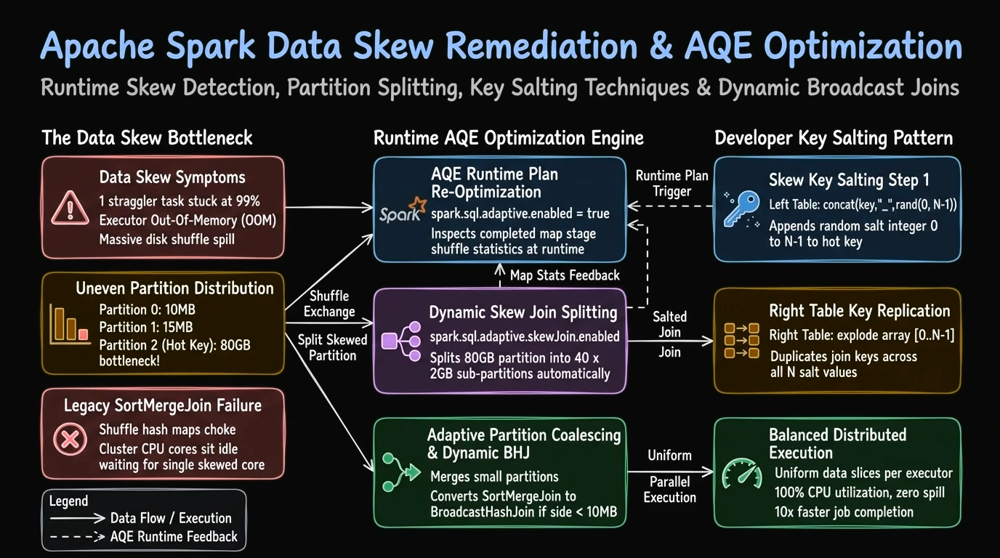
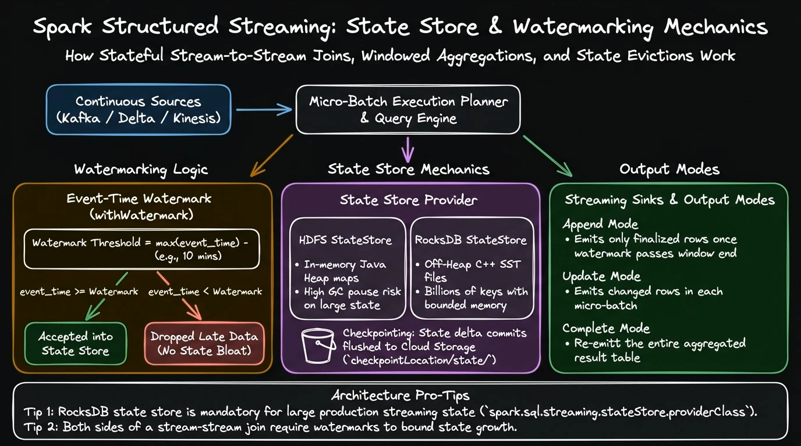

<p align="center">
  
</p>

# ⚡ The PySpark Handbook

**119 Code-Only Apache Spark 4.0+ Patterns, Lakehouse Format Internals, Incident Runbooks & Multi-Cloud Adapters**

[](https://github.com/santoshjammi29/pyspark-handbook/actions/workflows/ci.yml)
[](https://spark.apache.org/)
[](https://www.python.org/)
[](.github/workflows/ci.yml)
[](LICENSE)

*A fast, zero-bloat, **code-only Apache Spark 4.0+ reference repository** separating portable Core Spark (`01_`–`05_`) from cloud-vendor adapters (`06_platform_adapters/`). Every pattern module follows the 5-part engineering blueprint: Scenario & Scale → Anti-Pattern (`❌`) + Blast Radius → ANSI-Safe PySpark 4.0+ Fix (`✅`) → `explain("formatted")` / Spark UI Diagnostics → Production Gotchas.*

[Goal-Based Paths](#-goal-based-paths) • [Level 1–4 Roadmap](#-level-14-curriculum-roadmap) • [Anti-Pattern Quick-Ref](#-anti-pattern-quick-reference) • [Module Catalog](#-complete-119-module-catalog) • [Architectures & Runbooks](#%EF%B8%8F-architectures-runbooks--interview-prep) • [Visual Blueprints](#%EF%B8%8F-whiteboard-architecture-blueprints) • [Static CI](#-static-verification-zero-jvm)

---

## 🎯 Goal-Based Paths

| Your Goal | Start Here | What You Master |
|---|---|---|
| **1. Core Foundations** | [`01_foundations/`](01_foundations) | `SparkSession`, explicit schemas, `try_cast`, complex types (`ARRAY`/`STRUCT`/`MAP`), HOFs, window functions, joins, and the [SQL-to-PySpark Rosetta Stone](01_foundations/033_sql_to_pyspark_rosetta_stone.py). |
| **2. Production ETL & Testing** | [`02_production_patterns/`](02_production_patterns) | PyArrow Pandas UDFs, [`pytest` & `assertDataFrameEqual`](02_production_patterns/012_pytest_and_assert_dataframe_equal_testing_patterns.py), multi-format ingestion, Medallion/SCD 1–4, Data Vault 2.0, and E2E domain pipelines. |
| **3. Performance, Skew & Streaming Triage** | [`03_performance_and_streaming/`](03_performance_and_streaming) · [`runbooks/`](runbooks) | Catalyst/AQE, two-phase skew salting, OOM triage, `BroadcastNestedLoopJoin` fixes, Structured Streaming watermarks, RocksDB state, and DLQ quarantine. |
| **4. Spark 3.5 → 4.0 Upgrade** | [`04_spark4_and_modern_api/`](04_spark4_and_modern_api) | [Spark Connect](04_spark4_and_modern_api/001_spark_connect_decoupled_client_architecture.py), [ANSI default gotchas](04_spark4_and_modern_api/002_ansi_mode_default_and_spark35_to_40_migration_gotchas.py), [`VARIANT` shredding](04_spark4_and_modern_api/003_variant_semi_structured_data_type_and_shredding.py), [Python Data Source API](04_spark4_and_modern_api/004_python_data_source_api_custom_connectors.py), [Polymorphic UDTFs](04_spark4_and_modern_api/005_polymorphic_python_udtfs_and_table_arguments.py), [SQL Pipe syntax](04_spark4_and_modern_api/006_sql_pipe_syntax_and_parameterized_sql.py), and [structured JSON logging](04_spark4_and_modern_api/007_structured_json_logging_and_observability.py). |
| **5. Lakehouse Formats** | [`05_lakehouse_formats/`](05_lakehouse_formats) | Delta `_delta_log`, `MERGE INTO`, Time Travel, `VACUUM`, Liquid Clustering, CDF, and [Delta vs. Iceberg vs. Parquet](05_lakehouse_formats/044_delta_vs_iceberg_vs_parquet_format_patterns.py). |
| **6. Multi-Cloud Adapters** | [`06_platform_adapters/`](06_platform_adapters) | Isolated adapters for **Databricks** (Unity Catalog, Auto Loader, Photon, [DABs](06_platform_adapters/databricks_asset_bundles/databricks.yml)), [**Microsoft Fabric OneLake**](06_platform_adapters/096_microsoft_fabric_onelake_and_notebookutils_adapter.py), [**AWS EMR / Glue / S3A**](06_platform_adapters/097_aws_emr_glue_catalog_and_s3_committer_adapter.py), [**GCP Dataproc / BigQuery**](06_platform_adapters/098_gcp_dataproc_serverless_and_bigquery_connector.py), and [**Kubernetes / Volcano**](06_platform_adapters/099_kubernetes_spark_operator_and_volcano_adapter.py). |

---

## 🗺️ Level 1–4 Curriculum Roadmap

| Tier | Directory | Modules | Core Scope & Engineering Focus |
| :---: | :--- | :---: | :--- |
| **L1–L2** | [`01_foundations/`](01_foundations) | `31` | DataFrame API, `try_cast`, nested types, HOFs, SQL windows, joins, SQL-to-PySpark Rosetta Stone |
| **L2–L3** | [`02_production_patterns/`](02_production_patterns) | `30` | Arrow UDFs, `assertDataFrameEqual`, CSV/Parquet/Avro/JDBC ingestion, Medallion/SCD/Data Vault, E2E capstones |
| **L3–L4** | [`03_performance_and_streaming/`](03_performance_and_streaming) | `21` | Catalyst, AQE, skew salting, bucketing, memory/OOM diagnostics, watermarks, stream-stream joins, DLQs |
| **L2–L3** | [`04_spark4_and_modern_api/`](04_spark4_and_modern_api) | `7` | Spark Connect gRPC, ANSI default, `VARIANT`, Python Data Source API, Polymorphic UDTFs, SQL Pipe `\|>`, JSON logs |
| **L3** | [`05_lakehouse_formats/`](05_lakehouse_formats) | `12` | Delta ACID transactions, `MERGE INTO`, Liquid Clustering, CDF, constraints, Delta vs. Iceberg vs. Parquet |
| **L3–L4** | [`06_platform_adapters/`](06_platform_adapters) | `18` + DABs | Databricks UC/Auto Loader/Photon/DABs, Fabric OneLake, AWS EMR/Glue, GCP Dataproc/BQ, K8s Spark Operator |
| **L4** | [`architectures/`](architectures) · [`runbooks/`](runbooks) | `10` | 4 engine deep dives + 6 incident triage runbooks (OOM, spill, skew, RocksDB state, Delta OCC, Arrow GC) |

> Track personal mastery with interactive checkboxes in [`docs/ROADMAP.md`](docs/ROADMAP.md) and review the controlled vocabulary in [`docs/TAXONOMY.md`](docs/TAXONOMY.md).

---

## 🚨 Anti-Pattern Quick Reference

| ❌ Anti-Pattern | ✅ PySpark 4.0+ Fix | Blast Radius |
|---|---|---|
| `spark.sparkContext.*` or `.rdd.*` in pipeline logic | Use DataFrame APIs, `spark.conf`, `mapInPandas`, or `F.spark_partition_id()` | Fails immediately under **Spark Connect** (`PySparkNotImplementedError`) |
| Unchecked `.cast("int")` on dirty string inputs | Use `F.try_cast("col", T.IntegerType())` or `TRY_CAST(...)` | Crashes jobs in **Spark 4.0 ANSI default mode** (`spark.sql.ansi.enabled=true`) |
| Chaining 30+ `.withColumn()` calls in a loop | Batch via `df.withColumns({...})` or a single `.select(...)` | Exponential **Catalyst logical plan bloat** and driver OOM during planning |
| Row-by-row Python `@udf` over millions of rows | Native `F.*` expressions, HOFs (`transform`/`filter`), or Arrow `@pandas_udf` | **10x–100x slower** due to Py4J row serialization and broken Catalyst pushdown |
| `.collect()` / `.toPandas()` on unbounded tables | Aggregate/filter first, `.limit(n)`, or stream with `toLocalIterator` / Arrow | Instant **Driver OutOfMemoryError** and cluster crash |
| Join on skewed keys without skew mitigation | Enable AQE (`skewJoin.enabled=true`) or **two-phase key salting** | Single straggler task runs for hours while 99% of executors idle |
| Missing join condition / non-equi filter in `.join()` | Explicit equi-join key + range filter, or bounded window / bucketed join | Triggers **$O(M \times N)$ `BroadcastNestedLoopJoin`** Cartesian explosion |
| Stateful streaming without `withWatermark()` | Pair `withWatermark()` + RocksDB state store (`transformWithState` in 4.0+) | Unbounded state growth leading to **executor heap/disk exhaustion** |
| Hardcoding `dbutils` / cloud SDKs in Core ETL | Keep Core in `01_`–`05_`; isolate vendor hooks behind `06_platform_adapters/` | Locks pipelines to one vendor and blocks local/CI unit testing |

---

## 📚 Complete 119-Module Catalog

<details>
<summary><b>📊 01_foundations/ (31 Modules)</b> — Core DataFrame API, Complex Types, SQL & Windows</summary>

- `001` — [SparkSession Initialization & DataFrame Creation Strategies](01_foundations/001_sparksession_initialization_and_dataframe_creation_strategies.py)
- `002` — [Schema Enforcement, Safe Type Casting & `try_cast` Handling](01_foundations/002_schema_enforcement_safe_type_casting_and_try_cast_handling.py)
- `003` — [Column Manipulation, Batch Addition (`withColumns`) & Projection Pruning](01_foundations/003_column_manipulation_batch_addition_and_projection_pruning.py)
- `004` — [Filtering, Multi-Condition Predicates & Pushdown Analysis](01_foundations/004_filtering_multi_condition_predicates_and_pushdown_analysis.py)
- `005` — [String Operations, Regex Extraction & Data Cleansing](01_foundations/005_string_operations_regex_extraction_and_data_cleansing.py)
- `006` — [Date & Timestamp Mastery: Parsing, Arithmetic & Timezones](01_foundations/006_date_and_timestamp_mastery_parsing_arithmetic_and_timezones.py)
- `007` — [Handling Nulls, NaNs & Imputation Strategies](01_foundations/007_handling_nulls_nans_and_imputation_strategies.py)
- `008` — [Sorting, Ordering Semantics & Stratified Sampling](01_foundations/008_sorting_ordering_semantics_and_stratified_sampling.py)
- `009` — [Deduplication Strategies: `dropDuplicates` vs. Window `row_number`](01_foundations/009_deduplication_strategies_dropduplicates_vs_window_row_number.py)
- `010` — [Transformations vs. Actions, Lazy Evaluation & Lineage](01_foundations/010_transformations_vs_actions_lazy_evaluation_and_lineage_graph.py)
- `013` — [Array Creation, Element Extraction & Search Functions](01_foundations/013_array_creation_element_extraction_and_array_search_functions.py)
- `014` — [Higher-Order Functions: `transform`, `filter` & `aggregate`](01_foundations/014_spark_higher_order_functions_transform_filter_and_aggregate.py)
- `015` — [Exploding Arrays: `explode` vs. `explode_outer` & `posexplode`](01_foundations/015_exploding_and_flattening_arrays_explode_vs_explode_outer_and_posexplode.py)
- `016` — [Struct Creation, Nested Access & `withField` Updates](01_foundations/016_struct_creation_nested_field_access_and_updating_sub_fields.py)
- `017` — [Recursive Schema Traversal: Flattening Deeply Nested JSON/Structs](01_foundations/017_recursive_schema_traversal_flattening_deeply_nested_json_structs.py)
- `018` — [MapType Creation, Key Extraction & Dynamic Properties](01_foundations/018_maptype_creation_key_extraction_and_dynamic_properties.py)
- `019` — [Parsing Raw JSON: `from_json`, `to_json` & `schema_of_json`](01_foundations/019_parsing_raw_json_payloads_from_json_to_json_and_schema_of_json.py)
- `020` — [Corrupted JSON Quarantine: `PERMISSIVE` vs. `DROPMALFORMED` vs. `FAILFAST`](01_foundations/020_handling_corrupted_and_malformed_json_permissive_vs_dropmalformed_vs_failfast.py)
- `021` — [XML Data Ingestion, Hierarchical Parsing & Tag Structuring](01_foundations/021_xml_data_ingestion_hierarchical_parsing_and_tag_structuring.py)
- `022` — [Advanced Aggregations: `collect_list`, `collect_set` & Sorted Collections](01_foundations/022_advanced_aggregations_collect_list_vs_collect_set_and_sorted_collections.py)
- `023` — [Basic & Multi-Column Aggregations with Alias Management](01_foundations/023_basic_and_multi_column_aggregations_with_alias_management.py)
- `024` — [Multidimensional OLAP: `rollup`, `cube` & `groupingSets`](01_foundations/024_advanced_multidimensional_olap_rollup_cube_and_grouping_sets.py)
- `025` — [Pivoting & Unpivoting Data: `pivot` and `stack` Mastery](01_foundations/025_pivoting_and_unpivoting_data_pivot_and_stack_expression_mastery.py)
- `026` — [Ranking Window Functions: `row_number`, `rank`, `dense_rank`, `percent_rank`](01_foundations/026_ranking_window_functions_row_number_rank_dense_rank_and_percent_rank.py)
- `027` — [Cumulative Window Functions: Running Totals & Moving Averages](01_foundations/027_aggregate_and_cumulative_window_functions_running_totals_and_moving_averages.py)
- `028` — [Offset Window Functions: `lead`, `lag` & Period-over-Period Churn](01_foundations/028_offset_window_functions_lead_lag_and_period_over_period_churn.py)
- `029` — [Sessionization & the Gaps-and-Islands Problem](01_foundations/029_sessionization_and_the_gaps_and_islands_problem_in_pyspark.py)
- `030` — [Relational Joins: Inner, Outer, Left Semi & Left Anti](01_foundations/030_relational_joins_masterclass_inner_outer_semi_and_anti_joins.py)
- `031` — [Broadcast Hash Joins: Threshold Tuning & Memory Limits](01_foundations/031_broadcast_hash_joins_threshold_tuning_and_memory_limits.py)
- `032` — [Spark SQL Views, Temp Tables & Catalyst Optimization](01_foundations/032_spark_sql_views_temp_tables_and_catalyst_sql_optimization.py)
- `033` — [SQL to PySpark DataFrame Rosetta Stone](01_foundations/033_sql_to_pyspark_rosetta_stone.py)

</details>

<details>
<summary><b>🏭 02_production_patterns/ (30 Modules)</b> — Ingestion, Testing, Medallion/SCD & E2E Pipelines</summary>

- `011` — [Custom PySpark UDFs vs. Vectorized Pandas UDFs (PyArrow)](02_production_patterns/011_custom_pyspark_udfs_vs_vectorized_pandas_udfs_pyarrow.py)
- `012` — [`pytest` & `assertDataFrameEqual` Testing Patterns](02_production_patterns/012_pytest_and_assert_dataframe_equal_testing_patterns.py)
- `044` — [CSV Ingestion Edge Cases: Multiline, Escaped Quotes & Custom Delimiters](02_production_patterns/044_csv_ingestion_edge_cases_multiline_escaped_quotes_and_custom_delimiters.py)
- `045` — [Parquet & ORC Columnar Ingestion & Predicate Pushdown](02_production_patterns/045_parquet_and_orc_columnar_ingestion_predicate_pushdown_and_dictionary_encoding.py)
- `046` — [Avro Binary Ingestion & Schema Registry Compatibility](02_production_patterns/046_avro_binary_ingestion_and_schema_registry_compatibility.py)
- `047` — [JDBC Parallel Ingestion: Column Partitioning & `fetchsize` Tuning](02_production_patterns/047_jdbc_parallel_ingestion_partitioning_by_column_fetchsize_and_connection_sizing.py)
- `050` — [Metadata-Driven Multi-Format Ingestion Engine](02_production_patterns/050_building_a_metadata_driven_multi_format_ingestion_engine.py)
- `051` — [Incremental Batch Discovery & Modification Timestamp Watermarking](02_production_patterns/051_incremental_batch_file_discovery_watermarking_and_modification_timestamps.py)
- `052` — [Compressed Archives (`.zip`, `.tar.gz`, `.bz2`) in Distributed PySpark](02_production_patterns/052_handling_compressed_archives_zip_tar_gz_bz2_in_distributed_pyspark.py)
- `053` — [Distributed REST API & Webhook Ingestion Without Driver OOM](02_production_patterns/053_distributed_rest_api_and_webhook_ingestion_without_driver_oom.py)
- `064` — [Medallion Bronze Layer Standards & Audit Trails](02_production_patterns/064_medallion_architecture_bronze_ingestion_layer_standards_and_audit_trails.py)
- `065` — [Medallion Silver Transformation, Cleansing & Conformance](02_production_patterns/065_medallion_architecture_silver_transformation_cleansing_and_conformance.py)
- `066` — [Medallion Gold Business Aggregations & Dimensional Serving](02_production_patterns/066_medallion_architecture_gold_business_aggregations_and_dimensional_serving.py)
- `067` — [Distributed Surrogate Keys: `xxhash64` vs. UUIDs vs. `monotonically_increasing_id`](02_production_patterns/067_distributed_surrogate_key_generation_monotonically_increasing_id_vs_xxhash64_vs_uuids.py)
- `068` — [SCD Type 1 In-Place Overwrites via Delta `MERGE`](02_production_patterns/068_slowly_changing_dimension_type_1_scd_type_1_in_place_overwrites_via_delta_merge.py)
- `069` — [SCD Type 2 Historical Tracking with Effective Dates](02_production_patterns/069_slowly_changing_dimension_type_2_scd_type_2_historical_tracking_with_effective_dates.py)
- `070` — [SCD Type 3 & Type 4 Multi-Tier Implementation](02_production_patterns/070_slowly_changing_dimension_type_3_and_type_4_multi_tier_implementation.py)
- `071` — [CDC Ingestion from Debezium/Kafka into the Lakehouse](02_production_patterns/071_change_data_capture_cdc_ingestion_from_debezium_kafka_into_lakehouse.py)
- `072` — [Star Schema Fact & Conformed Dimension Modeling](02_production_patterns/072_star_schema_implementation_fact_and_conformed_dimension_modeling_in_spark.py)
- `073` — [Data Vault 2.0 Hubs, Links & Satellites in PySpark](02_production_patterns/073_data_vault_2_0_in_the_lakehouse_hubs_links_and_satellites_modeling.py)
- `096` — [E2E Finance: Real-Time Fraud Detection & Customer 360](02_production_patterns/096_project_finance_real_time_credit_card_fraud_detection_and_customer_360.py)
- `097` — [E2E Retail: Omnichannel Multi-Source Lakehouse ETL](02_production_patterns/097_project_retail_omnichannel_multi_source_lakehouse_etl.py)
- `098` — [E2E Healthcare: HIPAA Clinical Records De-Identification](02_production_patterns/098_project_healthcare_hipaa_compliant_clinical_records_de_identification.py)
- `099` — [E2E Telecom: Customer Churn Feature Store & Window Features](02_production_patterns/099_project_telecom_customer_churn_prediction_feature_store_and_window_features.py)
- `100` — [E2E Cybersecurity: Web Access Log Threat Detection](02_production_patterns/100_project_cybersecurity_web_server_access_log_analytics_and_threat_detection.py)
- `101` — [E2E IoT: Industrial Telemetry Z-Score Anomaly Detection](02_production_patterns/101_project_iot_industrial_telemetry_anomaly_detection_via_z_score_statistics.py)
- `102` — [E2E Supply Chain: Inventory Replenishment & Reorder Triggers](02_production_patterns/102_project_supply_chain_inventory_replenishment_forecasting_and_reorder_triggers.py)
- `103` — [E2E E-Commerce: Collaborative Filtering Recommendation Engine](02_production_patterns/103_project_e_commerce_collaborative_filtering_recommendation_engine_with_spark_mllib.py)
- `104` — [E2E GenAI: RAG Lakehouse Document Chunking & Vector Prep](02_production_patterns/104_project_agentic_ai_and_rag_lakehouse_document_chunking_and_vector_search.py)
- `105` — [Master Enterprise Orchestration, Parameters & Alerting](02_production_patterns/105_master_enterprise_production_orchestration_workflow_parameters_and_alerting.py)

</details>

<details>
<summary><b>🏎️ 03_performance_and_streaming/ (21 Modules)</b> — Catalyst, AQE, Skew, OOM & Structured Streaming</summary>

- `054` — [Structured Streaming Foundations & Query Progress](03_performance_and_streaming/054_structured_streaming_foundations_sources_execution_model_and_query_progress.py)
- `055` — [Streaming Triggers: `processingTime` vs. `availableNow`](03_performance_and_streaming/055_streaming_triggers_processingtime_once_and_availablenow_for_cost_optimization.py)
- `056` — [Streaming Window Aggregations & Event-Time Watermarking](03_performance_and_streaming/056_streaming_window_aggregations_and_watermarking_for_late_arriving_events.py)
- `057` — [Stream-Static Joins with Slowly Changing Dimension Lookups](03_performance_and_streaming/057_stream_static_joins_with_slowly_changing_dimension_lookups.py)
- `058` — [Stream-Stream Dual Watermark Joins with Interval Conditions](03_performance_and_streaming/058_stream_stream_dual_watermark_joins_with_interval_conditions.py)
- `059` — [Streaming Deduplication Across Time Windows with Watermarks](03_performance_and_streaming/059_streaming_deduplication_across_time_windows_with_watermarks.py)
- `060` — [Idempotent ACID Delta Upserts via `foreachBatch`](03_performance_and_streaming/060_idempotent_acid_delta_upserts_using_writestream_foreachbatch.py)
- `061` — [Arbitrary Stateful Streaming (`transformWithState` / `flatMapGroupsWithState`)](03_performance_and_streaming/061_arbitrary_stateful_streaming_operations_with_flatmapgroupswithstate_concepts.py)
- `062` — [Dead-Letter Queue (DLQ) Quarantine Streaming Pattern](03_performance_and_streaming/062_dead_letter_queue_dlq_quarantine_streaming_pattern_in_pyspark.py)
- `063` — [Streaming Observability: `StreamingQueryListener` & SLA Alerting](03_performance_and_streaming/063_streaming_observability_streamingquerylistener_and_sla_latency_alerting.py)
- `074` — [Catalyst Optimizer Deep Dive: Plans & Whole-Stage CodeGen](03_performance_and_streaming/074_catalyst_optimizer_deep_dive_parsed_analyzed_optimized_plans_and_code_generation.py)
- `075` — [Adaptive Query Execution (AQE): Coalescing, Join Switching & Skew](03_performance_and_streaming/075_adaptive_query_execution_aqe_dynamic_coalescing_join_switching_and_skew_joins.py)
- `076` — [Data Skew Detection & Two-Stage Key Salting](03_performance_and_streaming/076_data_skew_detection_and_mitigation_using_salting_and_two_stage_joins.py)
- `077` — [Partitioning Strategies & Directory Pruning](03_performance_and_streaming/077_partitioning_strategies_avoiding_over_partitioning_and_directory_pruning.py)
- `078` — [Bucketing for Pre-Sorted Joins & Shuffle Elimination](03_performance_and_streaming/078_bucketing_for_pre_sorted_join_optimization_and_shuffle_elimination.py)
- `079` — [Caching & Persistence: `StorageLevel` vs. Cache Traps](03_performance_and_streaming/079_caching_and_persistence_storagelevel_memory_and_disk_vs_cache_traps.py)
- `080` — [`repartition` vs. `coalesce` Internals](03_performance_and_streaming/080_repartition_vs_coalesce_internals_full_shuffle_vs_partition_minimization.py)
- `081` — [Shuffle Partition Sizing for Small vs. Terabyte Jobs](03_performance_and_streaming/081_shuffle_partition_sizing_and_tuning_for_small_vs_terabyte_scale_jobs.py)
- `082` — [Diagnosing Driver vs. Executor OutOfMemory (OOM) Errors](03_performance_and_streaming/082_diagnosing_and_fixing_outofmemory_oom_errors_driver_vs_executor_heap.py)
- `083` — [Spark UI & EventLog Metrics: Task Skew & Shuffle Spill](03_performance_and_streaming/083_spark_ui_eventlog_metrics_task_skew_and_shuffle_spill_analysis.py)
- `085` — [Fixing Accidental Cartesian Products & `BroadcastNestedLoopJoin`](03_performance_and_streaming/085_fixing_accidental_cartesian_products_and_broadcastnestedloopjoins.py)

</details>

<details>
<summary><b>⚡ 04_spark4_and_modern_api/ (7 Modules)</b> — Spark Connect, ANSI Default, VARIANT, Data Source API, Pipe SQL</summary>

- `001` — [Spark Connect Decoupled gRPC Client Architecture](04_spark4_and_modern_api/001_spark_connect_decoupled_client_architecture.py)
- `002` — [ANSI Mode Default & Spark 3.5 → 4.0 Migration Gotchas](04_spark4_and_modern_api/002_ansi_mode_default_and_spark35_to_40_migration_gotchas.py)
- `003` — [`VARIANT` Semi-Structured Data Type & Shredding](04_spark4_and_modern_api/003_variant_semi_structured_data_type_and_shredding.py)
- `004` — [Python Data Source API (`DataSource`, `DataSourceReader`, Arrow)](04_spark4_and_modern_api/004_python_data_source_api_custom_connectors.py)
- `005` — [Polymorphic Python UDTFs (`analyze()`) & `TABLE` Arguments](04_spark4_and_modern_api/005_polymorphic_python_udtfs_and_table_arguments.py)
- `006` — [SQL Pipe Syntax (`|>`) & Parameterized SQL (`args=`)](04_spark4_and_modern_api/006_sql_pipe_syntax_and_parameterized_sql.py)
- `007` — [Structured JSON Logging, Query Tags & Observability](04_spark4_and_modern_api/007_structured_json_logging_and_observability.py)

</details>

<details>
<summary><b>🧱 05_lakehouse_formats/ (12 Modules)</b> — Delta Lake ACID, Liquid Clustering & Iceberg vs. Parquet</summary>

- `033` — [Delta Table Creation & `_delta_log` Transaction Log Internals](05_lakehouse_formats/033_delta_table_creation_metadata_inspection_and_transaction_log_internals.py)
- `034` — [ACID CRUD Operations on Delta Tables](05_lakehouse_formats/034_acid_crud_operations_on_delta_insert_update_and_delete_mechanics.py)
- `035` — [Delta `MERGE INTO` Mastery with Multiple Conditions](05_lakehouse_formats/035_delta_upsert_and_merge_into_mastery_with_multiple_conditions.py)
- `036` — [Delta Time Travel, Audit History & Version Rollback](05_lakehouse_formats/036_delta_time_travel_audit_history_and_version_rollback.py)
- `037` — [`VACUUM` Retention Hours & Safe Tombstone Management](05_lakehouse_formats/037_vacuum_command_retention_hours_and_safe_tombstone_management.py)
- `038` — [Delta `OPTIMIZE` File Compaction & Auto-Compaction](05_lakehouse_formats/038_delta_optimize_file_compaction_and_auto_compaction_strategies.py)
- `039` — [Z-Ordering vs. Liquid Clustering (`CLUSTER BY`)](05_lakehouse_formats/039_z_order_multi_dimensional_indexing_vs_liquid_clustering_cluster_by.py)
- `040` — [Delta Change Data Feed (CDF) Row-Level Consumption](05_lakehouse_formats/040_delta_change_data_feed_cdf_enabling_and_consuming_row_level_changes.py)
- `041` — [Delta Schema Evolution (`mergeSchema`) & Enforcement](05_lakehouse_formats/041_delta_schema_evolution_mergeschema_and_schema_enforcement.py)
- `042` — [Delta `CHECK` & `NOT NULL` Table Constraints](05_lakehouse_formats/042_delta_table_constraints_check_and_not_null_data_quality_rules.py)
- `043` — [In-Place Parquet-to-Delta Migration (`CONVERT TO DELTA`)](05_lakehouse_formats/043_in_place_parquet_to_delta_lake_migration_with_convert_to_delta.py)
- `044` — [Delta Lake vs. Apache Iceberg v2/v3 vs. Raw Parquet Patterns](05_lakehouse_formats/044_delta_vs_iceberg_vs_parquet_format_patterns.py)

</details>

<details>
<summary><b>☁️ 06_platform_adapters/ (18 Modules + DABs)</b> — Databricks, Fabric, AWS EMR, GCP Dataproc & Kubernetes</summary>

- `012` — [Databricks `dbutils` Widgets & Secret Scopes Local Boundary](06_platform_adapters/012_emulating_databricks_dbutils_widgets_and_secret_scopes_locally.py)
- `048` — [Databricks Auto Loader (`cloudFiles`) & Checkpointing](06_platform_adapters/048_databricks_auto_loader_directory_mode_cloudfiles_schema_inference_and_checkpointing.py)
- `049` — [Auto Loader Schema Evolution & `_rescued_data`](06_platform_adapters/049_auto_loader_schema_evolution_and_rescued_data_column_rescued_data.py)
- `084` — [Vectorized Execution & Databricks Photon Engine Mechanics](06_platform_adapters/084_vectorized_execution_and_photon_engine_acceleration_mechanics.py)
- `086` — [Unity Catalog 3-Tier Namespace & Managed vs. External Tables](06_platform_adapters/086_unity_catalog_three_tier_namespace_catalogs_schemas_and_managed_vs_external_tables.py)
- `087` — [Unity Catalog Volumes for Unstructured Data Governance](06_platform_adapters/087_unity_catalog_volumes_for_unstructured_and_semi_structured_data_governance.py)
- `088` — [Dynamic Row-Level Security (RLS) via Row Filters](06_platform_adapters/088_dynamic_row_level_security_rls_using_row_filters_and_user_functions.py)
- `089` — [Dynamic Column Masking for PII Compliance](06_platform_adapters/089_dynamic_column_masking_for_pii_protection_and_compliance.py)
- `090` — [PII Encryption, Salted Hashing & `aes_encrypt` / `sha2`](06_platform_adapters/090_pii_encryption_salted_hashing_and_aes_decryption_aes_encrypt_sha2.py)
- `091` — [Databricks Secret Scopes & Credential Injection](06_platform_adapters/091_databricks_secret_scopes_and_secure_credential_injection_via_dbutils_secrets.py)
- `092` — [FinOps & DBU Cost Modeling via `system.billing.usage`](06_platform_adapters/092_finops_and_dbu_cost_calculation_using_system_billing_usage_system_tables.py)
- `093` — [Lakeflow Declarative Pipelines (DLT) & Expectations](06_platform_adapters/093_lakeflow_declarative_pipelines_and_delta_live_tables_dlt_expectations.py)
- `094` — [Databricks Asset Bundles (DABs) Multi-Env CI/CD](06_platform_adapters/094_databricks_asset_bundles_dabs_for_multi_environment_ci_cd_automation.py)
- `095` — [Semantic Layer & Databricks Metric Views](06_platform_adapters/095_semantic_layer_modeling_and_databricks_metric_views_for_bi_and_ai_agents.py)
- `096` — [Microsoft Fabric OneLake, Shortcuts & `notebookutils` Adapter](06_platform_adapters/096_microsoft_fabric_onelake_and_notebookutils_adapter.py)
- `097` — [AWS EMR Serverless, Glue Catalog & S3A Magic Committer](06_platform_adapters/097_aws_emr_glue_catalog_and_s3_committer_adapter.py)
- `098` — [GCP Dataproc Serverless & BigQuery Storage Connector](06_platform_adapters/098_gcp_dataproc_serverless_and_bigquery_connector.py)
- `099` — [Kubernetes Spark Operator, Shuffle Tracking & Volcano](06_platform_adapters/099_kubernetes_spark_operator_and_volcano_adapter.py)
- `DAB` — [Databricks Asset Bundle Config](06_platform_adapters/databricks_asset_bundles/databricks.yml)

</details>

---

## 🏗️ Architectures, Runbooks & Interview Prep

| Architectural Deep Dives (`L4`) | Production Incident Runbooks (`L4`) | 4-Tier Interview Guides |
|---|---|---|
| [01. Catalyst & Tungsten Engine](architectures/01_catalyst_optimizer_and_tungsten_engine.md) | [01. Driver & Executor OOM Triage](runbooks/01_driver_and_executor_oom_triage.md) | [Tier 1: Junior & Associate](interview/01_junior_and_associate_pyspark_engineer.md) |
| [02. Unified Memory & Spill](architectures/02_spark_unified_memory_management_and_spill_mechanics.md) | [02. Shuffle Spill & Partition Sizing](runbooks/02_shuffle_spill_and_partition_sizing.md) | [Tier 2: Mid-Level Data Engineer](interview/02_mid_level_data_engineer.md) |
| [03. Adaptive Query Execution (AQE)](architectures/03_adaptive_query_execution_aqe_deep_dive.md) | [03. Data Skew & Two-Phase Salting](runbooks/03_data_skew_and_two_phase_salting.md) | [Tier 3: Senior Distributed Systems](interview/03_senior_distributed_systems_engineer.md) |
| [04. Stateful Streaming & RocksDB](architectures/04_structured_streaming_and_stateful_stream_processing.md) | [04. Streaming State Store & Watermarks](runbooks/04_streaming_state_store_and_watermark_drops.md) | [Tier 4: Staff & Principal Architect](interview/04_staff_and_principal_spark_architect.md) |
| [157 Core Curriculum Topics](topics/README.md) | [05. Delta ACID Concurrency & OCC](runbooks/05_delta_acid_concurrency_and_metadata_bottlenecks.md) | [50 Rapid-Fire Flashcards](interview/05_flashcards_deck_50.md) |
| [Taxonomy & Evidence Standards](docs/TAXONOMY.md) | [06. Pandas UDF Arrow & GC Pauses](runbooks/06_pandas_udf_arrow_serialization_and_gc_pauses.md) | [Interactive Study Roadmap](docs/ROADMAP.md) |

---

## 🖼️ Whiteboard Architecture Blueprints

All **52 `.webp` architectural whiteboard blueprints** live in [`assets/whiteboards/`](assets/whiteboards) with multi-persona breakdowns and failure modes in [`docs/whiteboard_diagrams/README.md`](docs/whiteboard_diagrams/README.md) and [`docs/whiteboard_diagrams/handbook_whiteboard_blueprints.md`](docs/whiteboard_diagrams/handbook_whiteboard_blueprints.md).

<table>
  <tr>
    <td width="50%" valign="top">
      <a href="docs/whiteboard_diagrams/README.md#spark-catalyst-photon-engine">
        
      </a>
      <br><strong>Catalyst Optimizer, AQE &amp; Photon</strong> — Physical/logical optimization &amp; runtime re-planning.
    </td>
    <td width="50%" valign="top">
      <a href="docs/whiteboard_diagrams/README.md#spark-shuffle-memory-execution">
        
      </a>
      <br><strong>Unified Memory &amp; Shuffle Execution</strong> — Execution vs. storage pools &amp; Tungsten off-heap layout.
    </td>
  </tr>
  <tr>
    <td width="50%" valign="top">
      <a href="docs/whiteboard_diagrams/README.md#spark-data-skew-aqe-optimization">
        
      </a>
      <br><strong>Data Skew &amp; AQE Optimization</strong> — Two-phase key salting &amp; adaptive partition splitting.
    </td>
    <td width="50%" valign="top">
      <a href="docs/whiteboard_diagrams/README.md#spark-streaming-state-store">
        
      </a>
      <br><strong>Streaming State Store &amp; Watermarking</strong> — RocksDB LSM state, eviction &amp; incremental checkpoints.
    </td>
  </tr>
</table>

---

## ⚙️ Static Verification (Zero JVM)

No Java, Spark runtime, or heavy notebook dependencies are required to validate this repository:

```bash
python -m venv .venv && source .venv/bin/activate
pip install -r requirements.txt

python -m compileall -q .
ruff check .
pytest tests/
```

See [`CONTRIBUTING.md`](CONTRIBUTING.md) for the code-only PR rules and the [organization Security Policy](https://github.com/santoshjammi29/.github/blob/main/SECURITY.md) for vulnerability disclosure.

---

## 🌐 Sister Repositories & Ecosystem

Part of the 14-repository **Modern Data Engineering Lakehouse Ecosystem** ([moderndataengineer.uk](https://moderndataengineer.uk)):

- **[The Databricks Handbook](https://github.com/santoshjammi29/databricks-handbook)** — 105 Databricks recipes, Unity Catalog, Lakeflow & DABs
- **[Spark Experiments](https://github.com/santoshjammi29/spark-experiments)** — Empirical 1M+ row skew, salting & spill benchmarks
- **[The SQL Handbook](https://github.com/santoshjammi29/sql-handbook)** — Relational query engines, MPP & window internals
- **[Streaming Handbook](https://github.com/santoshjammi29/streaming-handbook)** — Kafka KRaft, Apache Flink & event-time pipelines
- **[DataOps & CI/CD Handbook](https://github.com/santoshjammi29/dataops-cicd-handbook)** — GitOps, Airflow, DABs & automated data quality
- **[System Design Handbook](https://github.com/santoshjammi29/data-system-design-handbook)** — Storage formats, CAP/PACELC & BCDR
- **[Interview Handbook](https://github.com/santoshjammi29/data-engineering-interview-handbook)** — Staff/Principal defense playbooks & 100 Spark data issues
- **[The Security Handbook](https://github.com/santoshjammi29/security-handbook)** — Zero-Trust lakehouse perimeters, OIDC & encryption

---

## 📜 License

Distributed under the **[MIT License](LICENSE)** — Maintained by [Santosh Jammi](https://github.com/santoshjammi29).
