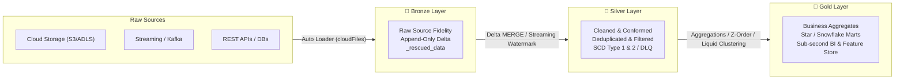
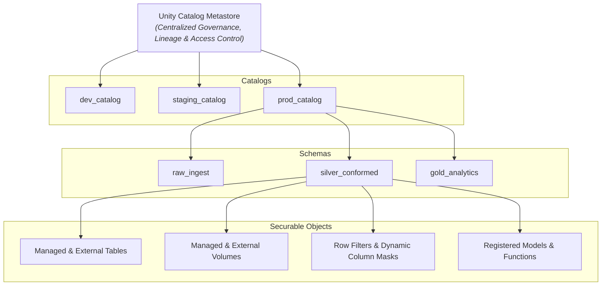
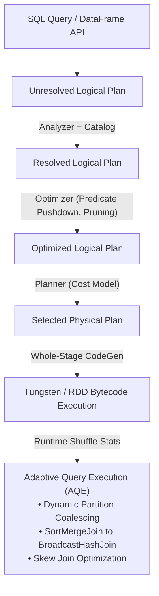
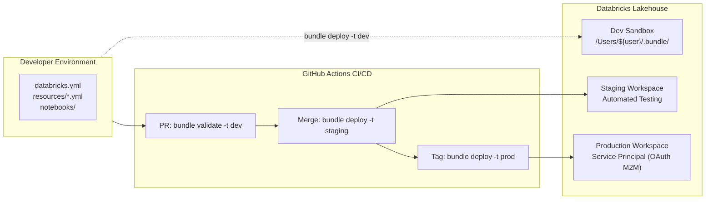

# ⚡ The PySpark Handbook

**105 Production Coding Use Cases, Performance Tuning Recipes & Lakehouse Masterclass**

[](https://github.com/santoshjammi29/pyspark-handbook/actions)
[](https://spark.apache.org/)
[](https://www.databricks.com/)
[](https://delta.io/)
[](https://www.python.org/)
[](databricks.yml)
[](LICENSE)

*The definitive enterprise reference repository of 105 battle-tested Apache Spark & Databricks Lakehouse coding use cases.*  
*Structured in the official **Databricks Source Notebook format (`.py`)** for seamless 1-click sync with **Databricks Repos / Git Folders**, **Databricks Asset Bundles (DABs)**, **VS Code**, and local PySpark / CI runtimes.*

[Curriculum Overview](#-curriculum-overview) • [Lakehouse Architecture](#-lakehouse-architecture) • [Quickstart](#-quickstart) • [DAB Deployment](#-production-deployment-with-dabs) • [Interview Matrix](#-senior-data-engineer-interview-matrix) • [Cheat Sheet](#-performance-tuning-cheat-sheet)

---

## 🎯 Overview & Mission

Modern Lakehouse engineering demands deep fluency in distributed memory execution, ACID transaction semantics, streaming ingestion, query plan optimization, and enterprise data governance.

This repository provides **105 end-to-end, runnable, modular use cases** covering:
- **Core & Advanced Distributed Compute:** PyArrow Pandas UDFs, Higher-Order Functions, Nested Structs/Arrays, Windowing, and Catalyst internals.
- **Lakehouse Storage & ACID Transactions:** Delta Lake transaction log, MERGE INTO, Time Travel, VACUUM, and Liquid Clustering (`CLUSTER BY`).
- **Streaming & Ingestion:** Databricks Auto Loader (`cloudFiles`), event-time watermarking, stream-stream joins, and Dead Letter Queues (DLQ).
- **Enterprise Governance & DevOps:** Unity Catalog 3-tier namespace, Row Filters, Dynamic Column Masking, and Databricks Asset Bundles (DABs) IaC.

---

## 🏛️ Lakehouse Architecture

### 1. Medallion Lakehouse Architecture (Bronze → Silver → Gold)



---

### 2. Databricks Unity Catalog 3-Tier Governance Namespace



---

### 3. Spark Catalyst Optimization & Adaptive Query Execution (AQE)



---

## 🚀 Quickstart

### Option 1: 1-Click Sync into Databricks Workspaces
Every notebook is written in the native Databricks `.py` format (`# Databricks notebook source`):
1. In your **Databricks Workspace**, navigate to **Workspace** > **Repos** (or **Git Folders**).
2. Click **Add Repo** (or **Create Git Folder**) and enter:
   ```text
   https://github.com/santoshjammi29/pyspark-handbook.git
   ```
3. Open any notebook under `notebooks/`, attach an active cluster, and click **Run All**!

---

### Option 2: Local Execution in VS Code or Terminal
Each notebook auto-detects its environment; if run locally without an active cluster, it automatically bootstraps a local SparkSession with Delta Lake support:

```bash
# 1. Clone repository
git clone https://github.com/santoshjammi29/pyspark-handbook.git
cd pyspark-handbook

# 2. Set up virtual environment & install dependencies
python3 -m venv venv && source venv/bin/activate
pip install -r requirements.txt

# 3. Execute any notebook directly as a standard Python script
python notebooks/01_core_dataframe_api/001_sparksession_initialization_and_dataframe_creation_strategies.py
```

---

## 🧭 Curriculum Overview

Click any module below to inspect its individual notebooks, real-world business scenarios, and architectural takeaways:

| Learning Track & Module | Range | Difficulty | Core Topics & Architectural Coverage |
|:---|:---:|:---:|:---|
| 📊 **[Module 01: Core PySpark Foundations & DataFrame API](#01-core-dataframe-api)** | `001 – 012` | 🟢 Beginner – 🟡 Intermediate | DataFrame creation, explicit StructType schemas, PyArrow Pandas UDFs, safe type casting, column projections, and DBUtils emulation. |
| 🧩 **[Module 02: Complex Data Types & Nested Structures](#02-complex-data-types)** | `013 – 022` | 🟡 Intermediate | Nested StructTypes, Arrays, Maps, Higher-Order Functions (transform, filter, aggregate), JSON parsing, XML shredding, and schema evolution. |
| 🪟 **[Module 03: Advanced SQL & Analytical Window Functions](#03-sql-and-window-functions)** | `023 – 032` | 🟡 Intermediate – 🔴 Advanced | Ranking, lead/lag, rolling moving averages, cumulative distribution, OLAP cubes, pivots, broadcast hash joins, and range vs rows framing. |
| 🧱 **[Module 04: Delta Lake Architecture & ACID Operations](#04-delta-lake-and-acid)** | `033 – 043` | 🟡 Intermediate – 🔴 Advanced | Delta transaction log (_delta_log), ACID CRUD, high-throughput MERGE INTO, time travel, VACUUM retention, and Liquid Clustering. |
| 📥 **[Module 05: Data Ingestion Patterns & Auto Loader](#05-data-ingestion-autoloader)** | `044 – 053` | 🟡 Intermediate – 🔴 Advanced | Databricks Auto Loader (cloudFiles), notification modes, rescued data column, parallel JDBC partitioning, and multi-format lakehouse ingestion. |
| ⚡ **[Module 06: Structured Streaming & Real-Time Processing](#06-streaming-realtime)** | `054 – 063` | 🟡 Intermediate – 🔴 Advanced | AvailableNow triggers, event-time watermarking, stateful stream-stream joins, deduplication, and Dead Letter Queues (DLQ). |
| 🏛️ **[Module 07: Lakehouse Data Modeling, CDC & SCD Implementation](#07-lakehouse-modeling-scd)** | `064 – 073` | 🔴 Advanced | Medallion Architecture (Bronze/Silver/Gold), Slowly Changing Dimensions (SCD Types 1, 2, 3, 4), Debezium CDC replay, and Data Vault 2.0. |
| 🏎️ **[Module 08: Performance Tuning, AQE & Skew Mitigation](#08-performance-and-tuning)** | `074 – 085` | 🔴 Advanced | Catalyst Logical & Physical Plans, Adaptive Query Execution (AQE), Salting join skew, Hive-style bucketing, OOM diagnosis, and Photon. |
| 🛡️ **[Module 09: Unity Catalog Governance, Security & FinOps](#09-unity-catalog-and-security)** | `086 – 095` | 🟡 Intermediate – 🔴 Advanced | Unity Catalog 3-tier namespace, Managed & External Volumes, Row-Level Security, Dynamic Column Masking, Secret Scopes, and DABs. |
| 🚀 **[Module 10: End-to-End Enterprise Production Projects](#10-end-to-end-projects)** | `096 – 105` | 🔴 Advanced Capstone | Full capstones: FinTech Fraud Detection, Omnichannel Retail Lakehouse, Healthcare FHIR Ingestion, IoT Telemetry, RAG Embeddings, and Workflows. |

---

## 📚 Master Curriculum Catalog (105 Use Cases)

<a id="01-core-dataframe-api"></a>
<details>
<summary><b>📊 Module 01: Core PySpark Foundations & DataFrame API (001 – 012)</b> — <i>🟢 Beginner – 🟡 Intermediate</i></summary>

> 💡 **Core Focus:** DataFrame creation, explicit StructType schemas, PyArrow Pandas UDFs, safe type casting, column projections, and DBUtils emulation.

| # | Databricks Notebook (.py) | Difficulty | Business Scenario | Key Architectural Focus |
|:---:|:---|:---:|:---|:---|
| `001` | [`SparkSession Initialization & DataFrame Creation Strategies`](notebooks/01_core_dataframe_api/001_sparksession_initialization_and_dataframe_creation_strategies.py) | 🟢 `Beginner` | A digital commerce platform needs to ingest customer profile extracts from multiple legacy sources (in-memory lists, Python dictionaries, Pandas exports, and RDDs) into a unified PySpark DataFrame with strict schema validation. | SparkSession serves as the unified entry point introduced in Spark 2.0, encapsulating SparkContext, SQLContext, and HiveContext. |
| `002` | [`Schema Enforcement, Safe Type Casting & Try-Cast Handling`](notebooks/01_core_dataframe_api/002_schema_enforcement_safe_type_casting_and_try_cast_handling.py) | 🟢 `Beginner` | A payments processor receives raw transaction dumps where numeric amounts contain currency symbols, timestamps are in non-standard formats, and corrupted text entries cause pipeline aborts on type casting. | In ANSI SQL mode (`spark.sql.ansi.enabled = true`), standard `.cast()` throws runtime exceptions on invalid values (e.g. casting 'INVALID' to INT). |
| `003` | [`Column Manipulation, Batch Addition & Projection Pruning`](notebooks/01_core_dataframe_api/003_column_manipulation_batch_addition_and_projection_pruning.py) | 🟢 `Beginner` | A SaaS telemetry service needs to enrich raw session events with calculated duration, derived flags, normalized client identifiers, and drop redundant legacy headers without incurring multiple Catalyst plan rebuilds. | Chaining dozens of `.withColumn()` calls produces a deep Catalyst logical plan tree that can drastically increase driver planning and compilation time. |
| `004` | [`Filtering, Multi-Condition Predicates & Pushdown Analysis`](notebooks/01_core_dataframe_api/004_filtering_multi_condition_predicates_and_pushdown_analysis.py) | 🟢 `Beginner` | A logistics fleet management company needs to identify critical alerts: vehicles with engine temperatures exceeding safe thresholds, low tire pressure, or battery degradation across specific geographic territories. | Predicate pushdown allows the storage layer (Parquet/Delta) to skip entire row groups and data files using file-level min/max statistics without deserializing data into the JVM heap. |
| `005` | [`String Operations, Regex Extraction & Data Cleansing`](notebooks/01_core_dataframe_api/005_string_operations_regex_extraction_and_data_cleansing.py) | 🟢 `Beginner` | A marketing automation system ingests unstructured customer lead notes containing messy phone numbers, email addresses with inconsistent cases, and unformatted address strings. | Spark SQL string functions are backed by native UTF-8 binary representations in Apache Spark's Tungsten project, avoiding Java String object allocation overhead. |
| `006` | [`Date & Timestamp Mastery: Parsing, Arithmetic & Timezones`](notebooks/01_core_dataframe_api/006_date_and_timestamp_mastery_parsing_arithmetic_and_timezones.py) | 🟢 `Beginner` | A global ride-sharing platform records ride dispatch, pickup, and dropoff events across multiple international timezones. | Spark 3.0 introduced Proleptic Gregorian calendar support by default (`spark.sql.session.timeZone`). |
| `007` | [`Handling Nulls, NaNs & Imputation Strategies`](notebooks/01_core_dataframe_api/007_handling_nulls_nans_and_imputation_strategies.py) | 🟢 `Beginner` | A medical diagnostics platform aggregates clinical lab test results. | In PySpark, `NULL` (unknown value) and `NaN` (IEEE 754 Not-a-Number float) have distinct semantics. `isnan()` only applies to Double/Float columns, while `isNull()` applies to all types. |
| `008` | [`Sorting, Ordering Semantics & Stratified Sampling`](notebooks/01_core_dataframe_api/008_sorting_ordering_semantics_and_stratified_sampling.py) | 🟢 `Beginner` | A financial auditing team must sample transaction logs for regulatory compliance. | `orderBy()` and `sort()` trigger a global RangePartitioner shuffle across all executor partitions, which can be expensive on multi-terabyte datasets. `sortWithinPartitions()` sorts locally inside each partition without shuffling. |
| `009` | [`Deduplication Strategies: dropDuplicates vs Window Row-Number`](notebooks/01_core_dataframe_api/009_deduplication_strategies_dropduplicates_vs_window_row_number.py) | 🟡 `Intermediate` | An e-commerce order ingestion pipeline receives duplicate HTTP webhook payloads. | `dropDuplicates()` uses a HashAggregate under the hood. |
| `010` | [`Transformations vs Actions, Lazy Evaluation & Lineage Graph`](notebooks/01_core_dataframe_api/010_transformations_vs_actions_lazy_evaluation_and_lineage_graph.py) | 🟡 `Intermediate` | A performance engineering lead must diagnose why a data pipeline fails after running for 40 minutes, only to crash on a lightweight `.count()` action. | Spark constructs a Directed Acyclic Graph (DAG) of stages separated by shuffle boundaries. |
| `011` | [`Custom PySpark UDFs vs Vectorized Pandas UDFs (PyArrow)`](notebooks/01_core_dataframe_api/011_custom_pyspark_udfs_vs_vectorized_pandas_udfs_pyarrow.py) | 🟡 `Intermediate` | A credit scoring model applies complex non-linear mathematical risk adjustments to customer accounts. | Standard Python UDFs serialize JVM row data to a Python worker process row-by-row via Py4J, incurring massive serialization and deserialization overhead and disabling Catalyst optimizations. |
| `012` | [`Emulating Databricks DBUtils, Widgets & Secret Scopes Locally`](notebooks/01_core_dataframe_api/012_emulating_databricks_dbutils_widgets_and_secret_scopes_locally.py) | 🟡 `Intermediate` | An enterprise migration team develops Databricks pipelines locally inside VS Code or CI/CD test runners before deploying to production workspaces. | In Databricks, `dbutils` is a Java/Scala bridge injected into the Python REPL. |

</details>

<a id="02-complex-data-types"></a>
<details>
<summary><b>🧩 Module 02: Complex Data Types & Nested Structures (013 – 022)</b> — <i>🟡 Intermediate</i></summary>

> 💡 **Core Focus:** Nested StructTypes, Arrays, Maps, Higher-Order Functions (transform, filter, aggregate), JSON parsing, XML shredding, and schema evolution.

| # | Databricks Notebook (.py) | Difficulty | Business Scenario | Key Architectural Focus |
|:---:|:---|:---:|:---|:---|
| `013` | [`Array Creation, Element Extraction and Array Search Functions`](notebooks/02_complex_data_types/013_array_creation_element_extraction_and_array_search_functions.py) | 🟡 `Intermediate` | A digital streaming platform logs user engagement tags, genre preferences, and content playlists as arrays. | Spark represents ArrayType as native columnar array buffers in Tungsten memory. `element_at` uses 1-based indexing for positive indices (1 = first element) and -1 for the last element, differing from standard Python 0-based indexing. |
| `014` | [`Spark Higher-Order Functions: Transform, Filter and Aggregate`](notebooks/02_complex_data_types/014_spark_higher_order_functions_transform_filter_and_aggregate.py) | 🟡 `Intermediate` | A fintech loyalty platform tracks customer reward points earned across multiple merchant transactions in an array. | Higher-order functions run inline lambda expressions inside the JVM on array elements without flattening the DataFrame. |
| `015` | [`Exploding and Flattening Arrays: explode vs explode_outer and posexplode`](notebooks/02_complex_data_types/015_exploding_and_flattening_arrays_explode_vs_explode_outer_and_posexplode.py) | 🟡 `Intermediate` | A flight booking aggregator normalizes JSON payloads of airline bookings. | Standard `explode()` drops rows where the array is empty or NULL, leading to silent data loss. `explode_outer()` emits a row with NULL for the exploded element, preserving the parent record. `posexplode()` generates both position (zero-based index) and element. |
| `016` | [`Struct Creation, Nested Field Access and Updating Sub-Fields`](notebooks/02_complex_data_types/016_struct_creation_nested_field_access_and_updating_sub_fields.py) | 🟡 `Intermediate` | A customer identity platform groups personal attributes, contact points, and address details into nested structs for clean schema organization. | StructType is a compound type that stores multiple typed named fields together in memory. |
| `017` | [`Recursive Schema Traversal: Flattening Deeply Nested JSON/Structs`](notebooks/02_complex_data_types/017_recursive_schema_traversal_flattening_deeply_nested_json_structs.py) | 🔴 `Advanced` | An enterprise integration hub ingests complex payloads from ERP and CRM systems containing 5+ levels of nested structs and arrays. | Deeply nested schemas can cause severe query compilation overhead. |
| `018` | [`MapType Creation, Key Extraction and Dynamic Properties`](notebooks/02_complex_data_types/018_maptype_creation_key_extraction_and_dynamic_properties.py) | 🟡 `Intermediate` | An advertising technology platform captures custom user ad-tracking attributes (cookies, campaign IDs, UTM tags, experiment variants) as dynamic key-value pairs where keys vary across partners and cannot be fixed into a static schema. | MapType represents key-value collections with arbitrary keys of identical data type. |
| `019` | [`Parsing Raw JSON Payloads: from_json, to_json and schema_of_json`](notebooks/02_complex_data_types/019_parsing_raw_json_payloads_from_json_to_json_and_schema_of_json.py) | 🟡 `Intermediate` | A payment gateway streams raw JSON transaction events via Apache Kafka or cloud storage. | `from_json()` parses JSON strings inside JVM tasks using Jackson parser, avoiding Python serialization. |
| `020` | [`Handling Corrupted & Malformed JSON: Permissive vs DropMalformed vs FailFast`](notebooks/02_complex_data_types/020_handling_corrupted_and_malformed_json_permissive_vs_dropmalformed_vs_failfast.py) | 🟡 `Intermediate` | A public data ingestion pipeline scrapes third-party web endpoints. | `PERMISSIVE` is Spark's default mode: corrupted fields evaluate to NULL and the unparseable string is diverted to `_corrupt_record`. `FAILFAST` halts execution immediately upon encountering syntax errors. `DROPMALFORMED` silently drops damaged records. |
| `021` | [`XML Data Ingestion, Hierarchical Parsing and Tag Structuring`](notebooks/02_complex_data_types/021_xml_data_ingestion_hierarchical_parsing_and_tag_structuring.py) | 🟡 `Intermediate` | A legacy healthcare exchange transmits insurance claims in XML format. | Native XML parsing in Spark utilizes the `spark-xml` library (or Databricks built-in XML reader in DBR 14+). |
| `022` | [`Advanced Aggregations: collect_list vs collect_set and Sorted Collections`](notebooks/02_complex_data_types/022_advanced_aggregations_collect_list_vs_collect_set_and_sorted_collections.py) | 🟡 `Intermediate` | A digital customer journey pipeline aggregates all URLs visited by users within a session. | `collect_list` and `collect_set` are wide aggregations that buffer array elements in executor memory per group. |

</details>

<a id="03-sql-and-window-functions"></a>
<details>
<summary><b>🪟 Module 03: Advanced SQL & Analytical Window Functions (023 – 032)</b> — <i>🟡 Intermediate – 🔴 Advanced</i></summary>

> 💡 **Core Focus:** Ranking, lead/lag, rolling moving averages, cumulative distribution, OLAP cubes, pivots, broadcast hash joins, and range vs rows framing.

| # | Databricks Notebook (.py) | Difficulty | Business Scenario | Key Architectural Focus |
|:---:|:---|:---:|:---|:---|
| `023` | [`Basic and Multi-Column Aggregations with Alias Management`](notebooks/03_sql_and_window_functions/023_basic_and_multi_column_aggregations_with_alias_management.py) | 🟢 `Beginner` | A retail analytics engine calculates daily regional performance metrics across store departments: total gross revenue, average transaction value, maximum discount applied, and distinct active shoppers. | Spark executes aggregations via HashAggregate (when data types are mutable) or SortAggregate. |
| `024` | [`Advanced Multidimensional OLAP: Rollup, Cube and Grouping Sets`](notebooks/03_sql_and_window_functions/024_advanced_multidimensional_olap_rollup_cube_and_grouping_sets.py) | 🟡 `Intermediate` | A financial controller needs a single unified sales reporting view that includes: (1) Detailed breakdown by Year, Quarter, and Product, (2) Subtotals by Year and Quarter, (3) Subtotals by Year alone, and (4) The grand total across the entire enterprise. | `rollup()` generates $N + 1$ grouping levels for $N$ dimensions in hierarchical order. `cube()` computes $2^N$ grouping combinations. |
| `025` | [`Pivoting and Unpivoting Data: pivot and stack Expression Mastery`](notebooks/03_sql_and_window_functions/025_pivoting_and_unpivoting_data_pivot_and_stack_expression_mastery.py) | 🟡 `Intermediate` | A business intelligence dashboard requires monthly revenue pivoted into wide columns (Jan, Feb, Mar...) for tabular display. | Calling `.pivot('col')` without specifying distinct values forces an extra, expensive distributed pass over the data to discover all unique column values. |
| `026` | [`Ranking Window Functions: row_number, rank, dense_rank and percent_rank`](notebooks/03_sql_and_window_functions/026_ranking_window_functions_row_number_rank_dense_rank_and_percent_rank.py) | 🟡 `Intermediate` | A national sales management board ranks sales representatives within each geographic territory based on quarterly quota attainment. | Window ranking functions require a WindowSpec with `partitionBy()` and `orderBy()`. |
| `027` | [`Aggregate & Cumulative Window Functions: Running Totals and Moving Averages`](notebooks/03_sql_and_window_functions/027_aggregate_and_cumulative_window_functions_running_totals_and_moving_averages.py) | 🟡 `Intermediate` | A fintech wealth management app displays account balance trajectories and 7-day smoothed moving averages of daily expenditures to help customers track spending habits. | The default window frame for an ordered window is `RANGE BETWEEN UNBOUNDED PRECEDING AND CURRENT ROW`. |
| `028` | [`Offset Window Functions: lead, lag and Period-over-Period Churn`](notebooks/03_sql_and_window_functions/028_offset_window_functions_lead_lag_and_period_over_period_churn.py) | 🟡 `Intermediate` | A SaaS subscription billing service analyzes customer MRR (Monthly Recurring Revenue). | Offset functions fetch values from neighboring rows within the same executor partition buffer without self-joining the table. |
| `029` | [`Sessionization and the Gaps & Islands Problem in PySpark`](notebooks/03_sql_and_window_functions/029_sessionization_and_the_gaps_and_islands_problem_in_pyspark.py) | 🔴 `Advanced` | A digital analytics platform tracks web page views. | Solving Gaps & Islands in Spark uses a 2-step window pattern: (1) An ordered window with `lag()` to compute time delta between consecutive events and emit a 1/0 boundary indicator, and (2) A cumulative sum window over the boundary indicator to generate monotonic session IDs across the entire partition. |
| `030` | [`Relational Joins Masterclass: Inner, Outer, Semi and Anti Joins`](notebooks/03_sql_and_window_functions/030_relational_joins_masterclass_inner_outer_semi_and_anti_joins.py) | 🟡 `Intermediate` | An enterprise CRM data reconciler syncs accounts between Salesforce and a billing database. | `left_semi` join filters rows from the left table that have at least one match in the right table without duplicating left rows or including right columns. `left_anti` returns rows from the left table that have NO match in the right table. |
| `031` | [`Broadcast Hash Joins, Threshold Tuning and Memory Limits`](notebooks/03_sql_and_window_functions/031_broadcast_hash_joins_threshold_tuning_and_memory_limits.py) | 🟡 `Intermediate` | A point-of-sale stream joins billions of transaction rows with a small 2MB store metadata lookup table. | In a Broadcast Hash Join, the driver downloads the small DataFrame, builds an in-memory hash table, and broadcasts it to all worker executors via Spark's peer-to-peer torrent protocol. |
| `032` | [`Spark SQL Views, Temp Tables and Catalyst SQL Optimization`](notebooks/03_sql_and_window_functions/032_spark_sql_views_temp_tables_and_catalyst_sql_optimization.py) | 🟢 `Beginner` | A hybrid analytics team consists of Python data engineers and SQL business analysts. | Temporary views exist purely as logical metadata pointers in the SparkSession catalog without materializing data to disk. |

</details>

<a id="04-delta-lake-and-acid"></a>
<details>
<summary><b>🧱 Module 04: Delta Lake Architecture & ACID Operations (033 – 043)</b> — <i>🟡 Intermediate – 🔴 Advanced</i></summary>

> 💡 **Core Focus:** Delta transaction log (_delta_log), ACID CRUD, high-throughput MERGE INTO, time travel, VACUUM retention, and Liquid Clustering.

| # | Databricks Notebook (.py) | Difficulty | Business Scenario | Key Architectural Focus |
|:---:|:---|:---:|:---|:---|
| `033` | [`Delta Table Creation, Metadata Inspection and Transaction Log Internals`](notebooks/04_delta_lake_and_acid/033_delta_table_creation_metadata_inspection_and_transaction_log_internals.py) | 🟡 `Intermediate` | A lakehouse platform architect requires an immutable, audit-compliant storage layer for financial ledger records. | Delta Lake brings ACID transactions to Apache Spark using a write-ahead log stored in `_delta_log/`. |
| `034` | [`ACID CRUD Operations on Delta: Insert, Update and Delete Mechanics`](notebooks/04_delta_lake_and_acid/034_acid_crud_operations_on_delta_insert_update_and_delete_mechanics.py) | 🟡 `Intermediate` | A GDPR/CCPA privacy compliance pipeline requires modifying existing customer records: deleting individuals exercising 'Right to be Forgotten' and updating consent preferences without taking the database offline. | Delta Lake files are immutable. |
| `035` | [`Delta Upsert and MERGE INTO Mastery with Multiple Conditions`](notebooks/04_delta_lake_and_acid/035_delta_upsert_and_merge_into_mastery_with_multiple_conditions.py) | 🟡 `Intermediate` | A retail inventory management system synchronizes daily inventory updates from 500 physical warehouses. | Delta MERGE is an atomic operation that performs a full outer join between source updates and target Delta files to identify matching keys. |
| `036` | [`Delta Time Travel, Audit History and Version Rollback`](notebooks/04_delta_lake_and_acid/036_delta_time_travel_audit_history_and_version_rollback.py) | 🟡 `Intermediate` | A bug in an automated ETL pricing script mistakenly discounted all luxury goods by 90% during an overnight run. | Delta Lake maintains physical Parquet files from previous commits until `VACUUM` is executed. |
| `037` | [`VACUUM Command, Retention Hours and Safe Tombstone Management`](notebooks/04_delta_lake_and_acid/037_vacuum_command_retention_hours_and_safe_tombstone_management.py) | 🟡 `Intermediate` | A cloud lakehouse table ingests high-frequency updates, accumulating 50,000 unreferenced obsolete Parquet files and generating massive cloud storage bills. | Delta `VACUUM` physically deletes data files that have been marked as removed (tombstoned) in the transaction log and are older than the retention threshold (default 168 hours / 7 days). |
| `038` | [`Delta OPTIMIZE, File Compaction and Auto-Compaction Strategies`](notebooks/04_delta_lake_and_acid/038_delta_optimize_file_compaction_and_auto_compaction_strategies.py) | 🟡 `Intermediate` | A streaming ingestion job writes 1,000 tiny 50KB Parquet files into a Delta table every hour. | The small file problem causes high metadata lookup overhead on cloud storage (millions of GET/LIST API calls). `OPTIMIZE` reads groups of tiny files and rewrites them into consolidated 1GB (or user-tuned size) Parquet files, creating a single commit in `_delta_log`. |
| `039` | [`Z-Order Multi-Dimensional Indexing vs Liquid Clustering (CLUSTER BY)`](notebooks/04_delta_lake_and_acid/039_z_order_multi_dimensional_indexing_vs_liquid_clustering_cluster_by.py) | 🔴 `Advanced` | An ad-tech analytics platform runs ad-hoc queries filtering on combinations of `customer_id`, `event_date`, and `campaign_id`. | Z-Ordering maps multi-dimensional data onto a 1D space-filling curve, preserving spatial locality so queries filtering on any subset of Z-ordered columns skip unneeded Parquet files. |
| `040` | [`Delta Change Data Feed (CDF): Enabling and Consuming Row-Level Changes`](notebooks/04_delta_lake_and_acid/040_delta_change_data_feed_cdf_enabling_and_consuming_row_level_changes.py) | 🔴 `Advanced` | An enterprise financial lakehouse architecture maintains a real-time risk dashboard that must react to downstream row-level modifications (inserts, updates, and deletes) occurring in the upstream customer ledger without re-scanning the entire table. | Delta Change Data Feed (CDF) generates row-level change events alongside commits. |
| `041` | [`Delta Schema Evolution (mergeSchema) and Schema Enforcement`](notebooks/04_delta_lake_and_acid/041_delta_schema_evolution_mergeschema_and_schema_enforcement.py) | 🟡 `Intermediate` | A product catalog service frequently releases new product attributes (e.g. `warranty_months`, `energy_rating`). | Delta Lake enforces schema on write to prevent bad data from silently corrupting tables. |
| `042` | [`Delta Table Constraints: CHECK and NOT NULL Data Quality Rules`](notebooks/04_delta_lake_and_acid/042_delta_table_constraints_check_and_not_null_data_quality_rules.py) | 🟡 `Intermediate` | A banking compliance application requires strict data quality invariants on account records: account balances must never drop below -$500 USD, customer email addresses must contain '@', and account IDs must never be null. | Delta constraints are stored directly in table metadata properties (`_delta_log`). |
| `043` | [`In-Place Parquet to Delta Lake Migration with CONVERT TO DELTA`](notebooks/04_delta_lake_and_acid/043_in_place_parquet_to_delta_lake_migration_with_convert_to_delta.py) | 🟡 `Intermediate` | An enterprise data platform has 100TB of historical data stored across partitioned Parquet directories in Amazon S3 or Azure ADLS. | `CONVERT TO DELTA` reads the file metadata and directory structure of an existing Parquet directory and synthesizes commit `000000.json` in `_delta_log/` in seconds. |

</details>

<a id="05-data-ingestion-autoloader"></a>
<details>
<summary><b>📥 Module 05: Data Ingestion Patterns & Auto Loader (044 – 053)</b> — <i>🟡 Intermediate – 🔴 Advanced</i></summary>

> 💡 **Core Focus:** Databricks Auto Loader (cloudFiles), notification modes, rescued data column, parallel JDBC partitioning, and multi-format lakehouse ingestion.

| # | Databricks Notebook (.py) | Difficulty | Business Scenario | Key Architectural Focus |
|:---:|:---|:---:|:---|:---|
| `044` | [`CSV Ingestion Edge Cases: Multiline, Escaped Quotes and Custom Delimiters`](notebooks/05_data_ingestion_autoloader/044_csv_ingestion_edge_cases_multiline_escaped_quotes_and_custom_delimiters.py) | 🟡 `Intermediate` | A financial auditing pipeline imports legacy bank statement extracts. | By default, Spark splits CSV files across byte boundaries for parallel reading, which breaks if records contain embedded newlines. |
| `045` | [`Parquet and ORC Columnar Ingestion: Predicate Pushdown and Dictionary Encoding`](notebooks/05_data_ingestion_autoloader/045_parquet_and_orc_columnar_ingestion_predicate_pushdown_and_dictionary_encoding.py) | 🟡 `Intermediate` | A petabyte-scale telemetry lakehouse queries 500 million vehicle diagnostic events daily. | Columnar storage arranges data by column rather than row. |
| `046` | [`Avro Binary Ingestion and Schema Registry Compatibility`](notebooks/05_data_ingestion_autoloader/046_avro_binary_ingestion_and_schema_registry_compatibility.py) | 🟡 `Intermediate` | An enterprise Apache Kafka event bus publishes high-throughput customer account updates serialized in Apache Avro format. | Apache Avro is a row-oriented binary serialization format widely used for streaming pipelines due to its compact size and schema evolution rules. |
| `047` | [`JDBC Parallel Ingestion: Partitioning by Column, fetchsize and Connection Sizing`](notebooks/05_data_ingestion_autoloader/047_jdbc_parallel_ingestion_partitioning_by_column_fetchsize_and_connection_sizing.py) | 🟡 `Intermediate` | A night batch pipeline extracts 50 million sales transaction records from an operational PostgreSQL production database into the Lakehouse. | By default, `spark.read.jdbc()` executes a single query on a single executor task (`SELECT * FROM table`), creating a severe driver bottleneck. |
| `048` | [`Databricks Auto Loader Directory Mode: cloudFiles, Schema Inference and Checkpointing`](notebooks/05_data_ingestion_autoloader/048_databricks_auto_loader_directory_mode_cloudfiles_schema_inference_and_checkpointing.py) | 🟡 `Intermediate` | A cloud storage bucket receives thousands of landing files (JSON and CSV) every hour from IoT devices. | Auto Loader uses `cloudFiles` source to incrementally discover landing files without re-scanning previously processed files. |
| `049` | [`Auto Loader Schema Evolution and Rescued Data Column (_rescued_data)`](notebooks/05_data_ingestion_autoloader/049_auto_loader_schema_evolution_and_rescued_data_column_rescued_data.py) | 🟡 `Intermediate` | Third-party vendors send telemetry files where new columns appear without prior warning, or column types change unexpectedly. | When `schemaEvolutionMode` is enabled, Auto Loader automatically evolves the target schema when new columns arrive. |
| `050` | [`Building a Metadata-Driven Multi-Format Ingestion Engine`](notebooks/05_data_ingestion_autoloader/050_building_a_metadata_driven_multi_format_ingestion_engine.py) | 🔴 `Advanced` | A centralized lakehouse ingestion platform must onboard 200+ distinct source datasets daily spanning CSV, Parquet, JSON, and ORC. | A metadata-driven framework separates orchestration logic from data transformation code. |
| `051` | [`Incremental Batch File Discovery: Watermarking and Modification Timestamps`](notebooks/05_data_ingestion_autoloader/051_incremental_batch_file_discovery_watermarking_and_modification_timestamps.py) | 🟡 `Intermediate` | A legacy data pipeline runs hourly batch jobs that read from an S3/ADLS bucket where external partners drop new files. | Spark's file readers support path options `modifiedAfter` and `modifiedBefore` (ISO 8601 strings). |
| `052` | [`Handling Compressed Archives (.zip, .tar.gz, .bz2) in Distributed PySpark`](notebooks/05_data_ingestion_autoloader/052_handling_compressed_archives_zip_tar_gz_bz2_in_distributed_pyspark.py) | 🔴 `Advanced` | A regulatory agency deposits quarterly compliance archives as massive 5GB ZIP and TAR.GZ files. | Compression formats without sync markers (GZIP, ZIP) are not splittable: a single 5GB GZIP file must be processed by exactly one Spark task. |
| `053` | [`Distributed REST API and Webhook Ingestion without Driver OOM`](notebooks/05_data_ingestion_autoloader/053_distributed_rest_api_and_webhook_ingestion_without_driver_oom.py) | 🔴 `Advanced` | A financial data vendor exposes historical equity prices via an authenticated REST API with rate limits. | Using `mapPartitions` initializes one HTTP connection pool (`requests.Session()`) per partition rather than opening a new TCP connection per row. |

</details>

<a id="06-streaming-realtime"></a>
<details>
<summary><b>⚡ Module 06: Structured Streaming & Real-Time Processing (054 – 063)</b> — <i>🟡 Intermediate – 🔴 Advanced</i></summary>

> 💡 **Core Focus:** AvailableNow triggers, event-time watermarking, stateful stream-stream joins, deduplication, and Dead Letter Queues (DLQ).

| # | Databricks Notebook (.py) | Difficulty | Business Scenario | Key Architectural Focus |
|:---:|:---|:---:|:---|:---|
| `054` | [`Structured Streaming Foundations: Sources, Execution Model and Query Progress`](notebooks/06_streaming_realtime/054_structured_streaming_foundations_sources_execution_model_and_query_progress.py) | 🟡 `Intermediate` | A payments platform monitors live transaction throughput. | Spark Structured Streaming treats a live stream as an unbounded, continuously appended table. |
| `055` | [`Streaming Triggers: ProcessingTime, Once and AvailableNow for Cost Optimization`](notebooks/06_streaming_realtime/055_streaming_triggers_processingtime_once_and_availablenow_for_cost_optimization.py) | 🟡 `Intermediate` | A cloud financial platform runs streaming pipelines. | `Trigger.AvailableNow` solves the major limitation of `Trigger.Once`. |
| `056` | [`Streaming Window Aggregations and Watermarking for Late-Arriving Events`](notebooks/06_streaming_realtime/056_streaming_window_aggregations_and_watermarking_for_late_arriving_events.py) | 🔴 `Advanced` | A mobile gaming platform aggregates player score events over 10-minute tumbling windows. | A watermark specifies the maximum threshold by which event-time can lag behind the maximum event-time observed by the engine ($Watermark = Max(event\_time) - Delay$). |
| `057` | [`Stream-Static Joins with Slowly Changing Dimension Lookups`](notebooks/06_streaming_realtime/057_stream_static_joins_with_slowly_changing_dimension_lookups.py) | 🟡 `Intermediate` | A financial fraud detection system processes streaming credit card swipe authorizations. | In a Stream-Static join, the static DataFrame is re-evaluated by Spark at the beginning of each streaming micro-batch. |
| `058` | [`Stream-Stream Dual Watermark Joins with Interval Conditions`](notebooks/06_streaming_realtime/058_stream_stream_dual_watermark_joins_with_interval_conditions.py) | 🔴 `Advanced` | An online retail logistics platform matches checkout order events with payment confirmation events arriving from Stripe/PayPal across separate event streams. | In a stream-stream join, both datasets are unbounded. |
| `059` | [`Streaming Deduplication Across Time Windows with Watermarks`](notebooks/06_streaming_realtime/059_streaming_deduplication_across_time_windows_with_watermarks.py) | 🟡 `Intermediate` | An IoT gateway ingests sensor readings from connected vehicles over cellular networks. | In Structured Streaming, calling `dropDuplicates(['key'])` without a watermark causes Spark to store every primary key ever seen in memory forever, eventually triggering an Executor OOM. |
| `060` | [`Idempotent ACID Delta Upserts using writeStream.foreachBatch`](notebooks/06_streaming_realtime/060_idempotent_acid_delta_upserts_using_writestream_foreachbatch.py) | 🔴 `Advanced` | A payments streaming pipeline consumes live financial transactions that include both new purchases and refund updates to existing transactions. | `foreachBatch` gives access to the output DataFrame of each micro-batch as a standard static DataFrame. |
| `061` | [`Arbitrary Stateful Streaming Operations with FlatMapGroupsWithState Concepts`](notebooks/06_streaming_realtime/061_arbitrary_stateful_streaming_operations_with_flatmapgroupswithstate_concepts.py) | 🔴 `Advanced` | A telecommunications security monitor detects SIM-swap and fraud patterns across customer cell towers. | `mapGroupsWithState` and `flatMapGroupsWithState` allow developers to maintain arbitrary user-defined state objects across streaming batches. |
| `062` | [`Dead-Letter Queue (DLQ) Quarantine Streaming Pattern in PySpark`](notebooks/06_streaming_realtime/062_dead_letter_queue_dlq_quarantine_streaming_pattern_in_pyspark.py) | 🟡 `Intermediate` | A real-time clickstream ingestion pipeline processes 10,000 events/second. | A Dead-Letter Queue pattern ensures continuous pipeline uptime (zero downtime). |
| `063` | [`Streaming Observability: StreamingQueryListener and SLA Latency Alerting`](notebooks/06_streaming_realtime/063_streaming_observability_streamingquerylistener_and_sla_latency_alerting.py) | 🔴 `Advanced` | An enterprise fintech streaming pipeline must maintain an SLA of processing events within 60 seconds of origination. | Spark's `StreamingQueryListener` provides an asynchronous callback API. |

</details>

<a id="07-lakehouse-modeling-scd"></a>
<details>
<summary><b>🏛️ Module 07: Lakehouse Data Modeling, CDC & SCD Implementation (064 – 073)</b> — <i>🔴 Advanced</i></summary>

> 💡 **Core Focus:** Medallion Architecture (Bronze/Silver/Gold), Slowly Changing Dimensions (SCD Types 1, 2, 3, 4), Debezium CDC replay, and Data Vault 2.0.

| # | Databricks Notebook (.py) | Difficulty | Business Scenario | Key Architectural Focus |
|:---:|:---|:---:|:---|:---|
| `064` | [`Medallion Architecture: Bronze Ingestion Layer Standards and Audit Trails`](notebooks/07_lakehouse_modeling_scd/064_medallion_architecture_bronze_ingestion_layer_standards_and_audit_trails.py) | 🟡 `Intermediate` | An enterprise data lakehouse ingests raw transactional data from ERP, CRM, and partner APIs. | The Bronze layer is an append-only, raw historical archive of source data. |
| `065` | [`Medallion Architecture: Silver Transformation, Cleansing and Conformance`](notebooks/07_lakehouse_modeling_scd/065_medallion_architecture_silver_transformation_cleansing_and_conformance.py) | 🟡 `Intermediate` | Raw invoices from the Bronze layer contain duplicate entries, unstandardized status codes ('appr', 'APPROVED', 'approved'), missing tax codes, and stringified numeric values. | The Silver layer represents the enterprise-conformed, cleansed version of truth. |
| `066` | [`Medallion Architecture: Gold Business Aggregations and Dimensional Serving`](notebooks/07_lakehouse_modeling_scd/066_medallion_architecture_gold_business_aggregations_and_dimensional_serving.py) | 🟡 `Intermediate` | Executive leadership and Power BI dashboards require pre-aggregated quarterly vendor performance scorecards: total invoiced volume, approval rate percentages, average turnaround time, and vendor tier classifications. | The Gold layer consists of project-specific, business-level aggregated tables, star schema dimension and fact tables, or feature store tables. |
| `067` | [`Distributed Surrogate Key Generation: monotonically_increasing_id vs xxhash64 vs UUIDs`](notebooks/07_lakehouse_modeling_scd/067_distributed_surrogate_key_generation_monotonically_increasing_id_vs_xxhash64_vs_uuids.py) | 🟡 `Intermediate` | A lakehouse dimensional model builds customer and account dimension tables. | `monotonically_increasing_id()` generates 64-bit integers where the upper 33 bits represent the partition ID and the lower 31 bits represent the row ID within the partition. |
| `068` | [`Slowly Changing Dimension Type 1 (SCD Type 1) In-Place Overwrites via Delta Merge`](notebooks/07_lakehouse_modeling_scd/068_slowly_changing_dimension_type_1_scd_type_1_in_place_overwrites_via_delta_merge.py) | 🟡 `Intermediate` | A master customer dimension stores current contact email, phone number, and address. | SCD Type 1 overwrites old data with new data in-place without maintaining historical versions. |
| `069` | [`Slowly Changing Dimension Type 2 (SCD Type 2) Historical Tracking with Effective Dates`](notebooks/07_lakehouse_modeling_scd/069_slowly_changing_dimension_type_2_scd_type_2_historical_tracking_with_effective_dates.py) | 🔴 `Advanced` | An insurance underwriting platform tracks policyholder residential address history. | SCD Type 2 preserves the full history of attribute changes over time. |
| `070` | [`Slowly Changing Dimension Type 3 and Type 4 Multi-Tier Implementation`](notebooks/07_lakehouse_modeling_scd/070_slowly_changing_dimension_type_3_and_type_4_multi_tier_implementation.py) | 🟡 `Intermediate` | A sales commission system tracks territory reassignments. | SCD Type 3 stores previous and current attribute values side-by-side in the same row, simplifying year-over-year territory comparisons. |
| `071` | [`Change Data Capture (CDC) Ingestion from Debezium/Kafka into Lakehouse`](notebooks/07_lakehouse_modeling_scd/071_change_data_capture_cdc_ingestion_from_debezium_kafka_into_lakehouse.py) | 🔴 `Advanced` | A transactional MySQL inventory database streams row-level changes into Kafka via Debezium CDC. | Debezium CDC events contain metadata fields: `op` (operation: c=create, u=update, d=delete, r=snapshot read) and `ts_ms` (source commit timestamp). |
| `072` | [`Star Schema Implementation: Fact and Conformed Dimension Modeling in Spark`](notebooks/07_lakehouse_modeling_scd/072_star_schema_implementation_fact_and_conformed_dimension_modeling_in_spark.py) | 🟡 `Intermediate` | A retail enterprise transitions from a monolithic relational data warehouse to a Databricks Lakehouse. | Star Schemas remain the gold standard for BI reporting in Lakehouses due to user familiarity and tool compatibility (Power BI / Tableau). |
| `073` | [`Data Vault 2.0 in the Lakehouse: Hubs, Links and Satellites Modeling`](notebooks/07_lakehouse_modeling_scd/073_data_vault_2_0_in_the_lakehouse_hubs_links_and_satellites_modeling.py) | 🔴 `Advanced` | A large banking institution integrates 30 disparate core banking, loan, and credit systems. | Data Vault 2.0 separates business keys (Hubs), relationships (Links), and descriptive attributes (Satellites). |

</details>

<a id="08-performance-and-tuning"></a>
<details>
<summary><b>🏎️ Module 08: Performance Tuning, AQE & Skew Mitigation (074 – 085)</b> — <i>🔴 Advanced</i></summary>

> 💡 **Core Focus:** Catalyst Logical & Physical Plans, Adaptive Query Execution (AQE), Salting join skew, Hive-style bucketing, OOM diagnosis, and Photon.

| # | Databricks Notebook (.py) | Difficulty | Business Scenario | Key Architectural Focus |
|:---:|:---|:---:|:---|:---|
| `074` | [`Catalyst Optimizer Deep Dive: Parsed, Analyzed, Optimized Plans and Code Generation`](notebooks/08_performance_and_tuning/074_catalyst_optimizer_deep_dive_parsed_analyzed_optimized_plans_and_code_generation.py) | 🔴 `Advanced` | A lead data architect conducts code reviews for data pipelines. | Catalyst compiles queries through 4 stages: (1) Analysis via Catalog lookup, (2) Logical Optimization (predicate pushdown, constant folding, projection pruning), (3) Physical Planning (choosing join algorithms, e.g. |
| `075` | [`Adaptive Query Execution (AQE): Dynamic Coalescing, Join Switching and Skew Joins`](notebooks/08_performance_and_tuning/075_adaptive_query_execution_aqe_dynamic_coalescing_join_switching_and_skew_joins.py) | 🔴 `Advanced` | A 2TB batch ETL pipeline runs with `spark.sql.shuffle.partitions = 200`. | Traditional Spark plans are fixed before execution starts. |
| `076` | [`Data Skew Detection and Mitigation Using Salting and Two-Stage Joins`](notebooks/08_performance_and_tuning/076_data_skew_detection_and_mitigation_using_salting_and_two_stage_joins.py) | 🔴 `Advanced` | A national e-commerce platform joins website clicks with user accounts. | Data skew occurs when one partition contains disproportionately more records than others. |
| `077` | [`Partitioning Strategies: Avoiding Over-Partitioning and Directory Pruning`](notebooks/08_performance_and_tuning/077_partitioning_strategies_avoiding_over_partitioning_and_directory_pruning.py) | 🟡 `Intermediate` | A telemetry pipeline partitioned data by `year/month/day/hour/device_id`. | Hive-style partitioning creates physical filesystem directories (`/date=2023-11-20/`). |
| `078` | [`Bucketing for Pre-Sorted Join Optimization and Shuffle Elimination`](notebooks/08_performance_and_tuning/078_bucketing_for_pre_sorted_join_optimization_and_shuffle_elimination.py) | 🔴 `Advanced` | Two multi-billion-row fact tables (Orders and Shipments) are joined hourly in a critical financial pipeline. | Bucketing pre-shuffles and pre-sorts data on write according to a hash function of the bucket column. |
| `079` | [`Caching and Persistence: StorageLevel (MEMORY_AND_DISK) vs Cache Traps`](notebooks/08_performance_and_tuning/079_caching_and_persistence_storagelevel_memory_and_disk_vs_cache_traps.py) | 🟡 `Intermediate` | A machine learning feature engineering notebook calls `df.cache()` on a 50GB dataset. | `cache()` is an alias for `persist(StorageLevel.MEMORY_AND_DISK)`. |
| `080` | [`Repartition vs Coalesce Internals: Full Shuffle vs Partition Minimization`](notebooks/08_performance_and_tuning/080_repartition_vs_coalesce_internals_full_shuffle_vs_partition_minimization.py) | 🟡 `Intermediate` | A data pipeline writes daily reports to cloud storage. | `repartition()` performs a full shuffle across all cluster nodes using a HashPartitioner, creating evenly balanced partitions. |
| `081` | [`Shuffle Partition Sizing and Tuning for Small vs Terabyte-Scale Jobs`](notebooks/08_performance_and_tuning/081_shuffle_partition_sizing_and_tuning_for_small_vs_terabyte_scale_jobs.py) | 🟡 `Intermediate` | A 100MB dataset query takes 45 seconds because Spark defaults to 200 shuffle partitions (`spark.sql.shuffle.partitions = 200`), launching 200 tasks that each process 500KB. | Spark's default `spark.sql.shuffle.partitions = 200` was chosen arbitrarily in Spark 1.0. |
| `082` | [`Diagnosing and Fixing OutOfMemory (OOM) Errors: Driver vs Executor Heap`](notebooks/08_performance_and_tuning/082_diagnosing_and_fixing_outofmemory_oom_errors_driver_vs_executor_heap.py) | 🔴 `Advanced` | A production ETL job intermittently crashes with `java.lang.OutOfMemoryError: Java heap space`. | Driver OOM occurs when the master node runs out of memory, usually caused by collecting large DataFrames (`collect()`, `toPandas()`), broadcasting tables larger than driver memory, or accumulating massive lineage DAGs. |
| `083` | [`Spark UI, EventLog Metrics, Task Skew and Shuffle Spill Analysis`](notebooks/08_performance_and_tuning/083_spark_ui_eventlog_metrics_task_skew_and_shuffle_spill_analysis.py) | 🔴 `Advanced` | A mission-critical nightly reconciliation job slows down by 3x on weekends. | Shuffle Spill occurs when an executor's execution memory buffer cannot hold intermediate shuffle or aggregation data. |
| `084` | [`Vectorized Execution and Photon Engine Acceleration Mechanics`](notebooks/08_performance_and_tuning/084_vectorized_execution_and_photon_engine_acceleration_mechanics.py) | 🔴 `Advanced` | An enterprise evaluates migrating high-throughput SQL analytics from classic Apache Spark clusters to Databricks clusters with Photon Engine enabled. | Classic Apache Spark compiles queries into Java bytecode running inside JVMs. |
| `085` | [`Fixing Accidental Cartesian Products and BroadcastNestedLoopJoins`](notebooks/08_performance_and_tuning/085_fixing_accidental_cartesian_products_and_broadcastnestedloopjoins.py) | 🔴 `Advanced` | A junior engineer submits a join query where the join condition accidentally uses an OR operator across two conditions: `ON (a.id = b.id OR a.email = b.email)`. | SortMergeJoin and BroadcastHashJoin strictly require equi-join conditions (`=`). |

</details>

<a id="09-unity-catalog-and-security"></a>
<details>
<summary><b>🛡️ Module 09: Unity Catalog Governance, Security & FinOps (086 – 095)</b> — <i>🟡 Intermediate – 🔴 Advanced</i></summary>

> 💡 **Core Focus:** Unity Catalog 3-tier namespace, Managed & External Volumes, Row-Level Security, Dynamic Column Masking, Secret Scopes, and DABs.

| # | Databricks Notebook (.py) | Difficulty | Business Scenario | Key Architectural Focus |
|:---:|:---|:---:|:---|:---|
| `086` | [`Unity Catalog Three-Tier Namespace: Catalogs, Schemas and Managed vs External Tables`](notebooks/09_unity_catalog_and_security/086_unity_catalog_three_tier_namespace_catalogs_schemas_and_managed_vs_external_tables.py) | 🟡 `Intermediate` | An enterprise migrates from the legacy Hive Metastore (`hive_metastore.default`) to Databricks Unity Catalog. | Unity Catalog introduces a centralized governance model across workspaces using a 3-tier namespace: `catalog` -> `schema` -> `table/view/volume`. |
| `087` | [`Unity Catalog Volumes for Unstructured and Semi-Structured Data Governance`](notebooks/09_unity_catalog_and_security/087_unity_catalog_volumes_for_unstructured_and_semi_structured_data_governance.py) | 🟡 `Intermediate` | A machine learning team manages non-tabular files (PDF documents, medical images, audio files, and model weights) in cloud storage. | Unity Catalog Volumes govern non-tabular files (CSVs, images, PDFs, models) alongside tabular tables. |
| `088` | [`Dynamic Row-Level Security (RLS) Using Row Filters and User Functions`](notebooks/09_unity_catalog_and_security/088_dynamic_row_level_security_rls_using_row_filters_and_user_functions.py) | 🔴 `Advanced` | A multinational sales organization maintains a single centralized `sales_pipeline` table. | Unity Catalog Row Filters evaluate dynamically at query compilation time. |
| `089` | [`Dynamic Column Masking for PII Protection and Compliance`](notebooks/09_unity_catalog_and_security/089_dynamic_column_masking_for_pii_protection_and_compliance.py) | 🟡 `Intermediate` | A medical insurance database stores member Social Security Numbers (SSN), full names, and email addresses. | Column Masks evaluate dynamically at query execution. |
| `090` | [`PII Encryption, Salted Hashing and AES Decryption (aes_encrypt, sha2)`](notebooks/09_unity_catalog_and_security/090_pii_encryption_salted_hashing_and_aes_decryption_aes_encrypt_sha2.py) | 🔴 `Advanced` | A payment processing platform stores credit card Primary Account Numbers (PANs). | Spark SQL built-in `aes_encrypt(expr, key, mode, padding)` provides hardware-accelerated AES encryption. |
| `091` | [`Databricks Secret Scopes and Secure Credential Injection via dbutils.secrets`](notebooks/09_unity_catalog_and_security/091_databricks_secret_scopes_and_secure_credential_injection_via_dbutils_secrets.py) | 🟡 `Intermediate` | A data integration pipeline connects to cloud databases, external APIs (Stripe, Salesforce), and message queues. | Databricks Secret Scopes store encrypted key-value pairs backed by Databricks internal storage or cloud key vaults (Azure Key Vault / AWS KMS). |
| `092` | [`FinOps and DBU Cost Calculation Using system.billing.usage System Tables`](notebooks/09_unity_catalog_and_security/092_finops_and_dbu_cost_calculation_using_system_billing_usage_system_tables.py) | 🔴 `Advanced` | A Director of Data Engineering needs to track monthly Databricks DBU (Databricks Unit) consumption across business units (Finance, Marketing, ML). | Databricks system tables (`system.billing.usage`, `system.compute.clusters`) provide historical operational telemetry. |
| `093` | [`Lakeflow Declarative Pipelines and Delta Live Tables (DLT) Expectations`](notebooks/09_unity_catalog_and_security/093_lakeflow_declarative_pipelines_and_delta_live_tables_dlt_expectations.py) | 🔴 `Advanced` | An enterprise financial lakehouse migrates manual notebook pipelines to Databricks Lakeflow Declarative Pipelines (Delta Live Tables). | Lakeflow Declarative Pipelines (DLT) allow data engineers to define *what* tables to produce rather than *how* to orchestrate them. |
| `094` | [`Databricks Asset Bundles (DABs) for Multi-Environment CI/CD Automation`](notebooks/09_unity_catalog_and_security/094_databricks_asset_bundles_dabs_for_multi_environment_ci_cd_automation.py) | 🔴 `Advanced` | An enterprise development team deploys 50 Databricks workflows and pipelines across development, staging, and production workspaces. | Databricks Asset Bundles (DABs) provide Infrastructure-as-Code (IaC) for Databricks projects. |
| `095` | [`Semantic Layer Modeling and Databricks Metric Views for BI and AI Agents`](notebooks/09_unity_catalog_and_security/095_semantic_layer_modeling_and_databricks_metric_views_for_bi_and_ai_agents.py) | 🔴 `Advanced` | Different business teams calculate 'Customer Churn' and 'Net Revenue' using conflicting SQL formulas, producing discrepancies between executive reports and Databricks Genie AI natural language answers. | A Semantic Layer translates physical Delta tables into business concepts (Measures and Dimensions). |

</details>

<a id="10-end-to-end-projects"></a>
<details>
<summary><b>🚀 Module 10: End-to-End Enterprise Production Projects (096 – 105)</b> — <i>🔴 Advanced Capstone</i></summary>

> 💡 **Core Focus:** Full capstones: FinTech Fraud Detection, Omnichannel Retail Lakehouse, Healthcare FHIR Ingestion, IoT Telemetry, RAG Embeddings, and Workflows.

| # | Databricks Notebook (.py) | Difficulty | Business Scenario | Key Architectural Focus |
|:---:|:---|:---:|:---|:---|
| `096` | [`Project Finance: Real-Time Credit Card Fraud Detection and Customer 360`](notebooks/10_end_to_end_projects/096_project_finance_real_time_credit_card_fraud_detection_and_customer_360.py) | 🔴 `Advanced` | A tier-1 retail bank processes 50 million credit card swipe transactions daily. | Financial fraud detection requires low latency and high consistency. |
| `097` | [`Project Retail: Omnichannel Multi-Source Lakehouse ETL`](notebooks/10_end_to_end_projects/097_project_retail_omnichannel_multi_source_lakehouse_etl.py) | 🔴 `Advanced` | A major omnichannel retailer operates physical retail stores, an e-commerce website, and customer support via Salesforce. | Omnichannel retail requires resolving disparate identity keys (e.g. loyalty card ID from store POS vs email from web cookies). |
| `098` | [`Project Healthcare: HIPAA-Compliant Clinical Records De-Identification`](notebooks/10_end_to_end_projects/098_project_healthcare_hipaa_compliant_clinical_records_de_identification.py) | 🔴 `Advanced` | A hospital research network prepares electronic health records (EHR) for clinical cancer research. | HIPAA Safe Harbor requires removing names, phone numbers, and truncating zip codes where populations exceed 20,000. |
| `099` | [`Project Telecom: Customer Churn Prediction Feature Store and Window Features`](notebooks/10_end_to_end_projects/099_project_telecom_customer_churn_prediction_feature_store_and_window_features.py) | 🔴 `Advanced` | A major mobile carrier experiences 2% monthly customer churn. | Feature stores prevent online/offline training-serving skew. |
| `100` | [`Project Cybersecurity: Web Server Access Log Analytics and Threat Detection`](notebooks/10_end_to_end_projects/100_project_cybersecurity_web_server_access_log_analytics_and_threat_detection.py) | 🔴 `Advanced` | A cyber defense operations center monitors 100 million web server access logs daily. | Log parsing in big data pipelines is CPU-intensive. |
| `101` | [`Project IoT: Industrial Telemetry Anomaly Detection via Z-Score Statistics`](notebooks/10_end_to_end_projects/101_project_iot_industrial_telemetry_anomaly_detection_via_z_score_statistics.py) | 🔴 `Advanced` | A smart manufacturing plant operates 5,000 robotic welding arms. | The three-sigma ($3\sigma$) rule assumes sensor readings under normal operation follow an approximate Gaussian distribution. |
| `102` | [`Project Supply Chain: Inventory Replenishment Forecasting and Reorder Triggers`](notebooks/10_end_to_end_projects/102_project_supply_chain_inventory_replenishment_forecasting_and_reorder_triggers.py) | 🔴 `Advanced` | A national grocery chain manages 10,000 SKUs across 20 regional distribution centers. | Supply chain optimization requires reconciling historical sales velocity with supplier delivery lead times. |
| `103` | [`Project E-Commerce: Collaborative Filtering Recommendation Engine with Spark MLlib`](notebooks/10_end_to_end_projects/103_project_e_commerce_collaborative_filtering_recommendation_engine_with_spark_mllib.py) | 🔴 `Advanced` | An online retail store has 1 million products and 5 million shoppers. | Spark MLlib ALS (Alternating Least Squares) factorizes the sparse user-item interaction matrix R into low-rank user matrix U and item matrix V (R ≈ U × Vᵀ). |
| `104` | [`Project Agentic AI & RAG: Lakehouse Document Chunking and Vector Search`](notebooks/10_end_to_end_projects/104_project_agentic_ai_and_rag_lakehouse_document_chunking_and_vector_search.py) | 🔴 `Advanced` | An enterprise customer service platform deploys an Agentic AI chatbot powered by Databricks Genie and LLMs. | RAG architectures require chunking large documents into semantically coherent segments (e.g. 500 characters with 100 character overlap) and embedding them into high-dimensional vectors. |
| `105` | [`Master Enterprise Production Orchestration, Workflow Parameters and Alerting`](notebooks/10_end_to_end_projects/105_master_enterprise_production_orchestration_workflow_parameters_and_alerting.py) | 🔴 `Advanced` | A mission-critical enterprise financial pipeline executes 15 dependent tasks every night. | Databricks Workflows orchestrates complex multi-task DAGs. |

</details>


---

## 📦 Production Deployment with DABs

This repository natively integrates **Databricks Asset Bundles (DABs)** — the declarative standard for Infrastructure as Code (IaC) across Databricks environments.

### DAB Deployment Flow



### Deployed Resource Specifications

All resources are defined declaratively in [`resources/`](resources/) and root [`databricks.yml`](databricks.yml):

| Object Type | Resource Config | Production Behavior & SLA |
|:---|:---|:---|
| ⚡ **Multi-Task Workflows & Jobs** | [`resources/jobs.yml`](resources/jobs.yml) | Multi-stage orchestration DAG: Auto Loader ingestion → JSON quarantine → SCD Type 2 dimension merge → Salting join → Gold rollup → Pipeline audit. Includes autoscaling clusters, AQE tuning, retry policies, and email alerts. |
| 🧱 **Delta Live Tables (DLT) Pipelines** | [`resources/dlt_pipelines.yml`](resources/dlt_pipelines.yml) | Declarative medallion ETL pipeline implementing data quality expectations (`@dlt.expect`, `@dlt.expect_or_drop`), Photon engine acceleration, and continuous/triggered lakehouse ingestion. |
| 🏛️ **Unity Catalog Schemas & Volumes** | [`resources/unity_catalog.yml`](resources/unity_catalog.yml) | Provisions conformed schemas (`${var.catalog}.${var.schema}`) and managed volumes (`raw_landing` for landing files and `streaming_checkpoints` for state storage). |
| 🤖 **Serverless Model Serving** | [`resources/model_serving.yml`](resources/model_serving.yml) | Deploys scalable REST endpoints for Unity Catalog registered models (`credit_card_fraud_model`) with automatic scale-to-zero capabilities for cost efficiency. |
| 📱 **Databricks Apps** | [`resources/apps.yml`](resources/apps.yml) | Deploys the Lakehouse Quality & Cost Monitor Streamlit app ([`apps/lakehouse_monitor/`](apps/lakehouse_monitor/)) directly onto Databricks serverless compute with workspace SSO. |
| 📊 **AI/BI Lakeview Dashboards** | [`resources/dashboards.yml`](resources/dashboards.yml) | Declarative executive analytics dashboard synchronized into workspace paths as version-controlled code. |

### Quick DAB Commands

```bash
# Validate bundle configurations across environments
databricks bundle validate -t dev

# Deploy to your isolated personal development sandbox
databricks bundle deploy -t dev

# Run the master pipeline on-demand
databricks bundle run pyspark_handbook_master_pipeline -t dev

# Clean up all deployed sandbox resources
databricks bundle destroy -t dev
```

---

## 🎯 Senior Data Engineer Interview Matrix

Common production challenges mapped directly to their reference notebook implementations:

| Interview Topic & Challenge | Core Technical Problem | Architectural Solution | Reference Notebook |
|:---|:---|:---|:---:|
| **Severe Data Skew in Distributed Joins** | One partition holds 90% of data, straggler tasks trigger job timeouts. | Key salting, synthetic repartitioning, and two-stage skew aggregation. | [`076_data_skew_mitigation`](notebooks/08_performance_and_tuning/076_data_skew_detection_and_mitigation_using_salting_and_two_stage_joins.py) |
| **ACID Concurrency & Write Conflicts** | Concurrent batch updates and streaming writes cause `ConcurrentAppendException`. | Optimistic Concurrency Control (OCC), transaction log mechanics, and partition isolation. | [`034_acid_crud_operations`](notebooks/04_delta_lake_and_acid/034_acid_crud_operations_on_delta_insert_update_and_delete_mechanics.py) |
| **SCD Type 2 Historical Tracking** | Track point-in-time attribute changes without rewriting whole tables. | Two-stage Delta `MERGE INTO` with effective date intervals and `is_current` flags. | [`069_scd_type_2_tracking`](notebooks/07_lakehouse_modeling_scd/069_slowly_changing_dimension_type_2_scd_type_2_historical_tracking_with_effective_dates.py) |
| **Streaming Late-Arriving Data & Watermarks** | Real-time streams receive delayed events; unbounded state memory growth. | Event-time watermarking with appropriate drop tolerances and window aggregations. | [`056_streaming_watermarking`](notebooks/06_streaming_realtime/056_streaming_window_aggregations_and_watermarking_for_late_arriving_events.py) |
| **Incremental File Ingestion at Scale** | S3/ADLS bucket with 1,000,000+ files causes file listing timeouts. | Databricks Auto Loader (`cloudFiles`) with RocksDB state and checkpointing. | [`048_auto_loader_cloudfiles`](notebooks/05_data_ingestion_autoloader/048_databricks_auto_loader_directory_mode_cloudfiles_schema_inference_and_checkpointing.py) |
| **Adaptive Query Execution (AQE) Dynamic Tuning** | Static Spark configurations fail to adapt to unpredictable runtime shuffle sizes. | AQE dynamic shuffle partition coalescing, join switching, and skew joins. | [`075_adaptive_query_execution`](notebooks/08_performance_and_tuning/075_adaptive_query_execution_aqe_dynamic_coalescing_join_switching_and_skew_joins.py) |
| **Fine-Grained Governance & PII Protection** | Multi-tenant users require dynamic masking for PII without duplicate tables. | Unity Catalog Row Filters and Dynamic Column Masking functions. | [`089_dynamic_column_masking`](notebooks/09_unity_catalog_and_security/089_dynamic_column_masking_for_pii_protection_and_compliance.py) |
| **Delta Lake Small Files & Compaction** | Thousands of micro-batch commits degrade query planning and metadata I/O. | Bin-packing compaction, `OPTIMIZE`, `auto_compaction`, and `VACUUM`. | [`038_delta_optimize_compaction`](notebooks/04_delta_lake_and_acid/038_delta_optimize_file_compaction_and_auto_compaction_strategies.py) |

---

## ⚡ Performance Tuning Cheat Sheet

### 1. Salting Skewed Keys in PySpark
```python
import pyspark.sql.functions as F

SALT_BUCKETS = 8

# Step 1: Add salt to skewed DataFrame
df_salted = df_large.withColumn("salt", F.concat(F.col("skewed_key"), F.lit("_"), F.floor(F.rand() * SALT_BUCKETS)))

# Step 2: Replicate the lookup dimension table to match salt keys
df_lookup_replicated = (
    df_small
    .withColumn("salt_array", F.array([F.lit(i) for i in range(SALT_BUCKETS)]))
    .withColumn("salt_id", F.explode("salt_array"))
    .withColumn("salt", F.concat(F.col("join_key"), F.lit("_"), F.col("salt_id")))
)

# Step 3: Perform balanced join
df_result = df_salted.join(df_lookup_replicated, on="salt", how="inner")
```

### 2. Production AQE Configurations (Apache Spark 3.5+)
```python
# Essential production configurations for Apache Spark 3.5+
spark.conf.set("spark.sql.adaptive.enabled", "true")
spark.conf.set("spark.sql.adaptive.coalescePartitions.enabled", "true")
spark.conf.set("spark.sql.adaptive.skewJoin.enabled", "true")
spark.conf.set("spark.sql.adaptive.autoBroadcastJoinThreshold", "67108864")  # 64MB
```

---

## 📂 Repository Structure

```
pyspark-handbook/
├── .github/workflows/
│   ├── ci.yml                     # Automated GitHub Actions CI workflow
│   └── deploy_bundles.yml         # Databricks Asset Bundles (DAB) CI/CD deployment
├── apps/
│   └── lakehouse_monitor/         # Databricks App: Streamlit Lakehouse monitor
├── notebooks/                     # 105 Databricks .py notebooks across 10 modules
│   ├── 01_core_dataframe_api/     # 001 - 012: Core DataFrame API, Schemas, Arrow Pandas UDFs
│   ├── 02_complex_data_types/     # 013 - 022: Arrays, Higher-Order Functions, Nested Structs, JSON
│   ├── 03_sql_and_window_functions/ # 023 - 032: OLAP Cubes, Pivots, Window Functions, Joins
│   ├── 04_delta_lake_and_acid/    # 033 - 043: Transaction Log, ACID CRUD, MERGE, Time Travel
│   ├── 05_data_ingestion_autoloader/ # 044 - 053: Auto Loader, Rescued Data, Parallel JDBC
│   ├── 06_streaming_realtime/     # 054 - 063: Structured Streaming, Triggers, Watermarks, DLQ
│   ├── 07_lakehouse_modeling_scd/ # 064 - 073: Medallion Architecture, SCD 1/2/3/4, Debezium CDC
│   ├── 08_performance_and_tuning/ # 074 - 085: Catalyst Optimizer, AQE, Salting Skew, OOM Fixes
│   ├── 09_unity_catalog_and_security/ # 086 - 095: 3-Tier Namespace, Volumes, RLS, Column Masking
│   └── 10_end_to_end_projects/    # 096 - 105: Finance Fraud, Retail, Healthcare, IoT, RAG
├── resources/                     # Databricks Asset Bundle (DAB) definitions
│   ├── apps.yml                   # Databricks Apps resource specification
│   ├── dashboards.yml             # Lakeview AI/BI dashboards specification
│   ├── dlt_pipelines.yml          # Delta Live Tables (DLT) declarative pipelines
│   ├── jobs.yml                   # Multi-task orchestration workflows & clusters
│   ├── model_serving.yml          # Serverless real-time model serving endpoints
│   └── unity_catalog.yml          # Unity Catalog schemas, volumes, and grants
├── scripts/
│   ├── generate_readme.py         # Rebuilds the GitHub master catalog and documentation
│   ├── validate_notebooks.py      # Structural integrity, syntax, and compliance checker
│   └── export_to_ipynb.py         # Converts .py notebooks to Jupyter .ipynb format
├── tests/
│   ├── test_bundle_integrity.py   # Validates DAB configs, resources, and object paths
│   └── test_notebook_integrity.py # Automated integrity test suite (count, format, syntax)
├── databricks.yml                 # Root Databricks Asset Bundle (DAB) configuration
├── requirements.txt               # Production and local PySpark dependencies
├── pyproject.toml
├── LICENSE                        # MIT Open Source License
└── README.md
```

---

## 🧪 Automated Testing & Continuous Integration

This repository enforces strict code quality and structural contracts on every commit via GitHub Actions:
- **Notebook File Contract:** Exactly 105 `.py` Databricks notebooks must exist.
- **Databricks Formatting:** Every notebook begins with `# Databricks notebook source` without empty prepended cells, uses valid `# COMMAND ----------` delimiters, and includes `# MAGIC %md` documentation.
- **Zero Video / Extraneous References:** Verified completely free of video timestamps, video links, or external author references.
- **AST Syntax Check:** All code blocks pass standard Python AST validation.

```bash
# Validate notebook format and AST compliance
python scripts/validate_notebooks.py

# Run integrity tests
python tests/test_notebook_integrity.py
```

---

## 🤝 Contributing

Contributions, feedback, and optimization recipes are warmly welcomed:
1. Fork the Project
2. Create your Feature Branch (`git checkout -b feature/awesome-pyspark-recipe`)
3. Commit your Changes (`git commit -m 'Add SCD2 PySpark implementation'`)
4. Push to the Branch (`git push origin feature/awesome-pyspark-recipe`)
5. Open a Pull Request

---

## 📜 License

This project is licensed under the **[MIT License](LICENSE)** — feel free to use it for personal study, enterprise lakehouse development, internal team training, and technical interview preparation.

Maintained with ❤️ by [Santosh Jammi](https://github.com/santoshjammi29)
