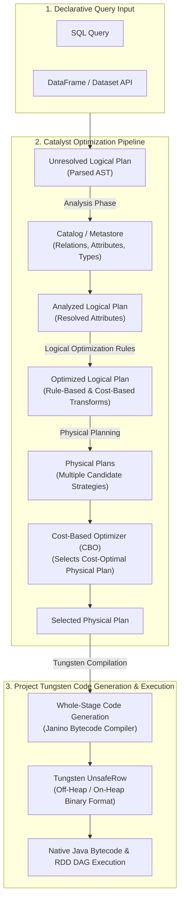
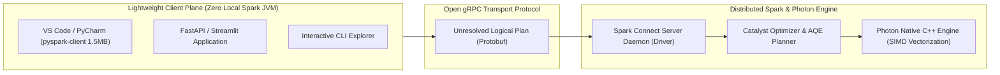

# 🏛️ Architecture 01: The Catalyst Optimizer & Project Tungsten Engine


> *Architectural Blueprint: [Catalyst Optimizer, AQE & Photon Engine](../docs/whiteboard_diagrams/README.md#spark-catalyst-photon-engine). View full multi-persona breakdown and engine mechanisms in the master index.*


> *Architectural Blueprint: [Photon Native C++ Engine vs Classic JVM](../docs/whiteboard_diagrams/README.md#photon-engine-vs-jvm). View full multi-persona breakdown and engine mechanisms in the master index.*

> **Focus**: Query Optimization Pipeline, Tree Transformations, Whole-Stage Code Generation, Memory Offloading, and Hardware-Conscious Computation in Apache Spark 3.5+ & 4.0.

---

## 1. Executive Summary & Core Philosophy

At the foundation of Apache Spark's performance lies a dual-engine architecture:
1. **The Catalyst Optimizer**: An extensible query optimizer based on functional programming constructs in Scala that transforms declarative DataFrame, Dataset, and SQL queries into an optimized physical execution plan of RDD transformations.
2. **Project Tungsten**: An execution engine engineered to bypass JVM overhead (garbage collection, object headers, boxing/unboxing) by managing memory explicitly off-heap (`sun.misc.Unsafe`), leveraging cache-aware binary formats (`UnsafeRow`), and generating fused bytecode via **Whole-Stage Code Generation (WSCG)**.



---

## 2. The 5 Phases of the Catalyst Optimizer

### Phase 1: Parsing & Unresolved Logical Plan
When you write `df.filter($"salary" > 50000).select("department", "salary")`, Spark's ANTLR parser generates an **Unresolved Logical Plan**. In this tree structure:
- Operations and expressions are known (`Filter`, `Project`).
- Relation identities and column types are unresolved (Spark does not yet verify whether `salary` exists or what its data type is).

### Phase 2: Analysis & Catalog Resolution
The Analyzer utilizes Spark's internal Catalog (or Databricks Unity Catalog / Hive Metastore):
- Resolves table and column names to specific schemas.
- Assigns unique expression IDs (`ExprId`) to prevent ambiguous references during self-joins.
- Injects explicit type coercion rules (e.g., converting `TINYINT` to `INT` for binary comparison).
- Emits the **Analyzed Logical Plan**.

### Phase 3: Logical Optimization (Rule-Based Transformations)
Catalyst executes batches of deterministic tree rewrite rules until reaching fixed-point convergence:
- **Predicate Pushdown (`PushDownPredicates`)**: Moves filter expressions down the DAG as close to the storage layer as possible. For Parquet and Delta Lake, filters translate into Parquet row-group statistics (`min`/`max` skipping) and Delta file pruning.
- **Projection Pruning (`ColumnPruning`)**: Drops unused columns from scan operators, minimizing I/O read bytes.
- **Constant Folding & Null Propagation**: Evaluates expressions like `1 + 1` to `2` and short-circuits null predicates (`x AND NULL` or `x + NULL`).
- **Boolean Simplification**: Normalizes predicates using De Morgan's Laws.

```text
Optimized Logical Plan Example:
==============================
Project [department#12, salary#13]
+- Filter (isnotnull(salary#13) AND (salary#13 > 50000))
   +- Relation[department#12, salary#13, age#14] parquet
```

### Phase 4: Physical Planning & Cost-Based Optimizer (CBO)
Catalyst converts the logical plan into one or more candidate **Physical Plans** using execution strategies:
- Maps logical joins (`Join`) to physical algorithms:
  - **Broadcast Hash Join (BHJ)**: If one table is under `spark.sql.autoBroadcastJoinThreshold` (default 10MB) or hinted.
  - **Shuffle Hash Join (SHJ)**: If tables cannot be broadcast, but build side can fit in executor memory.
  - **Sort-Merge Join (SMJ)**: The robust fallback for massive distributed datasets, requiring shuffle and sorting by join key.
  - **Broadcast Nested Loop Join (BNLJ)**: Fallback for non-equi joins (e.g., `t1.id < t2.id`).

When table statistics are available (`ANALYZE TABLE COMPUTE STATISTICS`), the **Cost-Based Optimizer (CBO)** calculates cardinality, filter selectivity, and shuffle costs to select the optimal physical plan.

### Phase 5: Code Generation (Tungsten Whole-Stage CodeGen)
Before execution, Spark leverages **Janino** (a lightweight Java compiler embedded in the driver and executors) to synthesize optimized Java bytecode dynamically for entire subtrees of the physical plan.

---

## 3. Project Tungsten Internals: Conquering Hardware Bottlenecks

Historically, distributed computing bottlenecks were CPU-bound by I/O and network bandwidth. With 100Gbps network cards, NVMe SSDs, and columnar storage (Parquet/Delta), the bottleneck shifted decisively to **CPU cycles and memory bandwidth**. Project Tungsten addresses three CPU bottlenecks:

### 1. Explicit Memory Management & `UnsafeRow`
- **JVM Garbage Collection Trap**: A simple 4-character string (`"ABCD"`) takes 48 bytes in standard JVM memory due to 12-byte object headers, 8-byte pointer references, character array wrappers, and 8-byte word alignment padding. Millions of small objects overwhelm GC cycles.
- **Tungsten Solution**: Allocates flat 8-byte word-aligned binary byte arrays on-heap or off-heap using `sun.misc.Unsafe`.
- **`UnsafeRow` Binary Layout**:
  - **Null BitSet**: 1 bit per column indicating whether the field is null.
  - **Fixed-Width Section**: Stores primitive types (8-byte integers, doubles, long timestamps) inline directly.
  - **Variable-Length Section**: Offsets and lengths pointing to strings, arrays, and structs stored at the end of the byte buffer.
  - Enables direct binary operations (sorting, hashing, byte-level comparisons) **without deserializing into JVM objects**.

```
Tungsten UnsafeRow Memory Layout (8-Byte Words):
[ Null BitSet (8B) ] [ Col 0: Long (8B) ] [ Col 1: Offset/Len (8B) ] [ Col 1 Var-Data: String Bytes ]
```

### 2. Cache-Aware Computation (L1 / L2 / L3 CPU Caching)
- Memory access latency from L1 cache is ~1 ns, whereas RAM latency is ~100 ns (a $100\times$ penalty).
- Tungsten designs sorting arrays (`UnsafeInMemorySorter`) that pack 8-byte sort key prefixes and 8-byte memory pointers into contiguous cache lines (64 bytes).
- During sorting, CPU caches compare prefixes sequentially in cache without dereferencing pointers to RAM, eliminating L1/L2 cache misses until final ties need resolution.

### 3. Whole-Stage Code Generation (WSCG)
Traditional execution models use the **Volcano Iterator Model**: each operator calls `.next()` on its child, resulting in:
- Virtual function dispatch overhead on every tuple.
- Poor compiler inlining and loop unrolling.
- Constant spilling of intermediate values into CPU registers or memory.

**Tungsten WSCG** collapses entire pipelines of operators (`Scan -> Filter -> Project -> Aggregate`) into a single flattened imperative Java `for` loop:
- Eliminates virtual method invocations entirely.
- Keeps intermediate variables exclusively in blazing-fast **CPU L1 registers**.
- Yields up to $10\times$ throughput improvements for analytical workloads.

```java
// Conceptual output of Tungsten Whole-Stage CodeGen for Filter + Project:
while (scan.hasNext()) {
    UnsafeRow row = scan.next();
    // Inlined filter predicate
    if (row.getLong(1) > 50000L) {
        // Direct register manipulation
        long departmentId = row.getLong(0);
        long salary = row.getLong(1);
        outputBuffer.write(departmentId, salary);
    }
}
```

---

## 4. Production Tuning & Diagnostic Knobs

| Spark Configuration | Default | Production Recommendation | Architectural Impact |
| :--- | :--- | :--- | :--- |
| `spark.sql.codegen.wholeStage` | `true` | `true` | Enables Janino Whole-Stage CodeGen. Only disable (`false`) when debugging stack traces. |
| `spark.sql.codegen.maxFields` | `100` | `200` (or `64` for wide tables) | Maximum fields before WSCG falls back to interpreted Volcano iterator to prevent Java 64KB bytecode limit crash. |
| `spark.sql.inMemoryColumnarStorage.compressed` | `true` | `true` | Uses compression for cached DataFrames in Tungsten columnar cache. |
| `spark.sql.cbo.enabled` | `false` | `true` | Enables Cost-Based Optimizer; requires `ANALYZE TABLE COMPUTE STATISTICS`. |
| `spark.sql.cbo.joinReorder.enabled` | `false` | `true` | Automatically reorders multi-table joins to minimize intermediate cardinality. |

---

## 5. Architectural Verification & Inspection

To inspect the physical execution and confirm Whole-Stage CodeGen in production:

```python
# Verify Catalyst physical plan and Tungsten WSCG markers (*)
df = spark.table("silver_orders").filter("amount > 1000").select("customer_id", "amount")

# Formatted plan output
df.explain(mode="formatted")

# Look for:
# == Physical Plan ==
# *Project [customer_id#1, amount#2]
# +- *Filter (isnotnull(amount#2) AND (amount#2 > 1000.0))
#    +- *ColumnarToRow
#       +- FileScan parquet [customer_id#1,amount#2] Batched: true, DataFilters: [isnotnull(amount#2)...]
# Asterisk (*) indicates Whole-Stage CodeGen
```

---

## 4. Spark Connect Decoupled Architecture & Photon Native Engine

Apache Spark 4.0 and Databricks Runtime 15.4+ introduce **Spark Connect**, decoupling client-side DataFrame API execution from the distributed Spark Driver and cluster JVM via an open gRPC protocol.



### Production Implementation: Remote DataFrame Execution via Spark Connect
```python
from pyspark.sql import SparkSession

# Initialize remote Spark Connect session via gRPC
spark = (SparkSession.builder
    .remote("sc://adb-cluster.internal:15002/;token=xxx")
    .appName("ServerlessDataPipeline")
    .getOrCreate())

# Compute runs remotely on Photon C++ engine
df = (spark.read.table("prod_catalog.gold.transactions")
    .filter("amount > 1000.00")
    .groupBy("customer_id")
    .sum("amount"))

# Client receives only final computed result partitions
df.show(5)
```

### Key Performance Invariants:
- **Zero Classpath Collisions**: Client environments do not require matching Java/Scala runtime versions, eliminating local JVM dependency hell.
- **Photon SIMD Vectorization**: Native C++ kernel processes data in register-sized columnar vectors, eliminating JVM bytecode interpretation.
- **Fail-Fast Protocol**: Protobuf serialization validates DataFrame schemas before dispatching jobs to the remote cluster.
