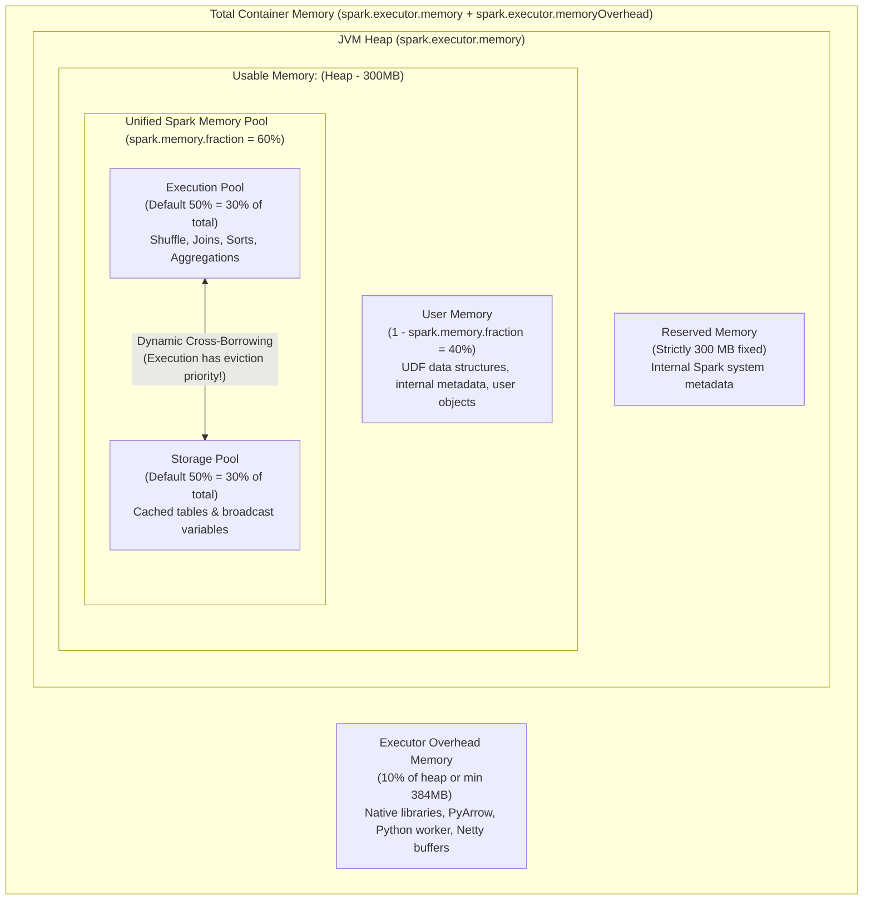
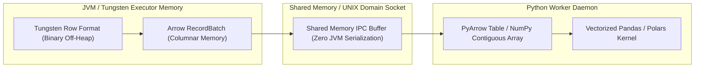

# 🏛️ Architecture 02: Spark Unified Memory Management & Spill Mechanics


> *Architectural Blueprint: [Apache Spark Memory Architecture & Shuffle Mechanics](../docs/whiteboard_diagrams/README.md#spark-shuffle-memory-execution). View full multi-persona breakdown and engine mechanisms in the master index.*


> *Architectural Blueprint: [Apache Spark Memory Management & Shuffle Spilling Mechanics](../docs/whiteboard_diagrams/README.md#spark-memory-management-spill). View full multi-persona breakdown and engine mechanisms in the master index.*


> **Focus**: JVM Heap Partitioning, Execution vs. Storage Dynamic Borrowing, Off-Heap Memory, Tungsten Shuffle Disk Spill, and Garbage Collection (G1GC) Tuning.

---

## 1. Executive Summary & Unified Memory Model

Starting with Apache Spark 1.6 and hardened through Spark 3.x and 4.0, the **Unified Memory Manager** dynamically balances memory between two major consumers:
1. **Execution Memory**: Required for shuffles, joins, aggregations, window operations, and sorting.
2. **Storage Memory**: Used for caching broadcast variables, cached DataFrames (`.cache()` / `.persist()`), and internal metadata.

Instead of static, rigid memory boundaries that cause premature OOMs, the Unified Memory Manager implements **Dynamic Cross-Borrowing**: execution can borrow unallocated storage space, and storage can borrow unallocated execution space.



---

## 2. Memory Breakdown & Mathematical Formulation

For an executor configured with `--executor-memory 16G` and default settings:

$$\text{Reserved Memory} = 300 \text{ MB (hardcoded)}$$

$$\text{Usable Heap} = 16 \text{ GB} - 300 \text{ MB} = 16,084 \text{ MB}$$

$$\text{Unified Spark Memory} = \text{Usable Heap} \times \text{spark.memory.fraction} (0.60) \approx 9,650 \text{ MB}$$

$$\text{User Memory} = \text{Usable Heap} \times (1 - 0.60) = 6,434 \text{ MB}$$

$$\text{Storage Immunity Boundary} = \text{Unified Spark Memory} \times \text{spark.memory.storageFraction} (0.50) \approx 4,825 \text{ MB}$$

### Dynamic Cross-Borrowing Rules & Eviction Priority:
1. **Execution Borrows from Storage**: If storage space is empty or underutilized, execution expands dynamically and claims up to 100% of the unified pool.
2. **Storage Borrows from Execution**: If execution space is unallocated, cached partitions can borrow execution memory.
3. **The Eviction Asymmetry Rule (Critical)**:
   - When execution memory demands surge, **Execution can forcibly evict cached Storage blocks to disk** or drop them from memory.
   - Conversely, **Storage CANNOT evict Execution blocks**. If execution is actively using memory for an active sort or hash join, storage requests will simply fail to cache in memory and fall back to disk or deserialization.

---

## 3. Tungsten Memory Spilling: Spill (Memory) vs. Spill (Disk)

When a wide transformation (such as a large `groupByKey`, window function, or sort-merge join) exceeds the available Execution Memory allocated to a task, Spark does not crash immediately. Instead, it triggers **Tungsten Memory Spill**:

```mermaid
sequenceDiagram
    participant Task as Spark Executor Task
    participant Sorter as Tungsten Append-Only Buffer
    participant Unified as Unified Memory Pool
    participant Disk as Local Scratch NVMe SSD

    Task->>Sorter: Inserts UnsafeRow records
    Sorter->>Unified: Requests additional memory page (8MB)
    Unified-->>Sorter: Page Granted
    Note over Sorter: Memory fills; Unified Pool reports OUT_OF_MEMORY
    Sorter->>Disk: Spills sorted chunk to disk (compressed block)
    Note over Disk: Writes Spill (Disk) = 1.2 GB
    Note over Sorter: Spill (Memory) was 4.8 GB (uncompressed)
    Sorter->>Sorter: Re-initializes memory buffer for next chunk
```

### The Spill Disparity: Why is Spill (Memory) $3\times$ to $5\times$ Larger than Spill (Disk)?
In the Spark Web UI Stage Details tab, you frequently encounter:
- `Spill (Memory): 4.8 GiB`
- `Spill (Disk): 1.1 GiB`

**Why?**
1. **Spill (Memory)**: Represents the size of the uncompressed data in memory, deserialized as structured internal `UnsafeRow` arrays, plus hash tables and memory alignment padding.
2. **Spill (Disk)**: Spark serializes and compresses the data using LZ4 or Zstandard before writing to the local executor NVMe scratch disk (`spark.local.dir`).
3. **Performance Impact**: Spilling incurs heavy CPU penalties for compression/decompression, serialized disk I/O, and subsequent disk reads during multi-way merge sort. A query with >10GB of spill will typically experience a $5\times$ to $10\times$ wall-clock slowdown.

---

## 4. Off-Heap Memory (`spark.memory.offHeap.enabled`)

For intensive analytical workloads, Spark allows allocating Execution and Storage memory directly from OS off-heap memory, bypassing the JVM garbage collector entirely:

```properties
spark.memory.offHeap.enabled=true
spark.memory.offHeap.size=8g
```

### Advantages of Off-Heap Memory:
- **Zero JVM GC Overhead**: Memory allocated via `sun.misc.Unsafe` or native C++ allocators is invisible to JVM garbage collectors (G1GC / ParallelGC). Eliminates GC pauses during long shuffles.
- **Direct Netty Network Transfer**: Data in off-heap buffers can be transferred across the network via Zero-Copy Netty channels without bouncing through JVM heap buffers.
- **Predictable Footprint**: Reduces full GC stop-the-world pauses from seconds down to milliseconds.

---

## 5. Garbage Collection Architecture & G1GC Tuning

In high-concurrency Spark workloads with heavy object generation (e.g., custom Python UDFs or complex Scala objects), improper GC leads to executor heartbeats timing out (`ExecutorLostFailure: Heartbeat to driver timed out`).

### Standard Production GC Configuration:
```properties
spark.executor.extraJavaOptions=-XX:+UseG1GC -XX:InitiatingHeapOccupancyPercent=35 -XX:G1ReservePercent=15 -XX:G1HeapRegionSize=32m -XX:MaxGCPauseMillis=200
```

| JVM Parameter | Purpose & Architectural Justification |
| :--- | :--- |
| `-XX:+UseG1GC` | Garbage-First Collector: splits heap into equal regions (1MB–32MB) and collects regions with the highest garbage first. |
| `-XX:InitiatingHeapOccupancyPercent=35` | Triggers background concurrent marking when total heap reaches 35% occupancy, preventing sudden stop-the-world Full GCs. |
| `-XX:G1ReservePercent=15` | Reserves 15% of heap as emergency buffer to absorb allocation bursts during shuffle merges. |
| `-XX:G1HeapRegionSize=32m` | Minimizes "humongous allocations" (objects larger than 50% of region size) by sizing regions to 32MB. |
| `-XX:MaxGCPauseMillis=200` | Target soft pause latency of 200 milliseconds per collection cycle. |

---

## 6. Sizing Formula for Production Clusters

To calculate production executor memory safely:

```python
# Production Node Sizing (e.g. AWS r5.4xlarge: 16 vCPU, 128 GB RAM)
total_node_ram = 128  # GB
total_node_cores = 16

# Reserve 1 core and 4 GB for OS / Node Daemon / K8s kubelet
usable_cores = total_node_cores - 1   # 15 cores
usable_ram = total_node_ram - 4       # 124 GB

# Optimal sizing: 4 to 5 cores per executor
cores_per_executor = 5
executors_per_node = usable_cores // cores_per_executor  # 3 executors per node

# Total RAM per executor allocation
ram_per_executor = usable_ram // executors_per_node      # 41 GB per executor

# Split between heap and memoryOverhead (10% rule)
memory_overhead = max(0.10 * ram_per_executor, 3)        # ~4.1 GB -> 4 GB
executor_memory = ram_per_executor - memory_overhead     # ~37 GB

print(f"--executor-cores {cores_per_executor}")
print(f"--executor-memory {int(executor_memory)}g")
print(f"--conf spark.executor.memoryOverhead={int(memory_overhead)}g")
```

---

## 4. Apache Arrow Vectorized IPC & Zero-Copy Off-Heap Processing

To eliminate Python worker serialization bottlenecks, modern PySpark leverages **Apache Arrow** for zero-copy inter-process communication (IPC) between the JVM executor and Python daemon processes.



### Production Implementation: High-Throughput Vectorized Arrow Processing
```python
from pyspark.sql.functions import pandas_udf
import pandas as pd

# Define vectorized scalar UDF with Apache Arrow execution
@pandas_udf("double")
def calculate_risk_index(score: pd.Series, exposure: pd.Series) -> pd.Series:
    # Operations execute directly on contiguous NumPy C-arrays
    return (score * 0.65) + (exposure * 0.35)

# Leverage Arrow vectorized UDF inside DataFrame transformation
processed_df = (spark.read.table("prod_catalog.gold.credit_assessments")
    .withColumn("risk_score", calculate_risk_index("base_score", "credit_exposure")))
```

### Key Memory Invariants:
- **Zero-Copy Deserialization**: Arrow RecordBatches eliminate Python pickle serialization overhead, accelerating Python UDFs up to $100	imes$.
- **Off-Heap Safety**: Vectorized memory allocations reside in off-heap buffers outside JVM garbage collection sweeps.
