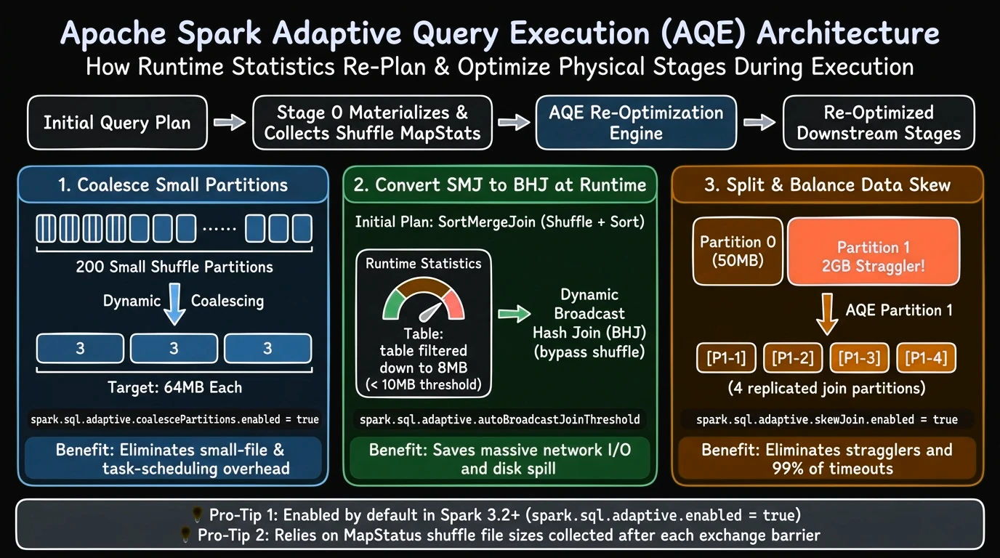
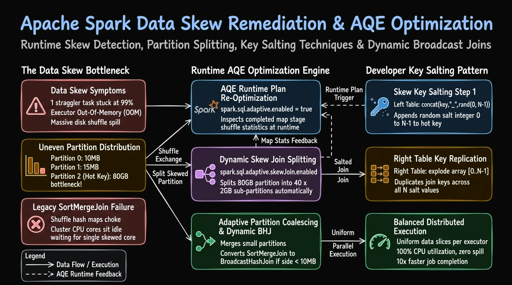
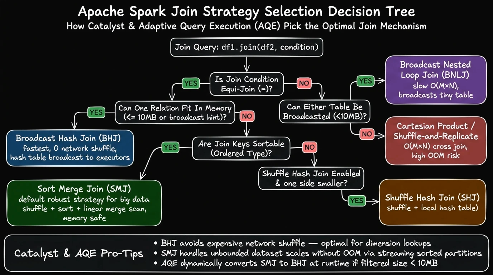
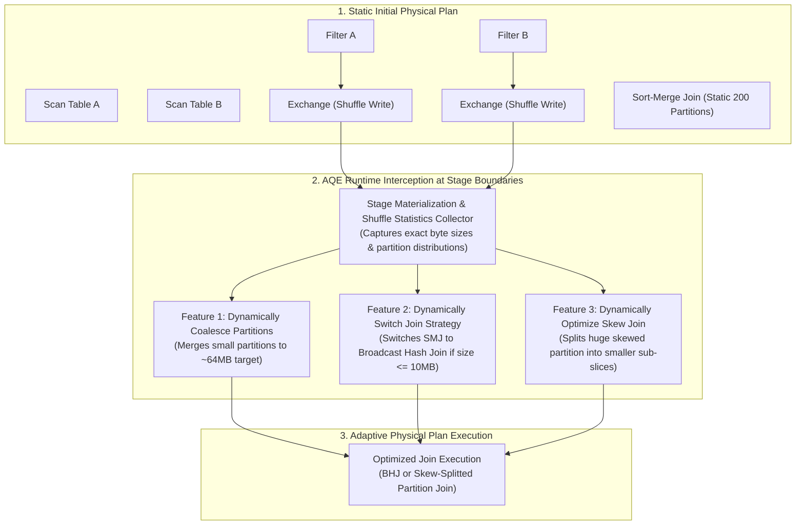
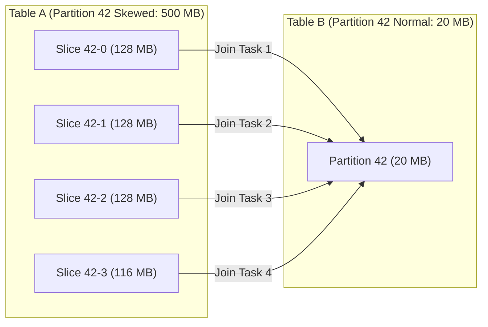

# 🏛️ Architecture 03: Adaptive Query Execution (AQE) Deep Dive



> *Architectural Blueprint: [Apache Spark Adaptive Query Execution (AQE) Architecture](../docs/whiteboard_diagrams/README.md#spark-aqe-dynamic-optimization). View full multi-persona breakdown and engine mechanisms in the master index.*



> *Architectural Blueprint: [Apache Spark Data Skew Remediation & AQE Optimization](../docs/whiteboard_diagrams/README.md#spark-data-skew-aqe-optimization). View full multi-persona breakdown and engine mechanisms in the master index.*



> *Architectural Blueprint: [Apache Spark Join Strategy Selection Decision Tree](../docs/whiteboard_diagrams/README.md#spark-join-decision-tree). View full multi-persona breakdown and engine mechanisms in the master index.*


> **Focus**: Runtime Re-optimization, Dynamic Partition Coalescing, Join Strategy Switching (Sort-Merge to Broadcast), Skew Join Splitting, and Stage Materialization.

---

## 1. Executive Summary & The Static Planning Dilemma

In traditional database systems and early Spark versions, query execution plans were **static**:
- The Catalyst optimizer created a physical execution plan based entirely on compile-time estimates or stale metadata statistics.
- If upstream data was skewed, filter selectivity was miscalculated, or complex UDFs altered cardinality, the query suffered from terrible execution choices:
  1. Default static shuffle partitions (`spark.sql.shuffle.partitions = 200`) caused either thousands of tiny 5KB files or massive 5GB partitions that spilled to disk.
  2. Tables that shrank after filtering to 2MB were still joined using an expensive, shuffle-heavy **Sort-Merge Join (SMJ)** instead of a lightning-fast **Broadcast Hash Join (BHJ)**.
  3. Skewed partitions caused single tasks to run for 2 hours while all other tasks completed in 10 seconds.

**Adaptive Query Execution (AQE)**, introduced in Spark 3.0 and enabled by default in Spark 3.2+, re-optimizes the physical execution plan **at runtime based on actual stage boundary statistics**.



---

## 2. The 3 Core Pillars of AQE

### Pillar 1: Dynamically Coalescing Shuffle Partitions (`spark.sql.adaptive.coalescePartitions.enabled`)
- **Problem**: When data is shuffled, setting `spark.sql.shuffle.partitions = 200` means exactly 200 reducer tasks are scheduled. If the total shuffled data is only 10MB, each task processes a minuscule 50KB, causing massive task scheduling overhead and a flood of small files. Conversely, for a 500GB shuffle, 200 partitions mean 2.5GB per partition, causing fatal disk spills and OOMs.
- **AQE Solution**:
  1. Developers set an intentionally high initial partition count (e.g., `spark.sql.adaptive.coalescePartitions.initialPartitionNum = 1000` or `2000`).
  2. When map stages finish writing shuffle files, Spark inspects the exact byte size of every shuffle partition.
  3. Contiguous small partitions are automatically coalesced into larger target partitions sized around `spark.sql.adaptive.advisoryPartitionSizeInBytes` (default 64MB).
  4. Reducer tasks shrink dynamically from 2,000 down to 18 tasks without manual intervention!

```text
Before AQE:
[Part 0: 2MB] [Part 1: 5MB] [Part 2: 1MB] [Part 3: 4MB] -> 4 separate Reducer tasks scheduled

After AQE Coalescing (Target ~64MB):
[Merged Part (0+1+2+3): 12MB]                           -> 1 single Reducer task scheduled
```

---

### Pillar 2: Dynamically Converting Sort-Merge Join to Broadcast Join (`spark.sql.adaptive.autoBroadcastJoinThreshold`)
- **Problem**: At compile time, Table A is 100GB. Spark correctly plans a distributed Sort-Merge Join. However, the user applies a high-selectivity filter: `WHERE transaction_date = '2026-11-18' AND region = 'APAC'`.
- After filtering, the data reduces from 100GB to just **4.2 MB**.
- In static Spark, the query still performs a full distributed shuffle on both tables, sorting millions of rows.
- **AQE Solution**:
  - Once the shuffle write of the filtered side finishes, AQE observes that the materialized size ($4.2 \text{ MB}$) is strictly less than `spark.sql.adaptive.autoBroadcastJoinThreshold` ($10 \text{ MB}$ or custom threshold).
  - AQE dynamically rewires the physical plan: it cancels the planned shuffle read and Sort-Merge Join, downloads the 4.2MB dataset to the driver, broadcasts it to all executors, and completes a **Broadcast Hash Join (BHJ)** with zero network shuffle on the other relation!

---

### Pillar 3: Dynamically Optimizing Skew Joins (`spark.sql.adaptive.skewJoin.enabled`)
- **Problem: The Data Skew Nightmare**:
  - A join key (e.g., `store_id = NULL` or `merchant_id = 'AMAZON'`) contains 100 million rows, while all other keys contain 500 rows.
  - In a standard Sort-Merge Join, all 100 million rows hash to the **exact same partition (e.g., Partition 42)**.
  - 199 tasks finish in 5 seconds. Task 42 runs on Executor 7 for 2 hours, spills 30GB to disk, exhausts heap memory, and triggers `ExecutorLostFailure`.
- **AQE Solution: Automatic Partition Splitting**:
  1. A partition is classified as skewed if both conditions are met:
     - `partition_size > spark.sql.adaptive.skewJoin.skewedPartitionFactor (5) * median_partition_size`
     - `partition_size > spark.sql.adaptive.skewJoin.skewedPartitionThresholdInBytes (256 MB)`
  2. Instead of routing the entire skewed partition to one task, AQE splits the skewed partition into $N$ smaller slices (e.g., 64MB each).
  3. AQE matches each slice against the corresponding partition of the other side by duplicating (reading) the other side's partition, allowing multiple executors to process the join in parallel!



---

## 3. Production Configuration Matrix

| Spark Configuration Property | Default | Production Value | Architectural Rationale |
| :--- | :--- | :--- | :--- |
| `spark.sql.adaptive.enabled` | `true` | `true` | Master toggle for AQE runtime query plan adaptation. |
| `spark.sql.adaptive.coalescePartitions.enabled` | `true` | `true` | Automatically merges small shuffle partitions. |
| `spark.sql.adaptive.coalescePartitions.initialPartitionNum` | `200` | `1000` to `2400` | Start with a high partition ceiling for large clusters so AQE has room to coalesce down. |
| `spark.sql.adaptive.advisoryPartitionSizeInBytes` | `64m` | `128m` (or `64m`) | Target uncompressed size of coalesced shuffle partitions. 128MB is optimal for NVMe SSDs. |
| `spark.sql.adaptive.autoBroadcastJoinThreshold` | `-1` (uses static) | `64m` or `128m` | Maximum runtime materialized size to switch join to Broadcast Hash Join. |
| `spark.sql.adaptive.skewJoin.enabled` | `true` | `true` | Enables automatic runtime detection and splitting of skewed join partitions. |
| `spark.sql.adaptive.skewJoin.skewedPartitionFactor` | `5` | `3` | Lowering to 3 triggers skew handling earlier for subtle distribution imbalances. |
| `spark.sql.adaptive.skewJoin.skewedPartitionThresholdInBytes` | `256m` | `128m` | Minimum absolute byte size before a partition is flagged as skewed. |

---

## 4. When AQE Cannot Save You (The Limits of AQE)

While AQE is transformative, senior distributed systems engineers must recognize when AQE cannot prevent performance bottlenecks:
1. **Cartesian Product / Non-Equi Joins**: AQE skew join splitting only applies to equi-joins (`A.key = B.key`). Joins with inequality (`A.start < B.end`) cannot be split and fall back to Broadcast Nested Loop Join.
2. **Extreme Data Skew on Single Duplicate Keys**: If a single distinct key has 200 million rows, AQE can split Sort-Merge Join, but aggregations (`groupBy("skewed_key").count()`) cannot be split without manual two-phase key salting!
3. **Driver Memory Pressure on Broadcast Conversion**: If `autoBroadcastJoinThreshold` is set too high (e.g. 2GB), the driver will attempt to collect and serialize the 2GB table to broadcast to 500 executors, causing an immediate **Driver OutOfMemoryError**.
