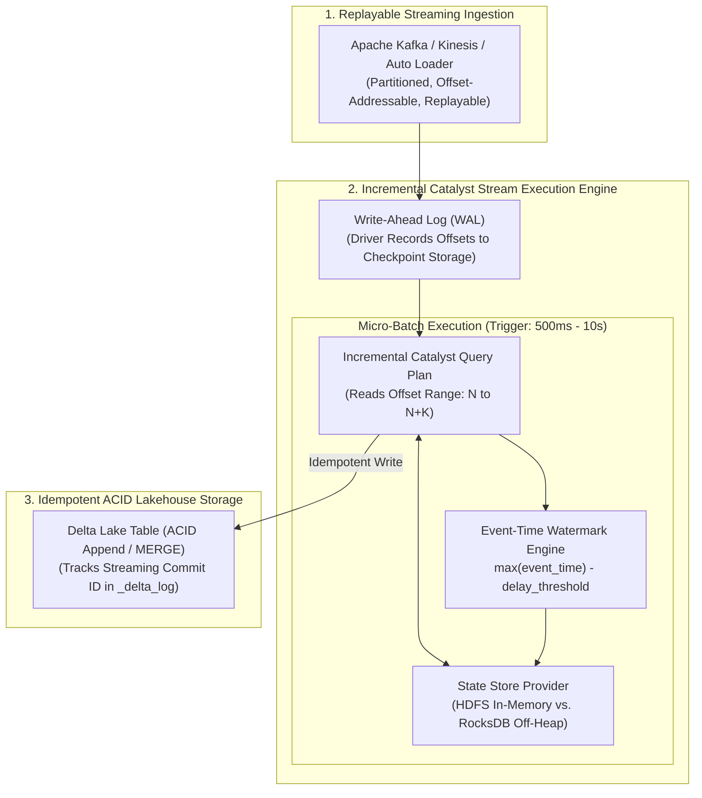
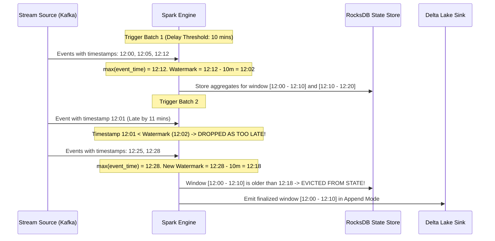
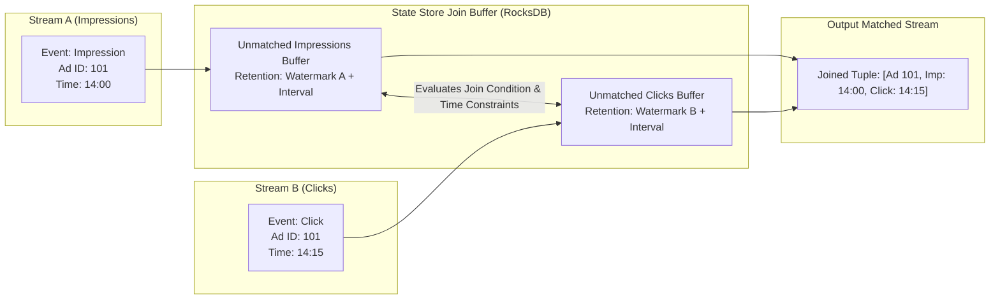
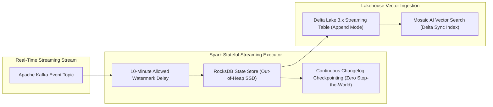

# 🏛️ Architecture 04: Structured Streaming & Stateful Stream Processing


> *Architectural Blueprint: [Spark Structured Streaming State Store & Watermarking Mechanics](../docs/whiteboard_diagrams/README.md#spark-streaming-state-store). View full multi-persona breakdown and engine mechanisms in the master index.*


> *Architectural Blueprint: [Real-Time Event Streaming & Kafka Architecture](../docs/whiteboard_diagrams/README.md#kafka-event-streaming-pipeline). View full multi-persona breakdown and engine mechanisms in the master index.*

> **Focus**: Micro-Batch vs. Continuous Processing, Event-Time Watermarking, Stateful Aggregations & Stream-Stream Joins, RocksDB State Store, Checkpointing, and Exactly-Once Guarantees.

---

## 1. Executive Summary & Structured Streaming Philosophy

**Apache Spark Structured Streaming** extends the Catalyst optimizer and Tungsten execution engine to unbounded data streams:
- Treats a live data stream as an **unbounded, continuously appending table**.
- Developers write standard declarative DataFrame / SQL queries. The streaming engine executes the query incrementally using micro-batches (default) or sub-millisecond continuous processing.
- Delivers end-to-end **Exactly-Once Fault-Tolerance** via deterministic replayable sources (Kafka, AWS Kinesis, Delta Lake Auto Loader), idempotent sinks (Delta Lake, ACID storage), and WAL (Write-Ahead Log) checkpointing.



---

## 2. Event-Time Processing & The Watermark Mechanism

In distributed systems, **Event Time** (when the event occurred at the sensor/client) differs significantly from **Processing Time** (when the record arrives at the Spark cluster) due to network jitter, mobile offline mode, and upstream partition backlog.

### How Watermarking Operates:
To prevent intermediate state memory from growing infinitely in stateful aggregations (e.g., `groupBy(window($"timestamp", "10 minutes")).count()`), Spark tracks an **Event-Time Watermark**:

$$\text{Watermark} = \max(\text{Event Time seen so far}) - \text{Delay Threshold}$$



---

## 3. State Store Internals: HDFS In-Memory vs. RocksDB State Store

In stateful streaming (session windows, stream-stream joins, deduplication, running metrics), Spark maintains state across micro-batches:

### 1. Default HDFS (Java Heap) State Store Provider
- Stores state records as standard JVM objects in the executor heap (`HDFSBackedStateStoreProvider`).
- **Critical Failure Mode**:
  - As state expands to millions of keys, the JVM heap experiences violent garbage collection thrashing.
  - Executors crash with `java.lang.OutOfMemoryError: Java heap space` or GC pause heartbeat timeouts.
  - State size is strictly limited by executor RAM (typically < 10–20 GB state per cluster).

### 2. Enterprise RocksDB State Store Provider
- Available in Spark 3.2+ and Databricks Runtime:
- Stores state off-heap in a high-performance, embedded C++ key-value store (**RocksDB**) written to local NVMe SSDs.
- Only a configurable LRU memory cache is held in RAM; the rest spills seamlessly to SSD without JVM garbage collection pressure!
- Backed by asynchronous background snapshot uploads to cloud storage checkpoint directories.
- Can easily handle **terabytes of state** (hundreds of millions of active keys) with flat, predictable sub-millisecond latencies.

### Configuration to Enable RocksDB in PySpark:
```python
spark.conf.set(
    "spark.sql.streaming.stateStore.providerClass",
    "org.apache.spark.sql.execution.streaming.state.RocksDBStateStoreProvider"
)
spark.conf.set("spark.sql.streaming.stateStore.rocksdb.compactOnCommit", "true")
```

---

## 4. End-to-End Exactly-Once Guarantees & Checkpointing

True Exactly-Once semantics require coordination across the entire streaming pipeline:

| Component | Responsibility for Exactly-Once |
| :--- | :--- |
| **Source** (Kafka, Delta) | Must be offset-addressable and replayable. If an executor fails at offset 450,000, Spark re-requests data starting exactly from offset 450,000. |
| **Engine** (Structured Streaming) | Uses **Write-Ahead Logging (WAL)**: records the offset range for micro-batch $N$ to durable storage (`checkpoint/offsets/`) *before* executing the transformations. |
| **State Store** (RocksDB) | State mutations are versioned atomically by micro-batch ID (`checkpoint/state/0/0/12.delta`). Replaying batch 12 rolls back state to version 11 before re-executing. |
| **Sink** (Delta Lake) | Must be **idempotent**. Delta Lake writes streaming commits transactionally using the micro-batch ID as the atomic transaction identifier in `_delta_log/00000000000000000012.json`. If batch 12 retries, Delta recognizes the duplicate batch ID and discards re-writes! |

---

## 5. Stream-Stream Joins Architecture & Watermark Symmetric Rules

Joining two live streams (e.g., matching ad impressions with ad clicks) requires buffering unmatched events on both sides:



### The Invariable Rules of Stream-Stream Joins:
1. **Both streams must define watermarks**:
   ```python
   impressions = impressions.withWatermark("impressionTime", "2 hours")
   clicks = clicks.withWatermark("clickTime", "3 hours")
   ```
2. **The join condition must specify an event-time range constraint**:
   ```python
   # Guarantees state store eviction once the 1-hour click window expires!
   joined = impressions.join(
       clicks,
       expr("""
           impressionId = clickId AND
           clickTime >= impressionTime AND
           clickTime <= impressionTime + interval 1 hour
       """),
       joinType="inner" # or leftOuter
   )
   ```
   Without this time window constraint, Spark cannot determine when an impression will never receive a click, causing the state store to **leak memory indefinitely until executor OOM crash**!

---

## 4. Stateful Streaming with RocksDB Changelog Checkpointing & Vector Search

For high-state streaming queries ($> 100	ext{ GB}$ of window state), modern Structured Streaming employs the **RocksDB state store provider with changelog checkpointing** and real-time vector embedding generation.



### Production Implementation: RocksDB Changelog Checkpointing
```python
# Configure RocksDB state store with changelog checkpointing
(spark.readStream
    .format("kafka")
    .option("kafka.bootstrap.servers", "kafka:9092")
    .option("subscribe", "customer-telemetry")
    .load()
    .writeStream
    .format("delta")
    .outputMode("append")
    .option("checkpointLocation", "abfss://checkpoints@datalake.dfs.core.windows.net/streaming_rocksdb")
    .option("spark.sql.streaming.stateStore.providerClass", "org.apache.spark.sql.execution.streaming.state.RocksDBStateStoreProvider")
    .option("spark.sql.streaming.stateStore.rocksdb.changelogCheckpointing.enabled", "true")
    .toTable("prod_catalog.silver.streaming_events"))
```

### Key Streaming Invariants:
- **Changelog Checkpointing**: Emits small incremental changelog deltas to cloud storage, eliminating micro-batch freeze times during SST file snapshots.
- **State Store Eviction**: State TTL policies automatically purge inactive keys after the watermark window elapses, preventing infinite disk consumption.
