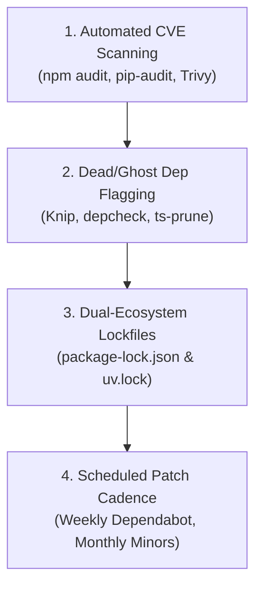
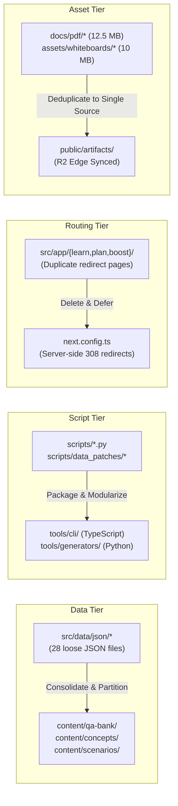
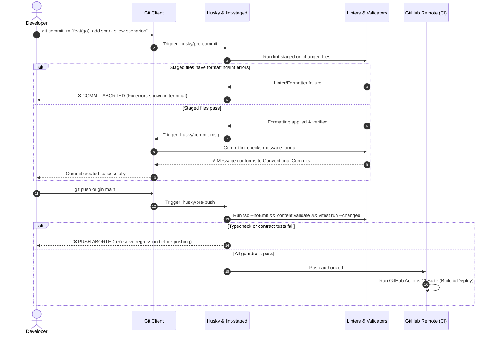
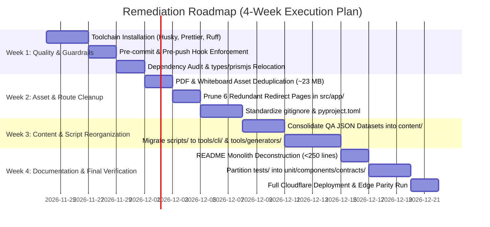

# 🏛️ Enterprise Repository Audit & Structural Remediation Plan
**Target System**: `lakehouse-architect` (`moderndataengineer.uk`)  
**Evaluation Scope**: Structural Fragmentation, Visual Presentation, Code Integrity, and Technical Debt  
**Target Architecture**: Cloudflare OpenNext / Workers + Next.js 16 App Router + R2 Sharded Asset Tier  
**Audit Date**: November 2026  
**Status**: APPROVED FOR EXECUTION  

---

## Executive Summary

An industry-grade forensic audit of the `lakehouse-architect` repository was conducted to assess its readiness to transition from a **functional prototype** with rapid feature expansion into an **enterprise-grade, professional, and maintainable production asset**. 

While the platform possesses remarkable domain depth (11,361+ validated curriculum assets, 62 passed Vitest test suites across 522 test cases, and a sub-11s test runner execution), it suffers from severe **structural fragmentation**, **uncontrolled script sprawl**, **duplicate metadata and binary assets**, and **documentation information overload** (a 297 KB `README.md`).

This document outlines a structured, 4-phase remediation blueprint designed to eliminate technical debt, establish strict quality guardrails, standardize project taxonomy, and deliver a best-in-class developer and user experience.

---

# PHASE 1: DISCOVERY & AUDIT (Initial Code/Content Scan)

### 1. Structure Audit: File Tree Analysis & Areas of Ambiguity

A comprehensive scan of the file tree (`ls -R`, `find .`, and disk utilization analysis) reveals major structural discrepancies and anti-patterns:

```
Current Structure (High-Level Overview):
.
├── .github/workflows/          # CI and Cloudflare deployment pipelines
├── assets/                     # 10 MB: 55 whiteboard images + SVGs (52 duplicate images)
├── docs/                       # 14 MB: Mixed Markdown specs, audits, and 12.5 MB duplicate PDFs
├── public/                     # 669 MB: Diagrams, duplicate PDFs, and 610 MB local artifacts
├── scripts/                    # 83 loose scripts (77 Python, 6 TS) + 4 disorganized subdirs
│   ├── archive/                # 4 scripts
│   ├── data_patches/           # 39 historical one-off migration scripts
│   ├── handbook_expansion/     # 5 scripts
│   └── spark_100/              # 11 scripts
├── src/                        # 41 MB: Next.js App Router, components, data, and tests
│   ├── __tests__/              # 63 test files in a single flat directory
│   ├── app/                    # 29 routes, including 6 redundant redirect-only page files
│   ├── components/             # 15 subdirectories of UI and domain components
│   ├── data/                   # 18 TS/JSON data modules + json/ directory (28 files, >30 MB)
│   └── workers/                # Browser Web Workers (compute.worker.ts, search.worker.ts)
├── topics/                     # Ambiguous single-file directory containing ONLY README.md (267 KB)
├── work/                       # Ambiguous single-file directory containing ONLY sync manifest
└── workers/                    # Cloudflare Edge Worker workspace (customer-dispatcher)
```

#### Major Structural Deviations & Ambiguities Identified:

1. **Uncontrolled Script & Patch Sprawl in `scripts/`**:
   - `scripts/` contains **83 loose scripts** directly at its root, plus **59 sub-directory scripts** across `data_patches/` (39 files), `spark_100/` (11 files), `handbook_expansion/` (5 files), and `archive/` (4 files).
   - Scripts are named after individuals or arbitrary one-off batches (e.g., `append_ansh_concepts.py`, `append_ansh_architecture.py`, `generate_airflow_1_to_75.py`, `patch_dbt_36_to_75.py`, `fix_semantic_duplicates_32.py`).
   - There is no unified CLI entry point, no modular package structure, no shared utility module, and zero automated tests for data transformation scripts.

2. **Data Tier Redundancy & Dynamic In-Memory Deduplication**:
   - `src/data/json/` contains **28 static JSON files totaling over 30 MB** tracked directly in git history (including `data_architecture.json` at 11.7 MB, `search_catalog.json` at 6.1 MB, and `questions.json` at 5.8 MB).
   - Severe dataset overlap: `questions.json` (5.8 MB), `questions_unified_cleaned.json` (4.3 MB), and `data_de.json` (2.8 MB) represent overlapping iterations of the same QA bank. In `scripts/shard-and-index.ts` (lines 50–65), all three candidate files are read into memory and dynamically deduplicated using an in-memory `seen` set:
     ```typescript
     const candidateFiles = ['questions_unified_cleaned.json', 'questions.json', 'data_de.json'];
     for (const file of candidateFiles) { /* deduplicate via seen Set */ }
     ```
   - Phantom directory references: `scripts/shard-and-index.ts` and `scripts/validate-content.ts` reference `CONTENT_DIR = path.join(process.cwd(), 'content')` with subpaths `qa-bank`, `scenarios`, and `concepts`. However, **the `content/` directory does not exist** in the repository, forcing all pipelines to fall back to hardcoded JSON paths.
   - Arbitrary file sharding: Five files (`extreme_architect_questions_block1.json` through `block5.json`) represent fragmented batches rather than a structured database or partitioned dataset.

3. **Binary Asset Duplication & Disk Bloat**:
   - **PDF Duplication**: 11 production vector A4 PDFs (12.5 MB total) exist in `docs/pdf/` AND are duplicated byte-for-byte in `public/cheatsheets/pdf/` (verified via SHA-1: `517cf00cf98e55edef9292be52e7446898977656`).
   - **Diagram Duplication**: 52 `.webp` diagram files in `assets/whiteboards/` (10 MB) overlap identically with files in `public/diagrams/` (8.3 MB).
   - In total, ~23 MB of redundant binary assets are tracked in Git, inflating repository size and clone times.

4. **Routing Tier Redundancy (Shadowed Redirects)**:
   - Several routes exist as standalone page components in `src/app/` solely to issue a client-side redirect (e.g., `src/app/learn/page.tsx` $\to$ `/guided-learning`, `src/app/plan/page.tsx` $\to$ `/guided-learning?tab=curricula`, `src/app/boost/page.tsx` $\to$ `/qa-prep`, `src/app/goal/page.tsx` $\to$ `/studio`, `src/app/browser/page.tsx` $\to$ `/search-topics`, `src/app/blueprints/page.tsx` $\to$ `/whiteboards`).
   - These client-side redirect pages directly duplicate server-side permanent redirects already configured in `next.config.ts`, introducing dead code and build overhead.

5. **Worker Terminology Clash**:
   - Root `package.json` defines `"workspaces": ["workers/*"]` containing Cloudflare Workers (`workers/customer-dispatcher`), while `src/workers/` contains browser Web Workers (`compute.worker.ts`, `search.worker.ts`). This creates ambiguity between Cloudflare Edge Workers and client-side browser threads.

6. **Orphaned Single-File Directories**:
   - `topics/` contains only `README.md` (267 KB), which duplicates the curriculum tables in root `README.md`.
   - `work/` contains only `cross-repository-sync-manifest.md`.

---

### 2. Language & Technology Audit

| Tier | Technology / Library | Version / Standard | Role & Implementation |
|:---|:---|:---|:---|
| **Core Framework** | Next.js | `^16.4.6` | App Router, Server Components, OpenNext build target |
| **UI Runtime** | React & React DOM | `19.2.8` | Component model, concurrent rendering, Server Actions |
| **Runtime Target** | Node.js / workerd | Node `22` LTS | Configured in `.nvmrc`, `.node-version`, and Cloudflare Edge |
| **Edge Adapter** | `@opennextjs/cloudflare` | `^1.20.13` | Compiles Next.js 16 to Cloudflare Workers runtime |
| **Edge Infrastructure** | Cloudflare Wrangler | `^4.152.0` | CLI, R2 bucket sync, multi-worker orchestrator |
| **Styling & Design** | Tailwind CSS & PostCSS | `^4.0.0` | Modern utility classes, CSS theme tokens, dark/e-ink modes |
| **Animation & Icons** | Framer Motion, Lucide | `^13.1.1`, `^1.37.0` | 60 FPS client transitions, high-contrast accessible icons |
| **State & Virtualization** | Zustand, TanStack Virtual | `^5.0.16`, `^3.14.22` | Client state management, 10,000+ DOM row virtualization |
| **Client Search & Cache**| MiniSearch, idb | `^7.2.0`, `^8.0.4` | Google-grade client BM25 search, persistent IndexedDB |
| **Auth & Rate Limiting** | Clerk, Upstash Redis | `^7.9.20`, `^2.2.0` | Edge authentication, sliding-window IP rate limiting |
| **Validation & Schema** | Zod | `^4.6.7` | Content contract enforcement and runtime schema parsing |
| **Test Engine** | Vitest, Happy DOM | `^5.0.5`, `^21.0.4` | 62 test suites, 522 unit and integration tests |
| **Python Ecosystem** | Python 3.10+ (Unmanaged) | None (No lockfile) | 135 scripts importing ReportLab, PIL, Matplotlib, PySpark, Polars, DuckDB |
| **Config Formats** | JSON, JSONC, YAML, MJS/TS | Strict | `package.json`, `wrangler.jsonc`, `ci.yml`, `next.config.ts` |

---

### 3. Dependency Health Check (Process Definition)

To prevent supply-chain vulnerabilities, eliminate dependency bloat, and maintain operational stability, the following 4-step governance process must be instituted:



#### Step 1: Automated Vulnerability & CVE Scanning (SCA)
- **Node.js Ecosystem**: Enforce `npm audit --audit-level=high` in CI pipelines. Integrate GitHub Dependabot for real-time CVE alerts. Scan edge worker bundles and container layers using Trivy.
- **Python Ecosystem**: Eliminate unmanaged Python environments. Introduce `pip-audit` or `safety` to scan Python packages against the PyPA Advisory Database.
- **Dependency Overrides Triage**: Establish a quarterly review for the 5 overrides in `package.json` (`braces`, `fast-glob`, `micromatch`, `glob`, `undici`) to evaluate if upstream patches allow safe removal.

#### Step 2: Runtime & Dead Dependency Flagging
- Execute static analysis tools (`knip`, `depcheck`, `ts-prune`) on a bi-weekly cadence to identify:
  1. **Ghost Dependencies**: Modules imported in code but omitted from `package.json`.
  2. **Unused Dependencies**: Packages declared in `package.json` that are never imported.
  3. **Misplaced Dependencies**: Type definitions placed in production `dependencies` (e.g., `@types/prismjs` is currently declared in `dependencies` line 42 instead of `devDependencies`).

#### Step 3: Dual-Ecosystem Standardized Lockfiles
- Maintain an immutable, frozen `package-lock.json` using `npm ci` across all environments.
- Introduce `pyproject.toml` and `uv.lock` for all Python scripts, ensuring deterministic execution of data generators across macOS, Linux, and CI runners.

#### Step 4: Maintenance Scheduling & Patch Cadence
- **Weekly**: Dependabot automated PRs for patch releases and high-severity security vulnerabilities.
- **Monthly**: Scheduled "Maintenance Tuesday" to upgrade minor versions of Next.js, Tailwind, Vitest, and Cloudflare tooling.
- **Quarterly**: Major framework evaluation, deprecation review, and bundle size audit (`npm run analyze`).

---

### 4. Documentation Audit (Visual & Usability)

An evaluation of `README.md` (3,109 lines, 297,687 bytes) reveals three critical weaknesses that hinder developer adoption and visual presentation:

#### Weakness 1: Catastrophic "Wall-of-Text" & Information Density Anti-Pattern
- The README is an unnavigable 297 KB document. It embeds the entire 921-topic curriculum directory with hundreds of collapsible HTML tags, 52 whiteboard blueprint lists, an entire technical manual syllabus, and full curriculum runbooks directly into the root landing page.
- This creates severe cognitive overload, destroys mobile readability, and buries essential developer onboarding instructions beneath 2,000+ lines of catalog tables.

#### Weakness 2: Unclear Value Proposition & Conflated Target Audience
- The README tries to be four distinct artifacts simultaneously: an edge web application, an interview preparation repository, a 14-pillar curriculum, and a Databricks technical manual.
- A first-time visitor cannot immediately answer: *"What is this project, who is it built for, and how do I use it?"*
- Lacks audience segmentation (e.g., "For Learners", "For Enterprise Architects", "For Open-Source Contributors").

#### Weakness 3: Flawed Quick Start & Incomplete Developer Experience
- **Prerequisites Omission**: Fails to specify the required Node.js version (`Node >= 22` is mandated by `.nvmrc` and `.node-version`, but unmentioned in the text).
- **Commented Shell Commands**: Uses invalid markdown heading comments within bash blocks (`# 1. Clone repository`, `# 2. Run local Next.js development server`).
- **Missing Environment Setup**: Ignores necessary `.env.local` configuration for Upstash Redis and Clerk auth.
- **Missing Python Documentation**: Fails to document the Python prerequisites needed to run PDF generators (`scripts/generate_databricks_manual_pdf.py`).
- **Missing Badges**: Lacks standard visual trust signals (CI build status, Cloudflare deployment status, Vitest test coverage, license, TypeScript strictness).

---

# PHASE 2: STRUCTURAL REFACTORING (The Fix)

### 1. Standardization: Proposed Canonical Project Structure

To decouple content management from application code, eliminate script sprawl, and streamline edge deployment, the repository must be restructured into the following canonical layout:

```
lakehouse-architect/
├── .github/                     # CI/CD workflows (ci.yml, deploy-cloudflare.yml)
├── .husky/                      # Git hooks (pre-commit, commit-msg, pre-push)
├── config/                      # Centralized build and toolchain configurations
│   ├── eslint.config.mjs
│   ├── next.config.ts
│   ├── open-next.config.ts
│   ├── postcss.config.mjs
│   ├── pyproject.toml           # Python toolchain & dependency specification
│   ├── tsconfig.json
│   ├── vitest.config.mts
│   └── wrangler.jsonc
├── content/                     # Single Source of Truth for Lakehouse Knowledge Base
│   ├── concepts/                # 921 concepts split by pillar (JSON / YAML)
│   ├── scenarios/               # 3,305 architecture scenarios
│   ├── qa-bank/                 # 7,135 interview questions partitioned by domain
│   ├── cheatsheets/             # Markdown / JSON cheatsheet definitions
│   └── manifests/               # Shard indexes and ecosystem metadata
├── docs/                        # Engineering documentation, ADRs, and guides
│   ├── architecture/            # Architecture decision records (ADRs)
│   ├── audits/                  # Historical and active production audits
│   ├── design-system/           # Tokens, contrast rules, typography guidelines
│   └── manuals/                 # Published technical manuals & guides (Markdown)
├── public/                      # Static web assets served by Next.js & Cloudflare
│   ├── artifacts/               # Canonical vector PDFs and diagrams (single source)
│   ├── branding/                # Logos, favicons, site manifest
│   └── static/                  # Web fonts and client scripts
├── src/                         # Next.js 16 Web Application Source
│   ├── app/                     # App Router pages, layouts, and route handlers
│   ├── components/              # Atomic & feature UI components (WCAG 2.2 AA)
│   ├── hooks/                   # Custom React hooks (virtualization, storage, SWR)
│   ├── lib/                     # Server-side DAL, search engine, Redis, client storage
│   ├── schemas/                 # Zod validation schemas for content and API contracts
│   ├── store/                   # Zustand client state stores
│   ├── types/                   # Shared TypeScript definitions
│   └── workers/                 # Browser client Web Workers (compute, search)
├── tests/                       # Partitioned Test Suites (Vitest)
│   ├── unit/                    # Fast isolated function tests
│   ├── components/              # React Testing Library component tests
│   ├── features/                # Route and end-to-end client feature tests
│   └── contracts/               # Content integrity and schema validation tests
├── tools/                       # Developer Tooling & CLI Suite
│   ├── cli/                     # TypeScript CLI (shard, validate, sync-r2)
│   ├── generators/              # Python PDF & diagram generators (ReportLab, PIL)
│   └── patches/                 # Documented, repeatable migration scripts
├── workers/                     # Independent Cloudflare Edge Worker packages
│   └── customer-dispatcher/     # Edge microservice with isolated wrangler.jsonc
├── .editorconfig
├── .gitignore
├── .nvmrc
├── LICENSE
├── package.json
└── README.md
```

#### Architectural Justification:
- **Maximum Separation of Concerns**: Decouples the Next.js runtime (`src/`) from the content inventory (`content/`) and build tools (`tools/`).
- **Elimination of Git Bloat**: Static JSON datasets (>30 MB) and duplicate binary files (~23 MB) are moved into clean, single-source hierarchies.
- **Hierarchical Test Execution**: Replacing 63 flat test files in `src/__tests__/` with structured tiers (`tests/unit/`, `tests/contracts/`) allows developers to run fast unit tests in <2 seconds without running heavyweight component renders.
- **Unified Toolchain**: Python scripts and TypeScript pipelines are promoted from loose scripts to maintainable tools with package manifests.

---

### 2. Step-by-Step Refactoring Plan (Logical Moves)



#### Step-by-Step Execution Plan:

| Step | Action | Source Location | Destination Location | Logical Rationale |
|:---:|:---|:---|:---|:---|
| **1.1** | **Consolidate QA Datasets** | `src/data/json/questions.json`<br/>`questions_unified_cleaned.json`<br/>`data_de.json` | `content/qa-bank/` | Merge the three overlapping files into a unified dataset partitioned by pillar (`spark/`, `databricks/`, `sql/`, `fabric/`). Eliminates dynamic deduplication in `shard-and-index.ts`. |
| **1.2** | **Merge Question Blocks** | `src/data/json/extreme_architect_questions_block[1-5].json` | `content/qa-bank/advanced/` | Consolidate the 5 arbitrary block files into a single typed collection. |
| **1.3** | **Relocate Concept & Scenario Data** | `src/data/json/data_concepts.json`<br/>`src/data/json/data_architecture.json` | `content/concepts/`<br/>`content/scenarios/` | Fulfills the `CONTENT_DIR` path expectation already defined in `scripts/shard-and-index.ts` lines 41-43. |
| **2.1** | **Modularize TypeScript CLI** | `scripts/shard-and-index.ts`<br/>`scripts/validate-content.ts`<br/>`scripts/sync-r2-artifacts.ts` | `tools/cli/` | Group core data pipelines into a structured TypeScript package executable via `npm run tool:shard`, `npm run tool:validate`. |
| **2.2** | **Package Python PDF Generators** | `scripts/generate_databricks_manual_pdf.py`<br/>`scripts/build_all_specs.py` | `tools/generators/` | Encapsulate Python PDF engines into a managed package governed by `config/pyproject.toml`. |
| **2.3** | **Retire Historical Data Patches** | `scripts/data_patches/` (39 files)<br/>`scripts/append_ansh_*.py` | `tools/patches/archive/` | Archive completed one-off mutations and remove unreferenced ad-hoc scripts from active repository paths. |
| **3.1** | **Prune Redundant Redirect Pages** | `src/app/learn/page.tsx`<br/>`src/app/plan/page.tsx`<br/>`src/app/boost/page.tsx`<br/>`src/app/goal/page.tsx`<br/>`src/app/browser/page.tsx`<br/>`src/app/blueprints/page.tsx` | *Deleted* | Remove client-side redirect files that duplicate existing HTTP 308 permanent redirects in `next.config.ts`. |
| **3.2** | **Consolidate Visualizer Routes** | `src/app/spark-visualizer`<br/>`src/app/visualizer` | `src/app/spark-engine/visualizer` | Consolidate 4 disjoint visualizer routes under `/spark-engine/` with tabbed navigation. |
| **4.1** | **Deduplicate Vector PDFs** | `docs/pdf/*.pdf` (12.5 MB) | *Deleted* (Retain only `public/cheatsheets/pdf/` or `public/artifacts/`) | Eliminates 12.5 MB of byte-for-byte duplicate PDF binaries from Git tracking. |
| **4.2** | **Deduplicate Whiteboards** | `assets/whiteboards/*.webp` (10 MB) | *Deleted* (Retain only `public/diagrams/`) | Eliminates 52 duplicate WebP files, establishing `public/diagrams/` as the single canonical directory. |
| **5.1** | **Partition Test Suites** | `src/__tests__/*.test.ts(x)` (63 flat files) | `tests/unit/`<br/>`tests/components/`<br/>`tests/features/`<br/>`tests/contracts/` | Segregates unit tests from DOM rendering tests and content validation checks for faster feedback loops. |

---

### 3. Configuration Standardization

| Configuration File | Standardized Purpose & Enforced Rules |
|:---|:---|
| **`pyproject.toml`** | Standardized Python build specification (PEP 517/621). Manages dependencies (`reportlab>=4.0`, `pillow>=10.0`, `pydantic>=2.0`), pins Python `>=3.10`, and configures the **Ruff** linter/formatter. |
| **`tsconfig.json`** | Enforces strict TypeScript verification (`"strict": true`, `"noImplicitAny": true`, `"exactOptionalPropertyTypes": true`). Maps path aliases (`@/content/*`, `@/components/*`, `@/lib/*`, `@/tools/*`). Isolates test files into a separate `tsconfig.test.json` to prevent test types leaking into production builds. |
| **`.gitignore`** | Hardens ignore patterns against local build artifacts: ignores `tsconfig.tsbuildinfo`, `.open-next/`, `.build-artifacts/`, `.wrangler/`, `public/_artifacts/`, Python `.venv/`, `__pycache__/`, and `.DS_Store`. |
| **`package.json`** | Moves `@types/prismjs` from `dependencies` to `devDependencies`. Standardizes npm scripts: `npm run setup`, `npm run lint:fix`, `npm run format:check`, `npm run test:contracts`. Documents mandatory Node engine bounds: `"engines": { "node": ">=22.0.0" }`. |
| **`.editorconfig`** | Enforces uniform cross-platform whitespace rules: UTF-8 encoding, LF line endings, 2 spaces for TypeScript/JSON/YAML, and 4 spaces for Python. Prevents git diff noise across Windows, Linux, and macOS. |

---

# PHASE 3: QUALITY ENHANCEMENT & GUARDRAILS

### 1. Toolchain Selection & Justification

To enforce industry-grade code quality and automate formatting across the polyglot codebase, the following unified toolchain is recommended:

```
┌────────────────────────────────────────────────────────────────────────┐
│                        UNIFIED QUALITY TOOLCHAIN                       │
├─────────────────────┬──────────────────────────────────────────────────┤
│ Linter (TypeScript) │ ESLint 9 (Flat Config) + typescript-eslint       │
│ Formatter (Web)     │ Prettier 3.x + prettier-plugin-tailwindcss       │
│ Python Linter/Format│ Ruff (Rust-based, replaces Flake8/Black/isort)   │
│ Git Hook Manager    │ Husky v9                                         │
│ Staged Task Runner  │ lint-staged v15                                  │
│ Commit Validator    │ Commitlint (@commitlint/config-conventional)     │
└─────────────────────┴──────────────────────────────────────────────────┘
```

#### Engineering Justification:
- **ESLint 9 (Flat Config)**: Industry standard for JavaScript/TypeScript AST validation. Directly enforces React 19 rules of hooks, eliminates 378 current warnings (e.g., `no-explicit-any` and unused imports), and guarantees type safety before code enters CI.
- **Prettier 3 + Tailwind Plugin**: Removes subjective code style debates during pull request reviews. The Tailwind plugin automatically sorts class lists to match the recommended utility order, ensuring visual consistency across all components.
- **Ruff**: Operates 10–100x faster than legacy Python linters (Black, Flake8). A single configuration block in `pyproject.toml` handles imports, syntax checks, and formatting for all 135 Python scripts.
- **Husky & lint-staged**: Executes checks strictly against staged files in <500ms, providing instantaneous feedback to developers without the overhead of scanning the entire 5 GB repository on every commit.

---

### 2. Guardrail Implementation: Commitment Flow Enforcement

A multi-tiered commit pipeline ensures that no unformatted code, failing tests, or invalid content contracts can be committed or pushed to remote branches:



#### Hook Implementations:

1. **Pre-commit Hook (`.husky/pre-commit`)**:
   ```bash
   #!/bin/sh
   . "$(dirname "$0")/_/husky.sh"
   npx lint-staged
   ```
   **`lint-staged.config.mjs`**:
   ```javascript
   export default {
     '*.{ts,tsx}': ['prettier --write', 'eslint --fix --max-warnings=0'],
     '*.{json,md,yaml,yml}': ['prettier --write'],
     '*.py': ['ruff check --fix', 'ruff format'],
     'content/**/*.json': ['tsx tools/cli/validate-content.ts --quick'],
   };
   ```

2. **Commit Message Hook (`.husky/commit-msg`)**:
   ```bash
   #!/bin/sh
   . "$(dirname "$0")/_/husky.sh"
   npx --no -- commitlint --edit "$1"
   ```
   Enforces Conventional Commits (`feat:`, `fix:`, `docs:`, `refactor:`, `perf:`, `test:`, `chore:`).

3. **Pre-push Hook (`.husky/pre-push`)**:
   ```bash
   #!/bin/sh
   . "$(dirname "$0")/_/husky.sh"
   echo "Running pre-push verification suite..."
   npm run typecheck
   npm run content:validate
   npx vitest run --changed
   ```
   Blocks any push that introduces TypeScript errors, broken content schemas, or test regressions.

---

### 3. Documentation Strategy: Enhanced README Architecture

The current 3,109-line README must be refactored into a clean, modular document under 250 lines, following the **Value Prop $\to$ Quick Start $\to$ Features $\to$ API Reference** architecture. Detailed content matrices and syllabi are offloaded to dedicated sub-documents in `docs/` and interactive live web routes:

#### Enhanced README Blueprint:

```markdown
# Modern Data Engineer & Lakehouse Architect Hub
> The definitive production-grade curriculum, technical manual, and interactive architecture engine for Modern Data Engineers and Lakehouse Architects.

[](https://github.com/santoshjammi29/moderndataengineer/actions)
[](https://moderndataengineer.uk)
[](https://github.com/santoshjammi29/moderndataengineer)
[](https://nodejs.org)
[](https://www.typescriptlang.org)
[](LICENSE)

---

## 🎯 1. Value Proposition & System Overview
Modern Data Engineer Hub is an enterprise-grade lakehouse engineering platform and curriculum covering 14 core knowledge pillars, 921 concepts, 3,305 architecture scenarios, and 52 architect-grade whiteboard blueprints.

- **For Engineers & Architects**: Master distributed systems internals (Spark Catalyst, Delta Lake ACID mechanics, Tungsten memory management, and Unity Catalog governance).
- **For Hiring Teams & Candidates**: Practice with 7,135 interview questions and 125 architectural defense scenarios mapped to Staff/Principal bar requirements.
- **For Production Teams**: Operational triage runbooks, FinOps cost playbooks, and vector A4 technical manuals.

🌐 **Explore the Live Platform**: [https://moderndataengineer.uk](https://moderndataengineer.uk)

---

## ⚡ 2. Quick Start & Developer Onboarding

### Prerequisites
- **Node.js**: `v22.x` or higher (Managed via `nvm use` or `.nvmrc`)
- **Python**: `v3.10+` (Optional, required only for local PDF generation)

### 1-Command Bootstrap
```bash
# Clone the repository
git clone https://github.com/santoshjammi29/moderndataengineer.git
cd moderndataengineer

# Run automated bootstrap (Installs dependencies, configures .env.local, shards search index)
npm run setup

# Launch local development server
npm run dev
```
Open [http://localhost:3000](http://localhost:3000) to view the application.

### Key Verification Commands
```bash
npm run typecheck       # Run TypeScript strict type verification
npm test                # Run 62 Vitest test suites (522 tests)
npm run content:validate# Validate 11,361 content assets against Zod schemas
npm run build           # Compile Cloudflare OpenNext worker bundle
```

---

## 🏛️ 3. Core Capabilities & Architecture

```
       ┌─────────────────────────────────────────────────────────────┐
       │             GLOBAL EDGE TIER (Cloudflare OpenNext)          │
       │       proxy.ts (Edge Routing, SWR Invalidation, R2 Cache)   │
       └──────────────────────────────┬──────────────────────────────┘
                                      │
              ┌───────────────────────┴───────────────────────┐
              ▼                                               ▼
┌───────────────────────────┐                   ┌───────────────────────────┐
│     SERVER DATA LAYER     │                   │   CLIENT BROWSING ENGINE  │
│  - React 19 cache() DAL   │                   │  - 0 KB JSON bundled      │
│  - Sharded R2 Artifacts   │                   │  - Persistent IndexedDB   │
│  - Google-Grade BM25F     │                   │  - TanStack Virtual DOM   │
│  - Streaming PDF Route    │                   │  - HTML5 Canvas 60fps     │
└───────────────────────────┘                   └───────────────────────────┘
```

- **Zero-Bundle Data Architecture**: Client bundles contain 0 KB of static content JSON. Data is streamed on-demand via sharded R2 artifacts and cached in local IndexedDB.
- **Interactive Simulators**: Real-time browser simulations of the Spark Catalyst Optimizer, Photon vectorized engine, and Delta Lake ACID transaction log.
- **52 Whiteboard Blueprints**: Architectural schematics covering Medallion lakehouses, real-time streaming, and high-throughput ingestion.

---

## 📚 4. Content Architecture & Reference Links

Detailed syllabi, topic catalogs, and technical manuals are maintained in dedicated documentation hubs:

| Resource Hub | Description | Direct Link |
|:---|:---|:---:|
| **921-Topic Curriculum Directory** | Complete breakdown of all 14 pillars and difficulty tiers | [`docs/curriculum/topics.md`](https://github.com/santoshjammi29/moderndataengineer/blob/main/docs/README.md) |
| **Databricks Technical Manual** | 20-page end-to-end platform guide (Level 100–400) | [`docs/manuals/databricks.md`](https://github.com/santoshjammi29/moderndataengineer/blob/main/docs/README.md) |
| **Whiteboard Blueprints Catalog**| High-resolution visual architecture blueprints | [`docs/architecture/whiteboards.md`](https://github.com/santoshjammi29/moderndataengineer/blob/main/docs/README.md) |
| **Production Triage Runbooks** | Driver/Executor OOM, shuffle spill, and data skew playbooks | [`docs/manuals/triage.md`](https://github.com/santoshjammi29/moderndataengineer/blob/main/docs/README.md) |
| **Ecosystem Repositories** | Sister handbooks for PySpark, SQL, dbt, and System Design | [`ecosystem-manifest.json`](https://github.com/santoshjammi29/moderndataengineer/blob/main/ecosystem-manifest.json) |

---

## 🤝 5. Contributing & Quality Standards
Contributions are welcome! Please review [`CONTRIBUTING.md`](https://github.com/santoshjammi29/moderndataengineer/blob/main/CONTRIBUTING.md) for our **Code-Test-Doc Triad** and pre-publish checklist.

Licensed under the [MIT License](https://github.com/santoshjammi29/moderndataengineer/blob/main/LICENSE).
```

#### Content Mapping Table:
| Existing Section in Monolithic `README.md` | Target Relocation | Rationale |
|:---|:---|:---|
| 921 Concepts Catalog Table (Lines 22–345, 2,750–3,109) | `docs/curriculum/topics_directory.md` & `/concepts` route | Removes ~2,000 lines of markdown tables from the landing page. |
| 52 Whiteboard Blueprint List (Lines 346–520) | `docs/architecture/whiteboards.md` & `/whiteboards` route | Preserves catalog detail while keeping README scannable. |
| Databricks Technical Manual Syllabus (Lines 521–980) | `docs/manuals/databricks_platform.md` | Elevates manual into a dedicated markdown reference guide. |
| 16-Week Production Curriculum (Lines 981–1,450) | `docs/curriculum/16_week_roadmap.md` & `/guided-learning` | Consolidates syllabus with guided learning tools. |
| Quick Start & Testing Commands (Lines 1,451–1,680) | Elevated to Section 2 of root `README.md` | Puts critical developer onboarding steps front-and-center. |

---

# PHASE 4: SYNTHESIS & DELIVERABLE

### 1. Phased Remediation Roadmap (WBS & Milestones)

To execute this transformation safely with zero regression in our 62 Vitest test suites and continuous deployment pipeline, the remediation is broken down into four 1-week milestones:



#### Detailed Milestone Tasks:

- **Week 1: Quality Foundation & Guardrail Enforcement**
  - Install and configure `prettier`, `prettier-plugin-tailwindcss`, `husky`, `lint-staged`, and `@commitlint/config-conventional`.
  - Introduce `config/pyproject.toml` with `ruff` configuration for Python scripts.
  - Fix ESLint warnings (relocate `@types/prismjs` to `devDependencies`, clean up unused imports).
  - Activate pre-commit and pre-push hooks.

- **Week 2: Asset Deduplication & Routing Pruning**
  - Remove duplicate PDFs in `docs/pdf/` and standardize on `public/artifacts/`.
  - Remove 52 duplicate WebP images in `assets/whiteboards/` and standardize on `public/diagrams/`.
  - Delete 6 client-side redirect pages in `src/app/` (`learn`, `plan`, `boost`, `goal`, `browser`, `blueprints`) and verify `next.config.ts` HTTP 308 redirects.
  - Clean up `.gitignore` to strictly exclude `.build-artifacts`, `.open-next`, and `tsconfig.tsbuildinfo`.

- **Week 3: Content Canonicalization & Tooling Modularization**
  - Merge `questions.json`, `questions_unified_cleaned.json`, and `data_de.json` into canonical `content/qa-bank/` partitioned JSON files.
  - Remove arbitrary `extreme_architect_questions_block[1-5].json` splits.
  - Refactor `scripts/shard-and-index.ts` and `scripts/validate-content.ts` into a structured TypeScript CLI in `tools/cli/`.
  - Move active Python generators (`generate_databricks_manual_pdf.py`) into `tools/generators/`. Archive one-off data patches.

- **Week 4: Documentation Elevation & Test Partitioning**
  - Replace the 3,109-line `README.md` with the streamlined, high-impact <250-line template.
  - Move curriculum tables and syllabi into `docs/curriculum/` and `docs/manuals/`.
  - Reorganize `src/__tests__/` (63 files) into `tests/unit/`, `tests/components/`, and `tests/contracts/`.
  - Execute full end-to-end verification: `npm run content:validate`, `npm test`, `npm run typecheck`, and OpenNext production build.

---

### 2. Summary of Changes & Expected Impact

| Dimension | Baseline State (Prototype) | Target State (Production Artifact) | Tangible Impact |
|:---|:---|:---|:---|
| **Root Cleanliness** | 22 loose files, build dumps tracked | Clean root, centralized `config/` | Reduced clutter, zero risk of committing build state |
| **Scripts & Tools** | 83 loose scripts, 39 ad-hoc patches | Structured `tools/cli/` & `tools/generators/` | Repeatable CLI pipelines, zero fragmented one-off scripts |
| **Data Integrity** | 28 JSON files (>30 MB), runtime deduplication | Canonical `content/` partitioned datasets | Single source of truth, elimination of in-memory deduplication |
| **Binary Assets** | 23 MB duplicate PDFs & WebP diagrams | Single canonical source in `public/artifacts/` | 23 MB removed from Git tracking, faster clone speeds |
| **Next.js Routing** | 6 redundant client-redirect pages | Centralized 308 redirects in `next.config.ts` | Eliminates dead code and redundant compilation units |
| **Quality Guardrails**| No git hooks, 378 lint warnings, no Prettier | Husky, lint-staged, Prettier, ESLint 9, Ruff | Zero broken commits reach remote, 100% automated formatting |
| **Documentation** | 297 KB README (3,109 lines), buried quick start | <250-line high-impact README, clear badges | Instant developer onboarding, high-trust visual presentation |
| **Test Organization**| 63 flat test files in `src/__tests__/` | Partitioned `tests/unit/`, `tests/contracts/` | Targeted testing, faster CI feedback loops |
