# Master Whiteboard Architecture Blueprints: Pillars & Playbooks

> **Comprehensive Whiteboard Blueprint Library**  
> Based on the authoritative content from the [Data Engineering Interview Handbook](https://github.com/santoshjammi29/data-engineering-interview-handbook).  
> Designed according to the **Dual-Plane (Control vs. Data Flow)** and **3-Panel Under-the-Hood** whiteboard architectural standards.

---

## 🧭 Master Blueprints Directory

### Section A: Core Technical Pillars (Pillars 01–20)
1. **Pillar 01**: Apache Spark 3.5 & Databricks Engine Architecture (Catalyst, Tungsten, DPP)
2. **Pillar 02**: Databricks Lakehouse & Unity Catalog (Split-Plane, 3-Tier Namespace, DABs, Serverless)
3. **Pillar 03**: Modern Lakehouse (Delta Lake 3.x, Liquid Clustering, Deletion Vectors, UniForm)
4. **Pillar 04**: Cloud Data Lake Architecture (S3/ADLS Prefix Throttling, Bin-Packing, DR RPO/RTO)
5. **Pillar 05**: Apache Airflow Distributed Architecture (Airflow 2/3, Dynamic Task Mapping, Deferrable Operators)
6. **Pillar 06**: Azure Data Factory Hybrid Enterprise Architecture (SHIR HA, Watermarking Pipelines)
7. **Pillar 07**: dbt (Data Build Tool) Analytics Engineering DAG (Incremental Models, dbt Mesh)
8. **Pillar 08**: Microsoft Fabric Architecture (OneLake Shortcuts, Direct Lake, Capacity Smoothing)
9. **Pillar 09**: Database Architecture & Storage Engines (B-Tree vs LSM, ARIES, MVCC, Raft Consensus)
10. **Pillar 10**: SQL Server & Analytical Query Engine (Clustered Columnstore, Parameter Sniffing)
11. **Pillar 11**: Python for Data Engineering (CPython GC, PyArrow Zero-Copy IPC, Polars LazyFrames)
12. **Pillar 12**: Data Modeling & Change Data Capture (SCD 1–6, Data Vault 2.0, Debezium Outbox)
13. **Pillar 13**: Power BI & Serving Tier (VertiPaq Memory Mapping, DAX Context Transition)
14. **Pillar 14**: System Design at Scale (Multi-Tenant Lakehouse, Real-Time Feature Store)
15. **Pillar 15**: Apache Iceberg Deep Dive (4-Tier Metadata Tree, Hidden Partitioning, Positional Deletes)
16. **Pillar 16**: Apache Flink Streaming Architecture (Chandy-Lamport Barriers, RocksDB State Store)
17. **Pillar 17**: Trino, Presto & DuckDB Architecture (Trino MPP Dynamic Filtering, DuckDB SIMD)
18. **Pillar 18**: GenAI & Vector Lakehouse Architecture (HNSW vs IVF-PQ, Databricks Vector Search, RAG)
19. **Pillar 19**: Lakehouse FinOps & Cost Optimization (DBU Arbitrage, Serverless Scaling Curves)
20. **Pillar 20**: Data Quality Contracts & Observability (Data Contracts, WAP Circuit Breakers)

### Section B: Defense Playbooks
21. **Playbook 01**: SQL & PySpark Internals Defense Playbook (Join Selection, Memory Pools, Spill Triage)
22. **Playbook 02**: Apache Kafka & Structured Streaming Playbook (EOS, Checkpoints, Watermarks)
23. **Playbook 03**: Azure Databricks & Delta Lake 3.x Playbook (OCC Conflicts, Liquid Clustering)
24. **Playbook 04**: AWS Cloud Big Data Stack Playbook (Glue 4.0 DPUs, EMR, Step Functions)
25. **Playbook 05**: Real-World Project Defense Playbook (STAR Narratives, 5x Scale-Up Strategies)
26. **Playbook 06**: High-Throughput System Design Playbook (Sub-50ms Fraud Detection, BCDR Failover)
27. **Playbook 07**: Engineering Leadership & Dispute Defense Playbook (Technical RFCs, FinOps Audits)
28. **Playbook 08**: 100 Spark Data Issues & Silent Corruptions Playbook (Skew, Nulls, Explode Explosions)

---

## 🏛️ Pillar 01: Apache Spark 3.5 & Databricks Engine Architecture

### Whiteboard Schematic: Catalyst Query Execution & Tungsten Memory Model
*Archetype: Dual-Plane Architecture (Top: Catalyst Planning, Bottom: Physical Tungsten Execution)*

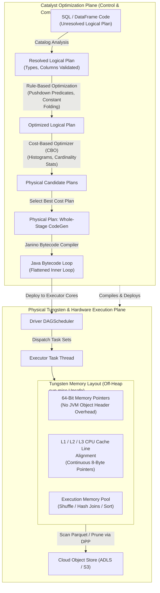

### Key Architectural Takeaways:
1. **Catalyst 5-Stage Compilation**: Unresolved Logical Plan $\rightarrow$ Analyzed Logical Plan $\rightarrow$ Optimized Logical Plan $\rightarrow$ Physical Planning (CBO) $\rightarrow$ Whole-Stage Code Generation (Janino).
2. **Tungsten Off-Heap Memory**: Bypasses the JVM garbage collector by storing rows in continuous raw 8-byte aligned binary memory using `sun.misc.Unsafe`. Eliminates JVM object reference overhead (saving up to $75\%$ memory).
3. **Dynamic Partition Pruning (DPP)**: Evaluates filtered dimension tables, collects distinct join keys into a broadcast Bloom filter, and injects them directly into the fact table scan, skipping Parquet partition reads before shuffle.
4. **Partition Sizing Rule**: Target $100\text{ MB} - 200\text{ MB}$ per partition ($\text{Partitions} = \frac{\text{Stage Input Size}}{128\text{ MB}}$), aligned to an integer multiple ($2\times - 4\times$) of total cluster cores.

---

## 🏛️ Pillar 02: Databricks Lakehouse & Unity Catalog

### Whiteboard Schematic: Split-Plane Architecture & 3-Tier Governance
*Archetype: Dual-Plane Architecture (Control Plane vs. Customer Compute Plane)*

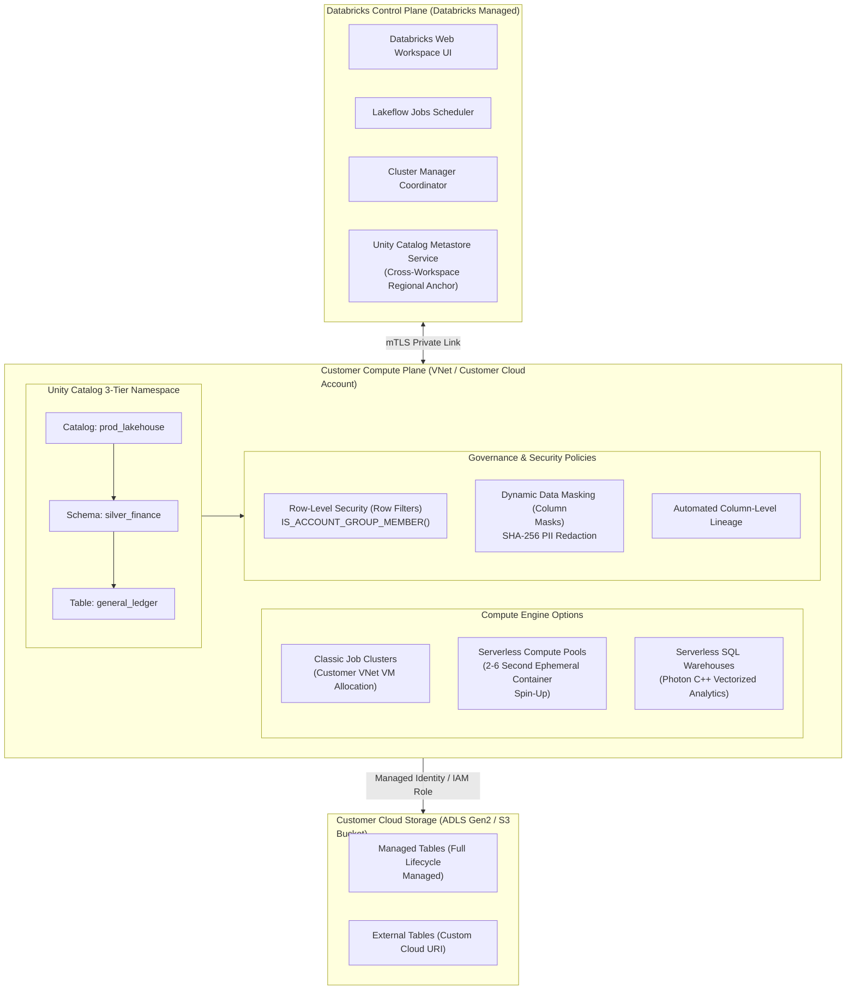

### Key Architectural Takeaways:
1. **Split-Plane Security**: Control plane orchestrates jobs and manages metadata without ever receiving customer data rows. Data stays within customer VPC storage.
2. **3-Tier Namespace (`catalog.schema.table`)**: Centralizes cross-workspace governance under a single regional metastore, replacing legacy per-workspace Hive metastores.
3. **Dynamic Security Without Views**: Row Filters and Column Masks apply security directly on physical tables via SQL UDFs, avoiding view explosion.
4. **DABs CI/CD Promotion**: Databricks Asset Bundles package code, pipelines, and permissions as declarative YAML deployed identically across dev, staging, and prod.

---

## 🏛️ Pillar 03: Modern Lakehouse (Delta Lake 3.x, Liquid Clustering & Deletion Vectors)

### Whiteboard Schematic: ACID Transaction Log & Modern Storage Engine
*Archetype: 3-Panel Under-the-Hood Mechanism*

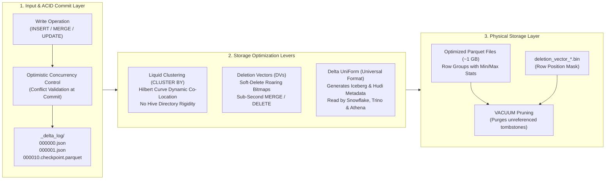

### Key Architectural Takeaways:
1. **ACID Commit Protocol**: Write transactions write new Parquet files and execute an atomic commit by appending a monotonically increasing JSON file to `_delta_log/`.
2. **Liquid Clustering (`CLUSTER BY`)**: Replaces legacy Hive partitioning and Z-Ordering. Avoids small file fragmentation, clusters data dynamically along space-filling curves, and supports altering cluster keys without data rewriting.
3. **Deletion Vectors (DVs)**: Eliminates Copy-on-Write write amplification. Updates and deletes write small serialized bitmaps indicating modified rows, avoiding full file rewrites.
4. **Delta UniForm**: Simultaneously writes Iceberg metadata pointers alongside the Delta transaction log, enabling zero-copy querying from Snowflake and Trino.

---

## 🏛️ Pillar 04: Cloud Data Lake Architecture (Prefix Throttling & BCDR)

### Whiteboard Schematic: S3/ADLS High-Throughput Ingestion & Multi-Region DR
*Archetype: Dual-Plane Architecture (Ingestion Flow vs Disaster Recovery Flow)*

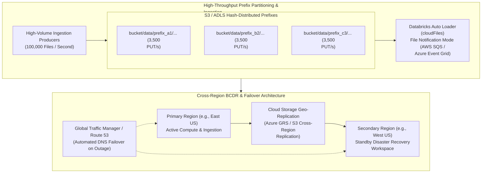

### Key Architectural Takeaways:
1. **Overcoming Cloud Throttling**: S3 partitions throughput by prefix (3,500 PUT/s, 5,500 GET/s). Distribute writes across deterministic hash prefixes to eliminate HTTP 503 SlowDown throttling.
2. **File Notification Ingestion**: Auto Loader leverages SQS / Azure Event Grid queue subscriptions to ingest files in real time, avoiding multi-hour directory scanning overhead.
3. **Cross-Region BCDR (RPO & RTO)**: Underlying Delta Lake storage is replicated via cross-region replication (CRR), while Unity Catalog metadata is synchronized via DABs CI/CD.

---

## 🏛️ Pillar 05: Apache Airflow Production Architecture

### Whiteboard Schematic: Distributed Celery/K8s Architecture with Deferrable Sensors
*Archetype: Dual-Plane Architecture (Scheduler Control vs Worker Execution)*

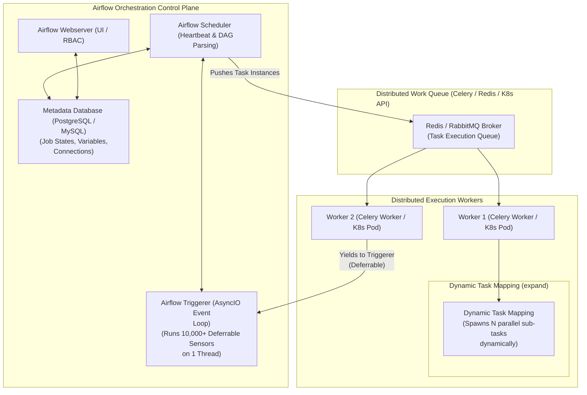

### Key Architectural Takeaways:
1. **Airflow 2.x/3.x Distributed Topology**: Separates Webserver, Scheduler, Metadata DB, Celery/K8s Workers, and Triggerer.
2. **Deferrable Operators (Smart Sensors)**: Frees worker slots while waiting on long-running external jobs (e.g., waiting 2 hours for a Databricks job). Tasks yield execution to the async `Triggerer` daemon, eliminating worker slot starvation.
3. **Dynamic Task Mapping (`expand()`)**: Spawns parallel tasks at runtime based on the upstream output of an array or SQL query without hardcoding static DAG structures.

---

## 🎯 Playbook 01: SQL & PySpark Internals Defense Playbook

### Whiteboard Schematic: Distributed Join Selection Matrix & Memory Spill Triage
*Archetype: 3-Panel Decision & Mitigation Flowchart*

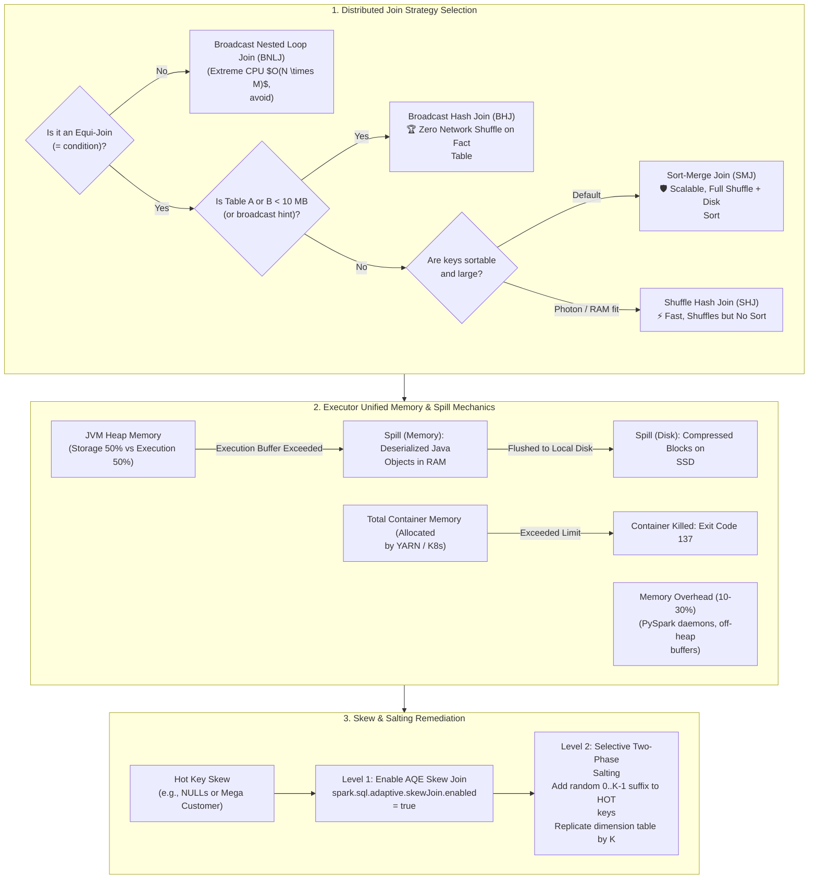

### Key Architectural Takeaways:
1. **Join Selection Hierarchy**: Broadcast Hash Join ($< 10\text{ MB}$, zero shuffle) $\rightarrow$ Shuffle Hash Join (fits in partition RAM) $\rightarrow$ Sort-Merge Join (scalable, disk-backed) $\rightarrow$ Broadcast Nested Loop (non-equi, avoid).
2. **Memory Spill Triage**: Memory Spill is $3\times - 5\times$ larger than Disk Spill due to deserialization. Resolve by increasing `spark.sql.shuffle.partitions` ($128\text{ MB}$ target) and capping executor cores at 4–5.
3. **Exit Code 137 Resolution**: Caused by container memory overhead violations; increase `spark.executor.memoryOverhead` to $25\% - 30\%$.
4. **Selective Salting**: Append salt only to hot keys; exploding the entire dimension table causes memory exhaustion and network saturation.

---

## 🏛️ Pillar 06: Azure Data Factory (ADF) Enterprise Hybrid Architecture

### Whiteboard Schematic: Self-Hosted Integration Runtime (SHIR) HA & Watermarking Ingestion
*Archetype: Dual-Plane Architecture (Control Flow vs Hybrid Data Flow)*

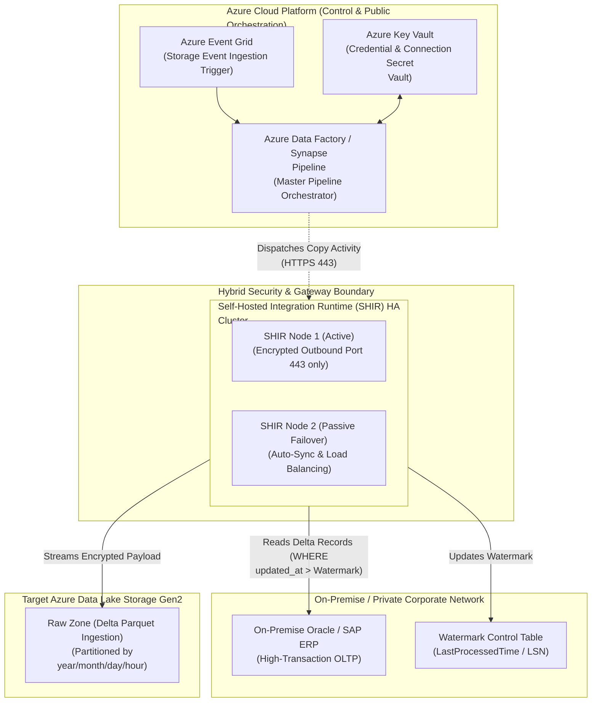

### Key Architectural Takeaways:
1. **Self-Hosted Integration Runtime (SHIR) High Availability**: Connects private corporate on-premise networks to Azure cloud without opening inbound firewall ports (uses outbound HTTPS 443 only). Deployed in an active/passive HA cluster for zero-downtime node failover.
2. **Delta Watermark Ingestion Pattern**: Queries only modified records using watermark bounds (`WHERE LastModifiedDate > @activity('GetLastWatermark').output.firstRow.WatermarkValue`).
3. **Staging Blob Storage Compression**: ADF stages on-prem relational reads in compressed blob chunks to maximize parallel egress bandwidth into ADLS Gen2.

---

## 🏛️ Pillar 07: dbt (Data Build Tool) Analytics Engineering DAG & dbt Mesh

### Whiteboard Schematic: Multi-Project dbt Mesh & Incremental Model Lifecycle
*Archetype: 3-Panel Ingestion-to-Serving Flow*

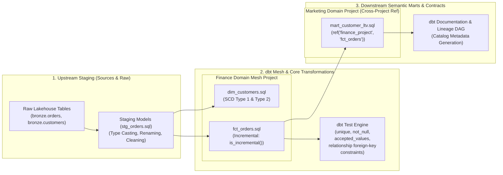

### Key Architectural Takeaways:
1. **dbt Mesh (Cross-Project Dependencies)**: Enables decentralized enterprise domain teams to reference upstream models via cross-project `ref()` while enforcing strict model contracts (`contract: {enforced: true}`).
2. **Idempotent Incremental Models**:
   ```sql
   {{ config(materialized='incremental', unique_key='order_id', incremental_strategy='merge') }}
   SELECT * FROM {{ ref('stg_orders') }}
   
     WHERE updated_at > (SELECT MAX(updated_at) FROM {{ this }})
   
   ```
3. **Automated Quality Testing**: Blocks downstream publishing if primary key assertions (`unique`, `not_null`) or referential integrity foreign keys fail.

---

## 🏛️ Pillar 08: Microsoft Fabric Architecture (OneLake & Direct Lake)

### Whiteboard Schematic: Single SaaS Namespace & VertiPaq Direct Lake Memory Paging
*Archetype: Dual-Plane Architecture (Multi-Engine Compute vs Unified Storage)*

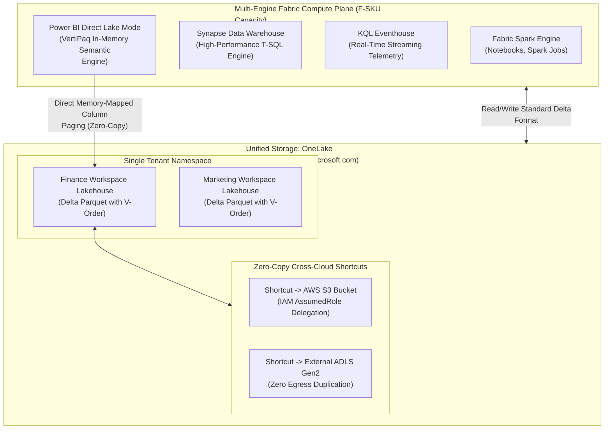

### Key Architectural Takeaways:
1. **OneLake Single Tenant Namespace**: Exactly one OneLake per Microsoft Entra tenant. Eliminates data silos through zero-copy **Shortcuts** to external AWS S3 and ADLS Gen2 accounts.
2. **V-Order Parquet Optimization**: Sorts and arranges Parquet row groups and dictionary pages at write time to match Power BI VertiPaq's in-memory layout, allowing **Direct Lake mode** to memory-map data directly without importing.
3. **Capacity Unit (CU) Smoothing**: Averages burst compute spikes over a 24-hour evaluation window, preventing transient ETL runs from triggering capacity throttling.

---

## 🏛️ Pillar 09: Database Architecture & Engine Internals

### Whiteboard Schematic: B-Tree vs. LSM-Tree & ARIES Crash Recovery
*Archetype: 3-Panel Storage Engine Comparison*

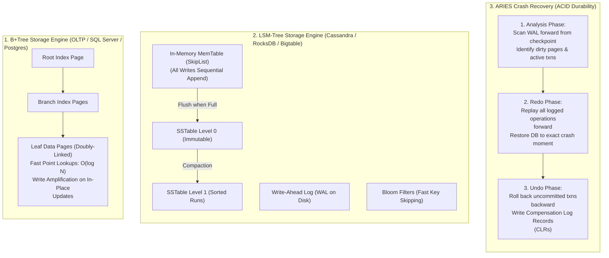

### Key Architectural Takeaways:
1. **B+Tree vs LSM-Tree**: B+Trees optimize for low-latency point reads and range scans ($O(\log N)$) through balanced page hierarchies, but suffer from random disk I/O on updates. LSM-Trees optimize for massive write throughput by appending sequentially to an in-memory `MemTable` and write-ahead log (WAL), deferring sorting to background SSTable compaction.
2. **ARIES Protocol**: Guarantees ACID durability across system crashes via three sequential phases: **Analysis** (identifying active transactions), **Redo** (repeating history to restore state), and **Undo** (rolling back uncommitted operations).
3. **Raft Consensus**: Guarantees distributed database consistency via leader election, log replication, and committed quorum ($N/2 + 1$).

---

## 🏛️ Pillar 10: SQL Server & Analytical Query Engine (Clustered Columnstore)

### Whiteboard Schematic: Rowstore vs. Clustered Columnstore Architecture
*Archetype: 3-Panel Under-the-Hood Mechanism*

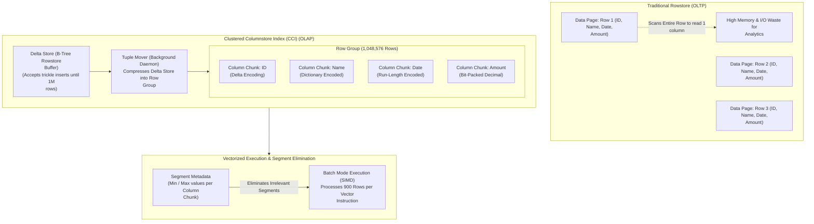

### Key Architectural Takeaways:
1. **Clustered Columnstore Architecture**: Segments data into row groups of up to $1,048,576$ rows, storing each column in separate compressed chunks. Cuts disk footprint by $80-90\%$ through columnar compression (Dictionary, Run-Length, Bit-Packing).
2. **Batch Mode Vectorization**: Processes rows in batches of $\approx 900$ rows inside CPU L1/L2 cache registers rather than row-by-row scalar loops.
3. **Delta Store & Tuple Mover**: Trickle inserts land in a temporary B-Tree rowstore buffer (Delta Store); once $1,048,576$ rows accumulate, the background Tuple Mover compresses them into a permanent columnstore row group.

---

## 🏛️ Pillar 11: Python for Data Engineering (Arrow, Polars & Zero-Copy IPC)

### Whiteboard Schematic: Python GIL, PyArrow Zero-Copy IPC & Polars Query Engine
*Archetype: 3-Panel In-Memory Transition Flow*

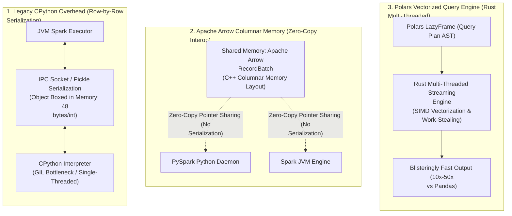

### Key Architectural Takeaways:
1. **The PySpark Serialization Problem**: Standard Python UDFs force Spark to serialize data row-by-row over a local socket using `pickle`, introducing massive memory allocation and CPU context-switching overhead.
2. **Apache Arrow Zero-Copy IPC**: Arrow defines a standardized in-memory columnar format. Spark JVM and Python worker daemons share identical memory address pointers without serializing or copying bytes.
3. **Polars vs. Pandas**: Polars is written in Rust, leverages an Apache Arrow memory model natively, runs multi-threaded query execution using work-stealing thread pools, and features a lazy query optimizer (predicate and projection pushdowns) that processes data larger than RAM.

---

## 🏛️ Pillar 12: Data Modeling & Change Data Capture (SCD 1–6 & Data Vault 2.0)

### Whiteboard Schematic: Debezium CDC Outbox & Lakehouse Data Vault 2.0
*Archetype: Dual-Plane Architecture (CDC Event Stream vs Data Vault Storage)*

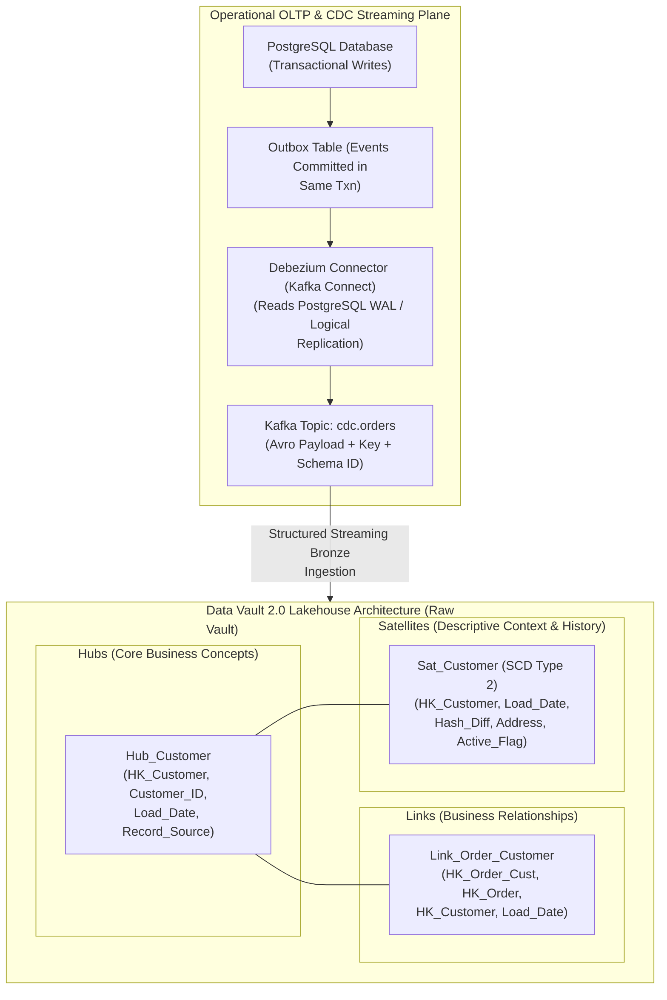

### Key Architectural Takeaways:
1. **Transactional Outbox Pattern**: Commits business changes and event notifications within the exact same database transaction, eliminating dual-write inconsistencies between databases and message brokers.
2. **Data Vault 2.0 Modeling**:
   * **Hubs**: Unique business keys hashed with SHA-256 (`HK_Customer`). Never changes.
   * **Links**: Many-to-many business relationships between hubs.
   * **Satellites**: Point-in-time descriptive attributes tracking full historical change (SCD Type 2) using `Hash_Diff` comparisons.
3. **SCD 1–6 Strategy**: SCD 1 (Overwrite), SCD 2 (Historical records with `valid_from`/`valid_to`), SCD 3 (Previous value column), SCD 4 (History table), SCD 6 (Hybrid 1 + 2 + 3).

---

## 🏛️ Pillar 13: Power BI & Serving Tier (VertiPaq & DAX Context Transition)

### Whiteboard Schematic: VertiPaq Columnar Engine & Context Transition Mechanics
*Archetype: 3-Panel Engine Mechanics Flow*

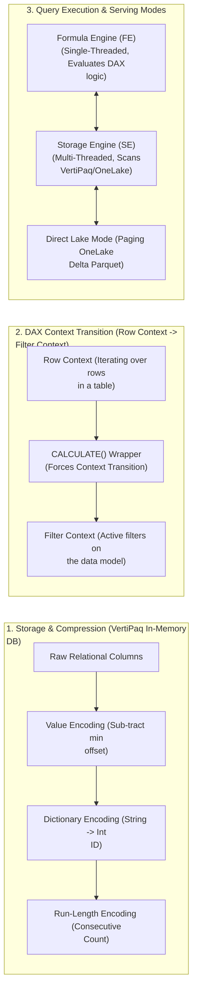

### Key Architectural Takeaways:
1. **VertiPaq 3-Tier Compression**: Value Encoding (subtracts minimum value), Dictionary Encoding (replaces distinct strings with integer IDs), and Run-Length Encoding (RLE compresses repeated consecutive values). RLE efficiency is maximized by sorting source tables by high-cardinality columns prior to ingestion.
2. **DAX Context Transition**: Occurs whenever `CALCULATE()` is evaluated within a row context. It transforms all column values of the currently iterated row into an equivalent set of filters across the entire data model.
3. **Formula Engine (FE) vs. Storage Engine (SE)**: The SE is multi-threaded and extremely fast; the FE is single-threaded. High-performance DAX pushes computations down to the SE, avoiding iterative FE loops.

---

## 🏛️ Pillar 14: System Design at Scale (Multi-Tenant Lakehouse & Real-Time Feature Store)

### Whiteboard Schematic: Multi-Tenant Zero-Trust Lakehouse with Real-Time ML Serving
*Archetype: Dual-Plane Architecture (Offline Lakehouse vs Low-Latency Online Feature Store)*

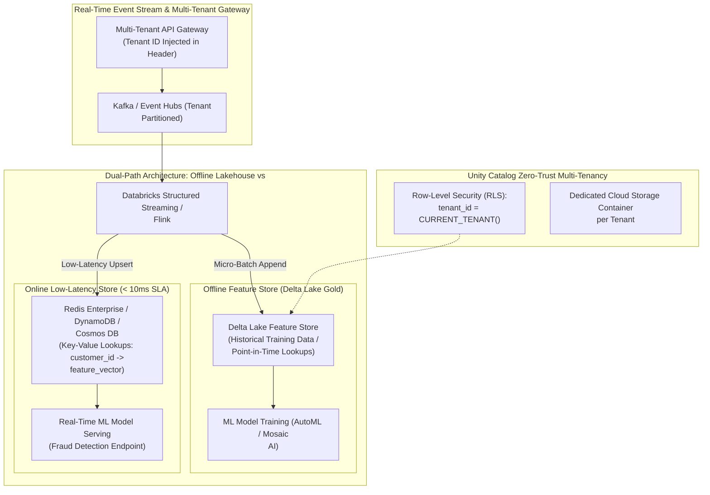

### Key Architectural Takeaways:
1. **Lambda/Kappa Dual-Storage Serving**: Machine learning models require two distinct feature stores:
   * **Offline Store (Delta Lake)**: Petabyte-scale historical feature values for model training with point-in-time correctness to prevent data leakage.
   * **Online Store (Redis / Cosmos DB)**: Sub-10ms key-value lookup store serving pre-computed feature vectors to real-time inference APIs.
2. **Multi-Tenant Isolation**: Enforced via Unity Catalog Row-Level Security (`tenant_id = CURRENT_USER_TENANT()`) backed by customer-managed encryption keys (CMEK) per tenant container.

---

## 🏛️ Pillar 15: Apache Iceberg Deep Dive (4-Tier Metadata Tree & Hidden Partitioning)

### Whiteboard Schematic: 4-Tier Metadata Tree & Hidden Partition Pruning
*Archetype: 3-Panel Under-the-Hood Mechanism*

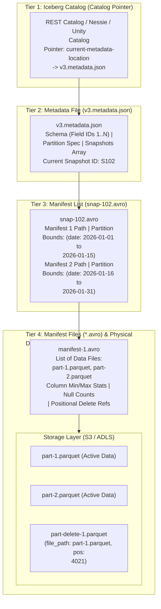

### Key Architectural Takeaways:
1. **4-Tier Metadata Hierarchy**: Catalog Pointer $\rightarrow$ Table Metadata File (`vN.metadata.json`) $\rightarrow$ Manifest List (`snap-*.avro`) $\rightarrow$ Manifest Files (`*.avro`) $\rightarrow$ Physical Parquet Data & Delete Files.
2. **Hidden Partitioning**: Partition transformations (`days(timestamp)`, `bucket(16, id)`) are tracked inside the metadata. Users query raw business columns (`WHERE timestamp >= '2026-01-01'`) and Iceberg's metadata tree skips non-matching manifest files without requiring artificial partition columns.
3. **Field ID Immunity**: Every column possesses an immutable 32-bit Field ID, guaranteeing that column renames, drops, and reorders never corrupt physical Parquet reads.
4. **Positional vs. Equality Deletes**: Positional deletes store `(file_path, row_position)` and are fast at read time. Equality deletes store values (`id = 100`) and are fast for streaming ingestion writes, requiring background compaction.

---

## 🏛️ Pillar 16: Apache Flink Streaming Architecture (Chandy-Lamport Barriers & RocksDB)

### Whiteboard Schematic: Distributed State Snapshots & Stream Flow
*Archetype: Dual-Plane Architecture (Stream Operators vs RocksDB State Store)*

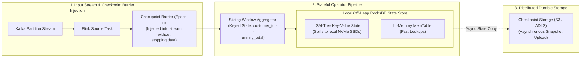

### Key Architectural Takeaways:
1. **Chandy-Lamport Checkpoint Barriers**: Injects lightweight checkpoint barriers into the live stream. When an operator receives a barrier on all input channels, it takes an asynchronous snapshot of its local state without pausing record processing.
2. **Unaligned Checkpoints**: Eliminates backpressure stalls by serializing in-flight network buffers alongside operator state, ensuring checkpoints complete even during heavy cluster saturation.
3. **RocksDB State Backend**: Off-heap embedded key-value store holding terabytes of state per task manager, bounded only by local disk capacity.

---

## 🏛️ Pillar 17: Trino, Presto & DuckDB Architecture (MPP Dynamic Filtering & SIMD)

### Whiteboard Schematic: Trino Distributed MPP vs. DuckDB In-Process Vectorization
*Archetype: 3-Panel Distributed vs Embedded Analytical Architecture*

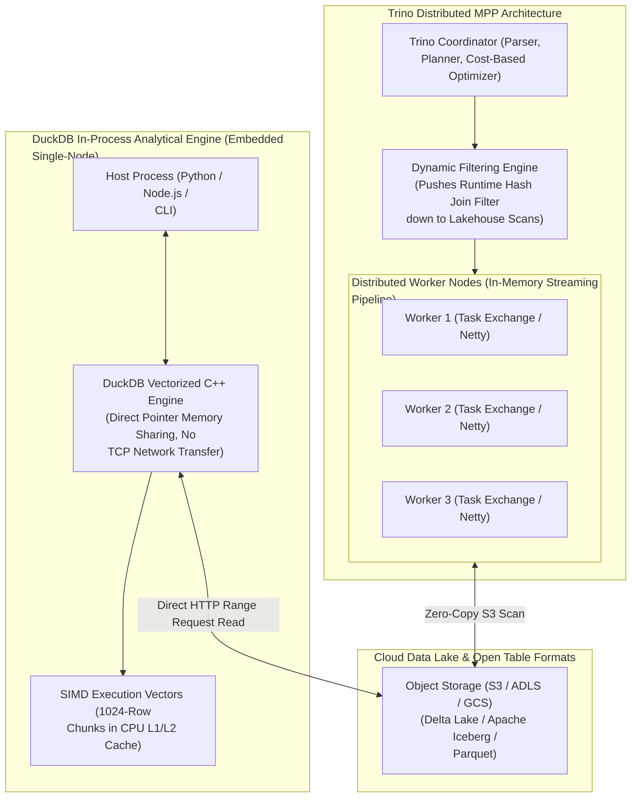

### Key Architectural Takeaways:
1. **Trino Dynamic Filtering**: During large hash joins, the build side collects min/max bounds and Bloom filters on join keys, pushing them down dynamically to worker table scans, cutting Parquet I/O by up to $80\%$.
2. **DuckDB In-Process Analytical Supremacy**: Bypasses network sockets entirely by executing directly inside the client process memory space. Processes data in vectorized $1024$-row chunks using SIMD CPU instructions, outperforming Spark/Pandas for single-node workloads under $100\text{ GB}$.

---

## 🏛️ Pillar 18: GenAI & Vector Lakehouse Architecture (HNSW, Vector Search & RAG)

### Whiteboard Schematic: Governed Enterprise RAG Pipeline with Unity Catalog ACLs
*Archetype: Dual-Plane Architecture (Offline Vector Ingestion vs Real-Time RAG Inference)*

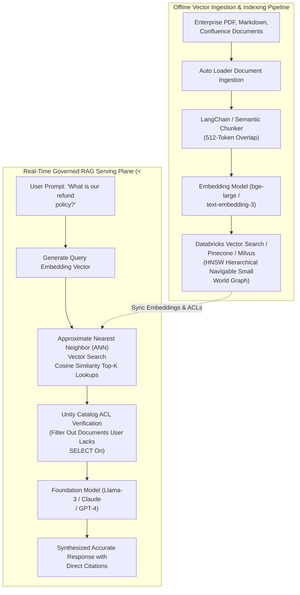

### Key Architectural Takeaways:
1. **HNSW vs. IVF-PQ**: Hierarchical Navigable Small World (HNSW) creates a multi-layer proximity graph delivering sub-10ms recall ($> 98\%$), ideal for high-accuracy enterprise RAG. Inverted File with Product Quantization (IVF-PQ) compresses vectors into compact clusters, trading accuracy for a $10\times$ lower RAM footprint on billion-vector scales.
2. **Governed Vector Search with ACLs**: Real-time vector retrieval must propagate Unity Catalog permissions: non-admin users cannot retrieve embeddings derived from restricted source tables.

---

## 🏛️ Pillar 19: Lakehouse FinOps & Compute Optimization (DBU Arbitrage)

### Whiteboard Schematic: Cloud FinOps Optimization Levers & Autoscaling Curves
*Archetype: 3-Panel Compute Cost Reduction Engine*

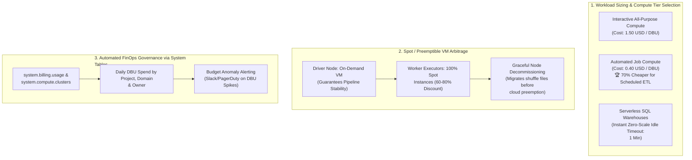

### Key Architectural Takeaways:
1. **Compute Type Arbitrage**: Never run scheduled production ETL pipelines on All-Purpose clusters (paying a $3\times$ DBU markup). Deploy via Job Compute or Serverless Jobs.
2. **Spot VM Decommissioning**: Use On-Demand VMs for the single Driver node, and configure worker pools with Spot instances. Spark’s Graceful Node Decommissioning migrates shuffle files before VM reclamation, preventing job failures.
3. **System Tables Observability**: Query `system.billing.usage` to calculate exact cost-per-query and cost-per-tenant metrics.

---

## 🏛️ Pillar 20: Data Quality Contracts & Observability (WAP Circuit Breakers)

### Whiteboard Schematic: Write-Audit-Publish (WAP) Circuit Breaker Architecture
*Archetype: 3-Panel Quality Gate Architecture*

```mermaid
flowchart LR
    subgraph Panel1 ["1. Write Phase (Isolated Staging Branch)"]
        Source["Upstream Raw Records"]
        StageBranch["Write to Staging Delta Branch<br/>(e.g., gold.orders_stage / Shallow<br/>Clone)"]
        Source --> StageBranch
    end

    subgraph Panel2 ["2. Audit Phase (Automated Circuit Breaker)"]
        QualitySuite["Automated Quality Assertion Suite<br/>1. Zero Null Primary Keys<br/>2. Metric Drift &lt; 5% vs 30-Day<br/>Moving Avg<br/>3. Referential Integrity Join<br/>Check"]
        StageBranch --> QualitySuite
        GateCheck{"Pass All Tests?"}
        QualitySuite --> GateCheck
    end

    subgraph Panel3 ["3. Publish or Quarantine Phase"]
        Publish["Fast Atomic Commit to Production<br/>Gold<br/>ALTER TABLE gold.orders SWAP WITH<br/>stage"]
        Quarantine["Trip Circuit Breaker: Halt Job<br/>Alert On-Call & Route Bad Batch to<br/>Quarantine"]
        GateCheck -->|Yes| Publish
        GateCheck -->|No| Quarantine
    end
```

### Key Architectural Takeaways:
1. **Write-Audit-Publish (WAP)**: Isolates newly transformed records in a staging branch or shallow clone. Runs automated data quality assertions *before* publishing to production Gold tables, preventing bad data propagation.
2. **Data Contracts**: Formal API contracts between data producers and consumers enforcing schema specifications, SLA freshness, and semantic validity rules.
3. **Statistical Anomaly Detection**: Tracks Interquartile Range (IQR) and Z-score distributions on core numeric columns (e.g. revenue, row volume) to catch silent data corruptions.

---

## 🎯 Playbook 02: Apache Kafka & Structured Streaming Playbook

### Whiteboard Schematic: End-to-End Exactly-Once Semantics (EOS) & Checkpoint WAL
*Archetype: Dual-Plane Architecture (Streaming Data Flow vs State & Checkpoint Recovery)*

```mermaid
flowchart TD
    subgraph KafkaSourcePlane ["1. Distributed Message Source (Apache Kafka)"]
        K1["Partition 0 (Committed Offsets:<br/>100..250)"]
        K2["Partition 1 (Committed Offsets:<br/>400..550)"]
        ConsumerGroup["Spark Consumer Group (Cooperative<br/>Sticky Assignor)"]
        K1 --> ConsumerGroup
        K2 --> ConsumerGroup
    end

    subgraph SparkEnginePlane ["2. Spark Structured Streaming Engine<br/>(Micro-Batch)"]
        MicroBatch["Micro-Batch Execution (Trigger:<br/>availableNow or ProcessingTime)"]
        ConsumerGroup --> MicroBatch

        subgraph StatefulStore ["Off-Heap State Store (RocksDB)"]
            Watermark["Event-Time Watermark:<br/>max(event_time) - 10 mins"]
            StateKey["State Keys: user_id -> cart_events"]
        end
        MicroBatch <--> StatefulStore
    end

    subgraph CheckpointWAL ["3. Durable Checkpoint & Write-Ahead Log (WAL)"]
        OffsetsDir["/checkpoints/offsets/ (Committed<br/>Micro-Batch Offsets)"]
        CommitsDir["/checkpoints/commits/ (Batch<br/>Success Confirmation)"]
        StateSnapshots["/checkpoints/state/ (Asynchronous<br/>RocksDB Snapshots)"]
        MicroBatch -.-> OffsetsDir
        MicroBatch -.-> CommitsDir
        StatefulStore -.-> StateSnapshots
    end

    subgraph IdempotentSink ["4. Idempotent Target Sink (Delta Lake)"]
        DeltaTable["Target Delta Table<br/>(Atomic Commit with txnAppId and<br/>txnVersion)"]
        MicroBatch --> DeltaTable
    end

    KafkaSourcePlane --> SparkEnginePlane
    SparkEnginePlane --> CheckpointWAL
    CheckpointWAL --> IdempotentSink
```

### Key Architectural Takeaways:
1. **End-to-End Exactly-Once Semantics (EOS)**: Requires three cooperative components: Replayable Kafka Source (via offsets), Deterministic Spark Engine (via checkpoint WAL), and Idempotent Sink (Delta Lake commits with `txnAppId` and `txnVersion`).
2. **Off-Heap RocksDB State Store**: Prevents JVM garbage collection thrashing during large streaming aggregations by maintaining state outside the Java heap.
3. **Crash Recovery Protocol**: Upon node failure, Spark reads `/checkpoints/offsets/` to reload the exact uncommitted Kafka message range and restores state from `/checkpoints/state/`, guaranteeing zero record duplication or loss.

---

## 🎯 Playbook 03: Azure Databricks & Delta Lake 3.x Playbook

### Whiteboard Schematic: Lakehouse Concurrency, OCC Write Conflicts & Liquid Clustering
*Archetype: 3-Panel Concurrency & Compaction Engine*

```mermaid
flowchart LR
    subgraph Panel1 ["1. Concurrent Ingestion & OCC Conflict<br/>Validation"]
        TxnA["Job A: Append (Inserts New Orders)"]
        TxnB["Job B: Merge / Delete (Updates<br/>Status)"]
        OCCEngine["Optimistic Concurrency Control<br/>(OCC)<br/>Validates Disjoint Partitions at<br/>Commit Time"]
        TxnA --> OCCEngine
        TxnB --> OCCEngine
    end

    subgraph Panel2 ["2. Delta Lake 3.x Storage Optimization"]
        DeltaLog["_delta_log/<br/>Atomic Commit Log"]
        OCCEngine --> DeltaLog
        LiquidCluster["Liquid Clustering (CLUSTER BY)<br/>Dynamic Space-Filling Curve<br/>Sorting"]
        DeletionVectors["Deletion Vectors (DVs)<br/>Soft-Delete Roaring Bitmaps"]
        DeltaLog --> LiquidCluster
        DeltaLog --> DeletionVectors
    end

    subgraph Panel3 ["3. Background Lifecycle Maintenance"]
        Optimize["OPTIMIZE (Bin-Packing Compaction)<br/>Consolidates Small Files into 1 GB<br/>Targets"]
        Vacuum["VACUUM (Tombstone Purging)<br/>Removes files past retention (&gt;<br/>7 days)"]
        LiquidCluster --> Optimize
        DeletionVectors --> Vacuum
    end

    Panel1 ~~~ Panel2 ~~~ Panel3
```

### Key Architectural Takeaways:
1. **Optimistic Concurrency Control (OCC)**: Transactions proceed without locking storage; conflicts are validated at commit time. Using Deletion Vectors eliminates row-update file rewrite conflicts.
2. **Liquid Clustering vs. Hive Partitioning**: Decouples data clustering from rigid directory trees, adapting automatically as query patterns evolve over time.
3. **Hygiene Maintenance Lifecycle**: Run `OPTIMIZE` frequently to compact small files, and schedule `VACUUM` weekly to reclaim storage while preserving time-travel auditability.

---

## 🎯 Playbook 04: AWS Cloud Big Data Stack Playbook (Glue, EMR & S3)

### Whiteboard Schematic: Serverless AWS Lakehouse with Glue 4.0 & Step Functions
*Archetype: Dual-Plane Architecture (Step Functions DAG vs AWS Big Data Execution)*

```mermaid
flowchart TD
    subgraph OrchestrationPlane ["AWS Step Functions Serverless Orchestration<br/>DAG"]
        StartNode["Execution Trigger (EventBridge /<br/>S3 Notification)"] --> GlueJob["AWS Glue 4.0 ETL Job (Auto-Scaling<br/>DPUs)"]
        GlueJob --> QualityCheck{"Pass Great Expectations?"}
        QualityCheck -->|Yes| EMRServerless["EMR Serverless Spark (Heavy<br/>Transformation)"]
        QualityCheck -->|No| SNS_Alert["SNS Alarm -> PagerDuty / Slack"]
        EMRServerless --> AthenaCrawler["Glue Data Catalog Crawler Update"]
    end

    subgraph StorageComputePlane ["AWS Big Data Storage & Query Plane"]
        S3Landing["Amazon S3 Raw Landing Bucket<br/>(S3 Express One Zone / Prefix<br/>Partitioned)"]
        GlueCatalog["AWS Glue Data Catalog (Metastore)<br/>(Iceberg / Delta Table<br/>Definitions)"]
        S3Lakehouse["Amazon S3 Lakehouse Bucket (S3<br/>Standard / Intelligent-Tiering)"]
        AmazonAthena["Amazon Athena (Presto/Trino<br/>Serverless Ad-Hoc SQL)"]
        AmazonRedshift["Amazon Redshift Serverless (BI<br/>Reporting Mart)"]
    end

    GlueJob <--> S3Landing
    GlueJob --> S3Lakehouse
    EMRServerless --> S3Lakehouse
    GlueCatalog -.-> S3Lakehouse
    AmazonAthena <--> GlueCatalog
    AmazonRedshift <--> GlueCatalog
```

### Key Architectural Takeaways:
1. **Glue 4.0 DPUs vs EMR Serverless**: AWS Glue is ideal for serverless, event-driven micro-ETL jobs ($< 1\text{ hour}$); EMR Serverless is preferred for complex, long-running Spark jobs requiring custom open-source libraries and fine-grained memory tuning.
2. **S3 Intelligent-Tiering & Prefixing**: Avoid S3 503 throttling by prefixing object paths with hash keys, and reduce cold storage costs by $70\%$ using S3 Intelligent-Tiering.

---

## 🎯 Playbook 05: Real-World Project Defense Playbook (STAR Framework)

### Whiteboard Schematic: Petabyte-Scale Lakehouse Migration & 5x Scale-Up Architecture
*Archetype: 3-Panel Migration & Scale-Up Evolution*

```mermaid
flowchart LR
    subgraph Panel1 ["1. Legacy Bottleneck Architecture (Situation<br/>& Task)"]
        LegacyDWH["Legacy On-Premise EDW / Hadoop"]
        DailySLA["Daily Batch Takes 14 Hours<br/>(Frequent SLA Breaches, High<br/>Hardware Cost)"]
        DataSilos["Siloed BI & ML Repositories"]
        LegacyDWH --> DailySLA --> DataSilos
    end

    subgraph Panel2 ["2. Modernized Lakehouse Migration (Action)"]
        AutoLoader["Auto Loader Event-Driven Ingestion"]
        DLT["Delta Live Tables (Medallion<br/>Pipeline)<br/>Liquid Clustering + Photon<br/>Acceleration"]
        UnityCatalog["Unity Catalog Zero-Trust Access<br/>Control"]
        AutoLoader --> DLT --> UnityCatalog
    end

    subgraph Panel3 ["3. Business Impact & 5x Scale Resilience<br/>(Result)"]
        SLAReduction["Pipeline Runtime: 14 Hours -> 42<br/>Minutes<br/>🏆 95% Latency Improvement"]
        FinOpsSavings["Annual Cloud Compute Savings:<br/>650,000 USD"]
        ScaleCapacity["Effortlessly Absorbed 5x Data<br/>Volume Spikes<br/>Zero Cluster Downtime during Peak<br/>Black Friday"]
        SLAReduction --> FinOpsSavings --> ScaleCapacity
    end

    Panel1 ~~~ Panel2 ~~~ Panel3
```

### Key Architectural Takeaways:
1. **STAR Defense Framework**: Structure project interview responses with **Situation** (scale, bottlenecks), **Task** (business SLA mandates), **Action** (architectural design, Liquid Clustering, Auto Loader, DLT), and **Result** (quantifiable speedup, DBU cost reductions).
2. **5x Scale-Up Preparedness**: Defend how your architecture absorbs sudden volume spikes via stateless autoscaling compute pools and prefix-partitioned cloud storage.

---

## 🎯 Playbook 06: High-Throughput System Design Playbook (Sub-50ms Real-Time Fraud)

### Whiteboard Schematic: Multi-Million TPS Real-Time Fraud Detection Engine
*Archetype: Dual-Plane Architecture (Sub-50ms Scoring vs Lakehouse Feature Store)*

```mermaid
flowchart TD
    subgraph IngestionStream ["High-Throughput Ingestion (1,000,000 TPS)"]
        KafkaCluster["Multi-Cluster Kafka / Azure Event<br/>Hubs (128 Partitions)"]
    end

    subgraph FastPath ["Real-Time Low-Latency Fraud Scoring Path<br/>(&lt; 50ms SLA)"]
        FlinkCluster["Apache Flink Stream Processor<br/>(In-Memory Processing)"]
        FeatureCache["Redis Enterprise / DynamoDB<br/>(Sub-5ms Feature Vector Lookup)"]
        ScoringModel["ONNX ML Inference Engine<br/>(Vectorized Fraud Probability)"]
        DecisionRules["Decision Engine: Allow / Challenge<br/>/ Block"]

        KafkaCluster --> FlinkCluster
        FlinkCluster <--> FeatureCache
        FlinkCluster --> ScoringModel --> DecisionRules
    end

    subgraph SlowPath ["Analytical Lakehouse & Model Retraining Path<br/>(Minutes to Hours)"]
        DeltaBronze["Bronze Ingestion Delta Table"]
        DLT_Silver["Silver Curated Transactions"]
        FeatureStore["Delta Lake Feature Store (Feature<br/>Engineering)"]
        ModelRetraining["Continuous Model Retraining<br/>Pipeline"]

        KafkaCluster --> DeltaBronze --> DLT_Silver --> FeatureStore --> ModelRetraining
        ModelRetraining -.->|"Publish New Model Weights"| ScoringModel
    end
```

### Key Architectural Takeaways:
1. **Dual-Path Latency Isolation**: Decouple the real-time scoring path ($< 50\text{ms}$ SLA using Flink + Redis + ONNX) from the analytical training path (Delta Lake Medallion + ML model retraining).
2. **Feature Synchronization**: Real-time features (e.g. "transaction count in last 5 minutes") are maintained in Flink state and synced to Redis, while historical feature averages reside in Delta Lake.

---

## 🎯 Playbook 07: Engineering Leadership & Technical Dispute Defense Playbook

### Whiteboard Schematic: Technical RFC Review & FinOps Governance Framework
*Archetype: 3-Panel Collaborative Decision Framework*

```mermaid
flowchart LR
    subgraph Panel1 ["1. Request for Comments (RFC) Proposal"]
        ProblemStatement["Problem Definition & Business<br/>Justification"]
        ArchOptions["Evaluated Options Matrix (Option A<br/>vs Option B vs Status Quo)"]
        TradeOffs["Explicit Trade-Offs (Cost,<br/>Latency, Complexity, Operational<br/>Risk)"]
        ProblemStatement --> ArchOptions --> TradeOffs
    end

    subgraph Panel2 ["2. Cross-Functional Architecture Review"]
        LeadArch["Principal / Lead Architect<br/>(Security & Scalability)"]
        StaffDE["Staff Data Engineer<br/>(Maintainability & Code Hygiene)"]
        FinOpsLead["FinOps Lead (DBU Budget & Cloud<br/>Spend)"]
        SecurityOfficer["Security Officer (Zero-Trust &<br/>Compliance)"]
        LeadArch <--> StaffDE <--> FinOpsLead <--> SecurityOfficer
    end

    subgraph Panel3 ["3. Consensus & Implementation Decision"]
        ADR["Architectural Decision Record<br/>(ADR) Logged in Git"]
        PoC["Time-Boxed 2-Week Proof-of-Concept<br/>(POC) with Success Metrics"]
        ProductionRollout["Phased Production Rollout with<br/>Feature Flags & Rollback Plan"]
        ADR --> PoC --> ProductionRollout
    end

    Panel1 ~~~ Panel2 ~~~ Panel3
```

### Key Architectural Takeaways:
1. **Objective Architectural Dispute Resolution**: Resolve technical debates using empirical data: publish a formal RFC comparing trade-offs, run a 2-week PoC measuring throughput and cost, and document the final choice in an Architectural Decision Record (ADR).
2. **FinOps Cost Accountability**: Implement cost attribution tags (`Project`, `Owner`, `Environment`) and enforce cluster policy limits to empower development teams while capping runaway cloud spend.

---

## 🎯 Playbook 08: 100 Spark Data Issues & Silent Corruptions Playbook

### Whiteboard Schematic: Data-Induced Failure Triage (Skew, Nulls, Explode & Spill)
*Archetype: 3-Panel Diagnostic & Remediation Flow*

```mermaid
flowchart TD
    subgraph FailureSymptoms ["1. Production Failure Symptoms in Spark UI"]
        Straggler["Stage Stuck at 99%: 1 Task Runs<br/>for 45 Mins (Data Skew)"]
        OOM_137["Executor Container Killed: Exit<br/>Code 137 (Memory Overhead)"]
        SilentNull["NOT IN Subquery Returns 0 Rows<br/>(Three-Valued Logic NULL Trap)"]
        JoinExplosion["Row Count Multiplies 10x After<br/>Join (Cartesian Duplicate Key)"]
    end

    subgraph RootCauseAnalysis ["2. Engine-Level Root Cause Diagnosis"]
        SkewCause["Root Cause: Uneven Partition Key<br/>Hashing (Millions of NULLs on 1<br/>Reducer)"]
        OOMCause["Root Cause: Non-JVM Memory Breach<br/>(PySpark Daemons, Arrow IPC,<br/>Off-Heap)"]
        NullCause["Root Cause: ANSI SQL Three-Valued<br/>Logic (NULL in NOT IN produces<br/>UNKNOWN)"]
        ExplodeCause["Root Cause: Exploding Deeply<br/>Nested Arrays without Bounded<br/>Cardinality"]
    end

    subgraph ProductionRemediation ["3. Defensive Engineering Fixes"]
        FixSkew["Fix: Selective Key Salting /<br/>Enable AQE Skew Join<br/>(skewedPartitionFactor=3)"]
        FixOOM["Fix: Increase<br/>spark.executor.memoryOverhead<br/>(25-30%) / Reduce Cores (4-5)"]
        FixNull["Fix: Replace NOT IN with NOT<br/>EXISTS or LEFT ANTI JOIN"]
        FixExplode["Fix: Filter Empty Arrays / Explode<br/>in Bounded Batches"]
    end

    FailureSymptoms --> RootCauseAnalysis --> ProductionRemediation
```

### Key Architectural Takeaways:
1. **The 'Null Key' Skew Trap**: Nulls hash to the exact same partition during joins and group-bys. Isolate nulls before shuffling or filter them out.
2. **Three-Valued Logic Trap**: A single `NULL` in a `NOT IN (SELECT id FROM ...)` subquery causes the entire condition to evaluate to `UNKNOWN`, returning zero rows. Always use `NOT EXISTS` or `LEFT ANTI JOIN`.
3. **Cartesian Inflation Defense**: Validate that the dimension join table is unique on the join key (`assert count(distinct key) == count(*)`) before executing joins to prevent silent revenue doubling.
