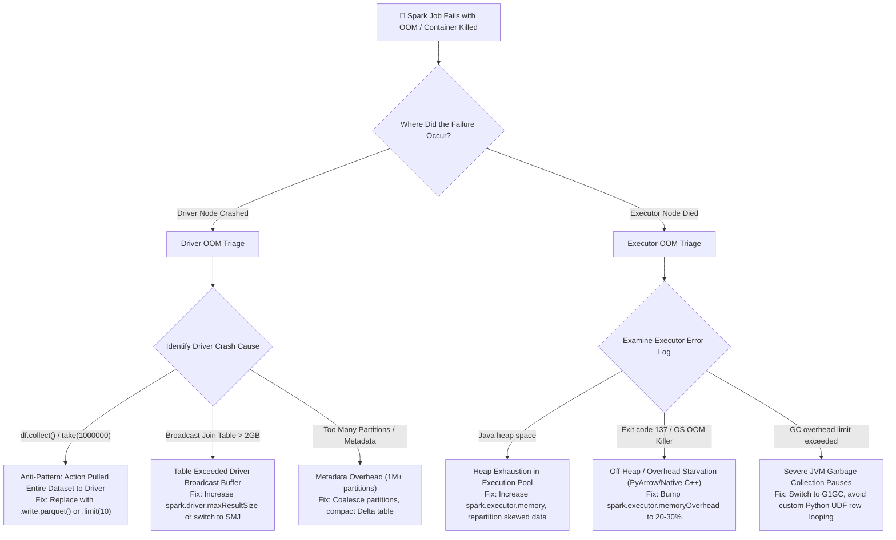

# 🚨 Runbook 01: Driver & Executor OutOfMemoryError (OOM) Triage

> **Severity**: `SEV-1 (CRITICAL)`  
> **Target Audience**: Data Engineers, Platform Reliability Engineers, On-Call Production Triage  
> **Key Error Signatures**: `java.lang.OutOfMemoryError: Java heap space`, `Container killed by YARN for exceeding memory limits`, `Exit code 137`, `ExecutorLostFailure: Heartbeat to driver timed out`.

---

## 1. Emergency Decision Tree



---

## 2. Immediate Diagnostic Procedures (First 5 Minutes)

### Step 1: Differentiate Driver vs. Executor OOM
1. Open the Spark Web UI (Port 4040) or cloud cluster event log (Databricks / EMR / Dataproc).
2. Check the **Jobs / Stages Tab**:
   - If the job failed during an active stage where individual tasks succeeded, but the driver terminated abruptly with `Driver daemon disconnected`, the culprit is **Driver OOM**.
   - If individual tasks fail repeatedly with `ExecutorLostFailure: Container killed by YARN for exceeding memory limits. 16.4 GB of 16 GB physical memory used`, the culprit is **Executor Overhead Memory OOM**.

### Step 2: Inspect Driver Logs for Common Anti-Patterns
Search driver `log4j` logs for the following keywords:
```bash
grep -E "OutOfMemoryError|collect\(\)|maxResultSize|Total size of serialized results" driver.log
```

Common trigger:
```text
org.apache.spark.SparkException: Job aborted due to stage failure: Total size of serialized results of 
16 tasks (1048.6 MiB) is bigger than spark.driver.maxResultSize (1024.0 MiB)
```

---

## 3. Root Cause Analysis & Detailed Remediation

### Cause A: Anti-Pattern `df.collect()` or Massive Local Python Conversion
- **Root Cause**: A developer invoked `.collect()`, `.toPandas()`, or `.show(1000000)` on an unaggregated DataFrame. All executor partitions serialized their records over the network into the single driver JVM heap.
- **Remediation**:
  1. Audit code for `.collect()` and replace with distributed writes:
     ```python
     # ❌ CRITICAL TRAP: Crashes driver on 100GB table
     all_records = df.collect()
     
     # ✅ PRODUCTION REMEDIATION: Write directly to lakehouse storage
     df.write.format("delta").mode("overwrite").saveAsTable("gold_output")
     ```
  2. If a sample is required for debugging, strictly enforce a limit:
     ```python
     sample_pdf = df.limit(500).toPandas()
     ```
  3. Increase driver safety limits if legitimate broadcast results are required:
     ```properties
     spark.driver.memory=16g
     spark.driver.maxResultSize=8g
     ```

---

### Cause B: Executor Container Killed by OS (Exit Code 137 / Memory Overhead)
- **Root Cause**: Spark runs inside a YARN container, Kubernetes Pod, or cloud VM with a hard memory ceiling. When memory allocated to non-JVM processes (PySpark Python workers, PyArrow IPC buffers, RocksDB off-heap C++, or native Netty networking) exceeds `spark.executor.memoryOverhead`, the Linux kernel OS OOM-Killer sends `SIGKILL (kill -9)`, resulting in **Exit code 137**.
- **Remediation & Recovery Strategy**:
  1. By default, `spark.executor.memoryOverhead` is `max(384MB, 0.10 * executorMemory)`. For PySpark workloads leveraging PyArrow Pandas UDFs or DuckDB, 10% is dangerously low.
  2. Increase overhead memory ratio to **25% to 35%**:
     ```properties
     # For 16GB Executor:
     spark.executor.memory=16g
     spark.executor.memoryOverhead=4g
     ```
  3. Batch PyArrow serialization records to prevent huge memory spikes:
     ```properties
     spark.sql.execution.arrow.maxRecordsPerBatch=10000
     ```

---

### Cause C: Severe Executor Heap Exhaustion during Wide Shuffles
- **Root Cause**: Uneven partition distribution or insufficient shuffle partition count causes a single executor task to process several gigabytes of data in its Tungsten aggregation hash table.
- **Remediation**:
  1. Scale up shuffle partition count:
     ```python
     spark.conf.set("spark.sql.shuffle.partitions", 1200)
     ```
  2. Enable Adaptive Query Execution (AQE) partition coalescing and skew join handling:
     ```properties
     spark.sql.adaptive.enabled=true
     spark.sql.adaptive.skewJoin.enabled=true
     ```
  3. Decrease `spark.memory.fraction` slightly if user UDF memory is starving:
     ```properties
     spark.memory.fraction=0.6
     spark.memory.storageFraction=0.3
     ```

---

## 4. Verification & Prevention Checklist

- [ ] Job completes all stages with 0 failed/retried tasks in the Spark UI.
- [ ] Garbage Collection time represents $< 10\%$ of total executor task run time.
- [ ] No `.collect()` or unbounded `.toPandas()` calls exist in the production codebase.
- [ ] Production clusters have `spark.driver.maxResultSize` set to a safe ceiling (e.g., 4GB–8GB) to prevent rogue developer queries from bringing down shared cluster drivers.
- [ ] Monitored cluster memory via Ganglia / Prometheus shows smooth utilization with no sawtooth spikes hitting 100% OS container limits.
