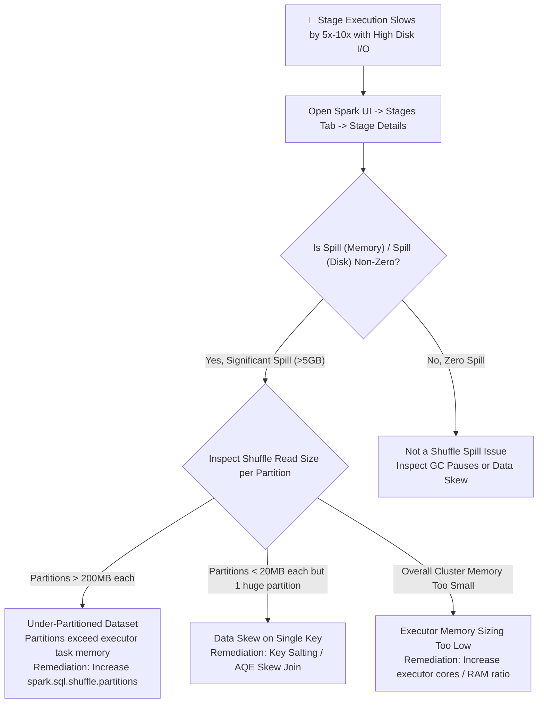

# 🚨 Runbook 02: Tungsten Shuffle Spill & Partition Sizing Triage

> **Severity**: `SEV-2 (HIGH / PERFORMANCE DEGRADATION)`  
> **Target Audience**: Data Engineers, Performance Architects, Pipeline Owners  
> **Key Error Signatures**: High Stage Duration, `Spill (Memory)` and `Spill (Disk)` exceeding 10 GiB, Disk write saturation, CPU throttling during SortMergeJoin.

---

## 1. Emergency Decision Tree



---

## 2. Immediate Diagnostic Procedures (First 5 Minutes)

### Step 1: Detect Shuffle Spill in the Spark UI
1. Navigate to the Spark Web UI (Port 4040).
2. Go to **Stages** and sort by **Duration (descending)**.
3. Click on the bottleneck stage and check the **Summary Metrics**:
   - Look at the columns:
     - `Spill (Memory)`: Total uncompressed in-memory data that could not fit in the Execution pool.
     - `Spill (Disk)`: Compressed data written to executor scratch disk.
   - If `Spill (Disk) > 0`, Tungsten was forced to serialize intermediate hash tables or sort buffers to local SSD.

### Step 2: Calculate Current Partition Size
In the Task Metrics table, examine **Shuffle Read Size**:
- 75th percentile / Max partition size.
- The **Golden Rule of Spark Partition Sizing**: Optimal partition size for analytical workloads in Apache Spark is **100 MB to 200 MB uncompressed**.

---

## 3. Root Cause Analysis & Detailed Remediation

### Cause A: Under-Partitioning (The 200 Default Partition Trap)
- **Root Cause**: Spark's default value for `spark.sql.shuffle.partitions` is statically hardcoded to `200`.
- If your query shuffles 500 GB of intermediate data:
  $$\text{Partition Size} = \frac{500 \text{ GB}}{200 \text{ partitions}} = 2.5 \text{ GB / partition}$$
- Because a 2.5 GB partition cannot fit into an executor task's execution memory slice (typically 1–2 GB), Tungsten spills gigabytes of records to disk, triggering heavy compression and disk merge-sort overhead.
- **Remediation & Recovery Strategy**:
  1. Calculate required shuffle partitions using the 150MB target formula:
     $$\text{Target Partitions} = \frac{\text{Total Shuffle Input Bytes}}{150 \times 1024 \times 1024}$$
  2. Dynamically set shuffle partitions in your PySpark script:
     ```python
     # For 300GB shuffle: 300,000 MB / 150 MB ≈ 2000 partitions
     spark.conf.set("spark.sql.shuffle.partitions", 2000)
     ```
  3. Ensure AQE dynamic partition coalescing is enabled:
     ```properties
     spark.sql.adaptive.enabled=true
     spark.sql.adaptive.coalescePartitions.enabled=true
     spark.sql.adaptive.advisoryPartitionSizeInBytes=134217728 # 128MB
     ```

---

### Cause B: Uneven Partitioning / Custom Key Spilling
- **Root Cause**: A custom `.repartition(column)` was applied on a low-cardinality column (e.g. `country_code` with only 5 distinct countries).
- Even if `spark.sql.shuffle.partitions` is set to 2000, 1,995 partitions are empty while 5 partitions carry 100 GB each, spilling catastrophically.
- **Remediation**:
  1. Never repartition on low-cardinality columns alone.
  2. Combine low-cardinality keys with high-cardinality attributes:
     ```python
     # ❌ TRAP: Only 5 partitions get all data
     df.repartition("country_code")
     
     # ✅ PRODUCTION REMEDIATION: Balanced distribution
     df.repartition(200, "country_code", "customer_id")
     ```

---

## 4. Verification & Prevention Checklist

- [ ] Stage Details in Spark UI confirms `Spill (Memory): 0 B` and `Spill (Disk): 0 B`.
- [ ] Task duration distribution is uniform (75th percentile duration is within $2\times$ of median).
- [ ] Shuffle partition count is sized dynamically based on workload scale rather than relying on default 200.
- [ ] Local executor NVMe scratch disks (`spark.local.dir`) have at least $3\times$ free space relative to total shuffle volume.
