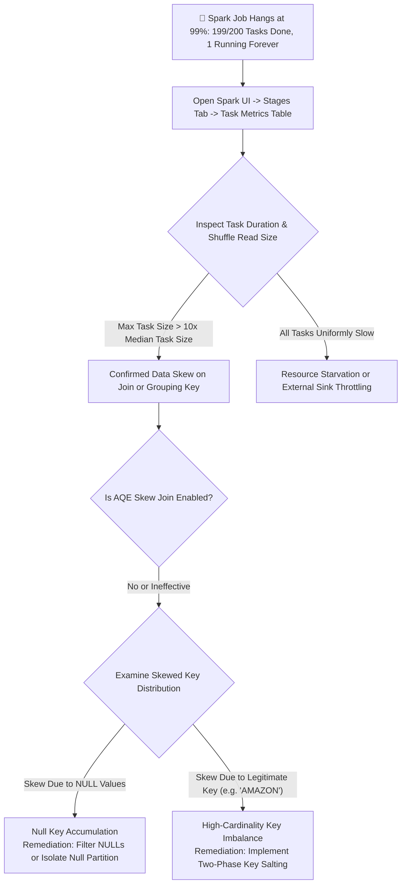

# 🚨 Runbook 03: Data Skew Diagnosis & Two-Phase Key Salting Triage

> **Severity**: `SEV-1 (CRITICAL PIPELINE BOTTLENECK)`  
> **Target Audience**: Data Engineers, Distributed Systems Specialists, Incident Responders  
> **Key Error Signatures**: Job hangs at 99% for hours, 1 straggler task with massive shuffle read, `ExecutorLostFailure` on a single executor while all other nodes are idle.

---

## 1. Emergency Decision Tree



---

## 2. Immediate Diagnostic Procedures (First 5 Minutes)

### Step 1: Detect Straggler Tasks in the Spark UI
1. In the **Spark Web UI**, locate the stage stuck at `[199/200]` tasks.
2. Scroll to the **Summary Metrics for 200 Completed Tasks**:
   - Compare the **Duration**:
     - `Min: 2 s`
     - `Median: 5 s`
     - `75th percentile: 6 s`
     - `Max: 1.8 h` 💥 (A classic $1000\times$ skew straggler!)
   - Compare **Shuffle Read Size / Records**:
     - Median task read: `12 MB / 85,000 records`
     - Max task read: `48 GB / 350,000,000 records`

### Step 2: Identify the Skewed Key
Execute an exploratory aggregation on the driver or in a separate session to locate the outlier key:
```python
# Identify the top 5 skewed keys
df.groupBy("join_key").count().orderBy(col("count").desc()).limit(5).show()
```

---

## 3. Root Cause Analysis & Detailed Remediation

### Cause A: Null Accumulation in Join Keys
- **Root Cause**: Millions of records have `NULL` or placeholder values (`""`, `"-1"`, `"N/A"`) in the foreign key. Because `hash(null)` resolves to the same partition, all null records flood a single reducer task.
- **Remediation & Recovery Strategy**:
  1. If null keys can never join to the dimension table, isolate or randomize null keys before the join:
     ```python
     # ❌ Trap: Nulls hash to single partition
     joined_df = orders.join(customers, "customer_id", "left")

     # ✅ Randomize null join keys
     from pyspark.sql.functions import col, when, rand, concat, lit

     orders_fixed = orders.withColumn(
         "salted_join_key",
         when(col("customer_id").isNull(), concat(lit("null_salt_"), (rand() * 100).cast("int")))
         .otherwise(col("customer_id"))
     )
     ```

---

### Cause B: Legitimate Hot Key Skew (Two-Phase Key Salting Pattern)
- **Root Cause**: A real-world entity (e.g., enterprise customer ID `"CORP_1001"`) accounts for 40% of all platform transactions. In an aggregation or join, this single key cannot be split across multiple executors by standard hash partitioning.
- **Remediation & Recovery Strategy (Two-Phase Salting)**:
  We distribute the skewed key across $K$ sub-partitions (e.g. $K=10$) by appending a random integer (`0` to `K-1`). We explode the dimension table by $K$ to ensure equi-join correctness:

```python
from pyspark.sql.functions import col, lit, explode, array, rand, floor, concat

SALT_FACTOR = 16  # Distribute hot key across 16 parallel tasks

# Salt fact table with random key [0..15]
orders_salted = orders.withColumn(
    "salted_key",
    concat(col("merchant_id"), lit("_"), floor(rand() * SALT_FACTOR))
)

# Replicate dimension table across salt keys
salt_array = array([lit(i) for i in range(SALT_FACTOR)])
merchants_replicated = merchants.withColumn("salt_number", explode(salt_array)) \
                                .withColumn("salted_key", concat(col("merchant_id"), lit("_"), col("salt_number")))

# Balanced equi-join on salted key
joined_result = orders_salted.join(
    merchants_replicated,
    on="salted_key",
    joinType="inner"
).drop("salted_key", "salt_number")
```

---

## 4. Verification & Prevention Checklist

- [ ] Task execution duration histogram shows normal distribution across all tasks (no single task exceeding $3\times$ median duration).
- [ ] Maximum task shuffle read size is $< 200 \text{ MB}$.
- [ ] Spark configuration includes adaptive skew join optimization:
  ```properties
  spark.sql.adaptive.skewJoin.enabled=true
  spark.sql.adaptive.skewJoin.skewedPartitionFactor=3
  spark.sql.adaptive.skewJoin.skewedPartitionThresholdInBytes=134217728
  ```
- [ ] Two-phase salting is packaged as a reusable PySpark utility function for all pipelines joining high-skew enterprise data.
