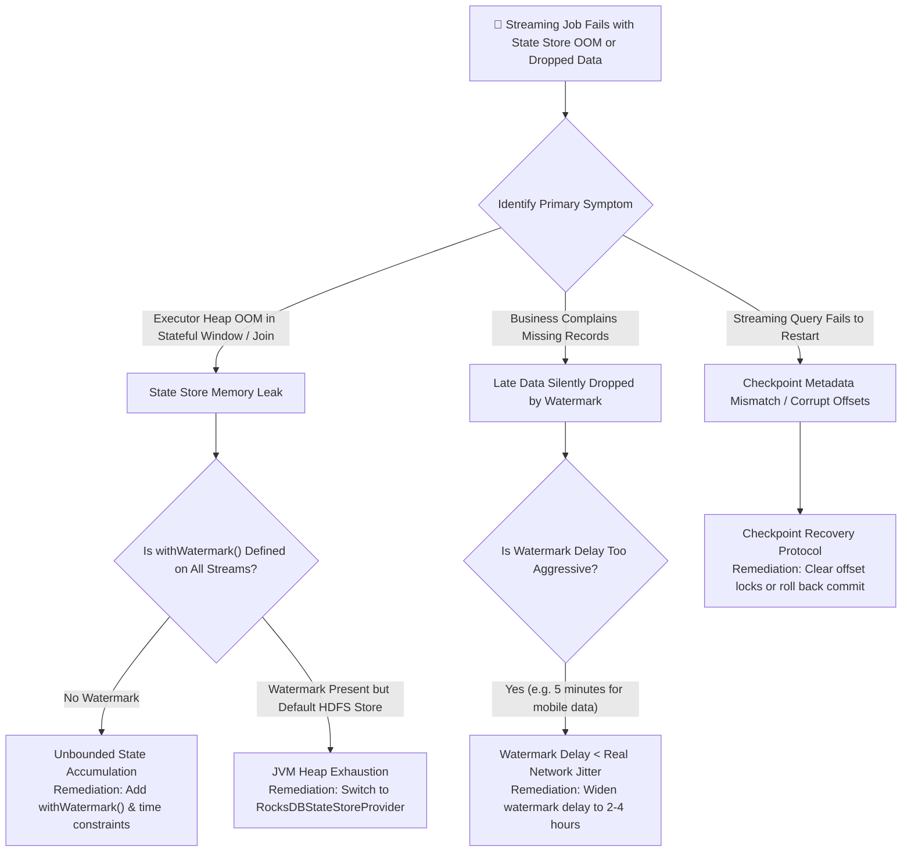

# 🚨 Runbook 04: Streaming State Store Leaks & Watermark Drops Triage

> **Severity**: `SEV-1 (CRITICAL PRODUCTION STREAMING)`  
> **Target Audience**: Real-Time Streaming Engineers, SREs, 24/7 Operations  
> **Key Error Signatures**: State store memory growing linearly, `OutOfMemoryError` on stateful micro-batches, late-arriving events silently dropped, checkpoint offset corruption.

---

## 1. Emergency Decision Tree



---

## 2. Immediate Diagnostic Procedures (First 5 Minutes)

### Step 1: Inspect Streaming Query Progress Telemetry
In your PySpark streaming job, extract the latest micro-batch progress report:
```python
# Print latest progress
for query in spark.streams.active:
    print(f"Query: {query.name}")
    progress = query.lastProgress
    if progress and "stateOperators" in progress:
        for state_op in progress["stateOperators"]:
            print(f"  Operator: {state_op.get('operatorName')}")
            print(f"  Num Rows in State: {state_op.get('numRowsTotal')}")
            print(f"  Memory Used (Bytes): {state_op.get('memoryUsedBytes')}")
```

**Warning Sign**: If `numRowsTotal` increments monotonically on every micro-batch and never decreases, state eviction is **completely failing**.

---

## 3. Root Cause Analysis & Detailed Remediation

### Cause A: Missing Watermarks in Stream-Stream Joins or Deduplication
- **Root Cause**: A stream-stream join or `dropDuplicates(["event_id"])` was executed without a watermark, or without a time boundary. Spark must retain every event indefinitely in state memory to check for possible future matches.
- **Remediation & Recovery Strategy**:
  1. Add explicit watermarks on all joined streaming DataFrames:
     ```python
     # ❌ TRAP: Retains all impressions forever in memory
     clicks.join(impressions, "ad_id")
     
     # ✅ PRODUCTION REMEDIATION: Watermarked with time interval bounds
     impressions_wm = impressions.withWatermark("impression_time", "2 hours")
     clicks_wm = clicks.withWatermark("click_time", "3 hours")
     
     joined_stream = impressions_wm.join(
         clicks_wm,
         expr("""
             ad_id = click_ad_id AND
             click_time >= impression_time AND
             click_time <= impression_time + interval 1 hour
         """)
     )
     ```

---

### Cause B: Default HDFS-Backed State Store Provider
- **Root Cause**: The default `HDFSBackedStateStoreProvider` stores all state objects in the JVM heap. Once the state exceeds 20–30 million keys, garbage collection causes fatal timeouts.
- **Remediation**:
  1. Configure off-heap **RocksDB State Store Provider**:
     ```python
     spark.conf.set(
         "spark.sql.streaming.stateStore.providerClass",
         "org.apache.spark.sql.execution.streaming.state.RocksDBStateStoreProvider"
     )
     spark.conf.set("spark.sql.streaming.stateStore.rocksdb.compactOnCommit", "true")
     ```

---

### Cause C: Checkpoint Offset Corruption Recovery Protocol
- **Root Cause**: Hard termination of the driver during checkpoint write leaves uncommitted temporary files in `checkpoint/commits/` or mismatched source offsets in `checkpoint/offsets/`.
- **Emergency Recovery Steps**:
  1. Stop the streaming query immediately.
  2. Inspect the latest committed version:
     ```bash
     ls -la /lakehouse/checkpoints/my_stream/commits/ | tail -n 5
     ls -la /lakehouse/checkpoints/my_stream/offsets/ | tail -n 5
     ```
  3. If offset file $N+1$ exists without a matching commit file $N+1$, delete offset file $N+1$ so Spark restarts cleanly from the last atomically committed batch $N$:
     ```bash
     rm /lakehouse/checkpoints/my_stream/offsets/N+1
     ```

---

## 4. Verification & Prevention Checklist

- [ ] Streaming query progress shows `numRowsTotal` stabilizing with cyclical state eviction.
- [ ] Micro-batch processing duration is strictly lower than the trigger interval (e.g. processing time $< 2\text{s}$ for a $5\text{s}$ trigger).
- [ ] Sinks use ACID idempotent storage (Delta Lake) with deterministic checkpointing.
- [ ] Watermark delay is sized to absorb 99.9th percentile network latency for IoT and mobile sources.
