# 🚨 Runbook 05: Delta Lake ACID Concurrency & Metadata Triage

> **Severity**: `SEV-2 (HIGH)`  
> **Target Audience**: Data Engineers, Lakehouse Administrators, CI/CD Pipeline Engineers  
> **Key Error Signatures**: `ConcurrentAppendException`, `ConcurrentModificationException`, `ProtocolChangedException`, Slow Delta table queries due to small files.

---

## 1. Emergency Decision Tree

```mermaid
flowchart TD
    DeltaAlert["🚨 Delta Lake Write Fails with<br/>Concurrency Conflict or Extreme<br/>Latency"] --> ClassifyIssue{"Identify Issue Category"}

    ClassifyIssue -->|"ConcurrentModificationException<br/>/ ConcurrentAppendException"| ConcurrencyTriage["Concurrency Conflict Triage"]
    ClassifyIssue -->|"Table Scan Slow: 100k+ tiny<br/>files"| SmallFileTriage["Small File Metadata Problem"]
    ClassifyIssue -->|"Data Inconsistency /<br/>Corruption Warning"| VacuumTriage["VACUUM / Time Travel Fault"]

    ConcurrencyTriage --> CheckConflictType{"Inspect Transaction Target<br/>Partitions"}
    CheckConflictType -->|"Writing to Same Partition<br/>Simultaneously"| PartitionPruning["Partition Overlap Conflict<br/>Remediation: Row-Level Concurrency<br/>or Partition Alignment"]
    CheckConflictType -->|"MERGE Conflicting with<br/>Streaming Append"| SegregatePipelines["Append vs Update Collision<br/>Remediation: Separate Bronze<br/>Append from Silver MERGE"]

    SmallFileTriage --> CompactionPlan["Compaction & Optimization Plan<br/>Remediation: Run OPTIMIZE with<br/>Liquid Clustering / Z-Order"]
```



---

## 2. Immediate Diagnostic Procedures (First 5 Minutes)

### Step 1: Inspect Delta Transaction Log History
Run the Delta history query to pinpoint concurrent writers:
```python
from delta.tables import DeltaTable

delta_table = DeltaTable.forPath(spark, "/lakehouse/silver/transactions")
delta_table.history(20).select(
    "version", "timestamp", "userId", "userName", "operation", "operationParameters"
).show(truncate=False)
```

Look for two operations with timestamps within milliseconds of each other competing for the same version commit.

---

## 3. Root Cause Analysis & Detailed Remediation

### Cause A: ConcurrentModificationException on Simultaneous Writes
- **Root Cause**: Two concurrent jobs attempted to modify the same Delta table. In Delta Lake's **Optimistic Concurrency Control (OCC)**, both read version $V$. Writer 1 commits version $V+1$. When Writer 2 attempts to commit $V+1$, Delta detects that the files Writer 2 read have been rewritten by Writer 1, failing Writer 2 with `ConcurrentModificationException`.
- **Remediation & Recovery Strategy**:
  1. **Enable Row-Level Concurrency (Delta 3.x / Databricks Runtime 14+)**:
     ```sql
     ALTER TABLE silver_transactions SET TBLPROPERTIES (
         'delta.rowLevelConcurrency' = 'true'
     );
     ```
  2. **Enforce Target Partition Pruning on MERGE Operations**:
     Always include the partition key in the `ON` clause of `MERGE INTO`:
     ```sql
     -- ❌ Scans entire table (causes write conflicts)
     MERGE INTO target t USING source s ON t.id = s.id ...

     -- Partition filter restricts conflict detection
     MERGE INTO target t USING source s
     ON t.id = s.id AND t.transaction_date = s.transaction_date ...
     ```

---

### Cause B: Small File Degraded Performance ("Millions of 10KB Files")
- **Root Cause**: Frequent micro-batch streaming writes (e.g. every 10 seconds) write 5 files per batch, generating 43,200 files per day. Query engines spend 90% of their execution time listing cloud storage objects and parsing metadata.
- **Remediation & Recovery Strategy**:
  1. Execute Delta `OPTIMIZE` to compact small files into 1GB target files:
     ```python
     delta_table.optimize().executeCompaction()
     ```
  2. For modern Delta tables, enable **Liquid Clustering**:
     ```sql
     ALTER TABLE silver_transactions CLUSTER BY (customer_id, transaction_date);
     ```
  3. Clean up orphaned files older than the retention threshold:
     ```python
     # Retain 7 days of time travel
     spark.conf.set("spark.databricks.delta.vacuum.parallelDelete.enabled", "true")
     delta_table.vacuum(168)  # 168 hours = 7 days
     ```

---

## 4. Verification & Prevention Checklist

- [ ] Delta table history shows clean monotonic commits with zero aborted versions.
- [ ] Average file size in Delta table is between 128 MB and 1024 MB.
- [ ] Streaming jobs use `autoOptimize.optimizeWrite = true` and `autoOptimize.autoCompact = true` for high-frequency ingestion:
  ```sql
  ALTER TABLE silver_transactions SET TBLPROPERTIES (
      'delta.autoOptimize.optimizeWrite' = 'true',
      'delta.autoOptimize.autoCompact' = 'true'
  );
  ```
