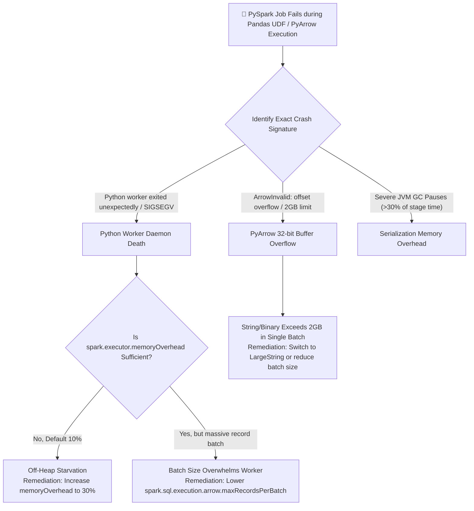

# 🚨 Runbook 06: PyArrow Serialization & Python Worker Crash Triage

> **Severity**: `SEV-2 (HIGH / PYTHON CRASH)`  
> **Target Audience**: PySpark Engineers, ML Platform Engineers, Data Scientists  
> **Key Error Signatures**: `Py4JJavaError`, `org.apache.spark.api.python.PythonException`, Python worker exited unexpectedly, `ArrowInvalid: offset overflow`, High GC pauses during Pandas UDF evaluation.

---

## 1. Emergency Decision Tree



---

## 2. Immediate Diagnostic Procedures (First 5 Minutes)

### Step 1: Inspect Executor Error Stack Trace
Search executor logs for Python daemon crashes:
```text
Caused by: org.apache.spark.SparkException: Python worker exited unexpectedly (crashed)
    at org.apache.spark.api.python.BasePythonRunner$ReaderIterator.handlePythonException(PythonRunner.scala:555)
    ...
```

### Step 2: Identify UDF Type in User Code
Check whether the offending code uses standard `@udf` (row-by-row pickle) or `@pandas_udf` (vectorized PyArrow IPC):
```python
# ❌ Anti-pattern: Row-by-row Python UDF
# Incurs JVM <-> Python context switch per row
@udf(returnType=StringType())
def slow_fn(val):
    return val.upper() if val else None

# ✅ Vectorized: Native Apache Arrow RecordBatches
@pandas_udf(StringType())
def fast_fn(s: pd.Series) -> pd.Series:
    return s.str.upper()
```

---

## 3. Root Cause Analysis & Detailed Remediation

### Cause A: PyArrow IPC Batch Size Overflow (`maxRecordsPerBatch`)
- **Root Cause**: By default, `spark.sql.execution.arrow.maxRecordsPerBatch = 10000`. If rows contain wide structs, large text descriptions, or embedding vectors, 10,000 rows can deserialize into **several gigabytes of memory** in the Python worker process, instantly exceeding OS memory boundaries.
- **Remediation & Recovery Strategy**:
  1. Restrict maximum records per batch to a safe ceiling (e.g. 500 to 2,000 rows):
     ```python
     spark.conf.set("spark.sql.execution.arrow.maxRecordsPerBatch", 1000)
     ```
  2. For PySpark with Pandas UDFs, allocate dedicated Python worker memory:
     ```properties
     spark.python.worker.reuse=true
     spark.executor.memoryOverhead=4g
     ```

---

### Cause B: PyArrow 2GB Buffer Limit (`ArrowInvalid: offset overflow`)
- **Root Cause**: Apache Arrow historically used 32-bit signed integers for string and binary offsets, imposing a hard 2GB ceiling on any single batch of string data.
- **Remediation**:
  1. Upgrade to Apache Spark 3.5+ with PyArrow 14.0+.
  2. Reduce `maxRecordsPerBatch` so no single batch exceeds 250MB.

---

## 4. Verification & Prevention Checklist

- [ ] All Python UDFs leverage `@pandas_udf` (Vectorized) or PySpark built-in functions (`pyspark.sql.functions`).
- [ ] No row-by-row standard `@udf` calls exist on high-cardinality DataFrames.
- [ ] `spark.sql.execution.arrow.pyspark.enabled = true` is set.
- [ ] Executor memory overhead is sized to at least $25\%$ of executor heap for PyArrow-heavy pipelines.
